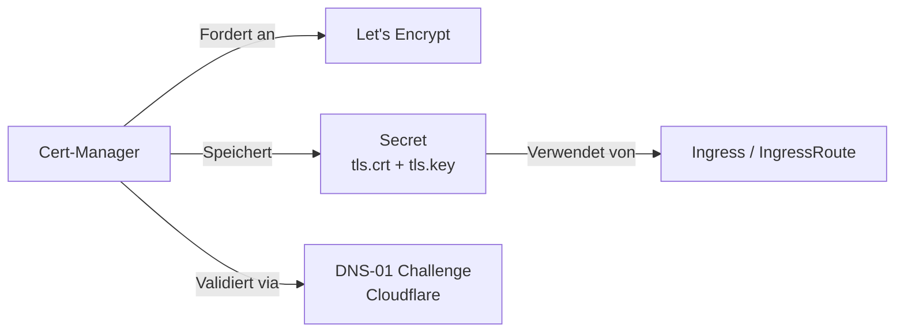

# Cert-Manager

> [!ABSTRACT]
> Cert-Manager automatisiert die Verwaltung und Ausstellung von TLS-Zertifikaten in Kubernetes. Er unterstützt Let's Encrypt, Self-Signed CAs und weitere Issuer. Zertifikate werden automatisch erneuert, bevor sie ablaufen.

---

## Was ist Cert-Manager?

Cert-Manager ist ein Kubernetes-nativer Zertifikats-Manager, der:

- **TLS-Zertifikate automatisch** von Issuern wie Let's Encrypt anfordert
- **Zertifikate erneuert**, bevor sie ablaufen
- **Zertifikate als Kubernetes Secrets** speichert
- **Verschiedene Issuer** unterstützt (ACME, Self-Signed, CA, Vault)



---

## Installation

```bash
# Helm Repository hinzufügen
helm repo add jetstack https://charts.jetstack.io
helm repo update

# Cert-Manager installieren
helm install cert-manager jetstack/cert-manager \
  --namespace cert-manager \
  --create-namespace \
  --values cert-manager-values.yaml \
  --version v1.16.2
```

### Values-Datei

```yaml
# cert-manager-values.yaml
installCRDs: true
replicaCount: 2
extraArgs:
  - --dns01-recursive-nameservers=1.1.1.1:53,8.8.8.8:53
  - --dns01-recursive-nameservers-only
podDnsPolicy: None
podDnsConfig:
  nameservers:
    - 1.1.1.1
    - 8.8.8.8
```

| Parameter | Beschreibung |
|-----------|-------------|
| `installCRDs: true` | Custom Resource Definitions automatisch installieren |
| `replicaCount: 2` | Zwei Replicas für Hochverfügbarkeit |
| `dns01-recursive-nameservers` | Externe DNS-Server für DNS-01 Validierung |
| `podDnsPolicy: None` | Eigene DNS-Konfiguration verwenden |

---

## Issuer-Typen

### ClusterIssuer vs Issuer

| Typ | Scope | Beschreibung |
|-----|-------|-------------|
| **Issuer** | Namespace | Stellt Zertifikate nur im eigenen Namespace aus |
| **ClusterIssuer** | Cluster-weit | Stellt Zertifikate in allen Namespaces aus |

> [!TIP]
> Für die meisten Setups ist ein **ClusterIssuer** empfehlenswert, da er von allen Namespaces genutzt werden kann.

---

## Let's Encrypt mit Cloudflare DNS

### Cloudflare API Token erstellen

Das Secret mit dem Cloudflare API Token erstellen:

```yaml
apiVersion: v1
kind: Secret
metadata:
  name: cloudflare-credentials
  namespace: cert-manager
type: Opaque
stringData:
  token: DEIN-CLOUDFLARE-API-TOKEN
```

> [!WARNING]
> Verwende einen **API Token** (nicht den Global API Key). Der Token benötigt die Berechtigung `Zone:DNS:Edit` für die entsprechende Zone.

### Staging ClusterIssuer

Zum Testen immer zuerst den Staging-Issuer verwenden:

```yaml
apiVersion: cert-manager.io/v1
kind: ClusterIssuer
metadata:
  name: letsencrypt-staging
spec:
  acme:
    server: https://acme-staging-v02.api.letsencrypt.org/directory
    email: deine-email@example.com
    privateKeySecretRef:
      name: letsencrypt-staging
    solvers:
      - dns01:
          cloudflare:
            email: deine-email@example.com
            apiTokenSecretRef:
              name: cloudflare-credentials
              key: token
        selector:
          dnsZones:
            - "example.com"
```

### Production ClusterIssuer

Nach erfolgreichem Test den Production-Issuer verwenden:

```yaml
apiVersion: cert-manager.io/v1
kind: ClusterIssuer
metadata:
  name: letsencrypt-production
spec:
  acme:
    server: https://acme-v02.api.letsencrypt.org/directory
    email: deine-email@example.com
    privateKeySecretRef:
      name: letsencrypt-production
    solvers:
      - dns01:
          cloudflare:
            email: deine-email@example.com
            apiTokenSecretRef:
              name: cloudflare-credentials
              key: token
        selector:
          dnsZones:
            - "example.com"
```

> [!IMPORTANT]
> Let's Encrypt hat Rate Limits für Production-Zertifikate. Teste immer zuerst mit dem Staging-Issuer, um keine Limits zu erreichen.

---

## Self-Signed Zertifikate

Für interne Services oder Homelab-Umgebungen können Self-Signed Zertifikate verwendet werden.

### CA Secret erstellen

```bash
# CA-Zertifikat und Key generieren
openssl genrsa -out ca.key 4096
openssl req -x509 -new -nodes -key ca.key -sha256 -days 3650 \
  -out ca.crt -subj "/CN=Homelab CA"
```

```yaml
apiVersion: v1
kind: Secret
metadata:
  name: selfsigned-ca-home
  namespace: cert-manager
type: Opaque
data:
  tls.crt: <BASE64-CA-CRT>    # cat ca.crt | base64 -w 0
  tls.key: <BASE64-CA-KEY>    # cat ca.key | base64 -w 0
```

### Self-Signed ClusterIssuer

```yaml
apiVersion: cert-manager.io/v1
kind: ClusterIssuer
metadata:
  name: selfsigned-issuer-home
spec:
  ca:
    secretName: selfsigned-ca-home
```

---

## Zertifikate erstellen

### Wildcard-Zertifikat (Let's Encrypt)

```yaml
apiVersion: cert-manager.io/v1
kind: Certificate
metadata:
  name: soniiit-net-production
  namespace: default
spec:
  secretName: soniiit-net-production-tls
  issuerRef:
    name: letsencrypt-production
    kind: ClusterIssuer
  commonName: "*.soniiit.net"
  dnsNames:
    - "soniiit.net"
    - "*.soniiit.net"
```

### Self-Signed Zertifikat

```yaml
apiVersion: cert-manager.io/v1
kind: Certificate
metadata:
  name: home-soniiit-net-selfsigned
  namespace: default
spec:
  secretName: home-soniiit-net-selfsigned-tls
  issuerRef:
    name: selfsigned-issuer-home
    kind: ClusterIssuer
  dnsNames:
    - "home.soniiit.net"
    - "*.home.soniiit.net"
```

### Zertifikat in einem anderen Namespace

Wenn ein Service in einem eigenen Namespace läuft, muss das Zertifikat dort erstellt werden:

```yaml
apiVersion: cert-manager.io/v1
kind: Certificate
metadata:
  name: home-soniiit-net-selfsigned-traefik
  namespace: traefik                          # ← Namespace des Services
spec:
  secretName: home-soniiit-net-selfsigned-tls
  issuerRef:
    name: selfsigned-issuer-home
    kind: ClusterIssuer
  dnsNames:
    - "*.home.soniiit.net"
    - "traefik.home.soniiit.net"
```

---

## Zertifikate verwalten

```bash
# Alle Zertifikate anzeigen
kubectl get certificates -A

# Zertifikat-Details
kubectl describe certificate soniiit-net-production

# Certificate Requests anzeigen
kubectl get certificaterequests -A

# ClusterIssuers anzeigen
kubectl get clusterissuers

# Secret mit dem Zertifikat prüfen
kubectl get secret soniiit-net-production-tls -o yaml

# Zertifikat-Ablaufdatum prüfen
kubectl get certificate soniiit-net-production -o jsonpath='{.status.notAfter}'
```

---

## ACME Challenge-Typen

| Typ | Beschreibung | Wildcard | Anforderung |
|-----|-------------|----------|-------------|
| **HTTP-01** | HTTP-Endpoint auf Port 80 | Nein | Port 80 erreichbar |
| **DNS-01** | TXT DNS-Record erstellen | Ja | DNS-Provider API |

> [!NOTE]
> Für **Wildcard-Zertifikate** (`*.example.com`) ist die **DNS-01 Challenge** zwingend erforderlich. HTTP-01 unterstützt keine Wildcards.

---

## Troubleshooting

```bash
# Cert-Manager Logs
kubectl logs -n cert-manager -l app.kubernetes.io/name=cert-manager

# Challenge-Status prüfen
kubectl get challenges -A
kubectl describe challenge <name>

# Certificate-Status
kubectl get certificate -A
# READY sollte True sein
```

| Problem | Lösung |
|---------|--------|
| Certificate stuck auf `False` | Challenges prüfen, DNS-Propagierung abwarten |
| DNS-01 Challenge fehlgeschlagen | API Token und DNS-Zone prüfen |
| Rate Limit erreicht | Staging-Issuer verwenden, warten |

---

## Verwandte Notizen

- [[Kubernetes Index]]
- [[Helm Package Manager]]
- [[Ingress und IngressRoutes]]
- [[ConfigMaps und Secrets]]
- [[Traefik Ingress Controller]]
