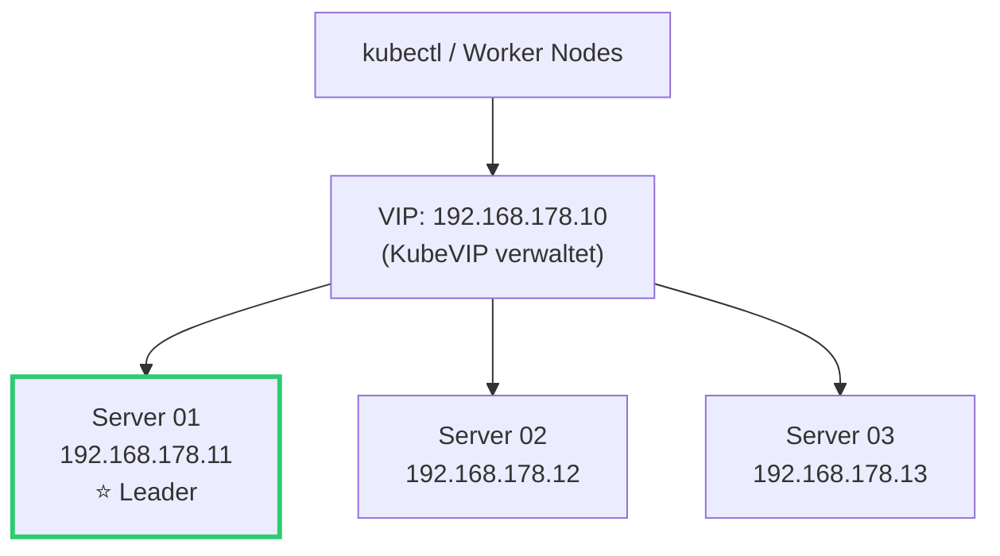
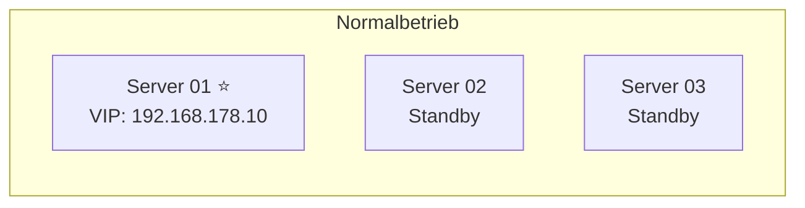
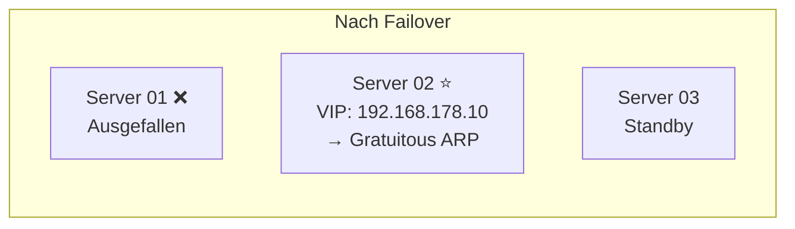
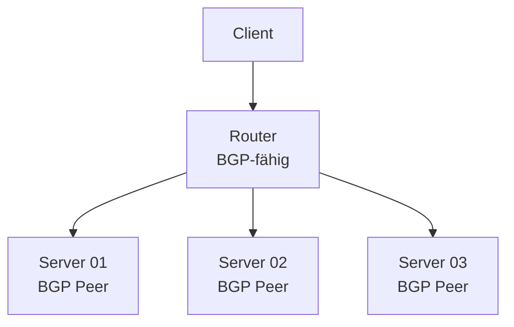
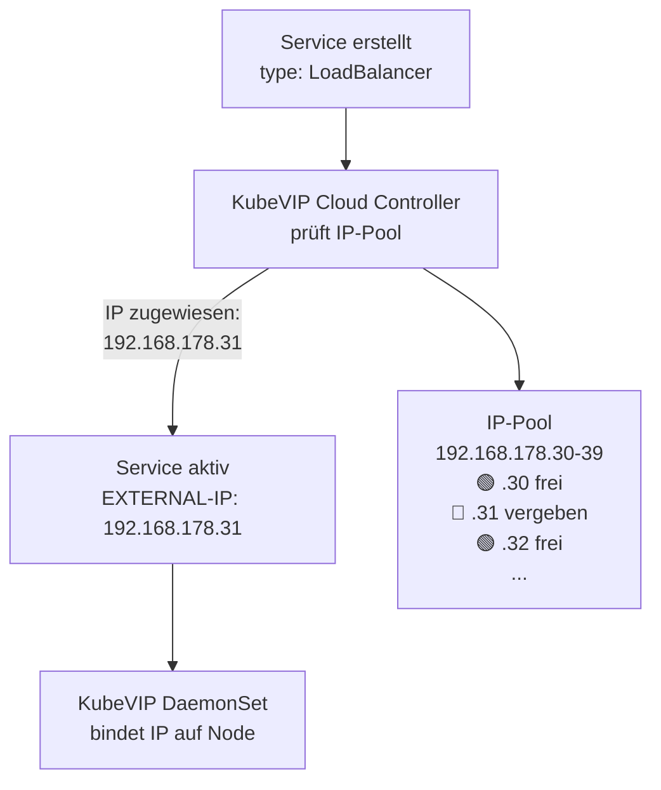

# KubeVIP

> [!ABSTRACT]
> KubeVIP ist ein leichtgewichtiger Virtual IP Manager für Kubernetes, der speziell für Bare-Metal- und Edge-Umgebungen entwickelt wurde. Er stellt eine hochverfügbare VIP für den API-Server bereit und ermöglicht LoadBalancer-Services ohne Cloud-Provider.

---

## Was ist KubeVIP und warum braucht man es?

In der Cloud bekommt ein Kubernetes-Cluster automatisch einen Load Balancer von AWS, Azure oder GCP — eine feste IP, über die der API-Server und Services erreichbar sind. Auf Bare-Metal-Servern (Homelab, On-Premises) gibt es das nicht. Hier hat man ein Problem:

- **Ohne VIP** muss man `kubectl` direkt auf einen bestimmten Server richten (z.B. `192.168.178.11:6443`). Fällt dieser Server aus, ist der Cluster nicht mehr erreichbar — obwohl die anderen Server noch laufen.
- **Mit VIP** verbindet man sich auf eine virtuelle IP (z.B. `192.168.178.10`), die automatisch auf einen gesunden Server zeigt. Fällt der aktive Server aus, wandert die VIP innerhalb von Sekunden zu einem anderen.

**KubeVIP** löst genau dieses Problem. Es läuft als DaemonSet direkt im Cluster und hat zwei Hauptaufgaben:

| Funktion | Beschreibung |
|----------|-------------|
| **Control Plane VIP** | Floating IP für den Kubernetes API-Server — kubectl, Worker Nodes und alle Komponenten verbinden sich auf diese IP |
| **Service LoadBalancer** | Ermöglicht `type: LoadBalancer` Services in Bare-Metal-Clustern — jeder Service kann eine eigene IP aus einem definierten Pool bekommen |



> [!NOTE]
> KubeVIP ist **nicht** mit einem klassischen Load Balancer wie HAProxy zu verwechseln. Es leitet keinen Traffic weiter — es sorgt nur dafür, dass eine IP-Adresse immer auf einem erreichbaren Node aktiv ist.

---

## Wie funktioniert KubeVIP?

KubeVIP läuft als Container auf den Control Plane Nodes. Es nutzt **Leader Election** über die Kubernetes Lease API, um zu bestimmen, welcher Node die VIP hält:

1. Alle KubeVIP-Instanzen starten und verhandeln über die Lease API
2. **Ein Node wird Leader** und aktiviert die VIP auf seinem Netzwerk-Interface
3. Die anderen Nodes sind Standby und beobachten den Leader
4. Fällt der Leader aus, wird ein neuer gewählt — die VIP wandert

Die VIP wird nicht auf Netzwerk-Ebene „umgeleitet" — sie wird tatsächlich als sekundäre IP auf dem Netzwerk-Interface des Leader-Nodes konfiguriert. Andere Geräte im Netzwerk müssen informiert werden, dass sich die MAC-Adresse hinter der IP geändert hat. Dafür gibt es zwei Modi: **ARP** und **BGP**.

---

## ARP-Modus (Layer 2)

Der ARP-Modus ist die **einfachste und häufigste Konfiguration** — Standard bei K3s-Clustern im Homelab.

### So funktioniert es

1. Der **Leader-Node** bindet die VIP an sein Netzwerk-Interface (z.B. `eth0`)
2. Wenn ein anderer Node zum Leader wird, entfernt der alte Node die VIP und der neue aktiviert sie
3. Der neue Leader sendet einen **Gratuitous ARP** — eine Broadcast-Nachricht an alle Geräte im Netzwerk: „Die IP `192.168.178.10` ist jetzt bei MAC-Adresse `XX:XX:XX:XX:XX:XX`"
4. Router, Switches und andere Geräte aktualisieren ihre ARP-Tabellen





### Vor- und Nachteile

| ✅ Vorteile | ❌ Nachteile |
|------------|-------------|
| Einfaches Setup, keine Netzwerk-Konfiguration nötig | Aller Traffic fließt über den Leader-Node |
| Funktioniert in jedem Layer-2-Netzwerk | Nicht subnet-übergreifend nutzbar |
| Schnelles Failover (Sekunden) | Skaliert nicht für sehr große Cluster |
| Kein spezieller Router/Switch nötig | ARP-Broadcasts müssen im Netzwerk erlaubt sein |

> [!TIP]
> **Für Homelabs und kleine bis mittlere Cluster ist ARP die richtige Wahl.** Es funktioniert out-of-the-box ohne Netzwerk-Konfiguration.

---

## BGP-Modus (Layer 3)

Der BGP-Modus ist für größere oder professionellere Umgebungen gedacht, in denen das Netzwerk BGP (Border Gateway Protocol) unterstützt.

### So funktioniert es

1. **Alle KubeVIP-Nodes** (nicht nur der Leader) annoncieren die VIP-Route über BGP an den Router
2. Der Router kennt mehrere Pfade zur VIP und kann Traffic über **ECMP** (Equal-Cost Multi-Path) verteilen
3. Bei Ausfall eines Nodes entfernt sich dessen BGP-Route automatisch — der Router leitet nur noch an gesunde Nodes



### Vor- und Nachteile

| ✅ Vorteile | ❌ Nachteile |
|------------|-------------|
| Traffic-Verteilung über mehrere Nodes (ECMP) | Erfordert BGP-fähige Netzwerk-Infrastruktur |
| Funktioniert über Subnetz-Grenzen hinweg | Komplexere Konfiguration |
| Kein Single Point of Failure beim Traffic | Nicht jeder Heimrouter unterstützt BGP |
| Skaliert auf große Cluster | Mehr Netzwerk-Know-how nötig |

### ARP vs BGP Vergleich

| Aspekt | ARP (Layer 2) | BGP (Layer 3) |
|--------|--------------|---------------|
| Netzwerk-Ebene | Layer 2 (Broadcast-Domain) | Layer 3 (Routing) |
| Leader | Ein Node hält die VIP | Alle Nodes annoncieren die Route |
| Traffic-Verteilung | Alles über den Leader | ECMP über mehrere Nodes |
| Failover-Mechanismus | Gratuitous ARP | BGP Route Withdrawal |
| Subnet-übergreifend | ❌ | ✅ |
| Netzwerk-Anforderung | Keine | BGP-fähiger Router |
| Empfohlen für | Homelab, kleine Cluster | Enterprise, Multi-Rack |

---

## KubeVIP Cloud Controller

Neben der Control Plane VIP kann KubeVIP auch als **Service LoadBalancer** fungieren. In der Cloud bekommt ein Service mit `type: LoadBalancer` automatisch eine externe IP von AWS/Azure/GCP. On-Premise passiert das nicht — der Service bleibt ewig im Status `Pending`.

Der **KubeVIP Cloud Controller** löst dieses Problem: Er verwaltet einen Pool von IP-Adressen und weist Services automatisch IPs zu — genau wie ein Cloud-Provider es tun würde.



### Installation

```bash
# Cloud Controller installieren
kubectl apply -f https://raw.githubusercontent.com/kube-vip/kube-vip-cloud-provider/main/manifest/kube-vip-cloud-controller.yaml

# IP-Pool konfigurieren
kubectl create configmap -n kube-system kubevip \
  --from-literal range-global=192.168.178.30-192.168.178.39
```

### Wie es funktioniert

1. Ein Service wird mit `type: LoadBalancer` erstellt
2. Der Cloud Controller erkennt den neuen Service und sucht eine freie IP aus dem Pool
3. Er weist die IP dem Service als `externalIP` zu
4. KubeVIP (das DaemonSet) bindet diese IP auf dem zuständigen Node (per ARP oder BGP)
5. Der Service ist von außen über diese IP erreichbar

```yaml
apiVersion: v1
kind: Service
metadata:
  name: webapp
spec:
  type: LoadBalancer
  loadBalancerIP: 192.168.178.31    # Optionale feste IP aus dem Pool
  ports:
    - port: 80
      targetPort: 8080
  selector:
    app: webapp
```

> [!NOTE]
> Ohne `loadBalancerIP` wird automatisch die nächste freie IP aus dem Pool vergeben. Mit `loadBalancerIP` kann man eine bestimmte IP anfordern — sie muss aber im konfigurierten Pool liegen.

### IP-Pool Konfiguration

Der Pool kann global oder pro Namespace konfiguriert werden. Das ist nützlich, um Teams oder Umgebungen eigene IP-Bereiche zuzuweisen:

| Konfiguration | Beschreibung | Beispiel |
|--------------|-------------|---------|
| `range-global` | Pool für alle Namespaces | `192.168.178.30-192.168.178.39` |
| `range-<namespace>` | Pool nur für einen Namespace | `range-production=192.168.178.40-49` |
| `cidr-global` | Pool als CIDR-Block | `192.168.178.32/27` |

```bash
# Globaler Pool
kubectl create configmap -n kube-system kubevip \
  --from-literal range-global=192.168.178.30-192.168.178.39

# Pool pro Namespace
kubectl create configmap -n kube-system kubevip \
  --from-literal range-production=192.168.178.40-192.168.178.49 \
  --from-literal range-staging=192.168.178.50-192.168.178.59

# Alternativ: CIDR-Notation
kubectl create configmap -n kube-system kubevip \
  --from-literal cidr-global=192.168.178.32/27
```

---

## KubeVIP vs MetalLB

MetalLB ist die bekannteste Alternative zu KubeVIP für LoadBalancer-Services auf Bare-Metal:

| Aspekt | KubeVIP | MetalLB |
|--------|---------|---------|
| Control Plane VIP | ✅ Integriert | ❌ Nicht unterstützt |
| Service LoadBalancer | ✅ Mit Cloud Controller | ✅ Kernfunktion |
| ARP-Modus | ✅ | ✅ (L2-Modus) |
| BGP-Modus | ✅ | ✅ |
| Resource-Verbrauch | Minimal (ein Container) | Zwei Deployments (controller + speaker) |
| Konfiguration | ConfigMap + CLI-Flags | Custom Resources (IPAddressPool, L2Advertisement) |
| K3s-Integration | Sehr gut (Manifest-Ordner) | Standard (Helm/kubectl) |

> [!TIP]
> **KubeVIP ist die bessere Wahl**, wenn du sowohl eine **Control Plane VIP** als auch LoadBalancer-Services brauchst — alles in einem Tool. MetalLB ist ausgereifter bei reinen LoadBalancer-Szenarien und bietet mehr Konfigurationsoptionen.

---

## Troubleshooting

### VIP nicht erreichbar

```bash
# KubeVIP Pods prüfen
kubectl get pods -n kube-system | grep kube-vip

# Logs des Leaders
kubectl logs -n kube-system -l app.kubernetes.io/name=kube-vip-ds

# Lease prüfen (wer ist Leader?)
kubectl get lease -n kube-system | grep kube-vip

# VIP auf den Nodes suchen
ssh server01 "ip addr show eth0 | grep 192.168.178.10"
```

### LoadBalancer Service bekommt keine IP

```bash
# Cloud Controller läuft?
kubectl get pods -n kube-system | grep kube-vip-cloud

# ConfigMap mit IP-Pool vorhanden?
kubectl get configmap -n kube-system kubevip -o yaml

# Service-Status
kubectl describe service <name>
```

### Häufige Fehlerursachen

| Problem | Mögliche Ursache | Lösung |
|---------|------------------|--------|
| VIP antwortet nicht | Falsches Interface (`--interface`) | Interface-Name prüfen: `ip link show` |
| Failover dauert lange | Leader Election Timeout zu hoch | Lease-Konfiguration anpassen |
| ARP-Update kommt nicht an | Managed Switch blockiert Gratuitous ARP | Switch-Konfiguration prüfen |
| Service bleibt `Pending` | Kein IP-Pool konfiguriert oder Pool voll | ConfigMap prüfen, Pool erweitern |

---

## Verwandte Notizen

- [[KubeVIP und High Availability]]
- [[K3s Cluster Installation]]
- [[Kubernetes Netzwerk]]
- [[Services]]
- [[Kubernetes Index]]
