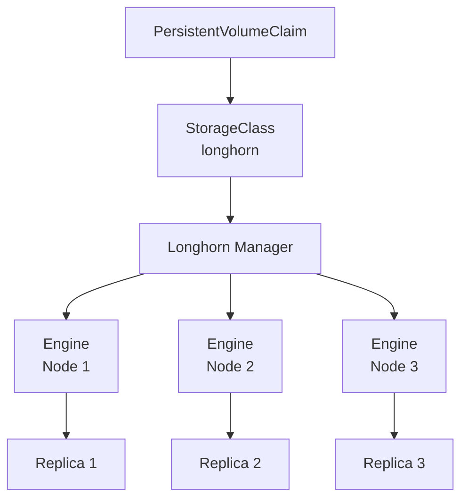

# Longhorn

> [!ABSTRACT]
> Longhorn ist ein leichtgewichtiges, verteiltes Block-Storage-System für Kubernetes. Es bietet persistenten Speicher mit Replikation, Snapshots und Backups — ideal für Bare-Metal- und Homelab-Cluster, die keinen Cloud-Storage haben.

---

## Was ist Longhorn?

Longhorn ist ein CNCF-Projekt (Sandbox), das verteilten Block-Storage direkt im Kubernetes-Cluster bereitstellt:

- **Replikation** — Daten werden über mehrere Nodes verteilt
- **Snapshots** — Point-in-Time Snapshots für Volumes
- **Backups** — Automatische Backups auf NFS oder S3
- **Web UI** — Dashboard zur Verwaltung
- **Dynamic Provisioning** — Volumes werden automatisch erstellt



---

## Voraussetzungen

Bevor Longhorn installiert wird, müssen auf **allen Nodes** einige Abhängigkeiten erfüllt sein.

### Environment Check

```bash
# Offizielles Environment-Check-Skript ausführen
curl -sSfL https://raw.githubusercontent.com/longhorn/longhorn/v1.7.2/scripts/environment_check.sh | bash
```

### Manuelle Vorbereitung

```bash
# iSCSI-Modul laden
sudo modprobe iscsi_tcp

# iSCSI-Service starten und aktivieren
sudo systemctl start iscsid
sudo systemctl enable iscsid

# NFS-Unterstützung installieren (für Backups)
sudo apt install nfs-common -y

# multipathd deaktivieren (verursacht Konflikte mit Longhorn)
sudo systemctl disable multipathd multipathd.socket
sudo systemctl stop multipathd multipathd.socket
```

### Vorbereitung mit Ansible

```yaml
- name: Longhorn bekannte Probleme beheben
  hosts: all
  become: true
  tasks:
    - name: Modprobe iscsi_tcp laden
      ansible.builtin.shell:
        cmd: modprobe iscsi_tcp

    - name: iscsi_tcp zum automatischen Laden hinzufügen
      ansible.builtin.lineinfile:
        path: /etc/modules
        line: iscsi_tcp
        create: yes

    - name: Enable ISCSI Service
      ansible.builtin.shell:
        cmd: systemctl enable iscsid

    - name: Start ISCSI Service
      ansible.builtin.shell:
        cmd: systemctl start iscsid

    - name: nfs-common installieren
      ansible.builtin.apt:
        name: nfs-common
        state: present
        update_cache: yes

    - name: Modprobe dm_crypt laden
      ansible.builtin.shell:
        cmd: modprobe dm_crypt

    - name: dm_crypt zum automatischen Laden hinzufügen
      ansible.builtin.lineinfile:
        path: /etc/modules
        line: dm_crypt
        create: yes

    - name: multipathd Service und Socket deaktivieren
      ansible.builtin.systemd:
        name: "{{ item }}"
        state: stopped
        enabled: no
      loop:
        - multipathd
        - multipathd.socket
```

---

## Installation

```bash
# Helm Repository hinzufügen
helm repo add longhorn https://charts.longhorn.io
helm repo update

# Longhorn installieren
helm install longhorn longhorn/longhorn \
  --namespace longhorn-system \
  --create-namespace \
  --version 1.7.2 \
  --values longhorn-values.yaml
```

### Values-Datei

```yaml
# longhorn-values.yaml
longhornUI:
  replicas: 2

persistence:
  defaultClassReplicaCount: 3
  migratable: true
```

| Parameter | Beschreibung |
|-----------|-------------|
| `longhornUI.replicas` | Anzahl der UI-Replicas |
| `defaultClassReplicaCount` | Standard-Replikationsfaktor für Volumes |
| `migratable` | Volumes können zwischen Nodes migriert werden |

---

## Longhorn als Standard-StorageClass

Nach der Installation ist Longhorn automatisch als StorageClass verfügbar:

```bash
# StorageClasses anzeigen
kubectl get storageclass

# Output:
# NAME                 PROVISIONER          RECLAIMPOLICY   VOLUMEBINDINGMODE
# longhorn (default)   driver.longhorn.io   Delete          Immediate
```

Falls Longhorn nicht als Standard gesetzt ist:

```bash
# Andere StorageClass als nicht-Standard markieren
kubectl patch storageclass local-path -p '{"metadata": {"annotations":{"storageclass.kubernetes.io/is-default-class":"false"}}}'

# Longhorn als Standard markieren
kubectl patch storageclass longhorn -p '{"metadata": {"annotations":{"storageclass.kubernetes.io/is-default-class":"true"}}}'
```

---

## Longhorn UI

Das Longhorn Dashboard bietet eine Web-Oberfläche zur Verwaltung von Volumes, Snapshots und Backups.

### Zugriff über IngressRoute (Traefik)

```yaml
apiVersion: traefik.io/v1alpha1
kind: IngressRoute
metadata:
  name: longhorn-http
  namespace: longhorn-system
spec:
  entryPoints:
    - web
  routes:
    - match: Host(`longhorn.home.soniiit.net`)
      kind: Rule
      middlewares:
        - name: longhorn-redirect
          namespace: longhorn-system
      services:
        - name: longhorn-frontend
          port: 80
---
apiVersion: traefik.io/v1alpha1
kind: IngressRoute
metadata:
  name: longhorn-https
  namespace: longhorn-system
spec:
  entryPoints:
    - websecure
  routes:
    - match: Host(`longhorn.home.soniiit.net`)
      kind: Rule
      services:
        - name: longhorn-frontend
          port: 80
  tls:
    secretName: home-soniiit-net-selfsigned-tls
---
apiVersion: traefik.io/v1alpha1
kind: Middleware
metadata:
  name: longhorn-redirect
  namespace: longhorn-system
spec:
  redirectScheme:
    scheme: https
    permanent: true
---
apiVersion: cert-manager.io/v1
kind: Certificate
metadata:
  name: home-soniiit-net-selfsigned-longhorn
  namespace: longhorn-system
spec:
  secretName: home-soniiit-net-selfsigned-tls
  issuerRef:
    name: selfsigned-issuer-home
    kind: ClusterIssuer
  dnsNames:
    - "longhorn.home.soniiit.net"
```

---

## Volumes verwalten

### PVC erstellen

```yaml
apiVersion: v1
kind: PersistentVolumeClaim
metadata:
  name: app-data
spec:
  accessModes:
    - ReadWriteOnce
  storageClassName: longhorn
  resources:
    requests:
      storage: 5Gi
```

### Volume-Status prüfen

```bash
# PVCs anzeigen
kubectl get pvc

# Longhorn Volumes anzeigen
kubectl get volumes.longhorn.io -n longhorn-system

# Volume-Details
kubectl describe volumes.longhorn.io <volume-name> -n longhorn-system
```

---

## Backups

### Backup-Target konfigurieren

Im Longhorn UI unter **Settings → General → Backup Target** eintragen:

```text
nfs://192.168.178.60:/mnt/kubernetes/backup
```

Alternativ S3-kompatiblen Storage:

```text
s3://bucket-name@region/
```

### Backup erstellen

Backups können über das Longhorn UI oder per kubectl erstellt werden:

```bash
# Snapshot erstellen
kubectl -n longhorn-system create -f - <<EOF
apiVersion: longhorn.io/v1beta2
kind: Snapshot
metadata:
  name: manual-snapshot
  labels:
    longhornvolume: <volume-name>
spec:
  volume: <volume-name>
EOF
```

---

## Best Practices

| Praxis | Beschreibung |
|--------|-------------|
| Mindestens 3 Nodes | Für Replikationsfaktor 3 werden 3 Nodes benötigt |
| Separate Disks | Dedizierte Disks für Longhorn-Storage empfohlen |
| Backup-Target | Immer ein externes Backup-Target konfigurieren |
| Monitoring | Longhorn Prometheus Metrics aktivieren |
| Resource Reservierung | Genug Disk-Space auf allen Nodes bereithalten |

> [!WARNING]
> Longhorn repliziert Daten über Nodes. Bei einem Cluster mit weniger Nodes als `defaultClassReplicaCount` kann kein Volume provisioniert werden. Passe den Replikationsfaktor entsprechend an.

---

## Verwandte Notizen

- [[Kubernetes Index]]
- [[Helm Package Manager]]
- [[Persistent Volumes und Storage Classes]]
- [[Traefik Ingress Controller]]
- [[Cert-Manager]]
