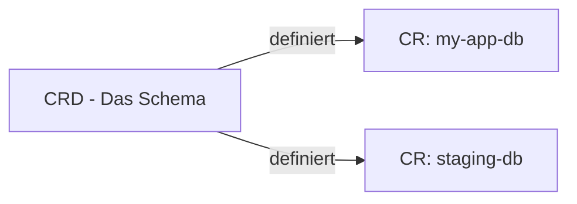
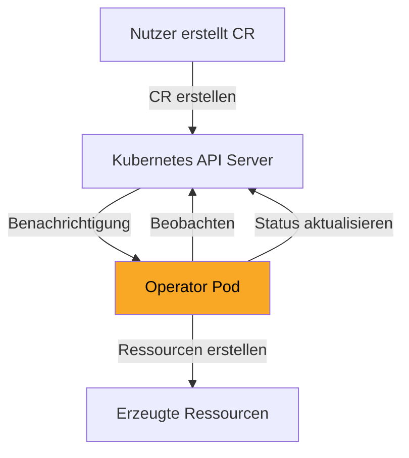
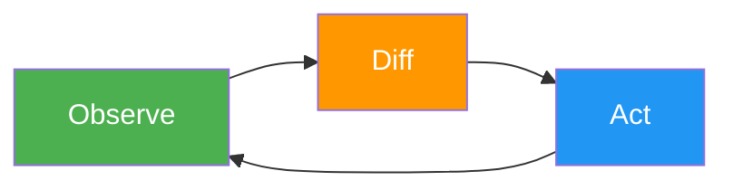
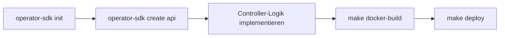
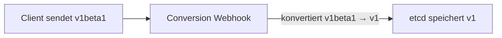

# CRDs und Operators

> [!ABSTRACT]
> Custom Resource Definitions (CRDs) erweitern die Kubernetes-API um eigene Ressourcentypen. Operators nutzen diese CRDs, um komplexe Anwendungen automatisch zu verwalten — wie ein erfahrener Administrator, der rund um die Uhr arbeitet.

---

## Warum CRDs?

Kubernetes bringt von Haus aus Ressourcen wie Pods, Services und Deployments mit. Aber was, wenn man eigene Konzepte abbilden möchte — zum Beispiel eine `Database`, ein `Certificate` oder einen `Backup`-Auftrag?

Genau hier kommen **Custom Resource Definitions** ins Spiel. Sie erlauben es, die Kubernetes-API um beliebige neue Ressourcentypen zu erweitern. Diese neuen Ressourcen verhalten sich dann exakt wie eingebaute Objekte:

- Man kann sie mit `kubectl` erstellen, lesen, ändern und löschen
- Sie werden im etcd gespeichert
- Sie unterstützen RBAC, Namespaces und Versionierung
- Sie erscheinen in der API-Discovery

> [!TIP]
> CRDs begegnen dir überall in Kubernetes — auch wenn du es nicht merkst. Wenn du [[Cert-Manager]] installierst, werden CRDs wie `Certificate`, `Issuer` und `ClusterIssuer` erstellt. Bei [[Traefik Ingress Controller|Traefik]] sind es `IngressRoute`, `Middleware` und `TLSStore`.

---

## Die zwei Begriffe: CRD vs. CR

Es ist wichtig, den Unterschied zwischen der **Definition** und der **Instanz** zu verstehen:



| Begriff | Was ist das? | Analogie |
|---------|-------------|----------|
| **CRD** | Die Schema-Definition — beschreibt welche Felder und Typen eine Ressource hat | Die Klasse in der Programmierung |
| **CR** (Custom Resource) | Eine konkrete Instanz einer CRD | Ein Objekt der Klasse |

---

## Eine CRD erstellen

Eine CRD definiert man als YAML-Manifest mit der API-Gruppe `apiextensions.k8s.io/v1`:

```yaml
apiVersion: apiextensions.k8s.io/v1
kind: CustomResourceDefinition
metadata:
  name: databasebackups.backup.example.com
spec:
  group: backup.example.com
  names:
    kind: DatabaseBackup
    plural: databasebackups
    singular: databasebackup
    shortNames:
      - dbb
  scope: Namespaced
  versions:
    - name: v1
      served: true
      storage: true
      schema:
        openAPIV3Schema:
          type: object
          properties:
            spec:
              type: object
              properties:
                databaseName:
                  type: string
                schedule:
                  type: string
                  description: "Cron-Schedule für das Backup"
                retentionDays:
                  type: integer
                  minimum: 1
              required:
                - databaseName
                - schedule
      additionalPrinterColumns:
        - name: Database
          type: string
          jsonPath: .spec.databaseName
        - name: Schedule
          type: string
          jsonPath: .spec.schedule
```

### Aufbau einer CRD im Detail

| Feld | Bedeutung |
|------|-----------|
| `group` | API-Gruppe — wird Teil der `apiVersion` (z.B. `backup.example.com/v1`) |
| `names.kind` | Der Typ-Name in PascalCase (z.B. `DatabaseBackup`) |
| `names.plural` | Pluralform für die API-URL und `kubectl get` (z.B. `databasebackups`) |
| `names.shortNames` | Abkürzungen für `kubectl` (z.B. `kubectl get dbb`) |
| `scope` | `Namespaced` oder `Cluster` — bestimmt, ob die Ressource einem Namespace zugeordnet ist |
| `versions` | Eine oder mehrere API-Versionen mit Schema-Validierung |
| `schema.openAPIV3Schema` | JSON-Schema für die Validierung — Kubernetes prüft jedes CR gegen dieses Schema |
| `additionalPrinterColumns` | Spalten, die `kubectl get` anzeigt |

### CRD anwenden und nutzen

```bash
# CRD erstellen
kubectl apply -f databasebackup-crd.yaml

# Prüfen ob die CRD registriert ist
kubectl get crd databasebackups.backup.example.com

# Alle CRDs im Cluster anzeigen
kubectl get crd
```

---

## Custom Resources erstellen

Sobald die CRD registriert ist, kann man Instanzen (Custom Resources) erstellen:

```yaml
apiVersion: backup.example.com/v1
kind: DatabaseBackup
metadata:
  name: app-db-daily
  namespace: production
spec:
  databaseName: app-postgres
  schedule: "0 2 * * *"
  retentionDays: 7
```

```bash
# CR erstellen
kubectl apply -f app-db-backup.yaml

# CRs auflisten
kubectl get databasebackups -n production
# oder mit shortName:
kubectl get dbb -n production

# Details anzeigen
kubectl describe dbb app-db-daily -n production

# CR löschen
kubectl delete dbb app-db-daily -n production
```

> [!NOTE]
> Eine CRD alleine macht noch nichts — sie registriert nur den neuen Typ in der API. Damit etwas passiert, wenn ein CR erstellt wird, braucht man einen **Controller** oder **Operator**.

---

## Was sind Operators?

Ein Operator ist ein **anwendungsspezifischer Controller**, der als Pod im Cluster läuft und Custom Resources überwacht. Er implementiert die Logik, die nötig ist, um den gewünschten Zustand (Spec) in den tatsächlichen Zustand (Status) zu überführen.

### Das Operator-Pattern



### Der Reconciliation Loop

Der Kern jedes Operators ist die **Reconciliation-Schleife** — ein endloser Kreislauf aus Beobachten, Vergleichen und Handeln:



| Phase | Was passiert |
|-------|-------------|
| **Observe** | Der Operator liest den aktuellen Zustand der Custom Resources und der verwalteten Ressourcen |
| **Diff** | Vergleich: Stimmt der tatsächliche Zustand mit dem gewünschten Zustand (Spec) überein? |
| **Act** | Falls Abweichungen existieren: Ressourcen erstellen, aktualisieren oder löschen |

Dieser Loop läuft kontinuierlich. Wenn jemand manuell einen Pod löscht, den der Operator verwaltet, erkennt der Operator die Abweichung und erstellt den Pod neu — **Self-Healing**.

---

## Bekannte Operators in der Praxis

Viele Tools, die du in Kubernetes nutzt, basieren auf dem Operator-Pattern:

| Operator | CRDs | Was er automatisiert |
|----------|------|---------------------|
| **Cert-Manager** | `Certificate`, `Issuer`, `ClusterIssuer`, `CertificateRequest` | TLS-Zertifikate automatisch beantragen, erneuern und verteilen |
| **Prometheus Operator** | `Prometheus`, `ServiceMonitor`, `PodMonitor`, `PrometheusRule` | Monitoring-Stack deployen und konfigurieren |
| **Longhorn** | `Volume`, `Engine`, `Replica`, `BackupTarget` | Verteilten Block-Storage verwalten, Snapshots, Backups |
| **Traefik** | `IngressRoute`, `Middleware`, `TLSStore`, `ServersTransport` | Ingress-Routing und Middleware-Ketten konfigurieren |
| **ArgoCD** | `Application`, `ApplicationSet`, `AppProject` | GitOps-Deployments automatisieren |
| **Strimzi** | `Kafka`, `KafkaTopic`, `KafkaUser`, `KafkaConnect` | Apache Kafka Cluster lifecycle verwalten |

> [!TIP]
> Du kannst alle im Cluster registrierten CRDs mit `kubectl get crd` auflisten. Bei einem typischen Produktions-Cluster mit Cert-Manager, Traefik und Longhorn siehst du schnell 30+ CRDs.

---

## CRDs in deinem Cluster untersuchen

### Alle CRDs auflisten

```bash
# Alle CRDs anzeigen
kubectl get crd

# CRDs einer bestimmten API-Gruppe filtern
kubectl get crd | grep cert-manager

# Details einer CRD anzeigen (Schema, Versionen)
kubectl describe crd certificates.cert-manager.io

# CRD als YAML exportieren
kubectl get crd certificates.cert-manager.io -o yaml
```

### Custom Resources einer CRD auflisten

```bash
# Alle Certificates im Cluster
kubectl get certificates --all-namespaces

# Alle IngressRoutes
kubectl get ingressroutes --all-namespaces

# API-Ressourcen anzeigen (inkl. CRDs)
kubectl api-resources | grep cert-manager
```

---

## Einen eigenen Operator entwickeln

Für die Entwicklung eigener Operators gibt es etablierte Frameworks:

| Framework | Sprache | Beschreibung |
|-----------|---------|-------------|
| **Operator SDK** | Go, Ansible, Helm | Das offizielle Framework von Red Hat/CNCF. Scaffolding, Testing, OLM-Integration |
| **Kubebuilder** | Go | Von der Kubernetes SIG. Basis für das Operator SDK (Go-Variante) |
| **KOPF** | Python | Kubernetes Operator Pythonic Framework. Ideal für schnelle Prototypen |
| **Metacontroller** | Jede Sprache | Webhooks statt voller Controller-Logik. Leichtgewichtig |
| **shell-operator** | Bash/Shell | Für einfache Automatisierungen mit Shell-Skripten |

### Operator SDK Workflow



### Beispiel: Minimaler Controller in Go (Pseudocode)

```go
func (r *DatabaseBackupReconciler) Reconcile(ctx context.Context, req ctrl.Request) (ctrl.Result, error) {
    // 1. Custom Resource laden
    backup := &v1.DatabaseBackup{}
    if err := r.Get(ctx, req.NamespacedName, backup); err != nil {
        return ctrl.Result{}, client.IgnoreNotFound(err)
    }

    // 2. Prüfen ob ein CronJob existiert
    cronJob := &batchv1.CronJob{}
    err := r.Get(ctx, types.NamespacedName{
        Name: backup.Name, Namespace: backup.Namespace,
    }, cronJob)

    if errors.IsNotFound(err) {
        // 3. CronJob erstellen
        cronJob = buildCronJob(backup)
        if err := r.Create(ctx, cronJob); err != nil {
            return ctrl.Result{}, err
        }
    }

    // 4. Status aktualisieren
    backup.Status.LastScheduled = cronJob.Status.LastScheduleTime
    r.Status().Update(ctx, backup)

    return ctrl.Result{RequeueAfter: 5 * time.Minute}, nil
}
```

---

## CRD Versionierung

CRDs unterstützen mehrere API-Versionen, um Breaking Changes kontrolliert einzuführen:

```yaml
spec:
  versions:
    - name: v1
      served: true
      storage: true
    - name: v1beta1
      served: true
      storage: false
```

| Feld | Bedeutung |
|------|-----------|
| `served: true` | Diese Version wird von der API akzeptiert |
| `storage: true` | In dieser Version wird im etcd gespeichert (nur **eine** Version darf `storage: true` sein) |

### Conversion Webhooks

Wenn sich das Schema zwischen Versionen ändert, übersetzt ein **Conversion Webhook** automatisch zwischen den Versionen:



> [!WARNING]
> Ohne Conversion Webhook können alte CRs nach einem Versions-Upgrade unlesbar werden. Plane Migrationen sorgfältig.

---

## Best Practices

### Für CRD-Entwicklung

| Praxis | Warum |
|--------|-------|
| **Schema-Validierung nutzen** | Verhindert ungültige CRs — Kubernetes lehnt sie bei `apply` ab |
| **Status-Subresource aktivieren** | Trennt Spec (Nutzer-Intent) von Status (Controller-Feedback) |
| **Printer Columns definieren** | Macht `kubectl get` informativ |
| **Short Names vergeben** | Spart Tipparbeit im Alltag |
| **Namespaced statt Cluster** | Außer die Ressource ist wirklich global (wie `ClusterIssuer`) |

### Für Operator-Entwicklung

| Praxis | Warum |
|--------|-------|
| **Idempotent arbeiten** | Der Reconcile-Loop läuft mehrfach — jede Ausführung muss sicher wiederholbar sein |
| **Owner References setzen** | Wenn die CR gelöscht wird, werden verwaltete Ressourcen automatisch aufgeräumt (Garbage Collection) |
| **Finalizer nutzen** | Für Cleanup-Logik bevor eine CR gelöscht wird (z.B. externe Ressourcen aufräumen) |
| **Status regelmäßig aktualisieren** | Nutzer müssen den Zustand ihrer Ressourcen sehen können |
| **Rate Limiting einbauen** | Verhindert API-Server-Überlastung bei vielen CRs |

---

## Verwandte Notizen

- [[Kubernetes Architektur]] — API Server und Controller Manager
- [[Cert-Manager]] — Operator für TLS-Zertifikate
- [[Traefik Ingress Controller]] — Nutzt CRDs für IngressRoutes
- [[Longhorn]] — Storage-Operator mit eigenen CRDs
- [[Helm Package Manager]] — Alternative zu Operators für einfache Deployments
- [[Monitoring und Logging]] — Prometheus Operator als Beispiel
