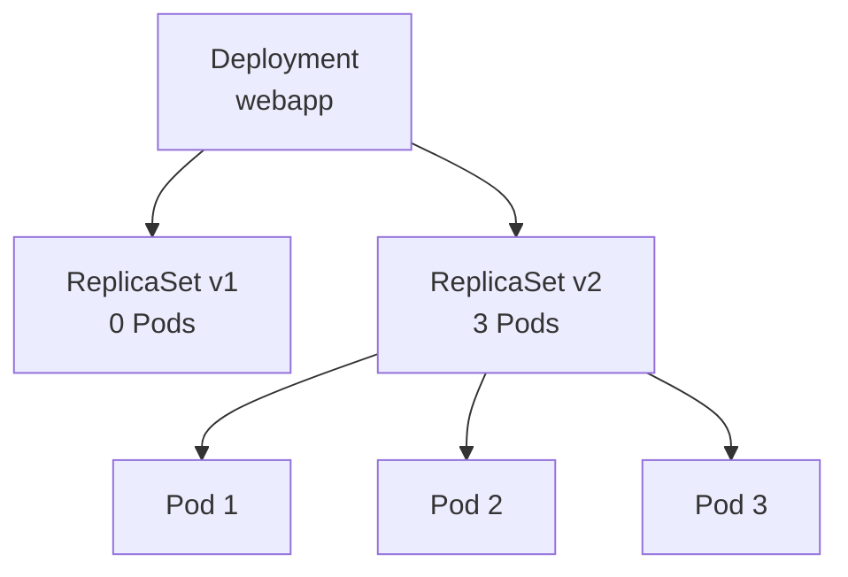
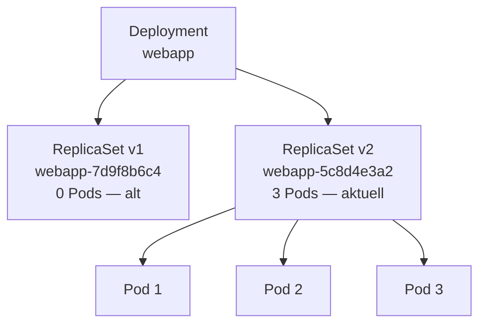
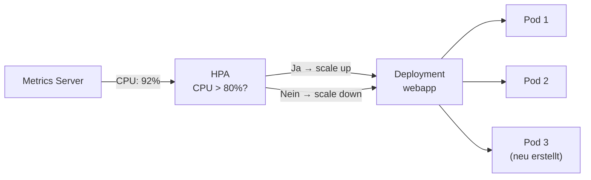
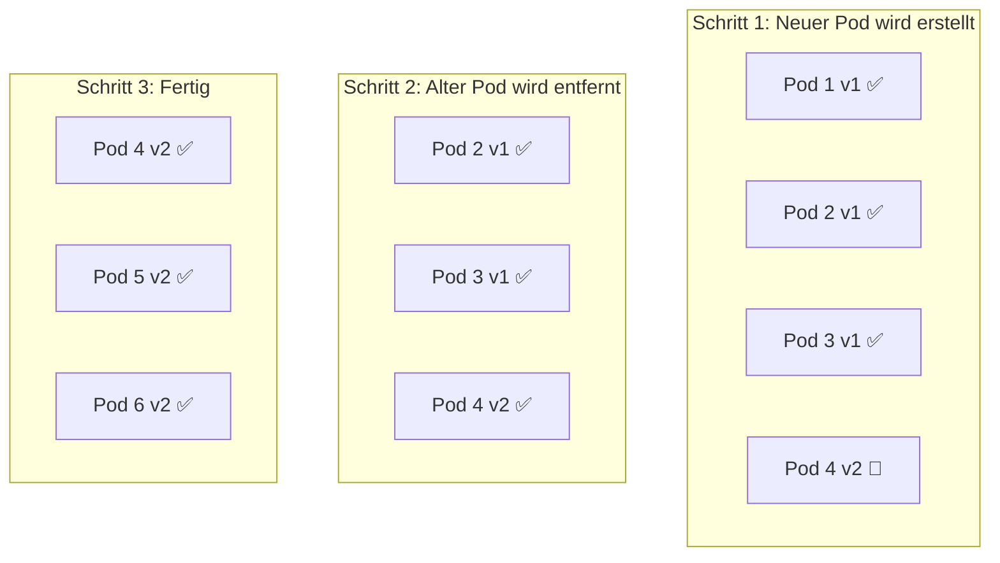

# Deployments und ReplicaSets

> [!ABSTRACT]
> Ein Deployment ist die empfohlene Methode, um Pods in Kubernetes zu verwalten. Es sorgt für die gewünschte Anzahl an Pod-Replicas, ermöglicht Rolling Updates und automatische Rollbacks. Ein ReplicaSet wird vom Deployment automatisch erstellt und verwaltet.

---

## Warum Deployments?

Man könnte Pods direkt erstellen — aber das wäre wie einen Prozess manuell auf einem Server starten: Wenn er abstürzt, ist er weg. Niemand startet ihn neu, und skalieren muss man auch von Hand.

Ein **Deployment** löst genau diese Probleme. Es ist ein Controller, der den **gewünschten Zustand** beschreibt (z.B. „3 Pods mit nginx:latest") und kontinuierlich dafür sorgt, dass dieser Zustand eingehalten wird:

- **Selbstheilung** — Stürzt ein Pod ab, wird automatisch ein neuer erstellt
- **Skalierung** — Die Anzahl der Replicas kann jederzeit geändert werden
- **Rolling Updates** — Neue Versionen werden schrittweise ausgerollt, ohne Downtime
- **Rollback** — Bei Problemen kann auf eine vorherige Version zurückgerollt werden

Ein **ReplicaSet** ist die Ressource, die im Hintergrund die gewünschte Anzahl an Pods sicherstellt. Man erstellt ReplicaSets nie direkt — das Deployment verwaltet sie automatisch. Bei einem Update erstellt das Deployment ein neues ReplicaSet und skaliert das alte herunter.



---

## Deployment-Definition

Ein Deployment beschreibt den **gewünschten Zustand** einer Anwendung: welches Image, wie viele Replicas und welche Update-Strategie.

### Deployment-Definition

```yaml
apiVersion: apps/v1
kind: Deployment
metadata:
  name: webapp
  namespace: default
  labels:
    app: webapp
spec:
  replicas: 3
  selector:
    matchLabels:
      app: webapp
  strategy:
    type: RollingUpdate
    rollingUpdate:
      maxSurge: 1          # Maximal 1 Pod zusätzlich während des Updates
      maxUnavailable: 0    # Kein Pod darf während des Updates fehlen
  template:
    metadata:
      labels:
        app: webapp
    spec:
      containers:
        - name: webapp
          image: webapp:v1
          ports:
            - containerPort: 8080
          resources:
            requests:
              memory: "128Mi"
              cpu: "250m"
            limits:
              memory: "256Mi"
              cpu: "500m"
```

```bash
# Deployment erstellen
kubectl apply -f deployment.yaml

# Deployments auflisten
kubectl get deployments

# Deployment-Details anzeigen
kubectl describe deployment webapp
```

---

## ReplicaSet

Ein ReplicaSet ist der Controller, der im Hintergrund die gewünschte Anzahl an Pods sicherstellt. Wenn ein Pod abstürzt, erstellt das ReplicaSet automatisch einen neuen. Wenn zu viele Pods laufen, beendet es welche.

Man erstellt ReplicaSets **nie direkt** — das Deployment verwaltet sie automatisch. Bei jedem Update erstellt das Deployment ein neues ReplicaSet mit der neuen Pod-Version und skaliert das alte herunter. Dadurch bleibt die Rollback-Historie erhalten:



```bash
# ReplicaSets anzeigen (zeigt aktuelle und alte)
kubectl get replicasets

# ReplicaSet-Details
kubectl describe rs webapp-7d9f8b6c4
```

> [!NOTE]
> Alte ReplicaSets werden aufbewahrt (Standard: 10 Revisionen). Das ermöglicht Rollbacks zu früheren Versionen. Die Anzahl kann mit `revisionHistoryLimit` im Deployment konfiguriert werden.

---

## Skalierung

### Manuelle Skalierung

```bash
# Auf 5 Replicas skalieren
kubectl scale deployment webapp --replicas=5

# Auf 0 Replicas skalieren (alle Pods stoppen)
kubectl scale deployment webapp --replicas=0
```

### Horizontal Pod Autoscaler (HPA)

Manuelle Skalierung funktioniert, aber man muss ständig selbst beobachten, ob die Anwendung überlastet ist. Der **HPA** automatisiert das: Er überwacht Metriken (CPU, Memory oder Custom Metrics) und passt die Anzahl der Replicas automatisch an.



> [!IMPORTANT]
> Der HPA benötigt einen **Metrics Server** im Cluster, der CPU- und Memory-Metriken bereitstellt. K3s installiert diesen standardmäßig. Bei kubeadm muss er manuell installiert werden.

```bash
# HPA erstellen
kubectl autoscale deployment webapp --min=2 --max=10 --cpu-percent=80
```

```yaml
apiVersion: autoscaling/v2
kind: HorizontalPodAutoscaler
metadata:
  name: webapp-hpa
spec:
  scaleTargetRef:
    apiVersion: apps/v1
    kind: Deployment
    name: webapp
  minReplicas: 2
  maxReplicas: 10
  metrics:
    - type: Resource
      resource:
        name: cpu
        target:
          type: Utilization
          averageUtilization: 80
    - type: Resource
      resource:
        name: memory
        target:
          type: Utilization
          averageUtilization: 85
```

```bash
# HPA-Status anzeigen
kubectl get hpa
```

---

## Update-Strategien

Kubernetes bietet zwei Strategien, wie Pods bei einem Update ersetzt werden:

### RollingUpdate (Standard)

Pods werden **schrittweise** durch neue ersetzt — es gibt keine Downtime. Kubernetes startet neue Pods mit der neuen Version und entfernt alte Pods erst, wenn die neuen bereit sind:



Zwei Parameter steuern das Verhalten:

| Parameter | Beschreibung | Beispiel |
|-----------|-------------|---------|
| `maxSurge` | Wie viele zusätzliche Pods während des Updates erlaubt sind | `1` = maximal 1 Pod mehr als gewünscht |
| `maxUnavailable` | Wie viele Pods während des Updates fehlen dürfen | `0` = kein Pod darf fehlen |

> [!TIP]
> `maxSurge: 1` + `maxUnavailable: 0` ist die sicherste Konfiguration: Es gibt immer mindestens die gewünschte Anzahl an Pods, aber das Update dauert länger.

### Recreate

Alle alten Pods werden **zuerst gestoppt**, bevor neue gestartet werden. Es gibt eine kurze **Downtime**, aber dafür laufen nie zwei Versionen gleichzeitig. Nützlich für Anwendungen, die nicht parallel in verschiedenen Versionen laufen dürfen (z.B. bei Datenbank-Schema-Änderungen):

```yaml
spec:
  strategy:
    type: Recreate
```

---

## Rolling Updates durchführen

```bash
# Image aktualisieren
kubectl set image deployment/webapp webapp=webapp:v2

# Oder im YAML die Image-Version ändern und apply
kubectl apply -f deployment.yaml

# Update-Status überwachen
kubectl rollout status deployment/webapp

# Update-Historie anzeigen
kubectl rollout history deployment/webapp
```

---

## Rollbacks

```bash
# Zur vorherigen Version zurückrollen
kubectl rollout undo deployment/webapp

# Zu einer bestimmten Revision zurückrollen
kubectl rollout undo deployment/webapp --to-revision=2

# Revisionsdetails anzeigen
kubectl rollout history deployment/webapp --revision=3
```

> [!TIP]
> Verwende immer spezifische Image-Tags (z.B. `webapp:v1.2.3`) statt `latest`. So sind Rollbacks eindeutig und reproduzierbar.

---

## Pause und Resume

Updates können pausiert werden, um mehrere Änderungen zu sammeln:

```bash
# Update pausieren
kubectl rollout pause deployment/webapp

# Änderungen vornehmen
kubectl set image deployment/webapp webapp=webapp:v3
kubectl set resources deployment/webapp -c=webapp --limits=memory=512Mi

# Update fortsetzen (alle Änderungen werden zusammen ausgerollt)
kubectl rollout resume deployment/webapp
```

---

## Best Practices

| Praxis | Beschreibung |
|--------|-------------|
| Ressourcen definieren | Immer `requests` und `limits` setzen |
| Spezifische Image-Tags | Keine `latest` Tags in Produktion |
| Readiness Probes | Sicherstellen, dass Pods Traffic erst empfangen, wenn sie bereit sind |
| PodDisruptionBudget | Mindestanzahl verfügbarer Pods während Wartung definieren |
| Revisionslimit | `revisionHistoryLimit` setzen (Standard: 10) |

```yaml
# PodDisruptionBudget
apiVersion: policy/v1
kind: PodDisruptionBudget
metadata:
  name: webapp-pdb
spec:
  minAvailable: 2
  selector:
    matchLabels:
      app: webapp
```

---

## Verwandte Notizen

- [[Pods]]
- [[Services]]
- [[DaemonSets StatefulSets und Jobs]]
- [[Labels Selektoren und Annotations]]
- [[kubectl Befehle und Cheatsheet]]
