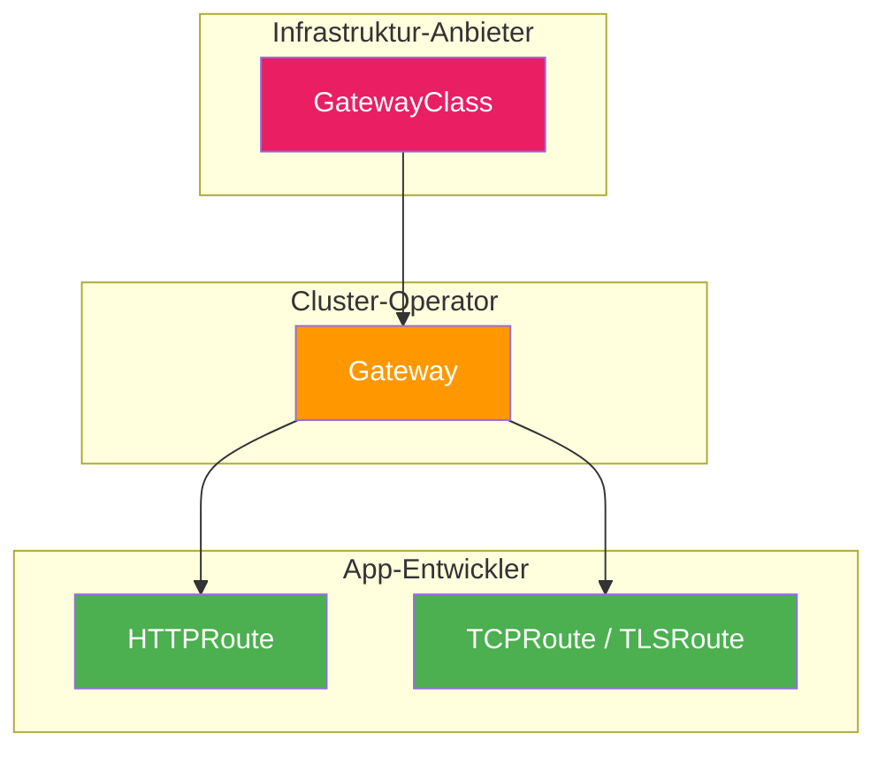
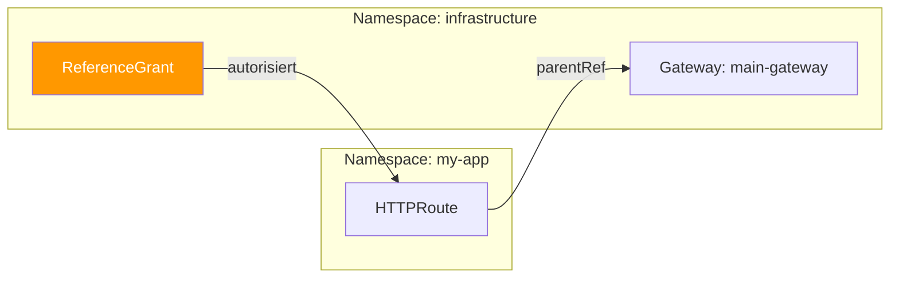

# Gateway API

> [!ABSTRACT]
> Die Gateway API ist der offizielle Nachfolger der Ingress-Ressource in Kubernetes. Sie bietet ein rollenbasiertes, erweiterbares Modell für Traffic-Management, das HTTP, TCP, UDP und TLS nativ unterstützt — ohne die Annotations-Hölle der alten Ingress-Welt.

---

## Warum ein neuer Standard?

Die klassische [[Ingress und IngressRoutes|Ingress]]-Ressource hat Kubernetes seit Jahren gute Dienste geleistet, stößt aber an klare Grenzen:

| Problem mit Ingress | Beispiel |
|---------------------|----------|
| **Nur HTTP/HTTPS** | Kein nativer Support für TCP, UDP oder TLS-Passthrough |
| **Annotations-Hölle** | Features wie Rewrites, Timeouts oder Canary-Deployments erfordern controller-spezifische Annotations |
| **Keine Portabilität** | `nginx.ingress.kubernetes.io/rewrite-target` funktioniert nur mit NGINX — nicht mit Traefik oder HAProxy |
| **Flaches Berechtigungsmodell** | Keine Trennung zwischen Infrastruktur-Team und Entwickler-Team |
| **Eingeschränkte Erweiterbarkeit** | Neue Features nur über Annotations oder CRDs des Controllers |

Die Gateway API löst all diese Probleme durch ein durchdachtes, mehrstufiges Ressourcen-Modell.

---

## Das Rollenmodell

Die Gateway API trennt Verantwortlichkeiten klar in **drei Rollen**:



| Rolle | Ressource | Verantwortung |
|-------|-----------|---------------|
| **Infrastruktur-Anbieter** | `GatewayClass` | Stellt die Implementierung bereit (z.B. Traefik, Envoy, Cilium) |
| **Cluster-Operator** | `Gateway` | Konfiguriert Entry-Points: Ports, Protokolle, TLS-Zertifikate |
| **App-Entwickler** | `HTTPRoute`, `TCPRoute`, etc. | Definiert Routing-Regeln für seine Anwendungen |

> [!TIP]
> Die klare Rollentrennung ist besonders in Multi-Team-Umgebungen wertvoll. Das Infrastruktur-Team kontrolliert den Gateway, während Entwickler-Teams eigenständig ihre Routes konfigurieren — ohne sich gegenseitig in die Quere zu kommen.

---

## Die Ressourcen im Detail

### GatewayClass

Die GatewayClass ist das Bindeglied zur Implementierung — vergleichbar mit der `IngressClass` bei Ingress, aber mächtiger:

```yaml
apiVersion: gateway.networking.k8s.io/v1
kind: GatewayClass
metadata:
  name: traefik
spec:
  controllerName: traefik.io/gateway-controller
```

Eine GatewayClass wird typischerweise **einmal pro Cluster** erstellt und vom Infrastruktur-Team verwaltet. Sie definiert, welcher Controller (Traefik, Envoy, Cilium, etc.) die Gateways dieser Klasse verarbeitet.

| Feld | Bedeutung |
|------|-----------|
| `controllerName` | Identifiziert den Controller, der diese Klasse implementiert |
| `parametersRef` | Optionale Referenz auf zusätzliche Konfiguration |

### Gateway

Der Gateway definiert die **Eintrittspunkte** für externen Traffic:

```yaml
apiVersion: gateway.networking.k8s.io/v1
kind: Gateway
metadata:
  name: main-gateway
  namespace: infrastructure
spec:
  gatewayClassName: traefik
  listeners:
    - name: http
      protocol: HTTP
      port: 80
    - name: https
      protocol: HTTPS
      port: 443
      tls:
        mode: Terminate
        certificateRefs:
          - name: wildcard-tls
            kind: Secret
    - name: tcp-db
      protocol: TCP
      port: 5432
      allowedRoutes:
        namespaces:
          from: Selector
          selector:
            matchLabels:
              gateway-access: "true"
```

Ein Gateway kann **mehrere Listener** für verschiedene Protokolle und Ports gleichzeitig haben. Jeder Listener kann einschränken, welche Namespaces Routes anhängen dürfen.

| Feld | Bedeutung |
|------|-----------|
| `gatewayClassName` | Verknüpfung mit der GatewayClass (welcher Controller?) |
| `listeners[].protocol` | HTTP, HTTPS, TCP, TLS oder UDP |
| `listeners[].port` | Der Port, auf dem gelauscht wird |
| `listeners[].tls` | TLS-Konfiguration (Terminate, Passthrough) |
| `listeners[].allowedRoutes` | Welche Namespaces dürfen Routes anhängen? |

> [!IMPORTANT]
> Die `allowedRoutes`-Konfiguration ist ein zentrales Sicherheitsfeature. Ohne sie könnten beliebige Namespaces Traffic über den Gateway routen. Mit `from: Selector` oder `from: Same` schränkt das Infrastruktur-Team den Zugriff gezielt ein.

### HTTPRoute

Die HTTPRoute ist der Ersatz für die Ingress-Ressource — aber deutlich mächtiger:

```yaml
apiVersion: gateway.networking.k8s.io/v1
kind: HTTPRoute
metadata:
  name: app-routes
  namespace: my-app
spec:
  parentRefs:
    - name: main-gateway
      namespace: infrastructure
  hostnames:
    - "app.example.com"
  rules:
    - matches:
        - path:
            type: PathPrefix
            value: /api
          headers:
            - name: X-Canary
              value: "true"
      backendRefs:
        - name: app-canary
          port: 8080
          weight: 100
    - matches:
        - path:
            type: PathPrefix
            value: /api
      backendRefs:
        - name: app-stable
          port: 8080
          weight: 90
        - name: app-canary
          port: 8080
          weight: 10
    - matches:
        - path:
            type: PathPrefix
            value: /
      backendRefs:
        - name: frontend
          port: 3000
```

#### Was HTTPRoute alles kann

| Feature | Wie | Beispiel |
|---------|-----|---------|
| **Path-Matching** | `path.type`: PathPrefix, Exact | `/api` matcht `/api/users` |
| **Header-Matching** | `headers[].name` + `value` | Route nur wenn `X-Canary: true` |
| **Traffic-Splitting** | `backendRefs[].weight` | 90% stable, 10% canary |
| **Host-basiertes Routing** | `hostnames[]` | `app.example.com` vs. `admin.example.com` |
| **Method-Matching** | `method` | Nur GET-Requests |
| **Query-Parameter** | `queryParams` | Route basierend auf URL-Parametern |

> [!NOTE]
> All das funktioniert **ohne Annotations** — die Konfiguration ist strukturiert im YAML definiert und wird von der API validiert. Egal ob du Traefik, Envoy oder Cilium als Controller nutzt, die HTTPRoute bleibt identisch.

---

## Weitere Route-Typen

Die Gateway API unterstützt nicht nur HTTP:

| Route-Typ | Protokoll | Anwendungsfall |
|-----------|-----------|----------------|
| `HTTPRoute` | HTTP/HTTPS (L7) | Web-Anwendungen, APIs, Microservices |
| `TCPRoute` | TCP (L4) | Datenbanken, Message Broker, Custom-Protokolle |
| `UDPRoute` | UDP (L4) | DNS, Gaming, VoIP |
| `TLSRoute` | TLS (L4) | TLS-Passthrough ohne Terminierung |
| `GRPCRoute` | gRPC (L7) | gRPC-Services mit nativen Features |

### TCPRoute Beispiel

```yaml
apiVersion: gateway.networking.k8s.io/v1alpha2
kind: TCPRoute
metadata:
  name: postgres-route
spec:
  parentRefs:
    - name: main-gateway
      sectionName: tcp-db
  rules:
    - backendRefs:
        - name: postgres-service
          port: 5432
```

---

## ReferenceGrant: Sichere Cross-Namespace-Referenzen

Wenn eine HTTPRoute in Namespace `my-app` auf einen Gateway in Namespace `infrastructure` verweisen will, braucht es eine explizite Erlaubnis:

```yaml
apiVersion: gateway.networking.k8s.io/v1beta1
kind: ReferenceGrant
metadata:
  name: allow-app-routes
  namespace: infrastructure
spec:
  from:
    - group: gateway.networking.k8s.io
      kind: HTTPRoute
      namespace: my-app
  to:
    - group: ""
      kind: Gateway
```



> [!WARNING]
> Ohne ReferenceGrant werden Cross-Namespace-Referenzen **stillschweigend ignoriert** — die Route wird einfach nicht aktiv. Kein Fehler, kein Warning. Prüfe also immer den Route-Status.

---

## Gateway API vs. Ingress vs. IngressRoute

| Feature | Ingress | IngressRoute (Traefik CRD) | Gateway API |
|---------|---------|---------------------------|-------------|
| **Standard** | Kubernetes-nativ | Traefik-spezifisch | Kubernetes-nativ (neu) |
| **Protokolle** | HTTP/HTTPS | HTTP/HTTPS, TCP | HTTP, HTTPS, TCP, UDP, TLS, gRPC |
| **Erweiterbarkeit** | Annotations | CRD-Felder | Strukturierte Felder + CRD-Erweiterungen |
| **Traffic-Splitting** | Nicht nativ | Gewichtetes Round-Robin | Nativ mit `weight` |
| **Header-Matching** | Annotation | CRD-Feld | Nativ |
| **Rollentrennung** | Nein | Nein | Ja (GatewayClass/Gateway/Route) |
| **Multi-Tenancy** | Schwierig | Möglich | ReferenceGrant, Namespace-Isolation |
| **Portabilität** | Gering (Annotations) | Keine (nur Traefik) | Hoch (jeder konforme Controller) |
| **Status** | Stabil, Wartungsmodus | Stabil | GA seit K8s 1.29 |

> [!IMPORTANT]
> Die Kubernetes-Community hat offiziell empfohlen, von Ingress auf die Gateway API zu migrieren. Der NGINX Ingress Controller geht bis März 2026 in den Wartungsmodus. Neue Projekte sollten direkt die Gateway API nutzen.

---

## Traefik als Gateway API Controller

Traefik unterstützt die Gateway API nativ. Aktivierung:

```yaml
# Traefik Helm values.yaml
providers:
  kubernetesGateway:
    enabled: true

# Gateway API CRDs installieren
kubectl apply -f https://github.com/kubernetes-sigs/gateway-api/releases/download/v1.2.0/standard-install.yaml
```

Danach lassen sich sowohl die alten IngressRoutes als auch die neuen HTTPRoutes parallel nutzen — ideal für eine schrittweise Migration.

---

## Migration von Ingress zur Gateway API

### Schritt-für-Schritt

| Schritt | Aktion |
|:-------:|--------|
| **1** | Gateway API CRDs installieren |
| **2** | GatewayClass + Gateway erstellen |
| **3** | HTTPRoutes für neue Apps nutzen |
| **4** | Bestehende Ingress-Regeln schrittweise migrieren |
| **5** | Alte Ingress-Ressourcen entfernen |

### Vorher (Ingress)

```yaml
apiVersion: networking.k8s.io/v1
kind: Ingress
metadata:
  name: my-app
  annotations:
    nginx.ingress.kubernetes.io/rewrite-target: /
    nginx.ingress.kubernetes.io/ssl-redirect: "true"
spec:
  ingressClassName: nginx
  rules:
    - host: app.example.com
      http:
        paths:
          - path: /
            pathType: Prefix
            backend:
              service:
                name: my-app
                port:
                  number: 80
```

### Nachher (Gateway API)

```yaml
apiVersion: gateway.networking.k8s.io/v1
kind: HTTPRoute
metadata:
  name: my-app
spec:
  parentRefs:
    - name: main-gateway
  hostnames:
    - app.example.com
  rules:
    - matches:
        - path:
            type: PathPrefix
            value: /
      filters:
        - type: URLRewrite
          urlRewrite:
            path:
              type: ReplacePrefixMatch
              replacePrefixMatch: /
      backendRefs:
        - name: my-app
          port: 80
```

> [!TIP]
> Die Migration muss nicht auf einmal passieren. Ingress und Gateway API können parallel im selben Cluster laufen. Migriere Route für Route.

---

## Route-Status prüfen

Die Gateway API bietet detaillierte Status-Informationen — deutlich besser als bei Ingress:

```bash
# Gateway-Status prüfen
kubectl describe gateway main-gateway -n infrastructure

# HTTPRoute-Status prüfen
kubectl describe httproute app-routes -n my-app

# Alle HTTPRoutes im Cluster
kubectl get httproutes --all-namespaces
```

Der Status zeigt an:
- Ob die Route akzeptiert wurde (`Accepted: True`)
- An welchen Gateway sie gebunden ist
- Welche Konflikte existieren

---

## Verwandte Notizen

- [[Ingress und IngressRoutes]] — Die Vorgänger-Technologie
- [[Services]] — Backend-Services, auf die Routes verweisen
- [[Traefik Ingress Controller]] — Controller mit Gateway API Support
- [[Kubernetes Netzwerk]] — Netzwerk-Grundlagen
- [[CRDs und Operators]] — Gateway API basiert auf CRDs
