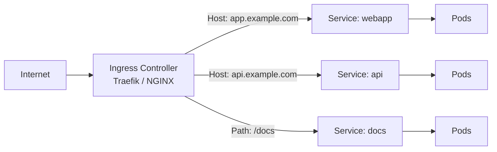
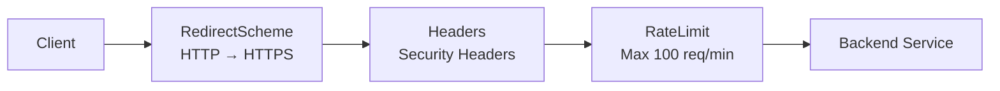

# Ingress und IngressRoutes

> [!ABSTRACT]
> Ingress regelt den externen HTTP(S)-Zugriff auf Services im Kubernetes-Cluster. Während ein Kubernetes Ingress die Standard-Ressource ist, bieten IngressRoutes (Traefik CRD) erweiterte Funktionalität wie Middleware und TCP/UDP-Routing.

---

## Was ist Ingress?

Ein Ingress definiert Regeln, wie externer HTTP(S)-Traffic zu internen Services weitergeleitet wird. Ohne Ingress müsste jeder Service als LoadBalancer oder NodePort exponiert werden.



> [!IMPORTANT]
> Ein Ingress allein macht nichts — es braucht einen **Ingress Controller** (z.B. Traefik, NGINX), der die Ingress-Regeln umsetzt. K3s liefert Traefik standardmäßig als Ingress Controller mit.

---

## Ingress Controller

Der Ingress Controller ist die eigentliche Software, die den Traffic routet. Er liest die Ingress-Ressourcen und konfiguriert sich entsprechend.

| Controller | Besonderheiten |
|-----------|---------------|
| **Traefik** | Standard in K3s, CRDs, Middleware, Auto-Discovery |
| **NGINX Ingress** | Weit verbreitet, annotation-basiert |
| **HAProxy** | Hohe Performance, TCP/UDP Support |
| **Contour** | Envoy-basiert, HTTPProxy CRD |

---

## Kubernetes Ingress (Standard)

Die Standard-Ingress-Ressource unterstützt grundlegendes HTTP(S)-Routing:

### Host-basiertes Routing

```yaml
apiVersion: networking.k8s.io/v1
kind: Ingress
metadata:
  name: webapp-ingress
  annotations:
    traefik.ingress.kubernetes.io/backend-protocol: HTTPS
spec:
  ingressClassName: traefik
  tls:
    - secretName: home-soniiit-net-selfsigned-tls
      hosts:
        - webapp.home.soniiit.net
  rules:
    - host: webapp.home.soniiit.net
      http:
        paths:
          - path: /
            pathType: Prefix
            backend:
              service:
                name: webapp
                port:
                  number: 80
```

### Path-basiertes Routing

```yaml
apiVersion: networking.k8s.io/v1
kind: Ingress
metadata:
  name: multi-path-ingress
spec:
  ingressClassName: traefik
  rules:
    - host: example.com
      http:
        paths:
          - path: /api
            pathType: Prefix
            backend:
              service:
                name: api-service
                port:
                  number: 8080
          - path: /
            pathType: Prefix
            backend:
              service:
                name: frontend-service
                port:
                  number: 80
```

### Path Types

| PathType | Verhalten |
|----------|----------|
| `Prefix` | Matcht den Pfad als Prefix (`/api` matcht `/api/users`) |
| `Exact` | Matcht den Pfad exakt (`/api` matcht nur `/api`) |
| `ImplementationSpecific` | Verhalten hängt vom Ingress Controller ab |

---

## IngressRoute (Traefik CRD)

Traefik bietet eigene **Custom Resource Definitions (CRDs)**, die mehr Funktionalität als Standard-Ingress bieten. Statt sich auf Annotations zu verlassen, haben IngressRoutes eine eigene, klar strukturierte Syntax für Routing-Regeln, Middleware-Referenzen und TLS-Konfiguration.

Wann IngressRoute statt Ingress? Sobald man Traefik-spezifische Features braucht: Middleware-Chains, TCP/UDP-Routing, gewichtetes Load Balancing oder komplexe Match-Expressions.

### Grundlegende IngressRoute

```yaml
apiVersion: traefik.io/v1alpha1
kind: IngressRoute
metadata:
  name: webapp-https
  namespace: default
  annotations:
    kubernetes.io/ingress.class: traefik
spec:
  entryPoints:
    - websecure
  routes:
    - match: Host(`webapp.home.soniiit.net`)
      kind: Rule
      services:
        - name: webapp
          port: 80
  tls:
    secretName: home-soniiit-net-selfsigned-tls
```

### HTTP zu HTTPS Redirect

Ein häufiges Pattern ist die Kombination aus HTTP-Redirect und HTTPS-Route:

```yaml
# HTTP → HTTPS Redirect
apiVersion: traefik.io/v1alpha1
kind: IngressRoute
metadata:
  name: webapp-http
  namespace: default
spec:
  entryPoints:
    - web
  routes:
    - match: Host(`webapp.home.soniiit.net`)
      kind: Rule
      middlewares:
        - name: redirect-https
          namespace: default
      services:
        - name: webapp
          port: 80
---
# HTTPS Route
apiVersion: traefik.io/v1alpha1
kind: IngressRoute
metadata:
  name: webapp-https
  namespace: default
spec:
  entryPoints:
    - websecure
  routes:
    - match: Host(`webapp.home.soniiit.net`)
      kind: Rule
      services:
        - name: webapp
          port: 80
  tls:
    secretName: home-soniiit-net-selfsigned-tls
---
# Redirect Middleware
apiVersion: traefik.io/v1alpha1
kind: Middleware
metadata:
  name: redirect-https
  namespace: default
spec:
  redirectScheme:
    scheme: https
    permanent: true
```

### IngressRoute mit Middleware

Traefik Middlewares ermöglichen zusätzliche Verarbeitung des Traffics:

```yaml
apiVersion: traefik.io/v1alpha1
kind: IngressRoute
metadata:
  name: app-https
  namespace: default
spec:
  entryPoints:
    - websecure
  routes:
    - match: Host(`app.home.soniiit.net`)
      kind: Rule
      middlewares:
        - name: default-headers
          namespace: default
        - name: rate-limit
          namespace: default
      services:
        - name: app
          port: 80
  tls:
    secretName: home-soniiit-net-selfsigned-tls
```

---

## Middleware-Typen (Traefik)

**Middleware** ist ein Traefik-Konzept, das es ermöglicht, HTTP-Requests zu verändern, bevor sie den Backend-Service erreichen. Man kann sich Middlewares wie eine Kette von Filtern vorstellen — jeder Request durchläuft die definierten Middlewares in Reihenfolge:



Middlewares werden als eigene Kubernetes-Ressourcen erstellt und in IngressRoutes referenziert. Dadurch kann man die gleiche Middleware in mehreren IngressRoutes wiederverwenden.

Traefik bietet zahlreiche Middleware-Typen:

| Middleware | Beschreibung |
|-----------|-------------|
| **BasicAuth** | HTTP Basic Authentication |
| **Headers** | Security Headers hinzufügen |
| **RateLimit** | Anfragen limitieren |
| **RedirectScheme** | HTTP zu HTTPS umleiten |
| **StripPrefix** | URL-Prefix entfernen |
| **IPAllowList** | Zugriff auf bestimmte IPs beschränken |
| **Compress** | Response-Komprimierung |

### Security Headers Middleware

```yaml
apiVersion: traefik.io/v1alpha1
kind: Middleware
metadata:
  name: default-headers
  namespace: default
spec:
  headers:
    browserXssFilter: true
    contentTypeNosniff: true
    forceSTSHeader: true
    stsIncludeSubdomains: true
    stsPreload: true
    stsSeconds: 15552000
    referrerPolicy: no-referrer
    customFrameOptionsValue: SAMEORIGIN
    customRequestHeaders:
      X-Forwarded-Proto: https
```

### BasicAuth Middleware

```yaml
apiVersion: traefik.io/v1alpha1
kind: Middleware
metadata:
  name: dashboard-basicauth
  namespace: traefik
spec:
  basicAuth:
    secret: dashboard-credentials
```

---

## TLS-Konfiguration

### Mit Cert-Manager (automatische Zertifikate)

```yaml
apiVersion: networking.k8s.io/v1
kind: Ingress
metadata:
  name: webapp
  annotations:
    cert-manager.io/cluster-issuer: letsencrypt-production
spec:
  ingressClassName: traefik
  tls:
    - hosts:
        - webapp.example.com
      secretName: webapp-tls
  rules:
    - host: webapp.example.com
      http:
        paths:
          - path: /
            pathType: Prefix
            backend:
              service:
                name: webapp
                port:
                  number: 80
```

### Mit vorhandenem Secret

```yaml
spec:
  tls:
    - secretName: home-soniiit-net-selfsigned-tls
      hosts:
        - "*.home.soniiit.net"
```

---

## Ingress vs IngressRoute

| Aspekt | Kubernetes Ingress | Traefik IngressRoute |
|--------|-------------------|---------------------|
| Standard | Kubernetes-nativ | Traefik CRD |
| Portabilität | Controller-unabhängig | Nur Traefik |
| Middleware | Über Annotations (begrenzt) | Native Middleware-Referenz |
| TCP/UDP | Nicht unterstützt | Unterstützt |
| Routing-Regeln | Host + Path | Komplexe Match-Expressions |
| TLS-Passthrough | Begrenzt | Nativ unterstützt |

> [!TIP]
> Für einfache HTTP-Routing-Regeln reicht der Standard-Ingress. Für erweiterte Features wie Middleware-Chains, TCP-Routing oder komplexe Match-Regeln sind IngressRoutes die bessere Wahl.

---

## Verwandte Notizen

- [[Services]]
- [[Traefik Ingress Controller]]
- [[Cert-Manager]]
- [[ConfigMaps und Secrets]]
