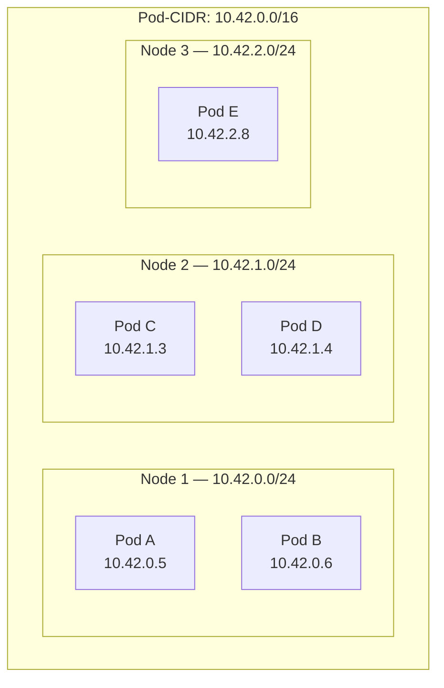
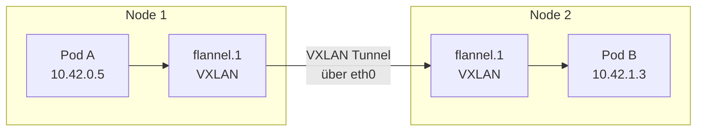
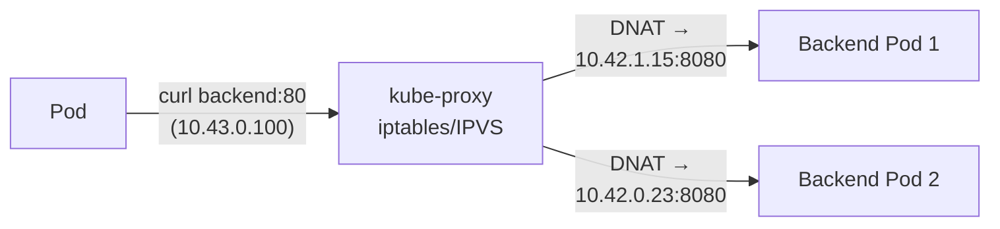
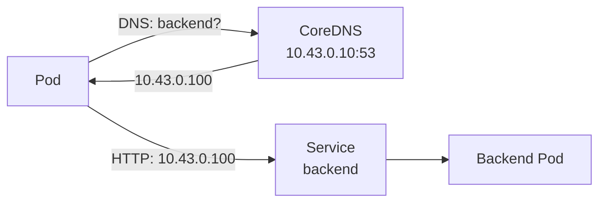
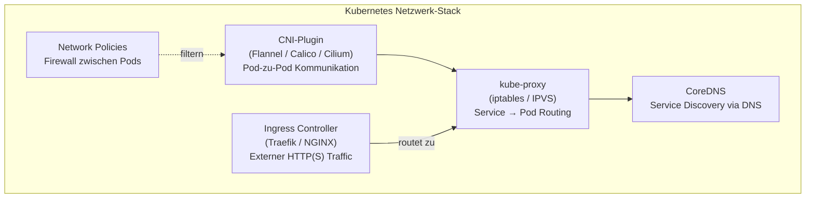

# Kubernetes Netzwerk

> [!ABSTRACT]
> Das Kubernetes-Netzwerkmodell basiert auf einem flachen Netzwerk, in dem jeder Pod eine eigene IP-Adresse bekommt und direkt mit jedem anderen Pod kommunizieren kann — ohne NAT. Diese Seite erklärt das Netzwerkmodell, CNI-Plugins, DNS-Auflösung, kube-proxy und Network Policies.

---

## Das Kubernetes-Netzwerkmodell

In Docker bekommt jeder Container eine private IP aus dem `docker0`-Bridge-Netzwerk (z.B. `172.17.0.x`). Container auf verschiedenen Hosts können sich standardmäßig **nicht** direkt erreichen — dafür braucht man Port-Mapping, Overlay-Netzwerke oder Docker Swarm.

Kubernetes geht einen anderen Weg mit einem **flachen Netzwerk**. Das bedeutet:

1. **Jeder Pod bekommt eine echte, cluster-weite IP-Adresse** — kein Port-Mapping nötig
2. **Jeder Pod kann jeden anderen Pod direkt erreichen** — egal auf welchem Node
3. **Kein NAT zwischen Pods** — die IP, die ein Pod sieht, ist die gleiche, die andere Pods sehen
4. **Nodes können direkt mit Pods kommunizieren** — und umgekehrt

> [!IMPORTANT]
> Kubernetes selbst implementiert kein Netzwerk. Es definiert nur die **Regeln** (das Modell). Die eigentliche Implementierung übernimmt ein **CNI-Plugin** wie Flannel, Calico oder Cilium.

### Die vier Kommunikationsebenen

| Ebene | Richtung | Wie | Beispiel |
|-------|----------|-----|---------|
| **1** | Container zu Container | `localhost` im selben Pod | App-Container spricht mit Sidecar auf `localhost:9090` |
| **2** | Pod zu Pod | Direkt über Pod-IP, CNI-Plugin | `curl 10.42.1.15:8080` |
| **3** | Pod zu Service | Über Service-ClusterIP oder DNS | `curl http://backend.default.svc.cluster.local` |
| **4** | Extern zu Service | NodePort, LoadBalancer oder Ingress | Browser → Traefik → Service → Pod |

---

## IP-Adressbereiche (CIDR)

Ein Kubernetes-Cluster arbeitet mit drei separaten IP-Bereichen, die sich nicht überlappen dürfen:

| Bereich | Typischer CIDR | Vergeben durch | Beispiel |
|---------|---------------|----------------|---------|
| **Node-Netzwerk** | `192.168.178.0/24` | Heimnetzwerk / DHCP | `192.168.178.11` (Server-Node) |
| **Pod-CIDR** | `10.42.0.0/16` | CNI-Plugin | `10.42.1.15` (ein Pod) |
| **Service-CIDR** | `10.43.0.0/16` | kube-apiserver | `10.43.0.1` (kubernetes Service) |

Jeder Node bekommt ein **Subnetz** aus dem Pod-CIDR. Pods auf diesem Node bekommen IPs aus diesem Subnetz:



> [!TIP]
> Bei K3s sind `10.42.0.0/16` (Pods) und `10.43.0.0/16` (Services) die Standardwerte. Sie können bei der Installation mit `--cluster-cidr` und `--service-cidr` angepasst werden.

---

## CNI-Plugins

Das **Container Network Interface (CNI)** ist ein Standard, der definiert, wie Netzwerk-Plugins Container-Netzwerke einrichten. Wenn ein Pod erstellt wird, ruft Kubernetes das CNI-Plugin auf, das dem Pod eine IP zuweist und die Routing-Regeln konfiguriert.

### Flannel

Der einfachste und am weitesten verbreitete CNI-Plugin — **Standard bei K3s**.

- Erstellt ein **VXLAN-Overlay-Netzwerk** über alle Nodes
- Jeder Node bekommt ein Subnetz (z.B. `10.42.0.0/24`, `10.42.1.0/24`)
- Pods verschiedener Nodes kommunizieren über VXLAN-Tunnel
- **Keine Network Policies** — Flannel kann Traffic nicht filtern



> [!NOTE]
> Flannel kapselt die Pod-Pakete in VXLAN-Frames ein und schickt sie über das physische Netzwerk zum Ziel-Node. Dort werden sie entpackt und an den richtigen Pod weitergeleitet. Das ist etwas langsamer als natives Routing, aber funktioniert in jedem Netzwerk.

### Calico

Ein leistungsstarkes CNI-Plugin mit **Network Policies** und **BGP-Routing**.

- Kann **ohne Overlay** arbeiten (BGP-Modus) — höhere Performance
- Unterstützt **Network Policies** zum Filtern von Pod-Traffic
- Skaliert auf tausende Nodes
- Komplexer zu konfigurieren als Flannel

| Modus | Beschreibung | Wann verwenden |
|-------|-------------|----------------|
| VXLAN | Overlay wie Flannel | Einfaches Setup, funktioniert überall |
| BGP | Natives Routing ohne Overlay | On-Premises mit BGP-fähigen Routern |
| IPIP | IP-in-IP Tunnel | Cross-Subnet-Kommunikation |

### Cilium

Das modernste CNI-Plugin — basiert auf **eBPF** (extended Berkeley Packet Filter).

- Nutzt eBPF statt iptables — deutlich **performanter bei vielen Services**
- Eingebaute **Network Policies** (L3/L4 und L7)
- **Transparente Verschlüsselung** (WireGuard oder IPsec)
- Kann kube-proxy komplett ersetzen
- **Hubble** — eingebautes Observability-Tool für Netzwerk-Traffic

### Vergleich

| Feature | Flannel | Calico | Cilium |
|---------|---------|--------|--------|
| Komplexität | Einfach | Mittel | Hoch |
| Network Policies | ❌ | ✅ | ✅ (+ L7) |
| Performance | Gut | Sehr gut (BGP) | Exzellent (eBPF) |
| Encryption | ❌ | ✅ (WireGuard) | ✅ (WireGuard) |
| Observability | ❌ | ❌ | ✅ (Hubble) |
| Verbreitung | K3s Standard | Kubeadm häufig | Enterprise / moderne Cluster |

> [!TIP]
> **Für Homelabs und kleine Cluster** ist Flannel (K3s-Standard) völlig ausreichend. Calico oder Cilium lohnt sich, wenn man Network Policies oder bessere Performance braucht.

---

## kube-proxy

Der **kube-proxy** läuft auf jedem Node und ist dafür zuständig, dass [[Services]] funktionieren. Er übersetzt Service-IPs (ClusterIP) in die tatsächlichen Pod-IPs.

Wenn ein Pod den Service `backend` auf `10.43.0.100:80` anspricht, sorgt kube-proxy dafür, dass der Traffic an einen der Backend-Pods weitergeleitet wird (z.B. `10.42.1.15:8080`).

### Modi

| Modus | Wie | Vor-/Nachteile |
|-------|-----|---------------|
| **iptables** (Standard) | Erstellt iptables-Regeln für jede Service/Endpoint-Kombination | Einfach, zuverlässig. Bei >1000 Services wird die Regelliste groß und langsam. |
| **IPVS** | Nutzt den Linux IPVS Load Balancer im Kernel | Performanter bei vielen Services, mehrere LB-Algorithmen (Round Robin, Least Connections). |
| **nftables** | Nutzt nftables statt iptables (ab K8s 1.31) | Modernerer Netfilter-Stack, bessere Performance als iptables. |



> [!NOTE]
> Bei Cilium kann kube-proxy komplett durch eBPF-basiertes Service-Routing ersetzt werden — das ist effizienter, weil keine iptables-Regeln nötig sind.

---

## CoreDNS und Service Discovery

**CoreDNS** ist der Cluster-interne DNS-Server. Er ermöglicht, dass Pods Services über **DNS-Namen** statt über IPs ansprechen können.

### DNS-Namensschema

Jeder Service bekommt automatisch einen DNS-Eintrag:

```text
<service-name>.<namespace>.svc.cluster.local
```

| DNS-Name | Auflösung |
|----------|-----------|
| `backend` | Service `backend` im **selben Namespace** |
| `backend.production` | Service `backend` im Namespace `production` |
| `backend.production.svc.cluster.local` | Vollqualifizierter Name (FQDN) |

### Wie funktioniert es?



1. Pod macht DNS-Anfrage für `backend`
2. Die `/etc/resolv.conf` im Pod zeigt auf CoreDNS (`10.43.0.10`)
3. CoreDNS löst `backend.default.svc.cluster.local` auf die ClusterIP `10.43.0.100`
4. kube-proxy leitet den Traffic von der ClusterIP zum eigentlichen Pod

### Headless Services

Ein **Headless Service** (`clusterIP: None`) bekommt keine eigene ClusterIP. Stattdessen löst DNS direkt auf die **Pod-IPs** auf — nützlich für StatefulSets, bei denen jeder Pod individuell angesprochen werden muss:

```text
# Normaler Service
nslookup backend → 10.43.0.100 (ClusterIP)

# Headless Service
nslookup backend → 10.42.0.5, 10.42.1.3, 10.42.2.8 (Pod-IPs)
```

### DNS-Debugging

```bash
# DNS-Auflösung testen
kubectl run dnstest --image=busybox -it --rm -- nslookup backend
kubectl run dnstest --image=busybox -it --rm -- nslookup backend.production.svc.cluster.local

# CoreDNS Pods prüfen
kubectl get pods -n kube-system -l k8s-app=kube-dns

# CoreDNS Logs
kubectl logs -n kube-system -l k8s-app=kube-dns
```

---

## Network Policies

Standardmäßig kann in Kubernetes **jeder Pod mit jedem anderen Pod** kommunizieren — es gibt keine Firewall zwischen Pods. **Network Policies** ändern das: Sie definieren, welcher Traffic erlaubt ist (Whitelist-Prinzip).

> [!WARNING]
> Network Policies funktionieren nur mit CNI-Plugins, die sie unterstützen (Calico, Cilium). **Flannel ignoriert Network Policies** — sie werden erstellt, aber nicht durchgesetzt.

### Grundprinzip

Sobald eine Network Policy auf einen Pod angewendet wird, wird **aller nicht explizit erlaubter Traffic blockiert** (Deny-by-Default für diesen Pod).

### Ingress Policy — Eingehenden Traffic beschränken

```yaml
apiVersion: networking.k8s.io/v1
kind: NetworkPolicy
metadata:
  name: backend-policy
  namespace: default
spec:
  podSelector:
    matchLabels:
      app: backend
  policyTypes:
    - Ingress
  ingress:
    # Nur Frontend-Pods dürfen auf den Backend-Pod zugreifen
    - from:
        - podSelector:
            matchLabels:
              app: frontend
      ports:
        - protocol: TCP
          port: 8080
```

Diese Policy sagt: „Nur Pods mit Label `app: frontend` dürfen auf Port 8080 des Backend-Pods zugreifen. Alles andere wird blockiert."

### Egress Policy — Ausgehenden Traffic beschränken

```yaml
apiVersion: networking.k8s.io/v1
kind: NetworkPolicy
metadata:
  name: db-egress
  namespace: default
spec:
  podSelector:
    matchLabels:
      app: database
  policyTypes:
    - Egress
  egress:
    # Nur DNS erlauben (sonst funktioniert nichts)
    - to: []
      ports:
        - protocol: UDP
          port: 53
        - protocol: TCP
          port: 53
```

### Namespace-übergreifende Policy

```yaml
apiVersion: networking.k8s.io/v1
kind: NetworkPolicy
metadata:
  name: allow-monitoring
  namespace: production
spec:
  podSelector: {}     # Gilt für alle Pods im Namespace
  policyTypes:
    - Ingress
  ingress:
    # Monitoring-Namespace darf Metriken scrapen
    - from:
        - namespaceSelector:
            matchLabels:
              name: monitoring
      ports:
        - protocol: TCP
          port: 9090
```

### Deny-All Policy

```yaml
# Blockiert allen eingehenden Traffic zu Pods im Namespace
apiVersion: networking.k8s.io/v1
kind: NetworkPolicy
metadata:
  name: deny-all-ingress
  namespace: production
spec:
  podSelector: {}
  policyTypes:
    - Ingress
```

> [!TIP]
> Eine gute Strategie: Zuerst eine **Deny-All-Policy** pro Namespace erstellen und dann gezielt einzelne Verbindungen erlauben. So hat man eine sichere Basis.

---

## Zusammenfassung



| Komponente | Aufgabe | Läuft auf |
|-----------|---------|-----------|
| **CNI-Plugin** | Pod-IPs vergeben, Pod-zu-Pod Routing | Jedem Node |
| **kube-proxy** | Service-IPs auf Pod-IPs übersetzen | Jedem Node |
| **CoreDNS** | DNS-Auflösung für Services | Control Plane (als Pod) |
| **Network Policies** | Traffic zwischen Pods filtern | CNI-Plugin (Calico/Cilium) |
| **Ingress Controller** | Externer HTTP(S)-Traffic ins Cluster | Dedizierte Pods |

---

## Verwandte Notizen

- [[Kubernetes Architektur]]
- [[Services]]
- [[Ingress und IngressRoutes]]
- [[Pods]]
- [[Traefik Ingress Controller]]
- [[Kubernetes Index]]
- [[Docker Networking]] — Docker-Bridge-Netzwerke als Basis für CNI-Konzepte
