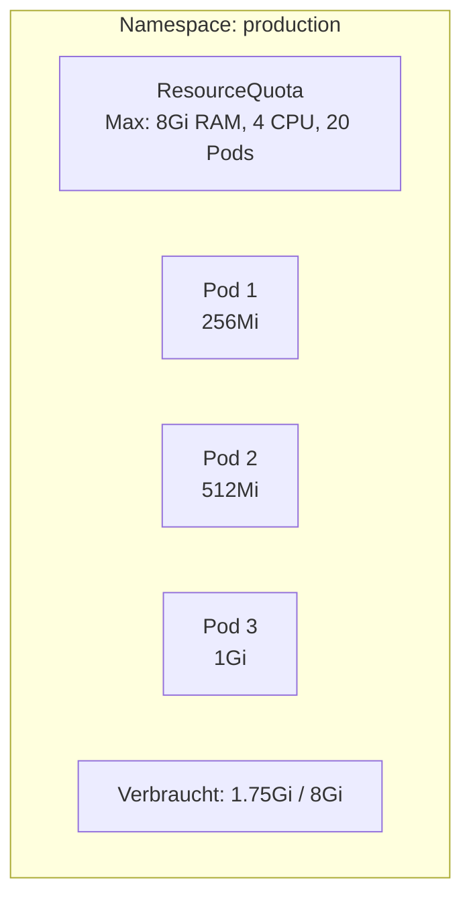

# Namespaces

> [!ABSTRACT]
> Namespaces bieten eine logische Trennung von Ressourcen innerhalb eines Kubernetes-Clusters. Sie ermöglichen es, verschiedene Umgebungen, Teams oder Anwendungen voneinander zu isolieren.

---

## Was sind Namespaces?

Stell dir vor, du hast einen Cluster und darauf laufen deine Produktions-App, eine Testumgebung und Monitoring-Tools. Ohne Trennung landen alle Pods, Services und Secrets in einem großen Topf — Namenskonflikte, keine Übersicht und keine Möglichkeit, Berechtigungen pro Team zu vergeben.

**Namespaces** sind die Lösung: Sie teilen einen physischen Cluster in logisch getrennte Bereiche auf — wie Ordner auf einer Festplatte. Jeder Namespace hat seine eigenen Ressourcen, und der gleiche Name kann in verschiedenen Namespaces existieren (z.B. ein Service `webapp` in `staging` und in `production`).

Namespaces bieten:
- **Isolation** — Ressourcen verschiedener Teams/Umgebungen sind getrennt
- **Berechtigungen** — Über [[RBAC]] können Rechte pro Namespace vergeben werden
- **Resource Quotas** — Jeder Namespace kann eigene CPU/Memory-Limits bekommen
- **Übersicht** — `kubectl get pods -n monitoring` zeigt nur Monitoring-Pods

```mermaid
graph TB
    subgraph Cluster
        subgraph default
            P1[Pod: webapp]
            S1[Service: webapp]
        end
        subgraph production
            P2[Pod: webapp]
            S2[Service: webapp]
        end
        subgraph monitoring
            P3[Pod: prometheus]
            S3[Service: grafana]
        end
    end
```

---

## Standard-Namespaces

Jeder Kubernetes-Cluster hat vier vordefinierte Namespaces:

| Namespace | Beschreibung |
|-----------|-------------|
| `default` | Standard-Namespace für Ressourcen ohne explizite Zuordnung |
| `kube-system` | System-Komponenten (CoreDNS, kube-proxy, Flannel) |
| `kube-public` | Öffentlich lesbare Daten (z.B. Cluster-Info) |
| `kube-node-lease` | Node-Heartbeats für die Gesundheitsprüfung |

```bash
# Alle Namespaces anzeigen
kubectl get namespaces

# Kurzform
kubectl get ns
```

---

## Namespace erstellen

```bash
# Per Befehl
kubectl create namespace production

# Per YAML
kubectl apply -f - <<EOF
apiVersion: v1
kind: Namespace
metadata:
  name: production
  labels:
    environment: production
EOF
```

---

## Mit Namespaces arbeiten

### Ressourcen in einem Namespace erstellen

```bash
# Namespace beim Erstellen angeben
kubectl apply -f deployment.yaml -n production

# Oder im YAML Manifest
```

```yaml
apiVersion: apps/v1
kind: Deployment
metadata:
  name: webapp
  namespace: production    # ← Namespace im Manifest
spec:
  replicas: 3
  # ...
```

### Standard-Namespace setzen

```bash
# Standard-Namespace für den aktuellen Context ändern
kubectl config set-context --current --namespace=production

# Prüfen welcher Namespace aktiv ist
kubectl config view --minify | grep namespace
```

### Ressourcen über Namespaces hinweg ansehen

```bash
# Pods in einem bestimmten Namespace
kubectl get pods -n kube-system

# Pods in allen Namespaces
kubectl get pods -A
# oder
kubectl get pods --all-namespaces
```

---

## Namespace-übergreifende Kommunikation

Services können Namespace-übergreifend angesprochen werden:

```text
<service>.<namespace>.svc.cluster.local

# Beispiel: Service "database" im Namespace "production"
database.production.svc.cluster.local
```

```bash
# Aus einem Pod im Namespace "default" den Service "database" in "production" erreichen
curl http://database.production:5432
```

> [!NOTE]
> Namespace-übergreifende Kommunikation funktioniert standardmäßig ohne Einschränkungen. Mit **Network Policies** kann diese Kommunikation eingeschränkt werden.

---

## Resource Quotas

Ohne Limits kann ein Team oder eine Anwendung den gesamten Cluster-Speicher und alle CPUs verbrauchen — und andere Namespaces leiden darunter. **Resource Quotas** setzen harte Obergrenzen pro Namespace: „In diesem Namespace dürfen maximal 20 Pods laufen und insgesamt 8 Gi Memory nutzen."



```yaml
apiVersion: v1
kind: ResourceQuota
metadata:
  name: compute-quota
  namespace: production
spec:
  hard:
    requests.cpu: "4"
    requests.memory: 8Gi
    limits.cpu: "8"
    limits.memory: 16Gi
    pods: "20"
    services: "10"
    persistentvolumeclaims: "10"
```

Wird das Limit erreicht, können keine neuen Pods mehr erstellt werden — Kubernetes gibt einen Fehler zurück. So wird sichergestellt, dass kein Namespace den Cluster monopolisiert.

```bash
# Quota-Status anzeigen (zeigt Verbrauch vs. Limit)
kubectl describe resourcequota compute-quota -n production
```

> [!WARNING]
> Wenn eine Resource Quota in einem Namespace aktiv ist, **müssen alle Pods** in diesem Namespace `requests` und `limits` für CPU/Memory definieren. Ohne diese Angaben wird der Pod abgelehnt.

---

## LimitRange

Resource Quotas begrenzen den **gesamten Namespace**, aber was ist mit einzelnen Containern? Ein Entwickler könnte einen Pod mit `limits.memory: 16Gi` erstellen und das gesamte Quota allein verbrauchen.

**LimitRange** löst das: Es definiert Standard-Werte und Obergrenzen für **einzelne Container**. Wenn ein Pod keine Ressourcen definiert, bekommt er automatisch die Standardwerte. Wenn er zu viel anfordert, wird er abgelehnt:

| Feld | Beschreibung |
|------|-------------|
| `default` | Standard-Limits, wenn der Container keine angibt |
| `defaultRequest` | Standard-Requests, wenn der Container keine angibt |
| `max` | Maximale Ressourcen, die ein Container anfordern darf |
| `min` | Minimale Ressourcen, die ein Container haben muss |

```yaml
apiVersion: v1
kind: LimitRange
metadata:
  name: default-limits
  namespace: production
spec:
  limits:
    - default:
        memory: 256Mi
        cpu: 500m
      defaultRequest:
        memory: 128Mi
        cpu: 250m
      max:
        memory: 1Gi
        cpu: "2"
      min:
        memory: 64Mi
        cpu: 100m
      type: Container
```

---

## Best Practices

| Praxis | Beschreibung |
|--------|-------------|
| Umgebungstrennung | Separate Namespaces für Dev, Staging, Prod |
| Komponenten-Namespaces | Tools in eigene Namespaces (z.B. `traefik`, `cert-manager`, `longhorn-system`) |
| Resource Quotas | Ressourcenlimits pro Namespace setzen |
| RBAC pro Namespace | Zugriff auf Namespace-Ebene einschränken |
| Labels | Namespaces mit Labels versehen für Policies |
| Nicht `default` nutzen | Eigene Namespaces erstellen, `default` vermeiden |

---

## Typische Namespace-Struktur

```text
Namespaces in einem Homelab-Cluster:
├── default           → Anwendungen
├── kube-system       → System-Komponenten
├── cert-manager      → Zertifikats-Management
├── traefik           → Ingress Controller
├── longhorn-system   → Distributed Storage
├── portainer         → Cluster-Management UI
├── monitoring        → Prometheus, Grafana
└── production        → Produktions-Workloads
```

---

## Verwandte Notizen

- [[Kubernetes Index]]
- [[RBAC]]
- [[Labels Selektoren und Annotations]]
- [[Services]]
