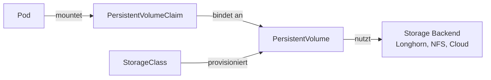
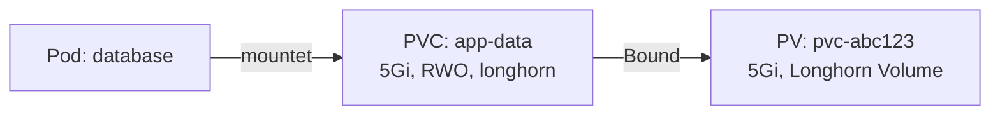
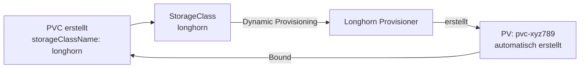

# Persistent Volumes und Storage Classes

> [!ABSTRACT]
> Kubernetes bietet ein Storage-System mit PersistentVolumes (PV), PersistentVolumeClaims (PVC) und StorageClasses, um dauerhaften Speicher für Pods bereitzustellen. Pods sind kurzlebig — ohne Persistent Storage gehen Daten bei einem Pod-Neustart verloren.

---

## Warum Persistent Storage?

Container sind von Natur aus **kurzlebig** (ephemeral) — wenn ein Pod stirbt, neu gestartet oder auf einen anderen Node verschoben wird, sind alle Daten im Container weg. Für Anwendungen wie Datenbanken, File-Uploads oder Caches braucht man Speicher, der **unabhängig vom Pod-Lifecycle** existiert.

Kubernetes löst das über ein dreistufiges System:

1. **PersistentVolume (PV)** — Das tatsächliche Stück Speicher (z.B. eine Festplatte, ein NFS-Share oder ein Longhorn-Volume). Der Admin stellt es bereit.
2. **PersistentVolumeClaim (PVC)** — Eine Anforderung: „Ich brauche 10 GB Speicher mit ReadWriteOnce." Der Entwickler schreibt sie.
3. **StorageClass** — Definiert *wie* der Speicher automatisch bereitgestellt wird (Dynamic Provisioning). Statt manuell PVs zu erstellen, erstellt die StorageClass sie on-demand.

> [!TIP]
> Mit **Dynamic Provisioning** (Standard bei Longhorn, Cloud-Anbietern) muss man keine PVs manuell erstellen. Man erstellt nur einen PVC, und die StorageClass kümmert sich um den Rest.

---

## Überblick



| Komponente | Beschreibung |
|-----------|-------------|
| **PersistentVolume (PV)** | Ein Stück Storage im Cluster (physische Ressource) |
| **PersistentVolumeClaim (PVC)** | Anforderung für Storage durch einen Pod (Wunsch) |
| **StorageClass** | Definiert die Art des Storage und ermöglicht Dynamic Provisioning |

---

## Volume-Typen (kurzlebig)

Einfache Volumes leben nur so lange wie der Pod:

| Typ | Beschreibung |
|-----|-------------|
| `emptyDir` | Temporärer Speicher, lebt mit dem Pod |
| `hostPath` | Verzeichnis auf dem Node (nicht empfohlen für Produktion) |
| `configMap` | ConfigMap als Dateien einbinden |
| `secret` | Secret als Dateien einbinden |

```yaml
# emptyDir — temporärer geteilter Speicher zwischen Containern
spec:
  containers:
    - name: app
      volumeMounts:
        - name: cache
          mountPath: /tmp/cache
    - name: sidecar
      volumeMounts:
        - name: cache
          mountPath: /data/cache
  volumes:
    - name: cache
      emptyDir:
        sizeLimit: 500Mi
```

---

## PersistentVolume (PV)

Ein PV repräsentiert ein **konkretes Stück Speicher** im Cluster — z.B. eine NFS-Freigabe, ein iSCSI-LUN oder ein Longhorn-Volume. Es ist eine Cluster-Ressource (nicht Namespace-gebunden) und wird entweder manuell vom Admin erstellt oder automatisch durch eine StorageClass provisioniert:

```yaml
apiVersion: v1
kind: PersistentVolume
metadata:
  name: nfs-volume
spec:
  capacity:
    storage: 10Gi
  accessModes:
    - ReadWriteMany
  persistentVolumeReclaimPolicy: Retain
  nfs:
    server: 192.168.178.60
    path: /mnt/kubernetes/data
```

### Access Modes

| Modus | Kurzform | Beschreibung |
|-------|---------|-------------|
| ReadWriteOnce | RWO | Ein Node kann lesen/schreiben |
| ReadOnlyMany | ROX | Mehrere Nodes können lesen |
| ReadWriteMany | RWX | Mehrere Nodes können lesen/schreiben |
| ReadWriteOncePod | RWOP | Nur ein Pod kann lesen/schreiben |

### Reclaim Policy

| Policy | Verhalten |
|--------|----------|
| `Retain` | PV bleibt nach Freigabe erhalten (manuelles Aufräumen) |
| `Delete` | PV und Storage werden gelöscht |
| `Recycle` | Daten werden gelöscht, PV wird wiederverwendet (veraltet) |

---

## PersistentVolumeClaim (PVC)

Ein PVC ist die **Anforderung** eines Pods für Storage — wie eine Bestellung: „Ich brauche 5 Gi Speicher mit ReadWriteOnce." Kubernetes sucht dann ein passendes PV (oder erstellt eines per Dynamic Provisioning) und bindet den PVC daran:



```yaml
apiVersion: v1
kind: PersistentVolumeClaim
metadata:
  name: app-data
  namespace: default
spec:
  accessModes:
    - ReadWriteOnce
  resources:
    requests:
      storage: 5Gi
  storageClassName: longhorn    # StorageClass für Dynamic Provisioning
```

### PVC im Pod verwenden

```yaml
apiVersion: apps/v1
kind: Deployment
metadata:
  name: database
spec:
  replicas: 1
  selector:
    matchLabels:
      app: database
  template:
    metadata:
      labels:
        app: database
    spec:
      containers:
        - name: postgres
          image: postgres:16
          volumeMounts:
            - name: data
              mountPath: /var/lib/postgresql/data
          env:
            - name: POSTGRES_PASSWORD
              valueFrom:
                secretKeyRef:
                  name: db-credentials
                  key: password
      volumes:
        - name: data
          persistentVolumeClaim:
            claimName: app-data
```

---

## StorageClass

Ohne StorageClass müsste ein Admin für jede Anwendung manuell ein PV erstellen — das skaliert nicht. Eine **StorageClass** automatisiert das: Sie definiert *wie* und *wo* Speicher erstellt wird (welcher Provisioner, wie viele Replicas, welche Performance) und erstellt PVs on-demand, sobald ein PVC angelegt wird.



```yaml
apiVersion: storage.k8s.io/v1
kind: StorageClass
metadata:
  name: longhorn
  annotations:
    storageclass.kubernetes.io/is-default-class: "true"
provisioner: driver.longhorn.io
reclaimPolicy: Delete
volumeBindingMode: Immediate
allowVolumeExpansion: true
parameters:
  numberOfReplicas: "3"
  staleReplicaTimeout: "2880"
  migratable: "true"
```

### Dynamic Provisioning

Mit einer StorageClass und einem Provisioner (z.B. Longhorn) werden PVs automatisch erstellt, wenn ein PVC angelegt wird:

```text
1. PVC wird erstellt mit storageClassName: longhorn
2. Longhorn-Provisioner erkennt den PVC
3. PV wird automatisch erstellt und an PVC gebunden
4. Pod kann das Volume nutzen
```

```bash
# StorageClasses anzeigen
kubectl get storageclass

# Standard-StorageClass ist mit (default) markiert
# NAME                PROVISIONER          RECLAIMPOLICY   VOLUMEBINDINGMODE
# longhorn (default)  driver.longhorn.io   Delete          Immediate
```

---

## Storage-Backends

### Longhorn

Longhorn ist ein verteiltes Block-Storage-System, ideal für Kubernetes:

| Feature | Details |
|---------|---------|
| Replikation | Daten werden über Nodes repliziert |
| Snapshots | Point-in-Time Snapshots |
| Backups | S3 oder NFS Backup-Target |
| Volume-Expansion | Online Volume-Vergrößerung |
| Web UI | Dashboard zur Verwaltung |

### NFS

Network File System — einfach, aber ohne Storage-Features:

```yaml
apiVersion: v1
kind: PersistentVolume
metadata:
  name: nfs-data
spec:
  capacity:
    storage: 100Gi
  accessModes:
    - ReadWriteMany
  nfs:
    server: 192.168.178.60
    path: /mnt/kubernetes/backup
```

### Local Path Provisioner

Standard in K3s — nutzt lokalen Speicher auf dem Node:

```yaml
apiVersion: v1
kind: PersistentVolumeClaim
metadata:
  name: local-data
spec:
  accessModes:
    - ReadWriteOnce
  storageClassName: local-path
  resources:
    requests:
      storage: 1Gi
```

> [!WARNING]
> Local Path bietet **keine Replikation**. Fällt der Node aus, sind die Daten nicht auf anderen Nodes verfügbar. Für Produktion ist Longhorn oder ein ähnliches System empfohlen.

---

## PVC-Status

| Status | Beschreibung |
|--------|-------------|
| **Pending** | Kein passendes PV gefunden oder Provisioner arbeitet |
| **Bound** | PVC ist an ein PV gebunden |
| **Released** | PV wurde freigegeben (PVC gelöscht) |
| **Failed** | Automatische Provisionierung fehlgeschlagen |

```bash
# PVCs anzeigen
kubectl get pvc

# PVs anzeigen
kubectl get pv

# Details zu einem PVC
kubectl describe pvc app-data
```

---

## Best Practices

| Praxis | Beschreibung |
|--------|-------------|
| StorageClass nutzen | Dynamic Provisioning statt manueller PV-Erstellung |
| Replikation | Mindestens 2-3 Replicas (Longhorn) für Ausfallsicherheit |
| Backups | Regelmäßige Backups über NFS oder S3 |
| Volume-Expansion | `allowVolumeExpansion: true` in der StorageClass |
| Separate Namespaces | PVCs im gleichen Namespace wie die Anwendung |
| Resource Requests | Speicher realistisch dimensionieren |

---

## Verwandte Notizen

- [[Pods]]
- [[Longhorn]]
- [[DaemonSets StatefulSets und Jobs]]
- [[ConfigMaps und Secrets]]
- [[Docker Volumes und Storage]] — Docker-Volume-Grundlagen, auf denen K8s aufbaut
