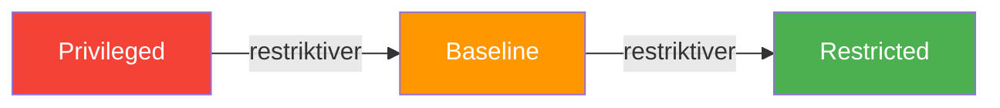
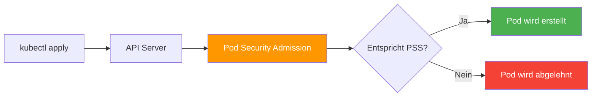

# Pod Security Standards

> [!ABSTRACT]
> Pod Security Standards (PSS) definieren drei Sicherheitsstufen für Pods — von uneingeschränkt bis maximal gehärtet. Die Pod Security Admission (PSA) setzt diese Standards auf Namespace-Ebene durch und ersetzt die veralteten Pod Security Policies.

---

## Warum Pod Security?

Standardmäßig können Pods in Kubernetes mit umfangreichen Rechten laufen — als Root, mit Host-Netzwerk, mit vollen Linux-Capabilities. Das ist praktisch für die Entwicklung, aber gefährlich in Produktion:

| Risiko | Was passieren kann |
|--------|-------------------|
| Container läuft als Root | Bei einem Container-Breakout hat der Angreifer Root-Rechte auf dem Node |
| Host-Netzwerk aktiviert | Container kann den gesamten Netzwerk-Traffic des Nodes sehen |
| Privilegierter Modus | Container hat fast vollständigen Zugriff auf den Host-Kernel |
| Capabilities nicht eingeschränkt | Container kann Netzwerk-Regeln ändern, Dateisysteme mounten, etc. |

> [!DANGER]
> Ein kompromittierter Container ohne Security-Einschränkungen kann den gesamten Node und potenziell den ganzen Cluster übernehmen. Pod Security ist keine optionale Maßnahme — es ist Pflicht.

---

## Die drei Sicherheitsstufen

Pod Security Standards definieren drei Profile, die aufeinander aufbauen:



### Privileged — Uneingeschränkt

Das `Privileged`-Profil erlaubt alles. Es gibt keinerlei Einschränkungen und existiert nur als expliziter Opt-out für System-Workloads:

| Was erlaubt ist | Typischer Einsatz |
|-----------------|-------------------|
| Privilegierter Modus | CNI-Plugins (Flannel, Calico, Cilium) |
| Host-Netzwerk, Host-PID, Host-IPC | kube-proxy, Monitoring-Agents |
| Alle Linux-Capabilities | Storage-Treiber, Device-Plugins |
| Root-User | Legacy-Anwendungen, die Root benötigen |
| Host-Pfad-Mounts | Node-Level-Logging, Storage-Provisioner |

> [!WARNING]
> `Privileged` sollte **nur** für System-Namespaces wie `kube-system` verwendet werden — niemals für Anwendungs-Workloads.

### Baseline — Offensichtliche Eskalationen blockieren

Das `Baseline`-Profil blockiert die gefährlichsten Konfigurationen, erlaubt aber gängige Workloads ohne Anpassung:

| Einschränkung | Was blockiert wird |
|---------------|-------------------|
| Kein privilegierter Modus | `privileged: true` wird abgelehnt |
| Kein Host-Netzwerk | `hostNetwork: true` nicht erlaubt |
| Kein Host-PID / Host-IPC | Isolation vom Host-Prozessbaum |
| Keine Host-Pfad-Mounts | `/var/run`, `/etc` des Hosts nicht mountbar |
| Eingeschränkte Capabilities | Nur DEFAULT-Set + `NET_BIND_SERVICE` |
| Keine Proc-Mount-Änderungen | `procMount` muss `Default` sein |
| Kein AppArmor-Override | Profile dürfen nicht deaktiviert werden |

**Geeignet für:** Die meisten Web-Anwendungen, APIs, Microservices — alles, was keine Host-Rechte braucht.

### Restricted — Maximale Härtung

Das `Restricted`-Profil erzwingt aktuelle Best Practices:

| Einschränkung | Was erzwungen wird |
|---------------|-------------------|
| **Alles aus Baseline** | Plus zusätzliche Härtung |
| Nicht als Root laufen | `runAsNonRoot: true` erforderlich |
| Kein Privilege Escalation | `allowPrivilegeEscalation: false` |
| Alle Capabilities droppen | `drop: ["ALL"]` muss gesetzt sein |
| Seccomp-Profil erforderlich | `RuntimeDefault` oder `Localhost` |
| Volume-Typen eingeschränkt | Nur `configMap`, `secret`, `emptyDir`, `pvc`, etc. |

> [!TIP]
> Das `Restricted`-Profil ist der Gold-Standard für Produktions-Workloads. Es erfordert, dass deine Container bewusst mit minimalen Rechten konfiguriert sind.

---

## Security Context — Die Pod-Konfiguration

Der **Security Context** ist das Feld im Pod-Manifest, in dem Sicherheitseinstellungen konfiguriert werden. Es gibt ihn auf zwei Ebenen:

### Pod-Level Security Context

Gilt für **alle Container** im Pod:

```yaml
apiVersion: v1
kind: Pod
metadata:
  name: secure-app
spec:
  securityContext:
    runAsUser: 1000
    runAsGroup: 3000
    fsGroup: 2000
    runAsNonRoot: true
    seccompProfile:
      type: RuntimeDefault
  containers:
    - name: app
      image: my-app:latest
```

### Container-Level Security Context

Gilt nur für den **einzelnen Container** und überschreibt Pod-Level-Einstellungen:

```yaml
containers:
  - name: app
    image: my-app:latest
    securityContext:
      allowPrivilegeEscalation: false
      readOnlyRootFilesystem: true
      capabilities:
        drop:
          - ALL
        add:
          - NET_BIND_SERVICE
```

### Alle Security Context Felder

| Feld | Ebene | Bedeutung |
|------|-------|-----------|
| `runAsUser` | Pod / Container | UID, unter der der Prozess läuft |
| `runAsGroup` | Pod / Container | GID des Prozesses |
| `runAsNonRoot` | Pod / Container | Kubernetes prüft, dass der Container nicht als UID 0 startet |
| `fsGroup` | Pod | Gruppe für gemountete Volumes |
| `supplementalGroups` | Pod | Zusätzliche Linux-Gruppen |
| `allowPrivilegeEscalation` | Container | Ob ein Prozess mehr Rechte erlangen darf als sein Parent |
| `readOnlyRootFilesystem` | Container | Root-Dateisystem nur lesbar |
| `capabilities.drop` | Container | Linux-Capabilities entfernen |
| `capabilities.add` | Container | Linux-Capabilities hinzufügen |
| `seccompProfile` | Pod / Container | Syscall-Filter-Profil |
| `seLinuxOptions` | Pod / Container | SELinux-Label zuweisen |
| `privileged` | Container | Voller Host-Zugriff (nur für System-Workloads!) |

---

## Pod Security Admission (PSA)

Die **Pod Security Admission** ist der eingebaute Admission Controller (stabil seit Kubernetes 1.25), der PSS auf Namespace-Ebene durchsetzt.

### So funktioniert PSA



### Enforcement Modes

PSA kennt drei Modi, die unabhängig voneinander pro Namespace gesetzt werden können:

| Modus | Label | Verhalten |
|-------|-------|-----------|
| **enforce** | `pod-security.kubernetes.io/enforce` | Pod wird **abgelehnt**, wenn er nicht dem Standard entspricht |
| **warn** | `pod-security.kubernetes.io/warn` | Pod wird erstellt, aber der Nutzer sieht eine **Warnung** |
| **audit** | `pod-security.kubernetes.io/audit` | Verstoß wird **geloggt**, Pod wird erstellt |

### Namespace labeln

```bash
# Restricted-Standard erzwingen
kubectl label namespace production \
  pod-security.kubernetes.io/enforce=restricted \
  pod-security.kubernetes.io/enforce-version=latest

# Baseline warnen, Restricted auditen
kubectl label namespace staging \
  pod-security.kubernetes.io/enforce=baseline \
  pod-security.kubernetes.io/warn=restricted \
  pod-security.kubernetes.io/audit=restricted

# System-Namespace auf Privileged setzen
kubectl label namespace kube-system \
  pod-security.kubernetes.io/enforce=privileged
```

> [!TIP]
> **Empfohlene Einführungsstrategie:** Starte mit `warn` und `audit` auf dem gewünschten Level. Analysiere die Warnungen und Audit-Logs. Passe deine Workloads an. Erst dann auf `enforce` umstellen.

### Verstoß-Beispiel

Wenn ein Pod ohne `runAsNonRoot: true` in einem `restricted`-Namespace erstellt wird:

```bash
$ kubectl apply -f insecure-pod.yaml -n production
Error from server (Forbidden): pods "insecure-app" is forbidden:
  violates PodSecurity "restricted:latest":
  allowPrivilegeEscalation != false
  (container "app" must set securityContext.allowPrivilegeEscalation=false),
  unrestricted capabilities
  (container "app" must set securityContext.capabilities.drop=["ALL"]),
  runAsNonRoot != true
  (pod or container "app" must set securityContext.runAsNonRoot=true)
```

---

## Ein sicherer Pod — Vollständiges Beispiel

Dieser Pod erfüllt das `Restricted`-Profil:

```yaml
apiVersion: v1
kind: Pod
metadata:
  name: hardened-app
  namespace: production
spec:
  securityContext:
    runAsNonRoot: true
    runAsUser: 1000
    runAsGroup: 1000
    fsGroup: 1000
    seccompProfile:
      type: RuntimeDefault
  automountServiceAccountToken: false
  containers:
    - name: app
      image: my-app:1.0
      securityContext:
        allowPrivilegeEscalation: false
        readOnlyRootFilesystem: true
        capabilities:
          drop:
            - ALL
      resources:
        limits:
          memory: "128Mi"
          cpu: "500m"
        requests:
          memory: "64Mi"
          cpu: "250m"
      volumeMounts:
        - name: tmp
          mountPath: /tmp
        - name: cache
          mountPath: /app/cache
  volumes:
    - name: tmp
      emptyDir: {}
    - name: cache
      emptyDir: {}
```

### Warum jedes Feld wichtig ist

| Einstellung | Warum |
|-------------|-------|
| `runAsNonRoot: true` | Container startet nicht als Root |
| `runAsUser: 1000` | Explizite UID statt Container-Default |
| `allowPrivilegeEscalation: false` | Prozesse können keine höheren Rechte erlangen |
| `readOnlyRootFilesystem: true` | Angreifer kann keine Dateien im Container ändern |
| `capabilities.drop: ["ALL"]` | Minimale Linux-Rechte |
| `seccompProfile: RuntimeDefault` | Syscall-Filter aktiv |
| `automountServiceAccountToken: false` | Kein API-Token im Container (wenn nicht benötigt) |
| `emptyDir` für `/tmp` | Beschreibbares Verzeichnis trotz readOnlyRootFilesystem |

---

## PSS in Deployments

Security Context gilt natürlich auch für Deployments — hier wird er im Pod-Template konfiguriert:

```yaml
apiVersion: apps/v1
kind: Deployment
metadata:
  name: secure-web
  namespace: production
spec:
  replicas: 3
  selector:
    matchLabels:
      app: secure-web
  template:
    metadata:
      labels:
        app: secure-web
    spec:
      securityContext:
        runAsNonRoot: true
        seccompProfile:
          type: RuntimeDefault
      containers:
        - name: web
          image: nginx:1.27-alpine
          securityContext:
            allowPrivilegeEscalation: false
            readOnlyRootFilesystem: true
            capabilities:
              drop:
                - ALL
          ports:
            - containerPort: 8080
          volumeMounts:
            - name: tmp
              mountPath: /tmp
            - name: cache
              mountPath: /var/cache/nginx
            - name: run
              mountPath: /var/run
      volumes:
        - name: tmp
          emptyDir: {}
        - name: cache
          emptyDir: {}
        - name: run
          emptyDir: {}
```

> [!NOTE]
> NGINX braucht standardmäßig Port 80 (Root erforderlich). Mit dem `nginx:alpine`-Image und Konfigurationsanpassung auf Port 8080 läuft es auch als Non-Root.

---

## Namespace-Strategie

Eine bewährte Strategie für verschiedene Umgebungen:

| Namespace | enforce | warn | audit | Begründung |
|-----------|---------|------|-------|------------|
| `kube-system` | privileged | — | — | System-Komponenten brauchen Host-Zugriff |
| `monitoring` | baseline | restricted | restricted | Monitoring-Agents brauchen teils Host-Zugriff |
| `staging` | baseline | restricted | restricted | Warnt vor Restricted-Verstößen |
| `production` | restricted | restricted | restricted | Maximale Härtung |
| `development` | baseline | baseline | restricted | Flexibel für Entwicklung |

```bash
# Alle Labels eines Namespace anzeigen
kubectl get namespace production --show-labels

# Label entfernen (falls nötig)
kubectl label namespace staging pod-security.kubernetes.io/enforce-
```

---

## Alternativen und Ergänzungen

PSA deckt die häufigsten Sicherheitsanforderungen ab. Für komplexere Policies gibt es externe Tools:

| Tool | Was es kann | Wann sinnvoll |
|------|------------|---------------|
| **OPA Gatekeeper** | Beliebige Policies als Rego-Code | Custom-Policies (z.B. "nur Images aus unserem Registry") |
| **Kyverno** | Policies als Kubernetes-YAML | Einfachere Alternative zu OPA, kein Rego nötig |
| **Falco** | Runtime-Erkennung verdächtiger Aktivitäten | Erkennt Angriffe zur Laufzeit (Syscall-Monitoring) |

> [!TIP]
> PSA und externe Policy-Engines ergänzen sich. PSA setzt grundlegende Standards durch, während OPA/Kyverno feinere Regeln hinzufügen (z.B. Image-Registry-Whitelisting, Label-Pflicht).

---

## Verwandte Notizen

- [[RBAC]] — Berechtigungen für Nutzer und ServiceAccounts
- [[Namespaces]] — PSA wird auf Namespace-Ebene konfiguriert
- [[Pods]] — Security Context im Pod-Manifest
- [[CRDs und Operators]] — OPA Gatekeeper und Kyverno nutzen CRDs
- [[Kubernetes Architektur]] — Admission Controller im API Server
- [[Docker Security und Hardening]] — Container-Hardening als Grundlage für Pod Security
