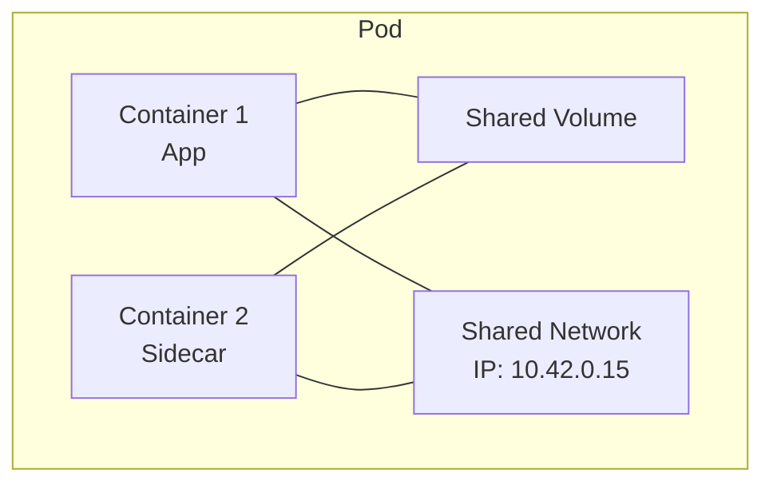
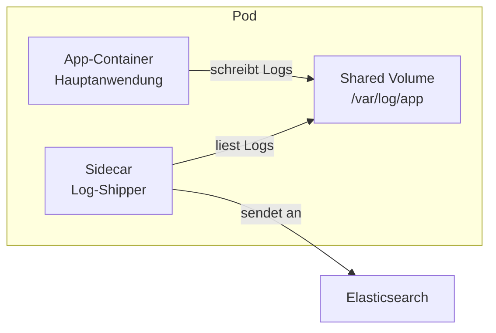
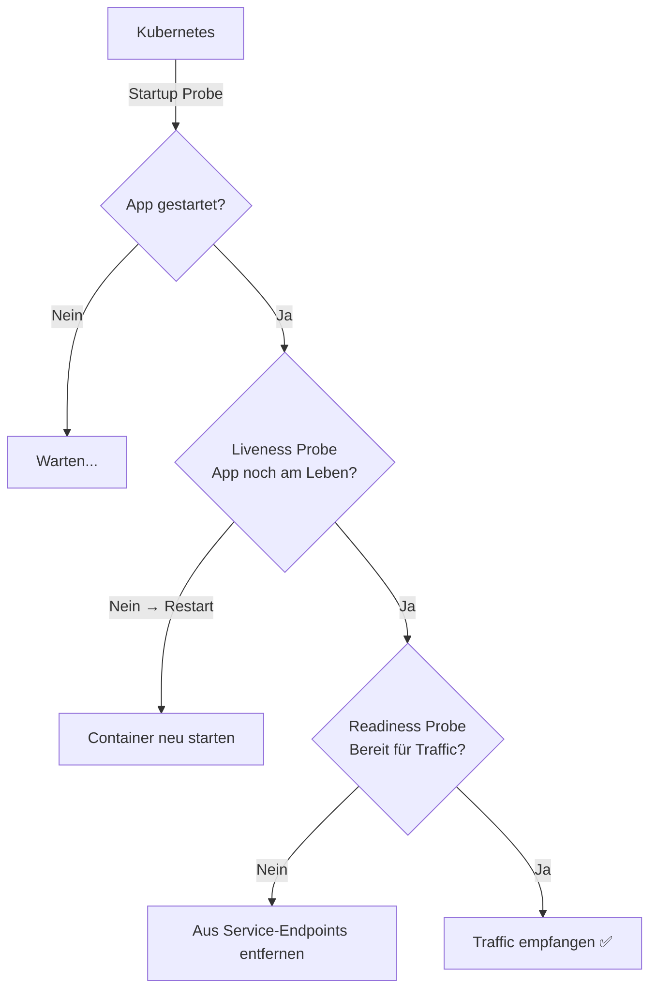

# Pods

> [!ABSTRACT]
> Ein Pod ist die kleinste deploybare Einheit in Kubernetes. Er kapselt einen oder mehrere Container, die sich Netzwerk und Storage teilen. Pods sind kurzlebig — sie werden erstellt, ausgeführt und verworfen.

---

## Was ist ein Pod?

In Docker startet man Container direkt — `docker run nginx` und fertig. In Kubernetes geht das nicht direkt: Container laufen immer **in einem Pod**. Ein Pod ist ein Wrapper um einen oder mehrere Container, der ihnen eine gemeinsame Umgebung gibt:

- **Gemeinsame IP-Adresse** — alle Container im Pod teilen sich eine IP
- **Gemeinsamer Netzwerk-Namespace** — Container können sich über `localhost` erreichen
- **Gemeinsame Volumes** — Storage kann zwischen Containern geteilt werden
- **Gemeinsamer Lifecycle** — alle Container starten und stoppen zusammen

Warum nicht einfach Container direkt starten? Weil Kubernetes zusätzliche Funktionen braucht, die über einen einzelnen Container hinausgehen: Health Checks, Restart-Policies, Resource-Limits und die Möglichkeit, mehrere zusammengehörige Container als Einheit zu verwalten.



> [!NOTE]
> In der Praxis läuft in den meisten Pods nur **ein einzelner Container**. Multi-Container-Pods werden für Sidecar-Patterns verwendet (z.B. Log-Shipper, Proxy, Monitoring Agent).

---

## Pod-Definition

Ein einfacher Pod wird als YAML-Manifest definiert:

```yaml
apiVersion: v1
kind: Pod
metadata:
  name: mein-pod
  namespace: default
  labels:
    app: meine-app
    environment: production
spec:
  containers:
    - name: web
      image: nginx:latest
      ports:
        - containerPort: 80
      resources:
        requests:
          memory: "64Mi"
          cpu: "250m"
        limits:
          memory: "128Mi"
          cpu: "500m"
```

```bash
# Pod erstellen
kubectl apply -f pod.yaml

# Pod-Status anzeigen
kubectl get pods

# Pod-Details anzeigen
kubectl describe pod mein-pod

# Pod löschen
kubectl delete pod mein-pod
```

> [!IMPORTANT]
> Pods sollten **nie direkt erstellt** werden. Stattdessen verwendet man Deployments, StatefulSets oder DaemonSets, die Pods verwalten und bei Ausfall automatisch neu erstellen.

---

## Container-Typen im Pod

### Anwendungs-Container

Der Haupt-Container, der die eigentliche Anwendung ausführt. Ein Pod kann mehrere Anwendungs-Container haben.

### Init-Container

Init-Container laufen **vor** den Anwendungs-Containern und müssen erfolgreich abschließen, bevor die Anwendung startet. Sie sind perfekt für Vorbereitungsaufgaben, die nur einmal beim Start nötig sind:

| Anwendungsfall | Was der Init-Container tut |
|---------------|---------------------------|
| Auf Datenbank warten | DNS-Lookup bis der DB-Service antwortet |
| Migration ausführen | Datenbank-Schema aktualisieren |
| Config herunterladen | Konfiguration von einem externen Service holen |
| Berechtigungen setzen | Volume-Verzeichnisse mit richtigen Rechten erstellen |

Init-Container laufen **sequentiell** — der zweite startet erst, wenn der erste erfolgreich beendet wurde. Schlägt ein Init-Container fehl, startet Kubernetes ihn neu (gemäß `restartPolicy`), und der Pod bleibt im Status `Init:0/1`.

```yaml
apiVersion: v1
kind: Pod
metadata:
  name: app-mit-init
spec:
  initContainers:
    - name: wait-for-db
      image: busybox:latest
      command: ['sh', '-c', 'until nslookup database.default.svc.cluster.local; do sleep 2; done']
  containers:
    - name: app
      image: meine-app:latest
```

### Sidecar-Container (ab K8s v1.28 stable)

Ein Sidecar ist ein Container, der **neben dem Haupt-Container** im selben Pod läuft und unterstützende Aufgaben übernimmt — z.B. Logs sammeln, Metriken exportieren oder als Proxy fungieren. Der Unterschied zum Init-Container: Sidecars laufen **dauerhaft**, nicht nur beim Start.

Seit Kubernetes v1.28 werden Sidecars als Init-Container mit `restartPolicy: Always` definiert. Sie starten vor dem Haupt-Container und laufen parallel mit ihm weiter:



```yaml
apiVersion: v1
kind: Pod
metadata:
  name: app-mit-sidecar
spec:
  containers:
    - name: app
      image: meine-app:latest
  # Sidecar als Init-Container mit restartPolicy: Always
  initContainers:
    - name: log-shipper
      image: fluentbit:latest
      restartPolicy: Always
      volumeMounts:
        - name: logs
          mountPath: /var/log/app
  volumes:
    - name: logs
      emptyDir: {}
```

---

## Pod Lifecycle

Ein Pod durchläuft verschiedene Phasen:

| Phase | Beschreibung |
|-------|-------------|
| **Pending** | Pod ist akzeptiert, aber Container werden noch erstellt |
| **Running** | Mindestens ein Container läuft |
| **Succeeded** | Alle Container haben erfolgreich beendet |
| **Failed** | Mindestens ein Container ist mit Fehler beendet |
| **Unknown** | Pod-Status konnte nicht ermittelt werden |

### Restart Policy

| Policy | Verhalten |
|--------|----------|
| `Always` | Container wird immer neu gestartet (Standard) |
| `OnFailure` | Nur bei Fehler-Exit-Code neu starten |
| `Never` | Niemals neu starten |

---

## Health Checks (Probes)

Woher weiß Kubernetes, ob ein Container tatsächlich funktioniert? Ein Container kann laufen (Prozess aktiv), aber trotzdem nicht richtig arbeiten — z.B. weil er in einem Deadlock hängt oder noch initialisiert. **Probes** sind automatische Gesundheitsüberprüfungen, die Kubernetes regelmäßig durchführt:



### Liveness Probe

Prüft, ob der Container noch **lebt**. Bei Fehlschlag wird der Container **neu gestartet**. Nützlich, um hängengebliebene Prozesse zu erkennen:

```yaml
livenessProbe:
  httpGet:
    path: /healthz
    port: 8080
  initialDelaySeconds: 15
  periodSeconds: 10
  failureThreshold: 3
```

### Readiness Probe

Prüft, ob der Container **bereit ist, Traffic zu empfangen**. Bei Fehlschlag wird der Pod aus den Service-Endpoints entfernt — er bekommt keinen Traffic mehr, wird aber **nicht** neu gestartet. Sobald die Probe wieder erfolgreich ist, wird er wieder aufgenommen:

```yaml
readinessProbe:
  httpGet:
    path: /ready
    port: 8080
  initialDelaySeconds: 5
  periodSeconds: 5
```

### Startup Probe

Manche Anwendungen brauchen lange zum Starten (z.B. Java-Apps mit Spring Boot). Ohne Startup Probe würde die Liveness Probe den Container als „tot" ansehen und ihn neu starten, bevor er überhaupt fertig initialisiert ist. Die **Startup Probe** verhindert das: Solange sie nicht erfolgreich ist, werden Liveness und Readiness Probes **nicht** ausgeführt:

```yaml
startupProbe:
  httpGet:
    path: /healthz
    port: 8080
  failureThreshold: 30
  periodSeconds: 10
```

### Probe-Methoden

| Methode | Beschreibung |
|---------|-------------|
| `httpGet` | HTTP GET-Request auf einen Endpunkt |
| `tcpSocket` | TCP-Verbindung zu einem Port |
| `exec` | Befehl im Container ausführen |
| `grpc` | gRPC Health Check |

---

## Ressourcen-Management

Jeder Container sollte Ressourcen-Anforderungen und Limits definieren:

```yaml
resources:
  requests:          # Mindest-Ressourcen (für Scheduling)
    memory: "128Mi"
    cpu: "250m"
  limits:            # Maximale Ressourcen
    memory: "256Mi"
    cpu: "500m"
```

| Einheit | Bedeutung |
|---------|-----------|
| `m` | Millicores (1000m = 1 CPU-Core) |
| `Mi` | Mebibyte (1 MiB = 1.048.576 Bytes) |
| `Gi` | Gibibyte (1 GiB = 1.073.741.824 Bytes) |

> [!WARNING]
> Ohne Limits kann ein einzelner Pod einen gesamten Node auslasten und andere Pods verdrängen. Definiere immer mindestens Memory-Limits.

---

## Pod Scheduling

Normalerweise entscheidet Kubernetes selbst, auf welchem Node ein Pod läuft (basierend auf verfügbaren Ressourcen). Manchmal braucht man aber mehr Kontrolle — z.B. wenn Pods auf Nodes mit SSDs, GPUs oder in einer bestimmten Availability Zone laufen sollen.

### Node Selector

Die **einfachste Form** der Node-Auswahl. Der Pod läuft nur auf Nodes mit dem passenden Label:

```yaml
spec:
  nodeSelector:
    disktype: ssd
```

### Node Affinity

Erweiterte und flexiblere Regeln für die Node-Auswahl. Anders als `nodeSelector` unterstützt Node Affinity Operatoren wie `In`, `NotIn`, `Exists` und kann zwischen **harten** (`required`) und **weichen** (`preferred`) Anforderungen unterscheiden:

```yaml
spec:
  affinity:
    nodeAffinity:
      requiredDuringSchedulingIgnoredDuringExecution:
        nodeSelectorTerms:
          - matchExpressions:
              - key: kubernetes.io/arch
                operator: In
                values:
                  - amd64
```

### Taints und Tolerations

Taints und Tolerations arbeiten umgekehrt wie Affinity: Statt Pods zu bestimmten Nodes zu **ziehen**, **stoßen** Taints Pods von Nodes ab. Ein Taint auf einem Node sagt: „Hier darf kein Pod hin — es sei denn, er hat eine passende Toleration."

Typisches Beispiel: Control Plane Nodes haben einen Taint `node-role.kubernetes.io/control-plane:NoSchedule`, damit keine normalen Workloads dort laufen. DaemonSets wie KubeVIP oder kube-proxy haben eine Toleration, die ihnen erlaubt, trotzdem dort zu laufen.

| Taint-Effekt | Verhalten |
|-------------|-----------|
| `NoSchedule` | Neue Pods werden nicht geplant (bestehende bleiben) |
| `PreferNoSchedule` | Kubernetes versucht es zu vermeiden, aber plant zur Not dort |
| `NoExecute` | Bestehende Pods werden entfernt, neue nicht geplant |

```bash
# Taint auf Node setzen
kubectl taint nodes worker-01 gpu=true:NoSchedule
```

```yaml
# Toleration im Pod
spec:
  tolerations:
    - key: "gpu"
      operator: "Equal"
      value: "true"
      effect: "NoSchedule"
```

---

## Verwandte Notizen

- [[Kubernetes Index]]
- [[Deployments und ReplicaSets]]
- [[Services]]
- [[ConfigMaps und Secrets]]
- [[Labels Selektoren und Annotations]]
- [[Docker Registries]] — Container-Images werden aus Docker Registries gezogen
