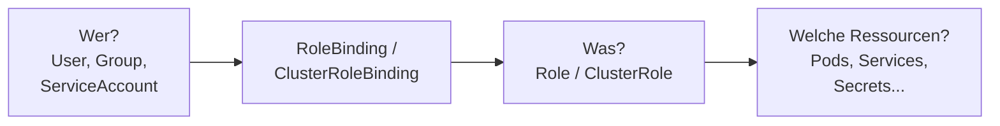
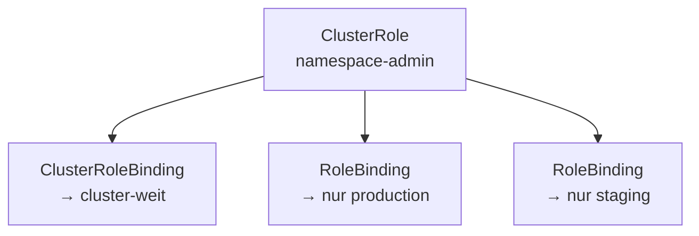
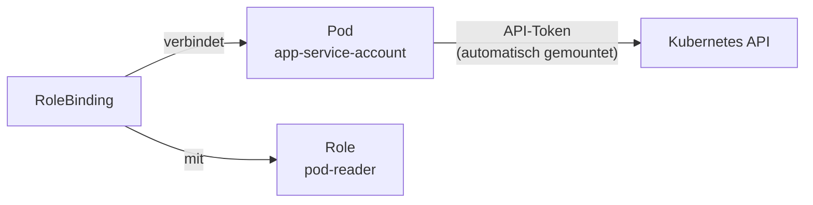

# RBAC

> [!ABSTRACT]
> Role-Based Access Control (RBAC) regelt, wer was im Kubernetes-Cluster tun darf. Über Roles, ClusterRoles, RoleBindings und ClusterRoleBindings werden Berechtigungen definiert und Benutzern oder ServiceAccounts zugewiesen.

---

## Was ist RBAC und warum braucht man es?

Standardmäßig kann in einem Kubernetes-Cluster jeder, der Zugang zum API-Server hat, **alles** tun — Pods löschen, Secrets lesen, Nodes verwalten. In einer produktiven Umgebung mit mehreren Benutzern, Teams oder Anwendungen ist das ein Sicherheitsrisiko.

**RBAC** (Role-Based Access Control) ist das Berechtigungssystem von Kubernetes. Es erlaubt, granular zu definieren, wer welche Aktionen auf welchen Ressourcen ausführen darf. Typische Szenarien:

- Ein **Entwickler** darf Pods und Logs in seinem Namespace ansehen, aber keine Secrets lesen
- Ein **CI/CD-System** (ServiceAccount) darf Deployments aktualisieren, aber keine Namespaces erstellen
- Ein **Monitoring-Tool** darf Metriken von allen Nodes lesen, aber nichts ändern
- Ein **Admin** hat volle Rechte auf den gesamten Cluster

RBAC ist in Kubernetes standardmäßig aktiviert und arbeitet nach dem **Deny-by-Default-Prinzip**: Ohne explizite Berechtigung hat ein Benutzer oder ServiceAccount *keine* Rechte.

---

## Grundkonzept

RBAC beantwortet die Frage: **Wer** darf **was** auf **welchen Ressourcen** tun?



| Komponente | Scope | Beschreibung |
|-----------|-------|-------------|
| **Role** | Namespace | Berechtigungen innerhalb eines Namespaces |
| **ClusterRole** | Cluster-weit | Berechtigungen über alle Namespaces |
| **RoleBinding** | Namespace | Bindet Role/ClusterRole an User im Namespace |
| **ClusterRoleBinding** | Cluster-weit | Bindet ClusterRole an User cluster-weit |

---

## Role und RoleBinding

### Role erstellen

Eine Role definiert Berechtigungen innerhalb eines Namespaces:

```yaml
apiVersion: rbac.authorization.k8s.io/v1
kind: Role
metadata:
  name: pod-reader
  namespace: production
rules:
  - apiGroups: [""]            # Core API (Pods, Services, etc.)
    resources: ["pods"]
    verbs: ["get", "list", "watch"]
  - apiGroups: [""]
    resources: ["pods/log"]
    verbs: ["get"]
```

### RoleBinding erstellen

```yaml
apiVersion: rbac.authorization.k8s.io/v1
kind: RoleBinding
metadata:
  name: read-pods
  namespace: production
subjects:
  - kind: User
    name: developer
    apiGroup: rbac.authorization.k8s.io
roleRef:
  kind: Role
  name: pod-reader
  apiGroup: rbac.authorization.k8s.io
```

---

## ClusterRole und ClusterRoleBinding

Eine **Role** gilt nur innerhalb eines Namespaces. Aber manche Berechtigungen gehen über Namespaces hinaus — z.B. Nodes verwalten, Namespaces erstellen oder alle Pods cluster-weit lesen. Dafür gibt es **ClusterRoles**.

Ein ClusterRole kann auf zwei Arten verwendet werden:
1. **Mit ClusterRoleBinding** → Die Berechtigungen gelten **cluster-weit** (alle Namespaces)
2. **Mit RoleBinding** → Die ClusterRole wird nur in **einem Namespace** angewendet (nützlich, um eine allgemeine Rolle in mehreren Namespaces wiederzuverwenden)



### ClusterRole erstellen

```yaml
apiVersion: rbac.authorization.k8s.io/v1
kind: ClusterRole
metadata:
  name: namespace-admin
rules:
  - apiGroups: [""]
    resources: ["namespaces"]
    verbs: ["get", "list", "watch", "create", "delete"]
  - apiGroups: ["apps"]
    resources: ["deployments", "replicasets"]
    verbs: ["*"]
  - apiGroups: [""]
    resources: ["pods", "services", "configmaps", "secrets"]
    verbs: ["*"]
```

### ClusterRoleBinding erstellen

```yaml
apiVersion: rbac.authorization.k8s.io/v1
kind: ClusterRoleBinding
metadata:
  name: admin-binding
subjects:
  - kind: User
    name: admin
    apiGroup: rbac.authorization.k8s.io
  - kind: Group
    name: cluster-admins
    apiGroup: rbac.authorization.k8s.io
roleRef:
  kind: ClusterRole
  name: cluster-admin         # Eingebaute ClusterRole
  apiGroup: rbac.authorization.k8s.io
```

---

## Verbs (Berechtigungen)

| Verb | HTTP-Methode | Beschreibung |
|------|-------------|-------------|
| `get` | GET | Einzelne Ressource lesen |
| `list` | GET | Ressourcen auflisten |
| `watch` | GET (streaming) | Änderungen beobachten |
| `create` | POST | Ressource erstellen |
| `update` | PUT | Ressource aktualisieren |
| `patch` | PATCH | Ressource teilweise aktualisieren |
| `delete` | DELETE | Ressource löschen |
| `deletecollection` | DELETE | Mehrere Ressourcen löschen |
| `*` | Alle | Alle Berechtigungen |

---

## ServiceAccounts

Wenn ein **Mensch** auf den Cluster zugreift, nutzt er ein User-Zertifikat oder einen kubeconfig-Token. Aber was ist mit **Pods**? Anwendungen im Cluster müssen oft selbst die Kubernetes API nutzen — z.B. ein Operator, der Deployments erstellt, oder ein Monitoring-Tool, das Pod-Metriken liest.

Dafür gibt es **ServiceAccounts**: Sie sind die Identität von Pods gegenüber der Kubernetes API. Jeder Pod läuft automatisch unter dem `default`-ServiceAccount seines Namespaces, der standardmäßig keine besonderen Rechte hat.



```yaml
apiVersion: v1
kind: ServiceAccount
metadata:
  name: app-service-account
  namespace: default
```

```yaml
# ServiceAccount im Pod verwenden
apiVersion: apps/v1
kind: Deployment
metadata:
  name: app
spec:
  template:
    spec:
      serviceAccountName: app-service-account
      containers:
        - name: app
          image: meine-app:latest
```

### ServiceAccount an Role binden

```yaml
apiVersion: rbac.authorization.k8s.io/v1
kind: RoleBinding
metadata:
  name: app-pod-reader
  namespace: default
subjects:
  - kind: ServiceAccount
    name: app-service-account
    namespace: default
roleRef:
  kind: Role
  name: pod-reader
  apiGroup: rbac.authorization.k8s.io
```

---

## Eingebaute ClusterRoles

Kubernetes liefert vordefinierte ClusterRoles:

| ClusterRole | Beschreibung |
|------------|-------------|
| `cluster-admin` | Vollzugriff auf alle Ressourcen |
| `admin` | Vollzugriff innerhalb eines Namespaces |
| `edit` | Lesen und Schreiben, aber kein RBAC |
| `view` | Nur Lesen |

```bash
# Eingebaute ClusterRoles anzeigen
kubectl get clusterroles | grep -E "^(cluster-admin|admin|edit|view)"

# Berechtigungen einer ClusterRole anzeigen
kubectl describe clusterrole view
```

---

## RBAC prüfen und debuggen

```bash
# Kann ein User eine Aktion ausführen?
kubectl auth can-i get pods --as developer
kubectl auth can-i delete deployments --as developer -n production

# Alle Berechtigungen eines Users prüfen
kubectl auth can-i --list --as developer -n production

# Wer hat Zugriff auf Secrets?
kubectl get rolebindings,clusterrolebindings --all-namespaces \
  -o jsonpath='{range .items[?(@.roleRef.name=="cluster-admin")]}{.subjects[*].name}{"\n"}{end}'
```

---

## Best Practices

| Praxis | Beschreibung |
|--------|-------------|
| Least Privilege | Nur die minimal nötigen Berechtigungen vergeben |
| Keine `cluster-admin` für Apps | ServiceAccounts nie an `cluster-admin` binden |
| Namespace-Isolation | Roles statt ClusterRoles wenn möglich |
| Audit Logging | API-Zugriffe protokollieren |
| Review | RBAC-Regeln regelmäßig überprüfen |
| Gruppen nutzen | Berechtigungen über Gruppen statt einzelne User |

---

## Verwandte Notizen

- [[Kubernetes Index]]
- [[Namespaces]]
- [[ConfigMaps und Secrets]]
- [[Kubernetes Architektur]]
