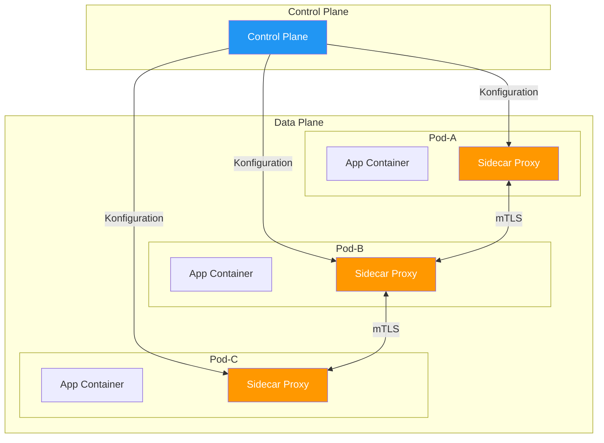
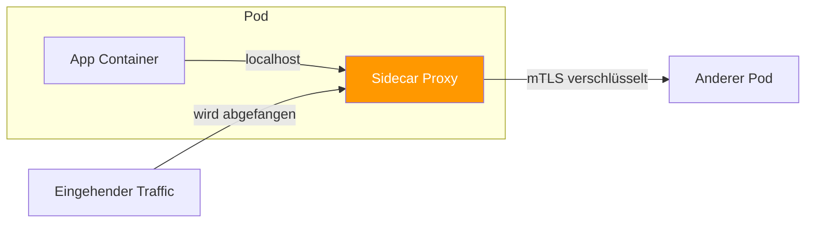
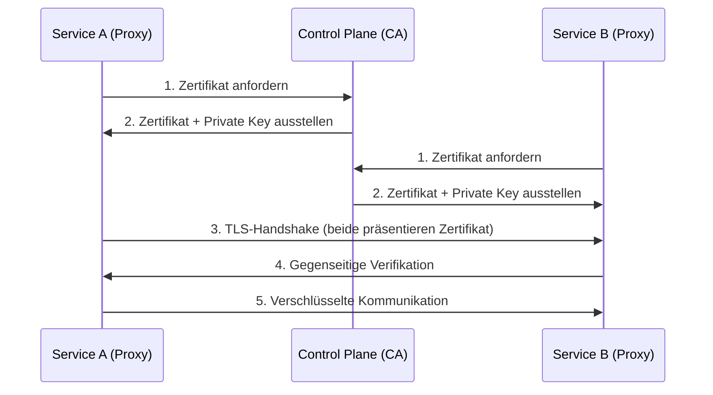
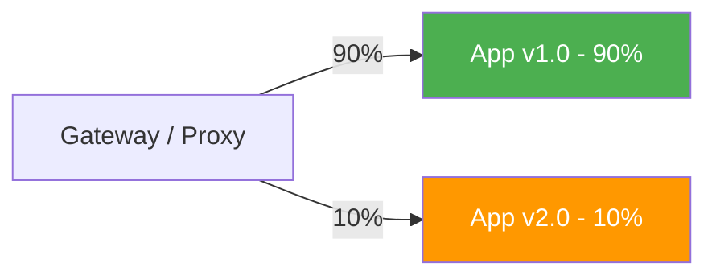
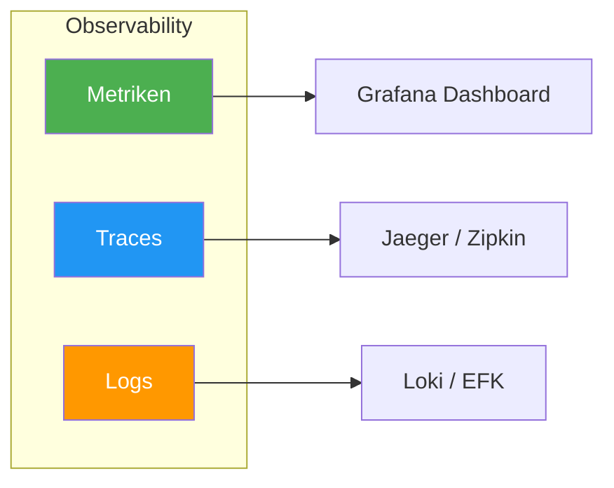
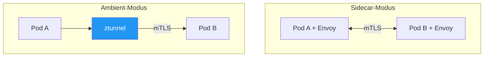

# Service Mesh

> [!ABSTRACT]
> Ein Service Mesh ist eine Infrastruktur-Schicht, die die Kommunikation zwischen Microservices transparent verwaltet. Es übernimmt Verschlüsselung (mTLS), Traffic-Management, Observability und Resilience — ohne dass der Anwendungscode angepasst werden muss.

---

## Warum braucht man ein Service Mesh?

In einer Microservice-Architektur kommunizieren Dutzende bis Hunderte Services miteinander. Dabei entstehen Herausforderungen, die jeder Service einzeln lösen müsste:

| Herausforderung | Ohne Service Mesh | Mit Service Mesh |
|-----------------|-------------------|------------------|
| **Verschlüsselung** | Jeder Service implementiert TLS selbst | mTLS automatisch zwischen allen Services |
| **Retry/Timeout** | Jeder Service implementiert Retry-Logik | Zentral konfiguriert im Mesh |
| **Load Balancing** | Einfaches Round-Robin über kube-proxy | Intelligentes L7-Balancing (Latenz, Fehlerrate) |
| **Observability** | Jeder Service instrumentiert sich selbst | Automatische Metriken, Traces, Logs |
| **Access Control** | Manuell über NetworkPolicies | Feingranulare Service-to-Service-Policies |
| **Traffic-Splitting** | Nicht möglich | Canary, Blue/Green, A/B-Testing |

> [!NOTE]
> Ein Service Mesh macht am meisten Sinn, wenn man **viele Services** hat, die miteinander kommunizieren. Für einen Cluster mit 5 einfachen Apps ist der Overhead oft zu hoch.

---

## Architektur: Data Plane und Control Plane

Jedes Service Mesh besteht aus zwei Schichten:



| Schicht | Aufgabe | Komponenten |
|---------|---------|-------------|
| **Data Plane** | Fängt den gesamten Netzwerk-Traffic ab und verarbeitet ihn | Sidecar-Proxies in jedem Pod (z.B. Envoy, linkerd2-proxy) |
| **Control Plane** | Konfiguriert die Proxies, verteilt Zertifikate, sammelt Telemetrie | Zentrale Management-Komponenten |

---

## Das Sidecar-Pattern

Das Sidecar-Pattern ist das Herzstück der meisten Service Meshes. Ein **Proxy-Container** wird automatisch in jeden Pod injiziert:



### Wie der Sidecar funktioniert

1. **Injection:** Beim Pod-Start wird der Proxy-Container automatisch hinzugefügt (über Admission Webhook)
2. **Traffic-Interception:** iptables-Regeln leiten allen ein- und ausgehenden Traffic durch den Proxy
3. **Transparenz:** Die Anwendung merkt nichts — sie kommuniziert weiterhin über normale HTTP/gRPC-Calls
4. **mTLS:** Der Proxy verschlüsselt automatisch den Traffic zum Ziel-Proxy

### Sidecar-Injection aktivieren

```bash
# Namespace für automatische Injection labeln (Istio)
kubectl label namespace my-app istio-injection=enabled

# Namespace für Linkerd
kubectl annotate namespace my-app linkerd.io/inject=enabled
```

> [!TIP]
> Die Injection passiert nur bei **neuen Pods**. Bestehende Pods müssen nach dem Labeln neu gestartet werden: `kubectl rollout restart deployment -n my-app`

---

## mTLS — Mutual TLS

Die wichtigste Funktion eines Service Mesh ist **mutual TLS** (mTLS): Beide Seiten einer Verbindung authentifizieren sich gegenseitig und verschlüsseln den Traffic.

### Wie mTLS funktioniert



### Unterschied TLS vs. mTLS

| Aspekt | Normales TLS | mTLS |
|--------|-------------|------|
| **Server-Authentifizierung** | Ja — Client prüft Server-Zertifikat | Ja |
| **Client-Authentifizierung** | Nein — Server vertraut jedem Client | Ja — Server prüft Client-Zertifikat |
| **Verschlüsselung** | Ja | Ja |
| **Identität** | Nur Server-Identität bekannt | Beide Identitäten bekannt |
| **Anwendungsfall** | Browser → Webserver (HTTPS) | Service → Service (Zero Trust) |

### Warum mTLS wichtig ist

Ohne mTLS kann jeder Pod im Cluster Traffic an jeden anderen Pod senden — und sich als beliebiger Service ausgeben. Mit mTLS:

- **Verschlüsselung:** Selbst wenn jemand den Cluster-Netzwerk-Traffic abfängt, ist er verschlüsselt
- **Authentifizierung:** Nur Services mit gültigem Zertifikat können kommunizieren
- **Identität:** Jeder Service hat eine kryptographisch verifizierte Identität (SPIFFE)
- **Rotation:** Zertifikate werden automatisch rotiert (typisch alle 24 Stunden)

---

## Traffic Management

Ein Service Mesh ermöglicht feingranulares Traffic-Routing ohne Änderungen am Code:

### Canary Deployments

Schrittweises Ausrollen einer neuen Version:



### Traffic-Splitting mit Istio

```yaml
apiVersion: networking.istio.io/v1beta1
kind: VirtualService
metadata:
  name: my-app
spec:
  hosts:
    - my-app
  http:
    - route:
        - destination:
            host: my-app
            subset: stable
          weight: 90
        - destination:
            host: my-app
            subset: canary
          weight: 10
---
apiVersion: networking.istio.io/v1beta1
kind: DestinationRule
metadata:
  name: my-app
spec:
  host: my-app
  subsets:
    - name: stable
      labels:
        version: v1
    - name: canary
      labels:
        version: v2
```

### Weitere Traffic-Features

| Feature | Beschreibung | Beispiel |
|---------|-------------|---------|
| **Retries** | Automatische Wiederholversuche bei Fehlern | 3 Retries bei 503-Fehlern |
| **Timeouts** | Maximale Wartezeit pro Request | 5 Sekunden Timeout |
| **Circuit Breaking** | Stoppt Traffic zu überlasteten Services | Max 100 offene Verbindungen |
| **Fault Injection** | Künstliche Fehler zum Testen | 10% der Requests mit 500er beantworten |
| **Mirror/Shadow** | Traffic kopieren ohne Auswirkung | Neue Version mithören lassen |
| **Header-basiertes Routing** | Routing nach HTTP-Headern | Beta-User auf neue Version leiten |

---

## Observability

Service Meshes generieren automatisch Telemetriedaten — ohne Code-Änderungen:

### Die drei Säulen



| Säule | Was man sieht | Tool |
|-------|--------------|------|
| **Metriken** | Requests/Sekunde, Latenz (p50, p95, p99), Fehlerrate, Erfolgsrate | Prometheus + Grafana |
| **Distributed Traces** | Vollständiger Pfad eines Requests durch alle beteiligten Services | Jaeger, Zipkin, Tempo |
| **Access Logs** | Detaillierte Protokolle jedes einzelnen Requests | Loki, EFK-Stack |

> [!TIP]
> Die **Golden Signals** (Rate, Errors, Duration) werden automatisch pro Service erfasst. Du siehst sofort, welcher Service Probleme macht — ohne ihn zu instrumentieren.

---

## Istio vs. Linkerd

Die zwei populärsten Service Meshes im Vergleich:

### Architektur-Unterschiede

| Aspekt | Istio | Linkerd |
|--------|-------|---------|
| **Proxy** | Envoy (C++, feature-reich) | linkerd2-proxy (Rust, ultra-leicht) |
| **Control Plane** | istiod (monolithisch, viele Features) | Modular (destination, identity, proxy-injector) |
| **Sidecar-Modus** | Classic Sidecar oder **Ambient Mesh** (sidecarless) | Nur Sidecar |
| **Ressourcenverbrauch** | Höher (~50-100 MB pro Proxy) | Niedriger (~20-30 MB pro Proxy) |
| **Lernkurve** | Steil (viele CRDs und Konzepte) | Flach (wenige Konfigurationsoptionen) |

### Feature-Vergleich

| Feature | Istio | Linkerd |
|---------|-------|---------|
| **mTLS** | Ja (SPIFFE, PeerAuthentication) | Ja (Zero-Config, standardmäßig an) |
| **Traffic-Splitting** | Ja (VirtualService, DestinationRule) | Ja (TrafficSplit, HTTPRoute) |
| **Retries/Timeouts** | Ja (umfangreich konfigurierbar) | Ja (ServiceProfile) |
| **Circuit Breaking** | Ja | Grundlegend |
| **Fault Injection** | Ja | Nein |
| **Header-basiertes Routing** | Ja | Begrenzt |
| **Multi-Cluster** | Ja (komplex) | Ja (einfacher) |
| **Wasm-Erweiterungen** | Ja (WebAssembly-Filter) | Nein |
| **Web UI** | Kiali (extern) | Viz (eingebaut) |
| **CNCF Status** | Graduated | Graduated |

### Istio Ambient Mesh

Istio bietet seit Version 1.24 den **Ambient Mesh** Modus als Alternative zu Sidecars:



| Aspekt | Sidecar | Ambient |
|--------|---------|---------|
| Proxy pro Pod | Ja | Nein |
| Proxy pro Node | Nein | Ja (ztunnel) |
| Ressourcenverbrauch | Hoch (pro Pod) | Niedrig (pro Node) |
| L7-Features | Sofort verfügbar | Waypoint-Proxy nötig |
| Komplexität | Einfacher zu verstehen | Neues Konzept |

### Wann welches Mesh?

| Szenario | Empfehlung | Begründung |
|----------|------------|------------|
| Kleine Teams, schneller Start | **Linkerd** | Minimaler Overhead, einfache Installation |
| Komplexe Routing-Anforderungen | **Istio** | VirtualService, DestinationRule, Fault Injection |
| Ressourcen-kritische Umgebungen | **Linkerd** oder **Istio Ambient** | Geringster Proxy-Overhead |
| Enterprise mit Custom-Policies | **Istio** | Wasm-Erweiterungen, feingranulare Policies |
| Multi-Cluster-Setups | Beide möglich | Istio mächtiger, Linkerd einfacher |

---

## Installation: Linkerd

```bash
# CLI installieren
curl -sL https://run.linkerd.io/install | sh

# Pre-Check
linkerd check --pre

# Control Plane installieren
linkerd install --crds | kubectl apply -f -
linkerd install | kubectl apply -f -

# Installation prüfen
linkerd check

# Viz-Dashboard installieren
linkerd viz install | kubectl apply -f -

# Namespace für Injection labeln
kubectl annotate namespace my-app linkerd.io/inject=enabled

# Bestehende Pods neu starten
kubectl rollout restart deployment -n my-app
```

---

## Installation: Istio

```bash
# istioctl installieren
curl -L https://istio.io/downloadIstio | sh -

# Demo-Profil installieren (für Evaluierung)
istioctl install --set profile=demo

# Oder minimales Profil für Produktion
istioctl install --set profile=minimal

# Namespace für Injection labeln
kubectl label namespace my-app istio-injection=enabled

# Bestehende Pods neu starten
kubectl rollout restart deployment -n my-app

# Installation prüfen
istioctl verify-install
```

---

## Brauche ich ein Service Mesh?

Ehrliche Entscheidungshilfe:

| Situation | Service Mesh? | Warum |
|-----------|:------------:|-------|
| 3-5 einfache Microservices | ❌ | Overhead zu hoch, [[Kubernetes Netzwerk\|NetworkPolicies]] reichen |
| 20+ Services mit Compliance-Anforderungen | ✅ | mTLS, Audit, Observability automatisch |
| Team ohne Kubernetes-Erfahrung | ❌ | Erst Kubernetes verstehen, dann Mesh |
| Zero-Trust-Anforderung | ✅ | mTLS ist die einfachste Lösung |
| Performance-kritische Workloads | ⚠️ | Latenz-Overhead beachten (1-3 ms pro Hop) |
| Multi-Tenant-Cluster | ✅ | Strikte Service-Isolation |

---

## Verwandte Notizen

- [[Kubernetes Netzwerk]] — Netzwerk-Grundlagen ohne Mesh
- [[Services]] — Kubernetes-Services als Basis
- [[Ingress und IngressRoutes]] — Ingress-Layer (ergänzend zum Mesh)
- [[Gateway API]] — Modernes Routing, teilweise überlappend
- [[RBAC]] — Kubernetes-native Autorisierung
- [[CRDs und Operators]] — Meshes nutzen CRDs für Konfiguration
- [[Monitoring und Logging]] — Observability-Stack
