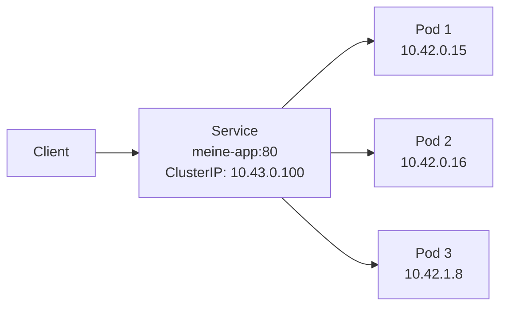
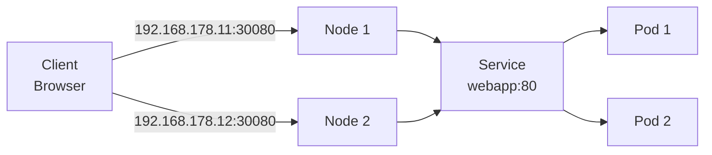
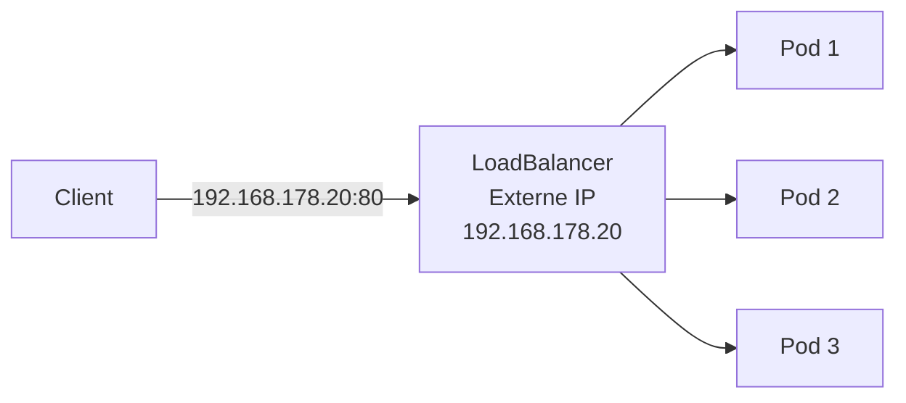
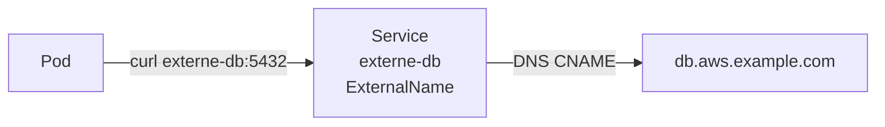
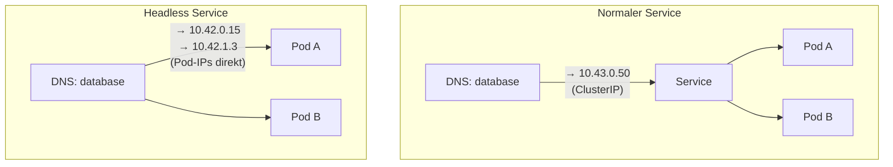

# Services

> [!ABSTRACT]
> Ein Kubernetes Service ist eine Abstraktion, die eine stabile Netzwerk-Adresse für eine Gruppe von Pods bereitstellt. Da Pods kurzlebig sind und ihre IP-Adressen sich ändern können, bieten Services eine zuverlässige Möglichkeit, auf Pods zuzugreifen.

---

## Warum Services?

Pods bekommen bei jedem Neustart eine neue IP-Adresse. Wenn eine Anwendung aus mehreren Teilen besteht (z.B. Frontend → Backend → Datenbank), kann man nicht einfach die Pod-IP fest verdrahten — sie ändert sich ständig.

Ein **Service** löst dieses Problem: Er stellt eine **feste IP-Adresse und einen DNS-Namen** bereit, die sich nie ändern. Egal wie viele Pods dahinter laufen, egal ob sie neu gestartet oder verschoben werden — der Service leitet den Traffic automatisch an die richtigen Pods weiter.



Der Service leitet Traffic automatisch an alle zugehörigen Pods weiter — unabhängig davon, auf welchem Node sie laufen.

---

## Service-Typen

### ClusterIP (Standard)

Der Service ist nur **innerhalb des Clusters** erreichbar. Idealer Standard für interne Kommunikation zwischen Microservices.

```yaml
apiVersion: v1
kind: Service
metadata:
  name: backend
  namespace: default
spec:
  type: ClusterIP
  selector:
    app: backend
  ports:
    - port: 80            # Port des Service
      targetPort: 8080    # Port des Containers
      protocol: TCP
```

```bash
# Innerhalb des Clusters erreichbar unter:
# backend.default.svc.cluster.local:80
# oder kurz: backend:80 (im gleichen Namespace)
```

### NodePort

Der Service wird auf einem **festen Port auf jedem Node** verfügbar gemacht. Damit kann man von außerhalb des Clusters direkt auf den Service zugreifen — über die IP eines beliebigen Nodes und den NodePort.



Der NodePort-Bereich liegt zwischen **30000–32767**. Kubernetes wählt automatisch einen freien Port, oder man kann ihn manuell setzen:

```yaml
apiVersion: v1
kind: Service
metadata:
  name: webapp
spec:
  type: NodePort
  selector:
    app: webapp
  ports:
    - port: 80
      targetPort: 8080
      nodePort: 30080     # Port-Bereich: 30000-32767
```

> [!NOTE]
> NodePort ist nützlich zum Testen oder wenn kein LoadBalancer verfügbar ist. Für Produktion sollte ein LoadBalancer oder Ingress verwendet werden, weil man sich bei NodePort die Node-IP und den hohen Port merken muss.

### LoadBalancer

Ein LoadBalancer-Service bekommt eine **eigene externe IP-Adresse**, über die er direkt erreichbar ist — wie eine öffentliche Adresse für den Service. Bei Cloud-Providern (AWS, Azure, GCP) wird automatisch ein Cloud-LB erstellt. On-Premise benötigt man eine Lösung wie [[KubeVIP]] oder MetalLB, die IPs aus einem Pool vergeben.



Technisch baut ein LoadBalancer auf NodePort auf — er erstellt intern auch einen NodePort, aber der eigentliche Zugriff erfolgt über die externe IP:

```yaml
apiVersion: v1
kind: Service
metadata:
  name: webapp
spec:
  type: LoadBalancer
  selector:
    app: webapp
  ports:
    - port: 80
      targetPort: 8080
  # Optionale statische IP (z.B. für KubeVIP/MetalLB)
  # loadBalancerIP: 192.168.178.20
```

> [!TIP]
> In der Praxis hat ein Cluster meist nur **einen oder wenige** LoadBalancer-Services — typischerweise für den Ingress Controller ([[Traefik Ingress Controller|Traefik]]). Alle anderen Services werden über Ingress-Regeln exponiert, statt jedem Service eine eigene IP zu geben.

### ExternalName

Ein ExternalName-Service ist anders als die anderen Typen: Er leitet **keinen Traffic weiter**, sondern erstellt nur einen **DNS-Alias** (CNAME-Eintrag) auf einen externen DNS-Namen. Damit kann man externe Dienste so ansprechen, als wären sie im Cluster:



```yaml
apiVersion: v1
kind: Service
metadata:
  name: externe-db
spec:
  type: ExternalName
  externalName: db.aws.example.com
```

Wann ist das nützlich? Wenn man z.B. eine Datenbank in der Cloud hat und die Pods im Cluster sie unter einem einfachen internen Namen ansprechen sollen. Ändert sich die externe Adresse, muss man nur den Service aktualisieren — nicht jede Anwendung.

---

## Service-Typen Vergleich

| Typ | Erreichbar von | Typischer Einsatz |
|-----|---------------|------------------|
| **ClusterIP** | Nur im Cluster | Interne Microservice-Kommunikation |
| **NodePort** | Extern via Node-IP | Entwicklung, Tests |
| **LoadBalancer** | Extern via LB-IP | Produktion (mit Ingress Controller) |
| **ExternalName** | Im Cluster (DNS) | Externe Dienste ansprechen |

---

## Selektoren und Endpoints

Services finden ihre Pods über **Label-Selektoren**:

```yaml
# Service
spec:
  selector:
    app: webapp    # ← Matcht Pods mit Label app=webapp

# Pod
metadata:
  labels:
    app: webapp    # ← Wird vom Service gefunden
```

```bash
# Endpoints eines Services anzeigen
kubectl get endpoints webapp

# EndpointSlice anzeigen (ab K8s v1.21 Standard)
kubectl get endpointslices -l kubernetes.io/service-name=webapp
```

---

## DNS und Service Discovery

Kubernetes erstellt automatisch DNS-Einträge für jeden Service:

```text
Format: <service>.<namespace>.svc.cluster.local

Beispiele:
  backend.default.svc.cluster.local
  database.production.svc.cluster.local
```

Innerhalb des gleichen Namespaces reicht der Service-Name:

```bash
# Im gleichen Namespace
curl http://backend:80

# In einem anderen Namespace
curl http://backend.production:80

# Vollständiger DNS-Name
curl http://backend.production.svc.cluster.local:80
```

---

## Headless Service

Ein normaler Service hat eine eigene ClusterIP — alle Anfragen gehen an diese eine IP und werden dann verteilt. Manchmal will man aber die **einzelnen Pods direkt ansprechen**, z.B. bei Datenbanken, wo jede Instanz eine andere Rolle hat (Primary, Replica).

Ein **Headless Service** (mit `clusterIP: None`) bekommt keine eigene IP. Stattdessen gibt eine DNS-Abfrage die **individuellen Pod-IPs** zurück:



```yaml
apiVersion: v1
kind: Service
metadata:
  name: database
spec:
  clusterIP: None      # ← Headless
  selector:
    app: database
  ports:
    - port: 5432
```

```bash
# DNS-Abfrage liefert individuelle Pod-IPs
nslookup database.default.svc.cluster.local
# → 10.42.0.15
# → 10.42.0.16
# → 10.42.1.8
```

---

## Multi-Port Services

Ein Service kann mehrere Ports exponieren:

```yaml
apiVersion: v1
kind: Service
metadata:
  name: webapp
spec:
  selector:
    app: webapp
  ports:
    - name: http
      port: 80
      targetPort: 8080
    - name: https
      port: 443
      targetPort: 8443
    - name: metrics
      port: 9090
      targetPort: 9090
```

> [!IMPORTANT]
> Bei mehreren Ports **muss** jeder Port einen `name` haben.

---

## Session Affinity

Standardmäßig verteilt Kubernetes Traffic per Round-Robin. Mit Session Affinity werden Anfragen eines Clients immer an den gleichen Pod geleitet:

```yaml
spec:
  sessionAffinity: ClientIP
  sessionAffinityConfig:
    clientIP:
      timeoutSeconds: 10800    # 3 Stunden
```

---

## Verwandte Notizen

- [[Pods]]
- [[Ingress und IngressRoutes]]
- [[Deployments und ReplicaSets]]
- [[Labels Selektoren und Annotations]]
- [[Traefik Ingress Controller]]
