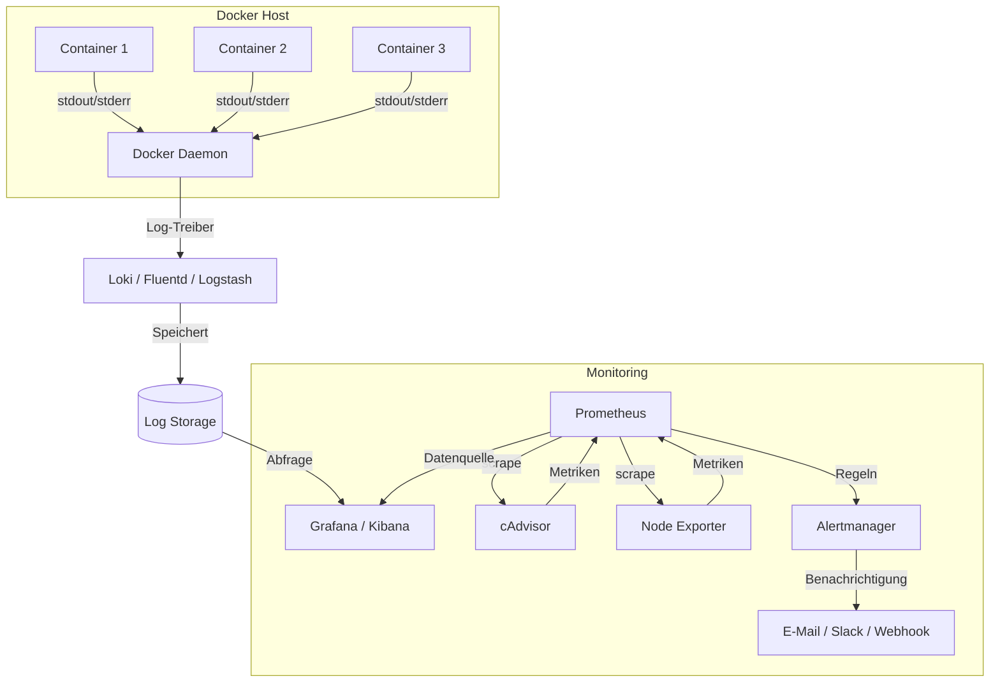

# Docker Monitoring und Logging

> [!ABSTRACT] Zusammenfassung
> Übersicht über alle relevanten Monitoring- und Logging-Strategien für Docker-Umgebungen — von eingebauten CLI-Tools über Log-Rotation und zentrale Log-Aggregation mit Loki/ELK bis hin zu vollständigen Monitoring-Stacks mit Prometheus, Grafana und cAdvisor inkl. Alerting.

---

## Eingebaute Tools

Docker bringt mehrere CLI-Werkzeuge mit, die ohne zusätzliche Software einen schnellen Überblick über den Zustand von Containern liefern.

### docker stats

Zeigt Echtzeit-Ressourcenverbrauch aller laufenden Container:

```bash
# Live-Ansicht aller Container
docker stats

# Einzelnen Container überwachen
docker stats mein-container

# Einmalige Momentaufnahme (kein Stream)
docker stats --no-stream

# Benutzerdefiniertes Format
docker stats --format "table {{.Name}}\t{{.CPUPerc}}\t{{.MemUsage}}\t{{.NetIO}}"
```

| Spalte | Beschreibung |
|--------|-------------|
| `CPU %` | CPU-Auslastung in Prozent |
| `MEM USAGE / LIMIT` | Genutzter / maximal verfügbarer RAM |
| `MEM %` | RAM-Auslastung in Prozent |
| `NET I/O` | Netzwerk-Traffic (empfangen / gesendet) |
| `BLOCK I/O` | Festplatten-I/O (gelesen / geschrieben) |
| `PIDS` | Anzahl aktiver Prozesse im Container |

### docker logs

Zugriff auf die Standardausgabe (stdout/stderr) eines Containers:

```bash
# Alle Logs anzeigen
docker logs mein-container

# Letzte 100 Zeilen
docker logs --tail 100 mein-container

# Live-Stream (wie tail -f)
docker logs -f mein-container

# Logs mit Zeitstempel
docker logs -t mein-container

# Logs seit einem Zeitpunkt
docker logs --since 2025-01-01T10:00:00 mein-container

# Logs der letzten 30 Minuten
docker logs --since 30m mein-container

# Kombination: Letzte 50 Zeilen + Live-Follow mit Timestamp
docker logs --tail 50 -f -t mein-container
```

### docker events

Überwacht Docker-Daemon-Events in Echtzeit:

```bash
# Alle Events streamen
docker events

# Events filtern nach Typ
docker events --filter type=container
docker events --filter event=start
docker events --filter event=die

# Events seit einem Zeitpunkt
docker events --since "2025-01-01T00:00:00"

# JSON-Ausgabe für Weiterverarbeitung
docker events --format '{{json .}}'
```

### docker system df

Zeigt den Speicherverbrauch der Docker-Ressourcen:

```bash
# Übersicht
docker system df

# Detaillierte Ansicht
docker system df -v
```

> [!TIP] Schnelldiagnose
> Für eine schnelle Fehlersuche reicht oft die Kombination aus `docker stats --no-stream` (Ressourcen) und `docker logs --tail 50 <container>` (Fehlerausgabe). Für tiefergehende Analyse sollte ein zentrales Logging eingerichtet werden.

---

## Logging-Treiber

Docker unterstützt verschiedene Logging-Treiber, die bestimmen, wohin Container-Logs geschrieben werden.

### Übersicht der Logging-Treiber

| Treiber | Ziel | Log-Rotation | `docker logs` | Einsatzzweck |
|---------|------|:------------:|:-------------:|-------------|
| `json-file` | Lokale JSON-Dateien | ✅ (konfigurierbar) | ✅ | Standard, Entwicklung, kleine Setups |
| `local` | Lokale optimierte Dateien | ✅ (automatisch) | ✅ | Performanter als json-file |
| `syslog` | Syslog-Daemon | ❌ | ❌ | Linux-Integration, rsyslog |
| `journald` | systemd-Journal | ❌ | ✅ | Systemd-basierte Hosts |
| `fluentd` | Fluentd-Collector | ❌ | ❌ | Zentrales Logging (EFK-Stack) |
| `gelf` | Graylog (GELF-Format) | ❌ | ❌ | Graylog-Umgebungen |
| `awslogs` | AWS CloudWatch | ❌ | ❌ | AWS-Deployments |
| `splunk` | Splunk HTTP Event Collector | ❌ | ❌ | Enterprise Splunk |
| `none` | Keine Logs | ❌ | ❌ | Log-Unterdrückung |

> [!WARNING] `docker logs` Kompatibilität
> Nur die Treiber `json-file`, `local` und `journald` unterstützen den Befehl `docker logs`. Bei allen anderen Treibern müssen die Logs direkt am Ziel abgerufen werden.

### Logging-Treiber konfigurieren

**Global in `/etc/docker/daemon.json`:**

```json
{
  "log-driver": "json-file",
  "log-opts": {
    "max-size": "10m",
    "max-file": "3",
    "labels": "environment,service",
    "tag": "{{.Name}}/{{.ID}}"
  }
}
```

**Pro Container:**

```bash
docker run -d \
  --log-driver=json-file \
  --log-opt max-size=10m \
  --log-opt max-file=5 \
  --name mein-service \
  nginx:alpine
```

**In Docker Compose:**

```yaml
services:
  webapp:
    image: nginx:alpine
    logging:
      driver: json-file
      options:
        max-size: "10m"
        max-file: "3"
        tag: "{{.Name}}"
```

> [!IMPORTANT] Daemon-Neustart erforderlich
> Nach Änderungen an `/etc/docker/daemon.json` muss der Docker-Daemon neu gestartet werden:
> ```bash
> sudo systemctl restart docker
> ```
> Bestehende Container übernehmen die neue Konfiguration **nicht** — nur neu erstellte Container.

---

## Log-Rotation

Ohne konfigurierte Log-Rotation wachsen Container-Logs unbegrenzt und können die Festplatte füllen.

### json-file Log-Rotation konfigurieren

**Empfohlene daemon.json für Produktionsumgebungen:**

```json
{
  "log-driver": "json-file",
  "log-opts": {
    "max-size": "20m",
    "max-file": "5",
    "compress": "true"
  }
}
```

| Option | Beschreibung | Empfehlung |
|--------|-------------|------------|
| `max-size` | Maximale Größe pro Log-Datei | `10m` – `50m` |
| `max-file` | Maximale Anzahl Log-Dateien | `3` – `5` |
| `compress` | GZIP-Komprimierung rotierter Dateien | `true` |

> [!DANGER] Festplatte volllaufen
> Ohne `max-size` und `max-file` wächst die Log-Datei unter `/var/lib/docker/containers/<id>/<id>-json.log` unbegrenzt. Ein einzelner Container mit hohem Log-Volumen kann das gesamte Dateisystem füllen und den Host zum Stillstand bringen.

### Aktuelle Log-Größen prüfen

```bash
# Log-Größe aller Container anzeigen
sudo du -sh /var/lib/docker/containers/*/*-json.log | sort -rh

# Logs eines einzelnen Containers manuell leeren (Notfall)
sudo truncate -s 0 /var/lib/docker/containers/<container-id>/<container-id>-json.log
```

### local-Treiber als Alternative

Der `local`-Treiber rotiert automatisch und ist performanter:

```json
{
  "log-driver": "local",
  "log-opts": {
    "max-size": "10m",
    "max-file": "3"
  }
}
```

> [!NOTE] local vs. json-file
> Der `local`-Treiber nutzt ein kompakteres internes Format und komprimiert automatisch. Er unterstützt `docker logs`, ist aber nicht so einfach mit externen Tools zu parsen wie `json-file`.

---

## Zentrales Logging

Für Umgebungen mit mehreren Containern oder Hosts ist ein zentrales Logging-System unverzichtbar.

### Monitoring-Architektur



### Loki + Grafana Stack

Loki ist ein von Grafana Labs entwickeltes Log-Aggregationssystem, das sich nahtlos in Grafana integriert. Im Vergleich zum ELK-Stack ist es deutlich ressourcenschonender.

```yaml
# docker-compose.logging.yml
services:
  loki:
    image: grafana/loki:latest
    container_name: loki
    ports:
      - "3100:3100"
    volumes:
      - loki-data:/loki
    command: -config.file=/etc/loki/local-config.yaml
    restart: unless-stopped

  promtail:
    image: grafana/promtail:latest
    container_name: promtail
    volumes:
      - /var/log:/var/log:ro
      - /var/lib/docker/containers:/var/lib/docker/containers:ro
      - /var/run/docker.sock:/var/run/docker.sock:ro
      - ./promtail-config.yml:/etc/promtail/config.yml
    command: -config.file=/etc/promtail/config.yml
    depends_on:
      - loki
    restart: unless-stopped

  grafana:
    image: grafana/grafana:latest
    container_name: grafana
    ports:
      - "3000:3000"
    environment:
      - GF_SECURITY_ADMIN_PASSWORD=sicheres-passwort
    volumes:
      - grafana-data:/var/lib/grafana
    depends_on:
      - loki
    restart: unless-stopped

volumes:
  loki-data:
  grafana-data:
```

**Promtail-Konfiguration (`promtail-config.yml`):**

```yaml
server:
  http_listen_port: 9080

positions:
  filename: /tmp/positions.yaml

clients:
  - url: http://loki:3100/loki/api/v1/push

scrape_configs:
  - job_name: docker
    static_configs:
      - targets:
          - localhost
        labels:
          job: docker
          __path__: /var/lib/docker/containers/*/*-json.log
    pipeline_stages:
      - docker: {}
      - labeldrop:
          - filename
```

### Alternativ: Docker-Plugin für Loki

```bash
# Loki Docker-Logging-Plugin installieren
docker plugin install grafana/loki-docker-driver:latest --alias loki --grant-all-permissions

# Container mit Loki-Treiber starten
docker run -d \
  --log-driver=loki \
  --log-opt loki-url="http://localhost:3100/loki/api/v1/push" \
  --log-opt loki-batch-size=100 \
  --name webapp \
  nginx:alpine
```

### ELK/EFK Stack — Überblick

| Komponente | ELK-Stack | EFK-Stack |
|------------|-----------|-----------|
| **Log-Collector** | Logstash | Fluentd / Fluent Bit |
| **Speicher** | Elasticsearch | Elasticsearch |
| **UI** | Kibana | Kibana |
| **RAM-Bedarf** | Hoch (4+ GB) | Mittel (2+ GB) |
| **Einsatz** | Enterprise, komplexe Pipelines | Kubernetes, Cloud-native |

> [!TIP] Loki vs. ELK
> Für Homelab- und kleinere Produktionsumgebungen ist **Loki + Grafana** die bessere Wahl: weniger RAM-Verbrauch, einfachere Konfiguration und native Grafana-Integration. ELK eignet sich für große Umgebungen mit komplexen Log-Parsing-Anforderungen.

---

## Container-Monitoring

### cAdvisor

cAdvisor (Container Advisor) von Google liefert detaillierte Metriken über Ressourcenverbrauch und Performance laufender Container.

```bash
docker run -d \
  --name cadvisor \
  --privileged \
  -p 8080:8080 \
  -v /:/rootfs:ro \
  -v /var/run:/var/run:ro \
  -v /sys:/sys:ro \
  -v /var/lib/docker/:/var/lib/docker:ro \
  gcr.io/cadvisor/cadvisor:latest
```

Das Web-Interface ist unter `http://<host>:8080` erreichbar und zeigt:

- CPU-, RAM-, Netzwerk- und Disk-Metriken pro Container
- Historische Daten (bis zu 60 Sekunden im Speicher)
- Prometheus-kompatible Metriken unter `/metrics`

### Prometheus + Node Exporter + cAdvisor

Prometheus sammelt Metriken per Pull-Modell (Scraping) und speichert sie als Zeitreihendaten.

**Prometheus-Konfiguration (`prometheus.yml`):**

```yaml
global:
  scrape_interval: 15s
  evaluation_interval: 15s

scrape_configs:
  # Prometheus eigene Metriken
  - job_name: "prometheus"
    static_configs:
      - targets: ["localhost:9090"]

  # Docker-Host-Metriken
  - job_name: "node-exporter"
    static_configs:
      - targets: ["node-exporter:9100"]

  # Container-Metriken
  - job_name: "cadvisor"
    static_configs:
      - targets: ["cadvisor:8080"]

  # Docker-Daemon-Metriken (wenn aktiviert)
  - job_name: "docker"
    static_configs:
      - targets: ["host.docker.internal:9323"]
```

**Docker-Daemon Metriken aktivieren (`/etc/docker/daemon.json`):**

```json
{
  "metrics-addr": "0.0.0.0:9323",
  "experimental": true
}
```

### Grafana Dashboards

Nach der Einrichtung von Prometheus als Datenquelle in Grafana können vorgefertigte Dashboards importiert werden:

| Dashboard | Grafana ID | Beschreibung |
|-----------|:----------:|-------------|
| Docker Container Monitoring | `893` | CPU, RAM, Netzwerk pro Container |
| Node Exporter Full | `1860` | Host-Metriken (CPU, RAM, Disk, Netzwerk) |
| cAdvisor Exporter | `14282` | Detaillierte Container-Metriken |
| Docker Prometheus Monitoring | `179` | Docker-Daemon-Metriken |

```bash
# Dashboard importieren — in Grafana:
# 1. Linke Sidebar → Dashboards → Import
# 2. Dashboard-ID eingeben (z.B. 893)
# 3. Prometheus als Datenquelle auswählen
# 4. Import klicken
```

---

## Docker Compose Monitoring-Stack

Vollständiger Monitoring-Stack mit Prometheus, Grafana, cAdvisor und Node Exporter:

```yaml
# docker-compose.monitoring.yml
services:
  prometheus:
    image: prom/prometheus:latest
    container_name: prometheus
    ports:
      - "9090:9090"
    volumes:
      - ./prometheus.yml:/etc/prometheus/prometheus.yml:ro
      - ./alert-rules.yml:/etc/prometheus/alert-rules.yml:ro
      - prometheus-data:/prometheus
    command:
      - "--config.file=/etc/prometheus/prometheus.yml"
      - "--storage.tsdb.retention.time=30d"
      - "--web.enable-lifecycle"
    restart: unless-stopped

  grafana:
    image: grafana/grafana:latest
    container_name: grafana
    ports:
      - "3000:3000"
    environment:
      - GF_SECURITY_ADMIN_USER=admin
      - GF_SECURITY_ADMIN_PASSWORD=sicheres-passwort
      - GF_INSTALL_PLUGINS=grafana-clock-panel,grafana-piechart-panel
    volumes:
      - grafana-data:/var/lib/grafana
    depends_on:
      - prometheus
    restart: unless-stopped

  cadvisor:
    image: gcr.io/cadvisor/cadvisor:latest
    container_name: cadvisor
    privileged: true
    ports:
      - "8080:8080"
    volumes:
      - /:/rootfs:ro
      - /var/run:/var/run:ro
      - /sys:/sys:ro
      - /var/lib/docker/:/var/lib/docker:ro
    restart: unless-stopped

  node-exporter:
    image: prom/node-exporter:latest
    container_name: node-exporter
    ports:
      - "9100:9100"
    volumes:
      - /proc:/host/proc:ro
      - /sys:/host/sys:ro
      - /:/rootfs:ro
    command:
      - "--path.procfs=/host/proc"
      - "--path.sysfs=/host/sys"
      - "--path.rootfs=/rootfs"
      - "--collector.filesystem.mount-points-exclude=^/(sys|proc|dev|host|etc)($$|/)"
    restart: unless-stopped

volumes:
  prometheus-data:
  grafana-data:
```

**Stack starten:**

```bash
# Monitoring-Stack starten
docker compose -f docker-compose.monitoring.yml up -d

# Status prüfen
docker compose -f docker-compose.monitoring.yml ps

# Logs verfolgen
docker compose -f docker-compose.monitoring.yml logs -f
```

> [!NOTE] Erreichbare Endpoints
> Nach dem Start sind folgende UIs verfügbar:
> - **Grafana:** `http://<host>:3000` (admin / sicheres-passwort)
> - **Prometheus:** `http://<host>:9090`
> - **cAdvisor:** `http://<host>:8080`
> - **Node Exporter Metriken:** `http://<host>:9100/metrics`

---

## Health Checks

Health Checks ermöglichen es Docker, den Gesundheitszustand eines Containers aktiv zu überwachen und bei Problemen automatisch zu reagieren.

### HEALTHCHECK im Dockerfile

```dockerfile
FROM nginx:alpine

# Einfacher HTTP Health Check
HEALTHCHECK --interval=30s --timeout=5s --start-period=10s --retries=3 \
  CMD wget --no-verbose --tries=1 --spider http://localhost:80/ || exit 1
```

| Parameter | Beschreibung | Standard |
|-----------|-------------|----------|
| `--interval` | Prüfintervall | `30s` |
| `--timeout` | Maximale Wartezeit auf Antwort | `30s` |
| `--start-period` | Karenzzeit nach Container-Start | `0s` |
| `--retries` | Fehlversuche bis `unhealthy` | `3` |

### Health Check in Docker Compose

```yaml
services:
  webapp:
    image: nginx:alpine
    healthcheck:
      test: ["CMD", "wget", "--no-verbose", "--tries=1", "--spider", "http://localhost:80/"]
      interval: 30s
      timeout: 5s
      start_period: 10s
      retries: 3

  postgres:
    image: postgres:16-alpine
    environment:
      POSTGRES_PASSWORD: geheim
    healthcheck:
      test: ["CMD-SHELL", "pg_isready -U postgres"]
      interval: 10s
      timeout: 5s
      retries: 5

  redis:
    image: redis:alpine
    healthcheck:
      test: ["CMD", "redis-cli", "ping"]
      interval: 10s
      timeout: 3s
      retries: 3
```

### Health-Status überwachen

```bash
# Health-Status eines Containers anzeigen
docker inspect --format='{{.State.Health.Status}}' mein-container

# Alle Container mit Health-Status auflisten
docker ps --format "table {{.Names}}\t{{.Status}}"

# Health-Check-Logs einsehen
docker inspect --format='{{json .State.Health}}' mein-container | jq .

# Nur unhealthy Container anzeigen
docker ps --filter health=unhealthy
```

Die drei möglichen Health-Zustände:

| Status | Bedeutung |
|--------|-----------|
| `starting` | Container gestartet, innerhalb der `start_period` |
| `healthy` | Health Check erfolgreich bestanden |
| `unhealthy` | Anzahl `retries` überschritten, Container gilt als krank |

> [!WARNING] Health Checks und Restart Policy
> Ein `unhealthy`-Status allein startet den Container **nicht** automatisch neu. Dafür muss zusätzlich `restart: unless-stopped` oder `restart: on-failure` gesetzt sein. In Docker Swarm werden unhealthy Container automatisch ersetzt.

### Abhängigkeiten mit Health Checks

```yaml
services:
  db:
    image: postgres:16-alpine
    healthcheck:
      test: ["CMD-SHELL", "pg_isready -U postgres"]
      interval: 5s
      timeout: 3s
      retries: 5

  webapp:
    image: meine-app:latest
    depends_on:
      db:
        condition: service_healthy
```

> [!TIP] Best Practice
> `depends_on` mit `condition: service_healthy` stellt sicher, dass ein abhängiger Service erst startet, wenn die Datenbank tatsächlich bereit ist — nicht nur wenn der Container läuft.

---

## Alerting

### Prometheus Alertmanager

Der Alertmanager empfängt Alerts von Prometheus und leitet sie über verschiedene Kanäle weiter (E-Mail, Slack, Webhook, PagerDuty etc.).

**Alertmanager zum Monitoring-Stack hinzufügen:**

```yaml
# In docker-compose.monitoring.yml ergänzen
  alertmanager:
    image: prom/alertmanager:latest
    container_name: alertmanager
    ports:
      - "9093:9093"
    volumes:
      - ./alertmanager.yml:/etc/alertmanager/alertmanager.yml:ro
    command:
      - "--config.file=/etc/alertmanager/alertmanager.yml"
    restart: unless-stopped
```

**Alertmanager-Konfiguration (`alertmanager.yml`):**

```yaml
global:
  resolve_timeout: 5m

route:
  group_by: ["alertname", "severity"]
  group_wait: 30s
  group_interval: 5m
  repeat_interval: 4h
  receiver: "default"

  routes:
    - match:
        severity: critical
      receiver: "critical-alerts"
      repeat_interval: 1h

receivers:
  - name: "default"
    webhook_configs:
      - url: "http://webhook-service:5000/alert"

  - name: "critical-alerts"
    email_configs:
      - to: "admin@example.com"
        from: "alertmanager@example.com"
        smarthost: "smtp.example.com:587"
        auth_username: "alertmanager@example.com"
        auth_password: "smtp-passwort"
```

**Prometheus mit Alertmanager verbinden (`prometheus.yml` ergänzen):**

```yaml
alerting:
  alertmanagers:
    - static_configs:
        - targets:
            - "alertmanager:9093"

rule_files:
  - "alert-rules.yml"
```

### Wichtige Alert-Regeln

**Alert-Regeln Datei (`alert-rules.yml`):**

```yaml
groups:
  - name: container-alerts
    rules:
      # Container ist gestoppt / nicht erreichbar
      - alert: ContainerDown
        expr: absent(container_last_seen{name=~".+"})
        for: 1m
        labels:
          severity: critical
        annotations:
          summary: "Container {{ $labels.name }} ist down"
          description: "Container {{ $labels.name }} wurde seit mehr als 1 Minute nicht gesehen."

      # Hoher RAM-Verbrauch (> 90%)
      - alert: ContainerHighMemory
        expr: |
          (container_memory_usage_bytes{name=~".+"} /
           container_spec_memory_limit_bytes{name=~".+"}) * 100 > 90
        for: 5m
        labels:
          severity: warning
        annotations:
          summary: "Hoher RAM-Verbrauch: {{ $labels.name }}"
          description: "Container {{ $labels.name }} nutzt {{ $value | printf \"%.1f\" }}% des RAM-Limits."

      # Hohe CPU-Auslastung (> 80%)
      - alert: ContainerHighCPU
        expr: |
          rate(container_cpu_usage_seconds_total{name=~".+"}[5m]) * 100 > 80
        for: 10m
        labels:
          severity: warning
        annotations:
          summary: "Hohe CPU-Last: {{ $labels.name }}"
          description: "Container {{ $labels.name }} nutzt seit 10 Minuten mehr als 80% CPU."

  - name: host-alerts
    rules:
      # Festplatte fast voll (> 85%)
      - alert: DiskSpaceLow
        expr: |
          (node_filesystem_avail_bytes{mountpoint="/"} /
           node_filesystem_size_bytes{mountpoint="/"}) * 100 < 15
        for: 5m
        labels:
          severity: critical
        annotations:
          summary: "Festplatte fast voll"
          description: "Nur noch {{ $value | printf \"%.1f\" }}% Speicherplatz auf / verfügbar."

      # Hohe Host-RAM-Auslastung (> 90%)
      - alert: HostHighMemory
        expr: |
          (1 - (node_memory_MemAvailable_bytes /
           node_memory_MemTotal_bytes)) * 100 > 90
        for: 5m
        labels:
          severity: critical
        annotations:
          summary: "Hoher Host-RAM-Verbrauch"
          description: "Der Host nutzt {{ $value | printf \"%.1f\" }}% des verfügbaren RAM."

      # Container-Neustart-Schleife
      - alert: ContainerRestartLoop
        expr: increase(container_restart_count[15m]) > 3
        for: 0m
        labels:
          severity: critical
        annotations:
          summary: "Container-Neustart-Schleife: {{ $labels.name }}"
          description: "Container {{ $labels.name }} wurde in den letzten 15 Minuten mehr als 3x neu gestartet."
```

> [!EXAMPLE] Alert testen
> Nach dem Deployment der Alert-Regeln können aktive und ausstehende Alerts in der Prometheus-UI unter `http://<host>:9090/alerts` eingesehen werden. Der Alertmanager zeigt aktive Benachrichtigungen unter `http://<host>:9093`.

### Übersicht der Alert-Schweregrade

| Severity | Bedeutung | Reaktion |
|----------|-----------|----------|
| `info` | Informativ, keine Aktion nötig | Dashboard-Anzeige |
| `warning` | Potentielles Problem, bald handeln | E-Mail / Slack |
| `critical` | Sofortiges Handeln erforderlich | E-Mail + SMS / PagerDuty |

---

## Verwandte Notizen

- [[Docker Index]]
- [[Docker Compose]]
- [[Docker Compose Beispiele]]
- [[Docker Troubleshooting]]
- [[Monitoring und Logging]] — Prometheus/Grafana/Loki-Stack in Kubernetes