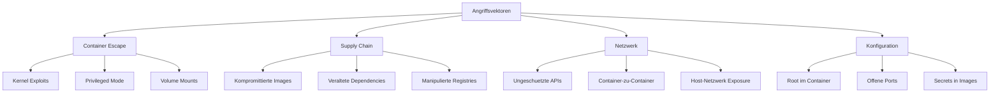
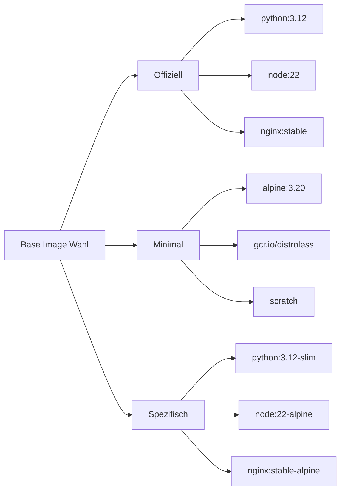
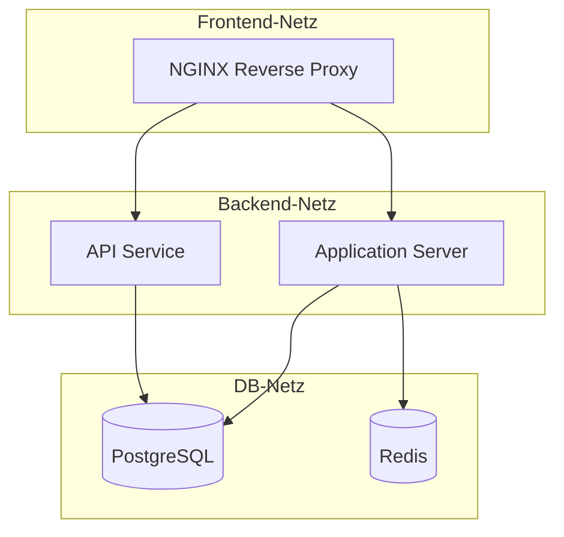

---
tags:
  - docker
  - security
  - hardening
  - sicherheit
---

# Docker Security und Hardening

> [!ABSTRACT] TL;DR
> Container teilen sich den Host-Kernel — ein kompromittierter Container kann das gesamte System gefährden. Dieses Dokument behandelt alle Ebenen der Docker-Sicherheit: Host-Absicherung, Image-Hygiene, Container-Hardening, Netzwerk-Isolation, Daemon-Konfiguration, Secrets Management und Compliance-Auditing.

---

## Sicherheitsrisiken verstehen

Docker-Container bieten **Prozess-Isolation**, aber keine vollständige Virtualisierung. Im Gegensatz zu VMs teilen sich alle Container denselben Host-Kernel. Das hat fundamentale Sicherheitsimplikationen.

### Angriffsvektoren



### Kernprobleme

| Risiko | Beschreibung | Schweregrad |
|--------|-------------|:-----------:|
| Shared Kernel | Container teilen den Host-Kernel — Kernel-Exploit = Game Over | Kritisch |
| Docker Daemon als root | Der Daemon läuft als root und hat volle Systemkontrolle | Kritisch |
| Supply-Chain-Angriffe | Kompromittierte Base Images betreffen alle abhängigen Container | Kritisch |
| Container Escape | Ausbruch aus dem Container auf den Host | Kritisch |
| Überprivilegierte Container | `--privileged` deaktiviert alle Sicherheitsmechanismen | Hoch |
| Secrets in Images | Passwörter und Keys in Layern sind extrahierbar | Hoch |
| Veraltete Images | Ungepatchte CVEs in Base Images | Mittel |
| Inter-Container-Traffic | Container im selben Netzwerk können frei kommunizieren | Mittel |

> [!DANGER] Container sind keine Sicherheitsgrenze
> Container sind **keine Sicherheitsgrenze** wie VMs. Ein Kernel-Exploit in einem Container betrifft potenziell alle Container und den Host. Für Multi-Tenant-Umgebungen mit unterschiedlichen Vertrauensstufen sind VMs oder gVisor/Kata Containers empfohlen.

---

## Host-Sicherheit

Die Sicherheit der Container beginnt beim Host-System. Ein kompromittierter Host bedeutet kompromittierte Container.

### Docker-Gruppe = Root-Äquivalent

> [!DANGER] Docker-Gruppe ist Root
> Jeder Benutzer in der `docker`-Gruppe hat **effektiv Root-Rechte** auf dem Host. Ein simples `docker run -v /:/host` gibt Zugriff auf das gesamte Dateisystem.

```bash
# Demonstration: Docker-Gruppe = Root
docker run --rm -v /etc/shadow:/etc/shadow:ro alpine cat /etc/shadow

# Stattdessen: Rootless Docker verwenden (siehe Abschnitt Daemon)
# Oder: Zugriff über sudo steuern
```

### Host-Hardening Checkliste

```bash
# 1. Kernel aktuell halten
sudo apt update && sudo apt upgrade -y

# 2. Automatische Sicherheitsupdates aktivieren (Ubuntu/Debian)
sudo apt install unattended-upgrades
sudo dpkg-reconfigure unattended-upgrades

# 3. AppArmor Status prüfen
sudo apparmor_status

# 4. Audit-Logging für Docker aktivieren
sudo auditctl -w /usr/bin/docker -p rwxa -k docker
sudo auditctl -w /etc/docker -p rwxa -k docker-config
sudo auditctl -w /var/lib/docker -p rwxa -k docker-files
sudo auditctl -w /run/containerd -p rwxa -k containerd

# 5. Docker-Verzeichnis-Berechtigungen prüfen
ls -la /var/lib/docker/
# Sollte root:root mit 710 sein
```

### Kernel-Sicherheitsmodule

| Modul | Distribution | Funktion |
|-------|-------------|----------|
| AppArmor | Ubuntu, Debian, SUSE | Mandatory Access Control über Profile |
| SELinux | RHEL, CentOS, Fedora | Mandatory Access Control über Labels |
| Seccomp | Alle modernen Kernels | Syscall-Filterung für Container |

```bash
# AppArmor-Profil für Docker prüfen
cat /etc/apparmor.d/docker

# SELinux-Status prüfen (RHEL/CentOS)
sestatus
# Docker mit SELinux: Volumes benötigen :z oder :Z
docker run -v /data:/data:z myimage
```

---

## Image-Sicherheit

Images sind die Grundlage jedes Containers. Ein unsicheres Image macht jedes Runtime-Hardening zunichte.

### Base Image Auswahl



| Image-Typ | Größe | Pakete | Angriffsfläche | Empfehlung |
|-----------|------:|--------|:--------------:|------------|
| `ubuntu:24.04` | ~78 MB | Viele | Mittel | Entwicklung |
| `debian:bookworm-slim` | ~52 MB | Moderat | Gering | Allgemein |
| `alpine:3.20` | ~7 MB | Minimal | Sehr gering | Produktion |
| `distroless` | ~2-20 MB | Nur Runtime | Minimal | Produktion |
| `scratch` | 0 MB | Keine | Keine | Go/Rust-Binaries |

> [!TIP] Minimale Images verwenden
> Weniger installierte Pakete bedeuten weniger potenzielle CVEs. Alpine-basierte Images oder Google Distroless reduzieren die Angriffsfläche drastisch.

### Multi-Stage Builds für sichere Images

```dockerfile
# === Build Stage ===
FROM golang:1.23 AS builder
WORKDIR /app
COPY go.mod go.sum ./
RUN go mod download
COPY . .
RUN CGO_ENABLED=0 GOOS=linux go build -a -installsuffix cgo -o server .

# === Production Stage ===
FROM gcr.io/distroless/static-debian12:nonroot
COPY --from=builder /app/server /server
USER nonroot:nonroot
EXPOSE 8080
ENTRYPOINT ["/server"]
```

### Image Scanning

Regelmäßiges Scanning deckt bekannte Schwachstellen (CVEs) in Images auf.

```bash
# Docker Scout (in Docker Desktop integriert)
docker scout cves myimage:latest
docker scout recommendations myimage:latest

# Trivy (Open Source, sehr verbreitet)
trivy image myimage:latest
trivy image --severity HIGH,CRITICAL myimage:latest
trivy image --exit-code 1 --severity CRITICAL myimage:latest  # CI/CD Gate

# Grype (von Anchore)
grype myimage:latest
grype myimage:latest --only-fixed
```

> [!WARNING] Scanning ist keine einmalige Aktion
> Images müssen **regelmäßig** gescannt werden — neue CVEs werden täglich veröffentlicht. In CI/CD-Pipelines sollte ein Scan vor jedem Deployment erfolgen und bei kritischen Findings den Build abbrechen.

### Image Signing und Verifikation

```bash
# Docker Content Trust (DCT) aktivieren
export DOCKER_CONTENT_TRUST=1
docker pull myregistry.io/myimage:latest

# Cosign (Sigstore — moderner Standard)
cosign sign --key cosign.key myregistry.io/myimage:latest
cosign verify --key cosign.pub myregistry.io/myimage:latest
```

### Dockerfile Best Practices für Sicherheit

```dockerfile
# 1. Spezifische Version pinnen (NICHT :latest)
FROM python:3.12.4-slim-bookworm

# 2. System aktualisieren und Cache aufräumen
RUN apt-get update && \
    apt-get upgrade -y && \
    apt-get install -y --no-install-recommends curl && \
    rm -rf /var/lib/apt/lists/*

# 3. Non-Root User erstellen
RUN groupadd -r appgroup && \
    useradd -r -g appgroup -d /app -s /sbin/nologin appuser

# 4. Arbeitsverzeichnis setzen
WORKDIR /app

# 5. Dependencies zuerst kopieren (Layer Caching)
COPY requirements.txt .
RUN pip install --no-cache-dir -r requirements.txt

# 6. Anwendungscode kopieren
COPY --chown=appuser:appgroup . .

# 7. Zu Non-Root User wechseln
USER appuser

# 8. Healthcheck definieren
HEALTHCHECK --interval=30s --timeout=5s --retries=3 \
    CMD curl -f http://localhost:8080/health || exit 1

EXPOSE 8080
ENTRYPOINT ["python", "app.py"]
```

> [!IMPORTANT] .dockerignore nicht vergessen
> Eine `.dockerignore`-Datei verhindert, dass Secrets, Git-History oder Build-Artefakte ins Image gelangen.

```bash
# .dockerignore
.git
.env
*.secret
*.key
*.pem
docker-compose*.yml
README.md
__pycache__
node_modules
```

---

## Container-Hardening

Runtime-Hardening begrenzt die Fähigkeiten eines Containers auf das absolut Notwendige.

### Non-Root User

> [!WARNING] Container laufen standardmäßig als Root
> Ohne explizite `USER`-Anweisung läuft der Prozess im Container als `root` (UID 0). Bei einem Container Escape hat der Angreifer dann Root-Rechte auf dem Host.

```bash
# User beim Start erzwingen
docker run --user 1000:1000 myimage

# Prüfen welcher User im Container läuft
docker exec mycontainer id
docker exec mycontainer whoami
```

### Read-Only Filesystem

```bash
# Filesystem read-only starten
docker run --read-only myimage

# Mit tmpfs für temporäre Dateien
docker run --read-only \
    --tmpfs /tmp:rw,noexec,nosuid,size=64m \
    --tmpfs /var/run:rw,noexec,nosuid \
    myimage
```

```yaml
# docker-compose.yml
services:
  app:
    image: myimage:latest
    read_only: true
    tmpfs:
      - /tmp:rw,noexec,nosuid,size=64m
      - /var/run:rw,noexec,nosuid
```

### Linux Capabilities

Docker startet Container standardmäßig mit einem reduzierten Set an Capabilities — aber es sind immer noch zu viele. Best Practice: Alle droppen und nur benötigte hinzufügen.

```bash
# Alle Capabilities droppen
docker run --cap-drop ALL myimage

# Nur benötigte hinzufügen
docker run --cap-drop ALL \
    --cap-add NET_BIND_SERVICE \
    myimage

# Aktive Capabilities anzeigen
docker exec mycontainer cat /proc/1/status | grep Cap
```

| Capability | Funktion | Typische Nutzung |
|-----------|----------|-----------------|
| `NET_BIND_SERVICE` | Ports unter 1024 binden | Webserver auf Port 80/443 |
| `CHOWN` | Datei-Eigentümer ändern | Init-Skripte |
| `SETUID` / `SETGID` | User/Group wechseln | Prozess-Downgrade |
| `DAC_OVERRIDE` | Dateiberechtigungen umgehen | Legacy-Anwendungen |
| `SYS_PTRACE` | Prozesse tracen | Debugging (nur Entwicklung!) |
| `NET_RAW` | Raw Sockets | Ping, Netzwerk-Diagnose |
| `NET_ADMIN` | Netzwerkkonfiguration | VPN-Container, Firewalls |
| `SYS_ADMIN` | Verschiedene Admin-Ops | Vermeiden! Fast wie `--privileged` |

> [!DANGER] --privileged niemals in Produktion
> `--privileged` gibt dem Container **alle** Capabilities, deaktiviert Seccomp und AppArmor, und gewährt Zugriff auf alle Host-Devices. Ein Container mit `--privileged` kann trivial auf den Host ausbrechen.

```yaml
# docker-compose.yml
services:
  app:
    image: myimage:latest
    cap_drop:
      - ALL
    cap_add:
      - NET_BIND_SERVICE
```

### Seccomp Profile

Seccomp filtert Syscalls und blockiert gefährliche Operationen auf Kernel-Ebene.

```bash
# Docker Default Seccomp Profile anzeigen
docker info --format '{{ .SecurityOptions }}'

# Custom Seccomp Profile verwenden
docker run --security-opt seccomp=custom-profile.json myimage

# Seccomp komplett deaktivieren (NICHT empfohlen)
docker run --security-opt seccomp=unconfined myimage
```

Beispiel für ein minimales Custom Seccomp Profile:

```json
{
    "defaultAction": "SCMP_ACT_ERRNO",
    "defaultErrnoRet": 1,
    "archMap": [
        {
            "architecture": "SCMP_ARCH_X86_64",
            "subArchitectures": ["SCMP_ARCH_X86", "SCMP_ARCH_X32"]
        }
    ],
    "syscalls": [
        {
            "names": [
                "read", "write", "open", "close",
                "stat", "fstat", "mmap", "mprotect",
                "munmap", "brk", "ioctl", "access",
                "pipe", "select", "clone", "execve",
                "exit", "exit_group", "futex", "nanosleep"
            ],
            "action": "SCMP_ACT_ALLOW"
        }
    ]
}
```

### No New Privileges

Verhindert, dass Prozesse über `setuid`-Binaries ihre Privilegien erhöhen.

```bash
docker run --security-opt no-new-privileges myimage
```

```yaml
# docker-compose.yml
services:
  app:
    image: myimage:latest
    security_opt:
      - no-new-privileges:true
```

### Resource Limits

Ohne Limits kann ein einzelner Container den gesamten Host lahmlegen (Denial of Service).

```bash
# Memory Limit (Container wird bei Überschreitung gekillt)
docker run --memory=512m --memory-swap=512m myimage

# CPU Limit
docker run --cpus=1.5 myimage
docker run --cpu-shares=512 myimage

# PID Limit (verhindert Fork-Bombs)
docker run --pids-limit=100 myimage

# Kombiniert
docker run \
    --memory=512m \
    --memory-swap=512m \
    --cpus=1.5 \
    --pids-limit=100 \
    myimage
```

```yaml
# docker-compose.yml
services:
  app:
    image: myimage:latest
    deploy:
      resources:
        limits:
          memory: 512M
          cpus: "1.5"
          pids: 100
        reservations:
          memory: 256M
          cpus: "0.5"
```

### Gehärteter Container — Vollständiges Beispiel

```bash
docker run -d \
    --name secure-app \
    --user 1000:1000 \
    --read-only \
    --tmpfs /tmp:rw,noexec,nosuid,size=64m \
    --cap-drop ALL \
    --cap-add NET_BIND_SERVICE \
    --security-opt no-new-privileges \
    --security-opt seccomp=default \
    --memory=512m \
    --memory-swap=512m \
    --cpus=1.5 \
    --pids-limit=100 \
    --restart unless-stopped \
    --health-cmd "curl -f http://localhost:8080/health || exit 1" \
    --health-interval=30s \
    myimage:latest
```

```yaml
# docker-compose.yml — Gehärteter Container
services:
  secure-app:
    image: myimage:latest
    user: "1000:1000"
    read_only: true
    tmpfs:
      - /tmp:rw,noexec,nosuid,size=64m
    cap_drop:
      - ALL
    cap_add:
      - NET_BIND_SERVICE
    security_opt:
      - no-new-privileges:true
    deploy:
      resources:
        limits:
          memory: 512M
          cpus: "1.5"
          pids: 100
    restart: unless-stopped
    healthcheck:
      test: ["CMD", "curl", "-f", "http://localhost:8080/health"]
      interval: 30s
      timeout: 5s
      retries: 3
```

> [!TIP] Hardening schrittweise einführen
> Nicht alle Maßnahmen lassen sich sofort umsetzen. Empfohlene Reihenfolge: **Non-Root User** → **no-new-privileges** → **cap-drop ALL** → **Resource Limits** → **read-only** → **Seccomp Profile**. Jede Stufe einzeln testen!

---

## Netzwerk-Sicherheit

Container-Netzwerke müssen bewusst segmentiert werden. Standardmäßig können alle Container im selben Netzwerk frei kommunizieren.

### Netzwerk-Isolation



```yaml
# docker-compose.yml mit Netzwerk-Segmentierung
services:
  proxy:
    image: nginx:stable-alpine
    networks:
      - frontend
      - backend
    ports:
      - "443:443"

  app:
    image: myapp:latest
    networks:
      - backend
      - database

  db:
    image: postgres:16-alpine
    networks:
      - database

networks:
  frontend:
    driver: bridge
  backend:
    driver: bridge
    internal: true
  database:
    driver: bridge
    internal: true
```

> [!TIP] Internal Networks nutzen
> Netzwerke mit `internal: true` haben **keinen Zugang zum Internet**. Ideal für Datenbank-Netzwerke, die nur von Anwendungscontainern erreicht werden sollen.

### Netzwerk-Härtung

> [!WARNING] --net=host in Produktion vermeiden
> `--net=host` deaktiviert die Netzwerk-Isolation komplett. Der Container teilt den Netzwerk-Stack des Hosts — alle Ports sind direkt exponiert und Netzwerk-Namespaces greifen nicht.

```bash
# Inter-Container Communication (ICC) global deaktivieren
# /etc/docker/daemon.json
{
    "icc": false
}

# Port-Bindung auf spezifische Interfaces beschränken
# SCHLECHT: Auf allen Interfaces
docker run -p 8080:80 myimage

# BESSER: Nur auf localhost
docker run -p 127.0.0.1:8080:80 myimage

# BESSER: Nur auf spezifisches Interface
docker run -p 192.168.1.10:8080:80 myimage
```

> [!IMPORTANT] Docker und iptables
> Docker manipuliert iptables-Regeln direkt. Port-Freigaben mit `-p` umgehen UFW/Firewalld-Regeln. Lösung: `"iptables": false` im Daemon oder Docker-spezifische Firewall-Chains konfigurieren.

---

## Docker Daemon absichern

Der Docker Daemon ist die zentrale Kontrollinstanz. Sein Schutz hat höchste Priorität.

### Daemon-Konfiguration

Die Datei `/etc/docker/daemon.json` steuert das Verhalten des Daemons:

```json
{
    "icc": false,
    "no-new-privileges": true,
    "userland-proxy": false,
    "log-driver": "json-file",
    "log-opts": {
        "max-size": "10m",
        "max-file": "3"
    },
    "live-restore": true,
    "default-ulimits": {
        "nofile": { "Name": "nofile", "Hard": 64000, "Soft": 64000 },
        "nproc": { "Name": "nproc", "Hard": 4096, "Soft": 4096 }
    },
    "userns-remap": "default",
    "storage-driver": "overlay2"
}
```

| Option | Funktion | Empfehlung |
|--------|----------|------------|
| `icc` | Inter-Container Communication | `false` — Explizite Verbindung erzwingen |
| `no-new-privileges` | Privilege Escalation verhindern | `true` — Global für alle Container |
| `userland-proxy` | Proxy für Port-Forwarding | `false` — Kernel-basiertes Forwarding |
| `live-restore` | Container laufen bei Daemon-Restart weiter | `true` — Weniger Downtime |
| `userns-remap` | User Namespace Remapping | `"default"` — Root-Isolation |
| `log-opts` | Log-Rotation | `max-size` und `max-file` setzen |

### TLS für Remote Docker API

> [!DANGER] Docker API ohne TLS = Root-Zugang
> Eine ungeschützte Docker-API (Port 2375/2376) ohne TLS gibt **jedem im Netzwerk vollständige Root-Rechte** auf dem Host. Exponierte Docker-APIs werden aktiv von Botnets gescannt.

```bash
# CA und Zertifikate erstellen
mkdir -p /etc/docker/certs
openssl genrsa -aes256 -out /etc/docker/certs/ca-key.pem 4096
openssl req -new -x509 -days 365 -key /etc/docker/certs/ca-key.pem \
    -sha256 -out /etc/docker/certs/ca.pem \
    -subj "/CN=Docker CA"

openssl genrsa -out /etc/docker/certs/server-key.pem 4096
openssl req -new -key /etc/docker/certs/server-key.pem \
    -out /etc/docker/certs/server.csr \
    -subj "/CN=docker-host.example.com"

openssl x509 -req -days 365 \
    -in /etc/docker/certs/server.csr \
    -CA /etc/docker/certs/ca.pem \
    -CAkey /etc/docker/certs/ca-key.pem \
    -CAcreateserial \
    -out /etc/docker/certs/server-cert.pem
```

```json
{
    "tls": true,
    "tlsverify": true,
    "tlscacert": "/etc/docker/certs/ca.pem",
    "tlscert": "/etc/docker/certs/server-cert.pem",
    "tlskey": "/etc/docker/certs/server-key.pem",
    "hosts": ["unix:///var/run/docker.sock", "tcp://0.0.0.0:2376"]
}
```

### Rootless Docker

Rootless Docker führt den Daemon und alle Container unter einem regulären Benutzer aus — ohne Root-Rechte.

```bash
# Voraussetzungen installieren (Ubuntu/Debian)
sudo apt install uidmap dbus-user-session

# Rootless Docker installieren
dockerd-rootless-setuptool.sh install

# Umgebungsvariablen setzen
export PATH=/usr/bin:$PATH
export DOCKER_HOST=unix:///run/user/$(id -u)/docker.sock

# Autostart via systemd User Service
systemctl --user enable docker
sudo loginctl enable-linger $(whoami)

# Prüfen ob Rootless aktiv ist
docker info --format '{{ .SecurityOptions }}'
```

> [!TIP] Rootless Docker als Standard
> Rootless Docker ist die **sicherste Art**, Docker zu betreiben. Die meisten Workloads funktionieren problemlos. Einschränkungen: kein Zugriff auf privilegierte Ports (< 1024) ohne Workaround, einige Storage-Driver nicht verfügbar.

### User Namespaces

User Namespaces remappen die UID/GID im Container auf unprivilegierte UIDs auf dem Host.

```bash
# /etc/docker/daemon.json
{
    "userns-remap": "default"
}

# Erstellt automatisch den dockremap User
grep dockremap /etc/subuid
grep dockremap /etc/subgid

# Root im Container ist NICHT Root auf dem Host
docker run --rm alpine id
# uid=0(root) — auf dem Host z.B. UID 100000
```

---

## Secrets Management

Zugangsdaten, API-Keys und Zertifikate dürfen **niemals** in Images oder Umgebungsvariablen im Klartext gespeichert werden.

### Anti-Patterns

> [!DANGER] Secrets niemals ins Image einbauen
> Jeder mit Zugriff auf das Image kann alle Layer extrahieren — auch gelöschte Dateien aus vorherigen Layern sind rekonstruierbar mit `docker history` und `docker save`.

```dockerfile
# FALSCH — Secret ist im Layer gespeichert
COPY .env /app/.env
RUN source /app/.env && rm /app/.env

# FALSCH — Sichtbar in docker history
ENV DB_PASSWORD=supersecret

# FALSCH — Sichtbar in docker inspect
ARG DB_PASSWORD
RUN echo $DB_PASSWORD > /dev/null
```

### Build-Secrets (BuildKit)

```dockerfile
# RICHTIG — Build-Secret wird nicht im Layer gespeichert
# syntax=docker/dockerfile:1
FROM python:3.12-slim
RUN --mount=type=secret,id=pip_credentials,target=/root/.pip/pip.conf \
    pip install --no-cache-dir -r requirements.txt
```

```bash
DOCKER_BUILDKIT=1 docker build \
    --secret id=pip_credentials,src=$HOME/.pip/pip.conf \
    -t myimage .
```

### Runtime-Secrets

```yaml
# docker-compose.yml mit Secrets
services:
  app:
    image: myapp:latest
    secrets:
      - db_password
      - api_key
    environment:
      DB_PASSWORD_FILE: /run/secrets/db_password
      API_KEY_FILE: /run/secrets/api_key

secrets:
  db_password:
    file: ./secrets/db_password.txt
  api_key:
    file: ./secrets/api_key.txt
```

> [!IMPORTANT] .env-Dateien nicht committen
> `.env`-Dateien gehören in die `.gitignore`. Im Repository sollte eine `.env.example` mit Platzhaltern liegen.

### Docker Secrets (Swarm Mode)

```bash
# Secret erstellen
echo "mein-sicheres-passwort" | docker secret create db_password -

# Secret in Service verwenden
docker service create \
    --name myapp \
    --secret db_password \
    myimage
# Verfügbar unter /run/secrets/db_password
```

---

## Compliance und Auditing

Regelmäßige Audits stellen sicher, dass Sicherheitsrichtlinien eingehalten werden.

### Docker Bench for Security

Docker Bench ist ein offizielles Audit-Tool, das den CIS Docker Benchmark prüft.

```bash
docker run --rm --net host --pid host --userns host \
    --cap-add audit_control \
    -e DOCKER_CONTENT_TRUST=$DOCKER_CONTENT_TRUST \
    -v /var/lib:/var/lib:ro \
    -v /var/run/docker.sock:/var/run/docker.sock:ro \
    -v /usr/lib/systemd:/usr/lib/systemd:ro \
    -v /etc:/etc:ro \
    docker/docker-bench-security
```

### CIS Benchmark Kategorien

| Kategorie | Prüfbereich | Beispiel-Checks |
|-----------|-------------|-----------------|
| Host Configuration | Host-System | Audit-Logging, Partitionierung |
| Docker Daemon | Daemon-Config | TLS, User Namespaces, ICC |
| Docker Files | Dateirechte | Socket-Permissions, Cert-Permissions |
| Container Images | Image-Sicherheit | Root User, Healthchecks |
| Container Runtime | Laufzeit-Config | Capabilities, Read-Only, Resources |
| Docker Security | Sicherheitsfeatures | AppArmor, Seccomp, SELinux |
| Docker Swarm | Cluster-Sicherheit | Secrets, Encryption, Cert Rotation |

### Audit-Tools im Überblick

| Tool | Zweck | Typ |
|------|-------|-----|
| Trivy | Image Vulnerability Scanning | Open Source |
| Grype | Image Vulnerability Scanning | Open Source |
| Docker Scout | Image Analyse und Empfehlungen | Docker Official |
| Dockle | Dockerfile Best Practice Linting | Open Source |
| Hadolint | Dockerfile Linting | Open Source |
| Falco | Runtime Security Monitoring | Open Source |

### Security-Checkliste

> [!NOTE] Regelmäßig prüfen
> Diese Checkliste sollte bei jedem Deployment und in regelmäßigen Audits durchgegangen werden.

- [ ] Images werden regelmäßig gescannt (Trivy/Grype)
- [ ] Base Images sind aktuell und gepinnt (keine `:latest` Tags)
- [ ] Alle Container laufen als Non-Root User
- [ ] Kein Container läuft mit `--privileged`
- [ ] Capabilities auf das Minimum reduziert (`--cap-drop ALL`)
- [ ] Read-Only Filesystem wo möglich aktiviert
- [ ] Resource Limits gesetzt (Memory, CPU, PIDs)
- [ ] Netzwerke segmentiert (Frontend, Backend, Database)
- [ ] Docker API nur über TLS erreichbar
- [ ] Keine Secrets in Images oder Umgebungsvariablen
- [ ] `.env`-Dateien in `.gitignore` eingetragen
- [ ] `no-new-privileges` aktiviert
- [ ] Docker Bench for Security regelmäßig ausgeführt
- [ ] Logging und Log-Rotation konfiguriert
- [ ] Healthchecks für alle Services definiert

---

## Verwandte Notizen

- [[Docker Index]] — Übersicht aller Docker-Dokumentationen
- [[Docker Architektur]] — Docker Engine, Daemon und Runtime-Architektur
- [[Dockerfile]] — Dockerfile-Referenz und Best Practices
- [[Docker Registries]] — Image Registries, Hosting und Distribution
- [[Pod Security Standards]] — K8s erzwingt Container-Security auf Cluster-Ebene
- [[Swarm Security]] — TLS, Secret-Management und Hardening im Swarm