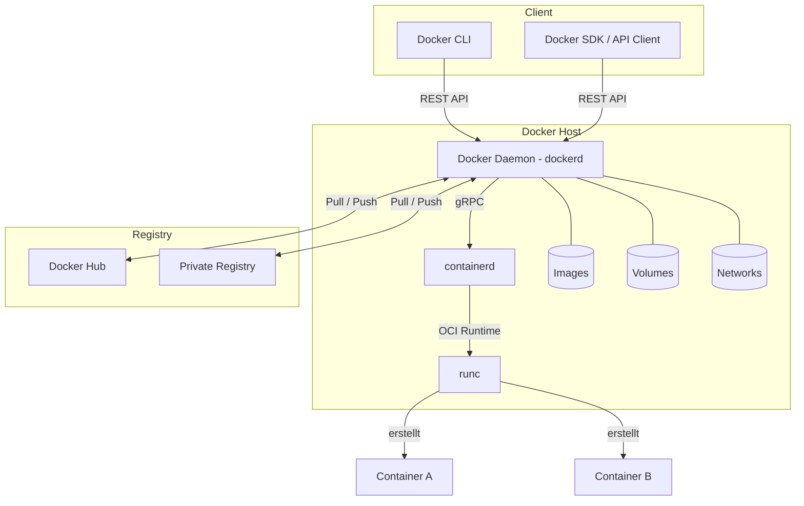
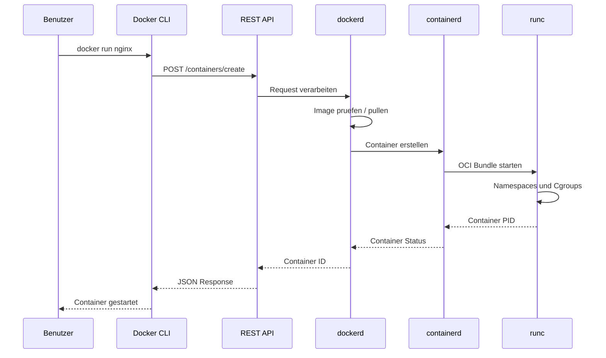
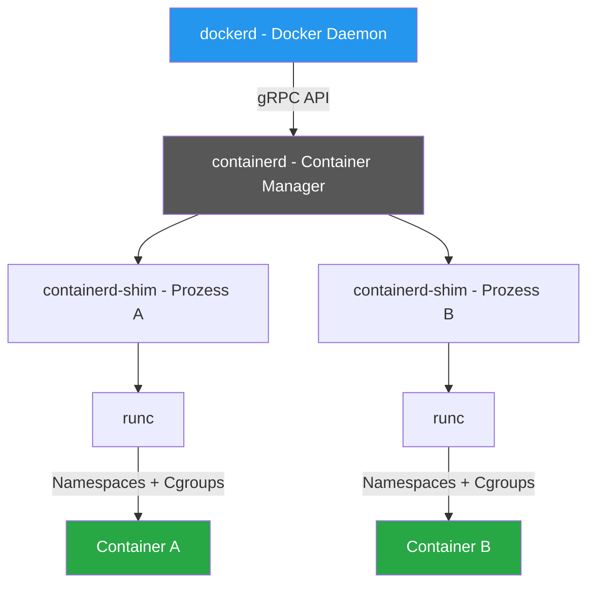
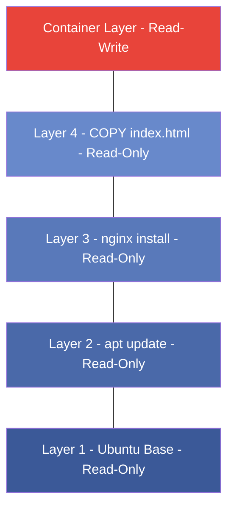
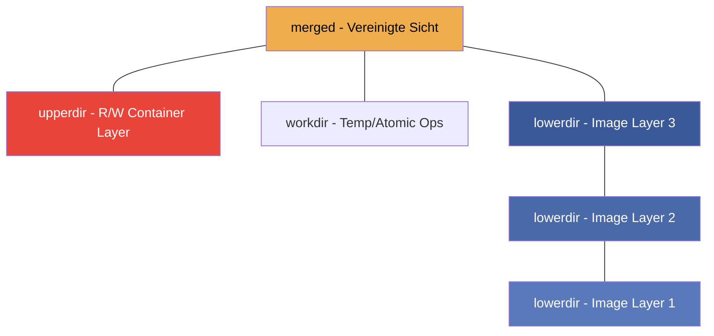
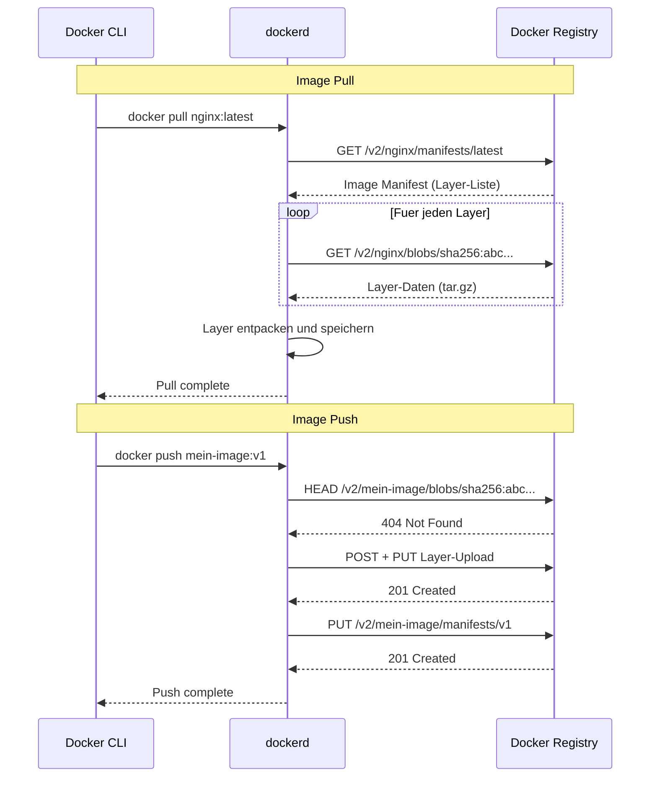

---
tags:
  - docker
  - architektur
  - container
  - daemon
---

# Docker Architektur

> [!ABSTRACT] TL;DR
> Docker basiert auf einer **Client-Server-Architektur**: Der Docker CLI (Client) kommuniziert über eine REST API mit dem Docker Daemon (Server), der wiederum Container über **containerd** und **runc** verwaltet. Images bestehen aus schreibgeschützten **Layern**, die über ein Union Filesystem (overlay2) geschichtet werden. Container erhalten darüber einen beschreibbaren Layer (Copy-on-Write).

---

## Überblick

Docker ist keine monolithische Anwendung, sondern ein Zusammenspiel mehrerer Komponenten, die jeweils eine klar definierte Aufgabe übernehmen. Das Verständnis dieser Architektur ist essenziell für:

- **Fehlerdiagnose** — Wo genau tritt ein Problem auf?
- **Sicherheit** — Welche Komponente hat welche Rechte?
- **Performance** — Wo entstehen Engpässe?
- **Betrieb** — Wie interagieren die Teile im Produktivbetrieb?

Die folgende Übersicht zeigt alle Hauptkomponenten und ihre Beziehungen zueinander:



---

## Client-Server-Architektur

Docker folgt einem strikten **Client-Server-Modell**. Client und Server können auf demselben Host laufen oder über das Netzwerk getrennt sein.

### Kommunikationsfluss



### Drei Kommunikationswege

| Methode | Beschreibung | Verwendung |
|:--------|:-------------|:-----------|
| **Unix Socket** | `/var/run/docker.sock` | Standard auf Linux — lokal, schnell |
| **TCP** | `tcp://host:2375` (unverschlüsselt) | Remote-Zugriff ohne TLS |
| **TCP + TLS** | `tcp://host:2376` (verschlüsselt) | Remote-Zugriff mit Zertifikaten |

> [!DANGER] Sicherheitsrisiko: Docker Socket
> Der Unix Socket `/var/run/docker.sock` gibt **Root-äquivalenten Zugriff** auf den Host. Wer Zugriff auf den Socket hat, kann beliebige Container starten — auch privilegierte. Den Socket niemals ungeschützt in Container mounten.

---

## Docker Daemon (dockerd)

Der Docker Daemon (`dockerd`) ist das **Herzstück der Docker-Architektur**. Er läuft als Hintergrundprozess mit Root-Rechten und verwaltet sämtliche Docker-Objekte.

### Aufgaben des Daemons

- **API-Endpunkt bereitstellen** — Empfängt und verarbeitet Client-Anfragen
- **Image-Management** — Pull, Build, Tag, Push, Layer-Caching
- **Container-Lifecycle** — Erstellen, Starten, Stoppen, Löschen
- **Netzwerk-Management** — Bridge, Overlay, Macvlan, DNS
- **Volume-Management** — Named Volumes, Bind Mounts, Treiber
- **Logging und Events** — Container-Logs, Event-Stream

### Systemd-Integration

Auf modernen Linux-Systemen wird `dockerd` über systemd verwaltet:

```bash
# Daemon-Status prüfen
sudo systemctl status docker

# Daemon starten / stoppen / neustarten
sudo systemctl start docker
sudo systemctl stop docker
sudo systemctl restart docker

# Autostart aktivieren
sudo systemctl enable docker
```

Die systemd Unit-Datei liegt unter:

```bash
# Unit-Datei anzeigen
systemctl cat docker.service
```

```ini
[Unit]
Description=Docker Application Container Engine
Documentation=https://docs.docker.com
After=network-online.target docker.socket firewalld.service containerd.service
Wants=network-online.target containerd.service

[Service]
Type=notify
ExecStart=/usr/bin/dockerd -H fd:// --containerd=/run/containerd/containerd.sock
ExecReload=/bin/kill -s HUP $MAINPID
Restart=always
RestartSec=2

[Install]
WantedBy=multi-user.target
```

### Daemon-Konfiguration

Die zentrale Konfigurationsdatei ist `/etc/docker/daemon.json`:

```json
{
  "storage-driver": "overlay2",
  "log-driver": "json-file",
  "log-opts": {
    "max-size": "10m",
    "max-file": "3"
  },
  "default-address-pools": [
    { "base": "172.20.0.0/16", "size": 24 }
  ],
  "dns": ["1.1.1.1", "8.8.8.8"],
  "live-restore": true,
  "userland-proxy": false,
  "experimental": false
}
```

> [!TIP] Live Restore
> Mit `"live-restore": true` überleben laufende Container einen Neustart des Daemons. Essenziell für Produktivumgebungen — bei einem `systemctl restart docker` laufen die Container weiter.

### Socket-Kommunikation

Der Daemon lauscht standardmäßig auf einem Unix Socket:

```bash
# Prüfen ob der Socket existiert
ls -la /var/run/docker.sock

# API direkt über den Socket ansprechen
curl --unix-socket /var/run/docker.sock http://localhost/v1.45/info | jq .

# Container auflisten über die API
curl --unix-socket /var/run/docker.sock http://localhost/v1.45/containers/json | jq .
```

Für Remote-Zugriff kann der Daemon zusätzlich auf TCP lauschen:

```json
{
  "hosts": ["unix:///var/run/docker.sock", "tcp://0.0.0.0:2376"],
  "tls": true,
  "tlscacert": "/etc/docker/ca.pem",
  "tlscert": "/etc/docker/server-cert.pem",
  "tlskey": "/etc/docker/server-key.pem",
  "tlsverify": true
}
```

> [!WARNING] TCP ohne TLS
> Docker **niemals** auf TCP ohne TLS-Verschlüsselung exponieren (`tcp://0.0.0.0:2375`). Jeder im Netzwerk könnte beliebige Container mit Root-Rechten starten. Immer TLS mit Client-Zertifikaten nutzen.

---

## Docker CLI

Die Docker CLI (`docker`) ist der Standard-Client zur Interaktion mit dem Daemon. Sie übersetzt Benutzerbefehle in REST-API-Aufrufe.

### Befehlsstruktur

```bash
docker [OPTIONS] COMMAND [SUBCOMMAND] [ARG...]

# Beispiele
docker container ls                   # Container auflisten
docker image pull nginx:latest        # Image herunterladen
docker volume create mein-volume      # Volume erstellen
docker network inspect bridge         # Netzwerk inspizieren
```

### CLI → REST API Zuordnung

| CLI-Befehl | HTTP-Methode | API-Endpunkt |
|:-----------|:-------------|:-------------|
| `docker ps` | `GET` | `/containers/json` |
| `docker run` | `POST` | `/containers/create` + `/containers/{id}/start` |
| `docker stop` | `POST` | `/containers/{id}/stop` |
| `docker rm` | `DELETE` | `/containers/{id}` |
| `docker pull` | `POST` | `/images/create?fromImage=...` |
| `docker build` | `POST` | `/build` |
| `docker logs` | `GET` | `/containers/{id}/logs` |
| `docker inspect` | `GET` | `/containers/{id}/json` |

### Remote Docker Host

Die CLI kann auch mit einem entfernten Daemon kommunizieren:

```bash
# Über Umgebungsvariable
export DOCKER_HOST=tcp://192.168.1.100:2376
export DOCKER_TLS_VERIFY=1
export DOCKER_CERT_PATH=~/.docker/certs
docker ps

# Über Context (empfohlen)
docker context create mein-server \
  --docker "host=tcp://192.168.1.100:2376,ca=~/.docker/ca.pem,cert=~/.docker/cert.pem,key=~/.docker/key.pem"

docker context use mein-server
docker ps

# Über SSH (einfachste Variante)
docker -H ssh://user@192.168.1.100 ps

# SSH-Context erstellen
docker context create ssh-server \
  --docker "host=ssh://user@192.168.1.100"
```

> [!TIP] Docker Context
> Docker Contexts erlauben das Speichern und schnelle Wechseln zwischen verschiedenen Docker-Hosts. Mit `docker context ls` werden alle konfigurierten Contexts angezeigt.

---

## Container Runtime

Docker verwendet eine **mehrstufige Runtime-Architektur**, die auf offenen Standards (OCI) basiert. Diese Trennung ermöglicht Austauschbarkeit und Stabilität.

### Architektur der Runtime-Schichten



### Komponentenübersicht

| Komponente | Aufgabe | Projekt |
|:-----------|:--------|:--------|
| **dockerd** | API, Image-Management, Orchestrierung | Docker Engine |
| **containerd** | Container-Lifecycle, Image-Transfer, Storage | CNCF Projekt |
| **containerd-shim** | Entkopplung von containerd und Container-Prozess | Teil von containerd |
| **runc** | Erstellt und startet Container nach OCI-Spec | OCI Referenz-Runtime |

### containerd

`containerd` ist ein **Industry-Standard Container Runtime**, der als eigenständiger Daemon läuft. Er wurde von Docker als eigenständiges Projekt ausgegliedert und ist heute ein CNCF-Graduated-Projekt.

Aufgaben von containerd:

- **Image Pull/Push** — Transfer von und zu Registries
- **Image Storage** — Lokale Verwaltung der Image Layer
- **Container Execution** — Delegation an runc über Shims
- **Snapshot Management** — Filesystem-Snapshots für Container
- **Netzwerk-Interfaces** — CNI-basierte Netzwerkkonfiguration bei Kubernetes

```bash
# containerd-Status prüfen
sudo systemctl status containerd

# Direkt mit containerd interagieren (ctr CLI)
sudo ctr namespaces list
sudo ctr -n moby containers list
sudo ctr -n moby images list
```

> [!NOTE] Namespace "moby"
> Docker verwendet den containerd-Namespace `moby`. Kubernetes nutzt dagegen `k8s.io`. Mit `ctr -n moby` greift man auf Docker-Container zu.

### runc

`runc` ist die **OCI-Referenzimplementierung** einer Container-Runtime. Es ist ein kleines CLI-Tool, das:

1. Ein **OCI Bundle** entgegennimmt (Filesystem + Konfiguration)
2. **Linux Namespaces** erstellt (PID, NET, MNT, UTS, IPC, USER)
3. **Cgroups** konfiguriert (CPU, RAM, I/O Limits)
4. Den **Container-Prozess** startet und sich dann beendet

```bash
# runc-Version anzeigen
runc --version

# OCI-Spec eines Containers anzeigen
runc spec
```

### containerd-shim

Der Shim ist ein kleiner Prozess, der **zwischen containerd und dem Container** steht. Er ermöglicht:

- **Daemon-Unabhängigkeit** — Container laufen weiter, wenn containerd neu startet
- **Exit-Code-Bewahrung** — Shim sammelt den Exit-Code, auch nach Container-Ende
- **STDIO-Weiterleitung** — Stdin/Stdout/Stderr ohne direkte containerd-Verbindung

```bash
# Laufende Shim-Prozesse anzeigen
ps aux | grep containerd-shim
```

### OCI-Standard

Die **Open Container Initiative (OCI)** definiert zwei Spezifikationen:

| Spezifikation | Beschreibung |
|:--------------|:-------------|
| **Runtime Spec** | Wie ein Container konfiguriert, gestartet und verwaltet wird |
| **Image Spec** | Wie ein Container-Image aufgebaut ist (Layer, Manifest, Config) |

Durch die OCI-Standards sind Container-Images **portabel** — ein mit Docker erstelltes Image funktioniert auch mit Podman, containerd oder CRI-O.

---

## Docker Objects

Der Docker Daemon verwaltet vier Haupttypen von Objekten:

### Images

Ein Image ist eine **schreibgeschützte Vorlage** zum Erstellen von Containern. Es besteht aus gestapelten Layern und enthält alles, was eine Anwendung zum Laufen braucht.

```bash
# Images auflisten
docker image ls

# Image-Details anzeigen
docker image inspect nginx:latest

# Image-Historie (Layer) anzeigen
docker image history nginx:latest
```

### Container

Ein Container ist eine **laufende oder gestoppte Instanz** eines Images. Er erhält einen eigenen beschreibbaren Layer über dem Image.

```bash
# Container erstellen und starten
docker container run -d --name webserver nginx:latest

# Laufende Container anzeigen
docker container ls

# Alle Container (inkl. gestoppte)
docker container ls -a
```

### Volumes

Volumes sind der empfohlene Mechanismus zur **persistenten Datenspeicherung**. Sie existieren unabhängig vom Container-Lifecycle.

```bash
# Volume erstellen
docker volume create app-data

# Volume in Container mounten
docker run -d -v app-data:/var/lib/data myapp

# Volumes auflisten
docker volume ls
```

### Networks

Docker erstellt isolierte **virtuelle Netzwerke** für die Container-Kommunikation.

```bash
# Netzwerke auflisten
docker network ls

# Eigenes Netzwerk erstellen
docker network create --driver bridge mein-netz

# Container ins Netzwerk starten
docker run -d --network mein-netz --name app myapp
```

| Netzwerk-Treiber | Beschreibung | Use Case |
|:-----------------|:-------------|:---------|
| **bridge** | Isoliertes internes Netzwerk | Standard für einzelne Hosts |
| **host** | Kein Netzwerk-Namespace, teilt Host-Netzwerk | Performance-kritische Anwendungen |
| **overlay** | Multi-Host-Netzwerk über Swarm | Docker Swarm / Cluster |
| **macvlan** | Container erhält eigene MAC-Adresse | Direkte LAN-Integration |
| **none** | Kein Netzwerk | Maximale Isolation |

---

## Image Layers und Union Filesystem

Das Layer-System ist eines der cleveren Kernkonzepte von Docker. Es spart Speicherplatz und beschleunigt Builds durch intelligentes Caching.

### Wie Layer entstehen

Jede Anweisung in einem Dockerfile erzeugt einen neuen Layer:

```dockerfile
FROM ubuntu:24.04                     # Layer 1: Basis-Image
RUN apt-get update                    # Layer 2: Paketindex
RUN apt-get install -y nginx          # Layer 3: Nginx
COPY index.html /var/www/             # Layer 4: Eigene Datei
CMD ["nginx", "-g", "daemon off;"]    # Metadata (kein Layer)
```

### Layer-Schichtung



> [!IMPORTANT] Read-Only vs. Read-Write
> Alle **Image Layer sind schreibgeschützt** (Read-Only). Erst beim Starten eines Containers wird ein **beschreibbarer Layer** (Read-Write) obenauf gelegt. Änderungen im laufenden Container betreffen nur diesen R/W Layer und gehen beim Löschen des Containers verloren.

### Copy-on-Write (CoW)

Das Copy-on-Write-Prinzip sorgt für Effizienz:

1. **Lesen** — Datei wird aus dem tiefsten Layer gelesen, in dem sie existiert
2. **Schreiben** — Datei wird zuerst in den R/W Layer **kopiert**, dann dort modifiziert
3. **Löschen** — Eine sogenannte *Whiteout-Datei* wird im R/W Layer erstellt, die die darunterliegende Datei verdeckt

```bash
# Layer eines Images anzeigen
docker image inspect nginx:latest --format '{{json .RootFS.Layers}}' | jq .

# Größe der einzelnen Layer
docker image history nginx:latest --format "{{.Size}}\t{{.CreatedBy}}"

# Speicherplatz-Analyse
docker system df -v
```

> [!TIP] Layer-Sharing
> Wenn mehrere Images denselben Base-Layer teilen (z. B. `ubuntu:24.04`), wird dieser Layer nur **einmal auf der Festplatte gespeichert**. Das spart erheblich Speicherplatz bei vielen Images.

### overlay2 Storage Driver

Docker nutzt standardmäßig `overlay2` als Storage Driver unter Linux. Er vereint die Image Layer zu einem einheitlichen Dateisystem.

| Verzeichnis | Beschreibung |
|:------------|:-------------|
| `lowerdir` | Schreibgeschützte Image Layer (gestapelt) |
| `upperdir` | Beschreibbarer Container Layer |
| `workdir` | Arbeitsverzeichnis für atomare Operationen |
| `merged` | Vereinigte Sicht aller Layer — das sieht der Container |

```bash
# Storage-Driver prüfen
docker info --format '{{.Driver}}'

# Mount-Details eines laufenden Containers
docker inspect <container-id> --format '{{json .GraphDriver.Data}}' | jq .

# Overlay2-Verzeichnisse anzeigen
ls /var/lib/docker/overlay2/
```



### Best Practices für Layer-Optimierung

```dockerfile
# SCHLECHT — jedes RUN erzeugt einen eigenen Layer
RUN apt-get update
RUN apt-get install -y nginx curl wget
RUN apt-get clean
```

```dockerfile
# GUT — ein Layer für den gesamten Vorgang
RUN apt-get update && \
    apt-get install -y --no-install-recommends \
      nginx curl wget && \
    apt-get clean && \
    rm -rf /var/lib/apt/lists/*
```

> [!TIP] Layer-Anzahl minimieren
> Zusammengehörige `RUN`-Befehle in einem Layer kombinieren. Temporäre Dateien im selben Layer bereinigen, in dem sie erstellt wurden — sonst belegen sie trotzdem Speicherplatz im darunterliegenden Layer.

---

## Docker Registry

Eine Registry ist ein **Speicherdienst für Docker Images**. Sie ermöglicht das Verteilen von Images zwischen Entwicklung, CI/CD und Produktion.

### Pull/Push Flow



### Docker Hub

Docker Hub ist die **Standard-Registry** und wird automatisch verwendet, wenn kein anderer Host angegeben wird:

```bash
# Von Docker Hub pullen (implizit)
docker pull nginx:latest
# Entspricht:
docker pull docker.io/library/nginx:latest

# Eigenes Image auf Docker Hub pushen
docker login
docker tag mein-image:v1 username/mein-image:v1
docker push username/mein-image:v1
```

### Private Registries

Für interne Images empfiehlt sich eine eigene Registry:

```bash
# Einfache Registry starten
docker run -d -p 5000:5000 --name registry \
  -v registry-data:/var/lib/registry \
  registry:2

# Image in private Registry pushen
docker tag mein-image:v1 localhost:5000/mein-image:v1
docker push localhost:5000/mein-image:v1

# Image aus privater Registry pullen
docker pull localhost:5000/mein-image:v1
```

### Verbreitete Registry-Lösungen

| Registry | Beschreibung | Self-Hosted |
|:---------|:-------------|:-----------:|
| **Docker Hub** | Offizielle Public Registry | Nein |
| **GitHub Container Registry** | Integriert in GitHub Packages | Nein |
| **GitLab Container Registry** | Teil von GitLab CI/CD | Ja |
| **Harbor** | Enterprise Registry mit RBAC und Scanning | Ja |
| **Docker Registry** | Minimale Open-Source-Registry | Ja |
| **Nexus** | Multi-Format Repository Manager | Ja |
| **Amazon ECR** | AWS-native Registry | Nein |

> [!NOTE] Image-Naming-Konvention
> Der vollständige Image-Name folgt dem Schema: `registry-host:port/namespace/repository:tag`. Wird kein Host angegeben, wird `docker.io` (Docker Hub) angenommen. Wird kein Tag angegeben, wird `latest` verwendet.

---

## Zusammenfassung der Architektur

| Schicht | Komponente | Funktion |
|:--------|:-----------|:---------|
| **Benutzerebene** | Docker CLI, Docker Compose | Befehle eingeben, Stacks definieren |
| **API-Schicht** | REST API (Unix Socket / TCP) | Kommunikation zwischen Client und Daemon |
| **Management** | Docker Daemon (dockerd) | Orchestrierung, Image- und Netzwerk-Verwaltung |
| **Runtime** | containerd | Container-Lifecycle, Image-Storage |
| **Low-Level Runtime** | runc | Namespaces, Cgroups, Prozess-Start |
| **Storage** | overlay2 | Union Filesystem, Layer-Verwaltung |
| **Distribution** | Registry (Docker Hub etc.) | Image-Verteilung und -Speicherung |

> [!EXAMPLE] Gesamtfluss: `docker run nginx`
> 1. **CLI** parst den Befehl und sendet einen API-Request an dockerd
> 2. **dockerd** prüft, ob das Image `nginx:latest` lokal vorhanden ist
> 3. Falls nicht: **Pull** der Layer von Docker Hub
> 4. **dockerd** instruiert containerd, einen Container zu erstellen
> 5. **containerd** erstellt einen Shim-Prozess und ruft runc auf
> 6. **runc** erstellt Namespaces, konfiguriert Cgroups und startet den Nginx-Prozess
> 7. **runc** beendet sich — der Shim übernimmt die Überwachung
> 8. **dockerd** meldet die Container-ID an die CLI zurück

---

## Verwandte Notizen

- [[Docker Index]] — Übersicht aller Docker-Dokumentationen
- [[Was ist Docker]] — Einführung und Grundkonzepte
- [[Docker Images]] — Detaillierte Dokumentation zu Images und Dockerfiles
- [[Container Lifecycle]] — Zustände und Management von Containern