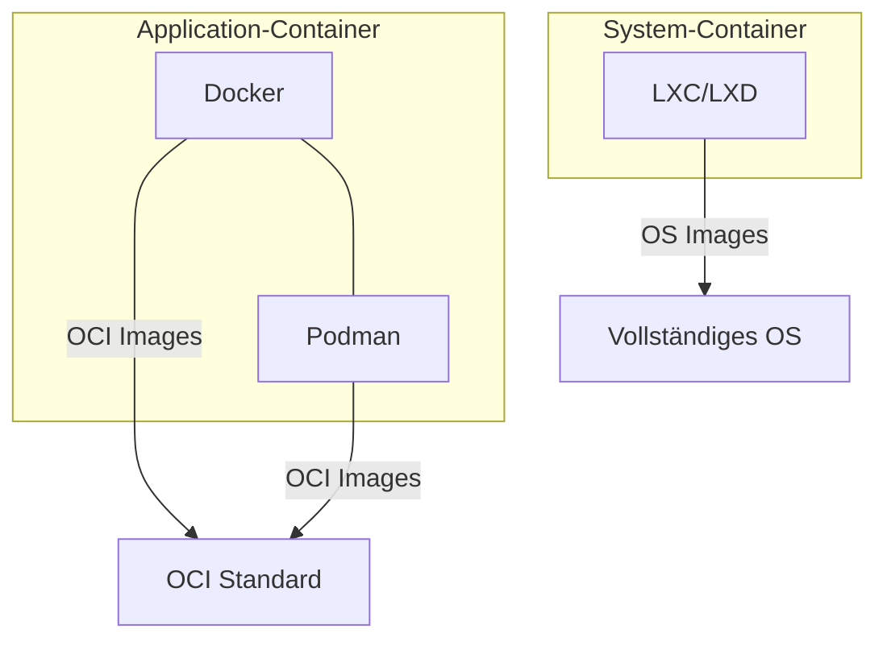
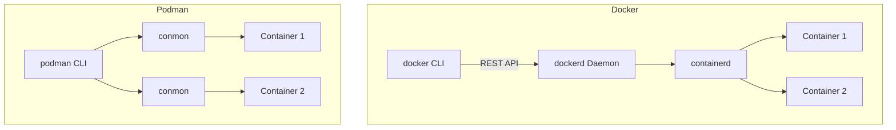

# Docker vs Podman und LXC

> [!ABSTRACT]
> Docker, Podman und LXC/LXD sind drei unterschiedliche Container-Technologien mit verschiedenen Ansätzen. Docker ist der De-facto-Standard für Application-Container, Podman bietet eine daemonlose und rootless-fähige Alternative, und LXC/LXD fokussiert sich auf System-Container als leichtgewichtigen VM-Ersatz.

---

## Überblick

Alle drei Technologien nutzen Linux-Kernel-Features wie **Namespaces** und **cgroups** zur Isolation, unterscheiden sich aber fundamental in Architektur und Einsatzzweck:

| Technologie | Typ | Fokus | Erste Version |
|------------|-----|-------|--------------|
| **Docker** | Application-Container | Apps verpacken und deployen | 2013 |
| **Podman** | Application-Container | Daemonless, rootless Docker-Alternative | 2018 |
| **LXC/LXD** | System-Container | Leichtgewichtige VM-Alternative | 2008 / 2015 |



---

## Docker vs Podman

Podman wurde von Red Hat als **Docker-kompatible Alternative** entwickelt. Das Ziel: gleiche CLI, gleiche Images, aber ohne zentralen Daemon und mit nativem Rootless-Betrieb.

### Architektur

Der fundamentalste Unterschied liegt in der Architektur:

| Aspekt | Docker | Podman |
|--------|--------|--------|
| **Architektur** | Client-Server (Daemon) | Daemonless (Fork-Exec) |
| **Daemon** | `dockerd` läuft als root | Kein Daemon nötig |
| **Prozessmodell** | Container sind Kind-Prozesse des Daemons | Container sind Kind-Prozesse des Users |
| **Systemd-Integration** | Über systemd-Unit für den Daemon | Native systemd-Integration pro Container |
| **Single Point of Failure** | Daemon-Absturz betrifft alle Container | Kein SPOF — Container sind unabhängig |



> [!NOTE] Kein Daemon = Kein SPOF
> Bei Docker sind alle Container Kind-Prozesse des `dockerd`-Daemons. Stürzt der Daemon ab oder wird neugestartet, sind alle Container betroffen. Bei Podman ist jeder Container ein unabhängiger Prozess.

### Rootless-Betrieb

| Aspekt | Docker | Podman |
|--------|--------|--------|
| **Root-Modus** | Standard (Daemon läuft als root) | Unterstützt |
| **Rootless-Modus** | Möglich (seit Docker 20.10), aber nicht Standard | Standard und empfohlen |
| **User Namespaces** | Optional konfigurierbar | Nativ integriert |
| **Privilegierte Ports (<1024)** | Nur mit root oder Capabilities | Über `sysctl` oder `slirp4netns` |

```bash
# Docker rootless (muss separat installiert werden)
dockerd-rootless-setuptool.sh install

# Podman rootless (funktioniert out-of-the-box)
podman run -d -p 8080:80 nginx:alpine
```

> [!TIP] Rootless für mehr Sicherheit
> Im Rootless-Modus kann ein Container-Ausbruch keine root-Rechte auf dem Host erlangen. Podman macht Rootless zum Standard — bei Docker muss es explizit eingerichtet werden.

### CLI-Kompatibilität

Podman wurde bewusst als **Drop-in-Replacement** für Docker konzipiert:

```bash
# Docker-Befehl
docker run -d --name web -p 8080:80 nginx:alpine
docker ps
docker logs web
docker stop web

# Identischer Podman-Befehl
podman run -d --name web -p 8080:80 nginx:alpine
podman ps
podman logs web
podman stop web
```

```bash
# Alias setzen für vollständige Kompatibilität
alias docker=podman
```

> [!WARNING] Nicht 100% kompatibel
> Trotz der CLI-Kompatibilität gibt es Unterschiede: Docker Compose v1 funktioniert nicht mit Podman (v2 über `podman compose` schon), Docker Swarm wird nicht unterstützt, und einige Docker-spezifische API-Endpunkte fehlen.

### Pod-Konzept

Podman unterstützt nativ **Pods** — eine Gruppe von Containern, die sich Netzwerk und IPC teilen (wie Kubernetes-Pods):

```bash
# Pod erstellen
podman pod create --name mein-pod -p 8080:80

# Container im Pod starten
podman run -d --pod mein-pod --name web nginx:alpine
podman run -d --pod mein-pod --name sidecar busybox sleep 3600

# Pod-Status anzeigen
podman pod ps

# Kubernetes-YAML aus Pod generieren
podman generate kube mein-pod > pod.yaml
```

> [!TIP] Von Podman zu Kubernetes
> Mit `podman generate kube` können Pod-Definitionen direkt als Kubernetes-YAML exportiert werden — ideal für den Übergang von lokaler Entwicklung zu Kubernetes.

### Compose-Unterstützung

| Feature | Docker | Podman |
|---------|--------|--------|
| **Docker Compose v2** | `docker compose` (Plugin) | `podman compose` (über podman-compose oder docker-compose) |
| **compose.yaml** | Vollständig unterstützt | Weitgehend kompatibel |
| **Build** | Integriert | Über Buildah |
| **Profiles** | ✅ | ✅ |
| **Watch/Sync** | ✅ | ❌ |

```bash
# Docker Compose
docker compose up -d
docker compose logs -f

# Podman Compose
podman compose up -d
podman compose logs -f
```

### Vergleichstabelle Docker vs Podman

| Feature | Docker | Podman |
|---------|--------|--------|
| **OCI-kompatibel** | ✅ | ✅ |
| **Rootless (Standard)** | ❌ (optional) | ✅ |
| **Daemon** | ✅ (dockerd) | ❌ (daemonless) |
| **Docker Compose** | ✅ | ✅ (eingeschränkt) |
| **Docker Swarm** | ✅ | ❌ |
| **Kubernetes-Integration** | ❌ | ✅ (`generate kube`) |
| **Pods** | ❌ | ✅ |
| **systemd-Integration** | Über Daemon-Unit | Native pro Container |
| **Build-Tool** | docker build (BuildKit) | Buildah |
| **Image-Format** | OCI / Docker v2 | OCI / Docker v2 |
| **Windows/macOS** | Docker Desktop | Podman Desktop / Machine |
| **Community** | Sehr groß | Wachsend |

---

## Docker vs LXC/LXD

LXC (Linux Containers) und sein Management-Layer LXD verfolgen einen fundamental anderen Ansatz als Docker.

### Application-Container vs System-Container

| Aspekt | Docker (Application) | LXC/LXD (System) |
|--------|---------------------|-------------------|
| **Zweck** | Eine Anwendung pro Container | Vollständiges Betriebssystem pro Container |
| **Init-System** | Kein Init (ein Prozess) | Vollständiges Init (systemd, runit) |
| **Mehrere Prozesse** | Anti-Pattern | Normal und gewollt |
| **SSH-Zugang** | Unüblich (docker exec) | Möglich und üblich |
| **Paketmanager** | Während Build (Dockerfile) | Zur Laufzeit (apt, dnf) |
| **Lifecycle** | Kurzlebig (ephemeral) | Langlebig (wie eine VM) |
| **Image-Format** | OCI / Docker | OS-Templates (Squashfs) |
| **Netzwerk** | Docker Networks, Port-Mapping | Bridge, macvlan, SR-IOV |
| **Storage** | Overlay2, Volumes | ZFS, Btrfs, LVM, Dir |

```bash
# Docker: Eine Anwendung starten
docker run -d nginx:alpine

# LXC/LXD: Ein vollständiges Ubuntu-System starten
lxc launch ubuntu:24.04 mein-server
lxc exec mein-server -- bash
# → Vollständige Shell mit systemd, apt, etc.
```

### Wann LXC/LXD statt Docker?

| Szenario | Empfehlung | Begründung |
|----------|-----------|------------|
| Legacy-Anwendung migrieren | **LXC/LXD** | Bestehende Systeme ohne Containerisierung |
| Mehrere Dienste auf einem Host | **LXC/LXD** | Systemd verwaltet Services wie auf einer VM |
| Multi-Tenant-Umgebungen | **LXC/LXD** | Stärkere Isolation, eigenes Netzwerk |
| Microservices | **Docker** | Leichtgewichtig, schnelle Skalierung |
| CI/CD Build-Umgebungen | **Docker** | Reproduzierbare, kurzlebige Umgebungen |
| Entwicklungsumgebungen | **Docker** | Docker Compose, schneller Startup |
| Kubernetes-Workloads | **Docker** | OCI-kompatible Images |
| VM-Ersatz im Homelab | **LXC/LXD** | Vollständiges OS ohne Hypervisor-Overhead |

> [!NOTE] LXD → Incus
> Canonical hat LXD in ein kommerzielles Produkt umgewandelt. Die Community hat daraufhin **Incus** als Fork gestartet, der unter der Linux Containers-Organisation weiterentwickelt wird. Für neue Installationen ist Incus die empfohlene Wahl.

---

## Entscheidungshilfe

| Anforderung | Docker | Podman | LXC/LXD |
|------------|--------|--------|---------|
| Microservices deployen | ✅✅✅ | ✅✅✅ | ❌ |
| Rootless-Sicherheit | ✅ | ✅✅✅ | ✅ |
| Docker Compose nutzen | ✅✅✅ | ✅✅ | ❌ |
| Kubernetes-Migration | ✅✅ | ✅✅✅ | ❌ |
| VM-Ersatz | ❌ | ❌ | ✅✅✅ |
| Legacy-Apps containerisieren | ✅ | ✅ | ✅✅✅ |
| CI/CD Pipelines | ✅✅✅ | ✅✅ | ✅ |
| Homelab Self-Hosting | ✅✅✅ | ✅✅ | ✅✅ |
| Maximale Ecosystem-Unterstützung | ✅✅✅ | ✅✅ | ✅ |
| RHEL/CentOS/Fedora Standard | ❌ | ✅✅✅ | ✅ |

> [!TIP] Pragmatische Empfehlung
> - **Einsteiger und allgemeiner Einsatz** → Docker (größtes Ökosystem, meiste Tutorials)
> - **Sicherheitsfokus oder RHEL-Umgebungen** → Podman (rootless Standard, Red Hat Standard)
> - **VM-Ersatz oder Legacy-Migration** → LXC/LXD/Incus (vollständiges OS im Container)

---

## Verwandte Notizen

- [[Docker Index]]
- [[Was ist Docker]]
- [[Docker Architektur]]
- [[Kubernetes vs Docker und Docker Swarm]] — Container-Runtimes im K8s-Kontext
