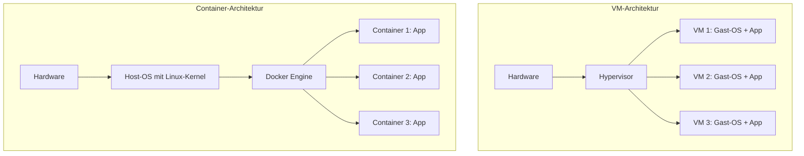

# Was ist Docker

> [!ABSTRACT]
> Docker ist eine Open-Source-Plattform zur Erstellung, Verteilung und Ausführung von Anwendungen in Containern. Container verpacken eine Anwendung mitsamt aller Abhängigkeiten in eine isolierte, portable Einheit, die auf jedem System identisch läuft. Seit der Veröffentlichung 2013 hat Docker die Art und Weise, wie Software entwickelt und bereitgestellt wird, grundlegend verändert.

---

## Herkunft und Geschichte

Docker entstand aus dem internen Tooling der **PaaS-Plattform dotCloud**, einem Unternehmen des französisch-amerikanischen Entwicklers **Solomon Hykes**. Die Technologie basiert auf bestehenden Linux-Kernel-Features wie **cgroups** und **Namespaces**, die Docker erstmals in einer benutzerfreundlichen und einheitlichen Schnittstelle zusammenführte.

Im März 2013 wurde Docker auf der PyCon als Open-Source-Projekt vorgestellt und löste innerhalb kürzester Zeit eine Revolution in der Softwareentwicklung aus. dotCloud wurde daraufhin in **Docker, Inc.** umbenannt, um den Fokus vollständig auf die Container-Technologie zu legen.

| Meilenstein | Beschreibung |
|-------------|-------------|
| 2013 | Solomon Hykes stellt Docker auf der PyCon vor — Open-Source-Release |
| 2014 | Docker 1.0 — Erste produktionsreife Version |
| 2015 | Gründung der **Open Container Initiative (OCI)** für offene Container-Standards |
| 2017 | Moby-Projekt — Docker spaltet die Open-Source-Basis vom kommerziellen Produkt |
| 2019 | Mirantis übernimmt Docker Enterprise — Docker, Inc. fokussiert auf Developer Tools |
| 2020 | Kubernetes deprecates Docker als Container Runtime (zugunsten von containerd) |
| 2023 | 10 Jahre Docker — weltweit über 20 Milliarden Image-Downloads pro Monat |
| 2025 | Aktuelle stabile Version: Docker Engine 28.x |

> [!NOTE] Docker und containerd
> Docker nutzt intern **containerd** als Container Runtime. Auch Kubernetes verwendet containerd direkt. Der Unterschied: Docker bietet zusätzlich eine benutzerfreundliche CLI, Build-Tooling und Docker Compose — Funktionen, die über die reine Runtime hinausgehen.

---

## Was macht Docker?

Docker löst eines der ältesten Probleme der Softwareentwicklung: **„It works on my machine."** Durch Container wird garantiert, dass eine Anwendung auf dem Entwickler-Laptop, dem CI-Server und in Produktion **identisch** läuft.

### Isolation ohne Overhead

Container teilen sich den Kernel des Host-Betriebssystems, laufen aber in isolierten Umgebungen mit eigenem Dateisystem, eigenen Prozessen und eigener Netzwerkkonfiguration. Im Gegensatz zu virtuellen Maschinen entfällt der Overhead eines kompletten Gast-Betriebssystems.

```bash
# Einen Container starten — isoliert vom Host
docker run -d --name mein-nginx -p 8080:80 nginx:alpine

# Prozesse im Container anzeigen — nur nginx sichtbar
docker exec mein-nginx ps aux
```

### Portabilität

Ein Docker-Image läuft überall dort, wo Docker installiert ist — unabhängig von der zugrundeliegenden Infrastruktur. Entwickelt auf Ubuntu, getestet auf macOS, deployed auf AWS — das Image bleibt identisch.

### Reproduzierbare Builds

Ein **Dockerfile** beschreibt exakt, wie ein Image gebaut wird. Jeder Build erzeugt bei gleichen Eingaben das gleiche Ergebnis:

```dockerfile
# Beispiel: Python-Anwendung containerisieren
FROM python:3.12-slim

WORKDIR /app

COPY requirements.txt .
RUN pip install --no-cache-dir -r requirements.txt

COPY . .

EXPOSE 8000

CMD ["python", "main.py"]
```

```bash
# Image bauen
docker build -t meine-app:1.0 .

# Container aus dem Image starten
docker run -d -p 8000:8000 meine-app:1.0
```

### Schnelle Bereitstellung

Container starten in Millisekunden bis Sekunden — nicht in Minuten wie virtuelle Maschinen. Das ermöglicht schnelle Skalierung und kurze Deployment-Zyklen:

```bash
# Container starten und sofort nutzen
docker run --rm -it alpine sh

# Mehrere Instanzen parallel starten
for i in $(seq 1 5); do
  docker run -d --name worker-$i meine-app:1.0
done
```

### Versionierung und Rollback

Jedes Image hat einen **Tag** (Versionsnummer). Alte Versionen bleiben verfügbar, Rollbacks sind trivial:

```bash
# Aktuelle Version deployen
docker run -d --name app meine-app:2.0

# Rollback auf vorherige Version
docker stop app && docker rm app
docker run -d --name app meine-app:1.9
```

---

## Kernkonzepte

Docker basiert auf einer Handvoll zentraler Konzepte, die zusammen das Container-Ökosystem bilden.

### Images

Ein **Image** ist eine schreibgeschützte Vorlage, die alles enthält, was eine Anwendung zum Laufen braucht: Code, Runtime, Bibliotheken, Umgebungsvariablen und Konfigurationsdateien. Images werden aus einem Dockerfile gebaut und bestehen aus übereinander gestapelten **Layern**.

```bash
# Verfügbare Images anzeigen
docker images

# Image aus einer Registry herunterladen
docker pull nginx:alpine
```

### Container

Ein **Container** ist eine laufende Instanz eines Images. Er ist isoliert, hat einen eigenen Dateisystemzustand und kann gestartet, gestoppt und gelöscht werden. Mehrere Container können vom selben Image erzeugt werden.

```bash
# Container erstellen und starten
docker run -d --name webserver nginx:alpine

# Laufende Container anzeigen
docker ps

# Container stoppen und entfernen
docker stop webserver && docker rm webserver
```

### Dockerfile

Das **Dockerfile** ist die Bauanleitung für ein Image. Jede Anweisung erzeugt einen neuen Layer. Häufig verwendete Anweisungen:

| Anweisung | Beschreibung |
|-----------|-------------|
| `FROM` | Basis-Image festlegen |
| `RUN` | Befehl während des Builds ausführen |
| `COPY` / `ADD` | Dateien ins Image kopieren |
| `WORKDIR` | Arbeitsverzeichnis setzen |
| `EXPOSE` | Port dokumentieren (nicht öffnen) |
| `ENV` | Umgebungsvariable setzen |
| `CMD` | Standardbefehl beim Containerstart |
| `ENTRYPOINT` | Fester Einstiegspunkt des Containers |
| `VOLUME` | Mount-Point für persistente Daten |
| `ARG` | Build-Argument (nur zur Build-Zeit verfügbar) |

### Registry

Eine **Registry** ist ein Speicherort für Docker-Images. Die bekannteste öffentliche Registry ist **Docker Hub**. Für private Images können eigene Registries betrieben werden.

```bash
# Image in eine Registry pushen
docker tag meine-app:1.0 registry.example.com/meine-app:1.0
docker push registry.example.com/meine-app:1.0

# Image aus privater Registry ziehen
docker pull registry.example.com/meine-app:1.0
```

### Volumes

**Volumes** ermöglichen persistente Datenspeicherung. Container-Dateisysteme sind flüchtig — wenn ein Container gelöscht wird, gehen alle Daten verloren. Volumes lösen dieses Problem:

```bash
# Named Volume erstellen und verwenden
docker volume create app-daten
docker run -d -v app-daten:/data meine-app:1.0

# Bind Mount — Host-Verzeichnis in Container einbinden
docker run -d -v /host/pfad:/container/pfad meine-app:1.0
```

> [!WARNING] Datenverlust vermeiden
> Ohne Volume oder Bind Mount gehen alle im Container geschriebenen Daten beim Löschen des Containers verloren. Datenbanken, Uploads und Konfigurationen sollten **immer** auf Volumes liegen.

### Netzwerke

Docker erstellt eigene virtuelle Netzwerke, über die Container miteinander kommunizieren können. Standardmäßig gibt es drei Netzwerk-Typen:

| Netzwerk-Typ | Beschreibung |
|--------------|-------------|
| `bridge` | Standard — Container im selben Netzwerk können sich über Namen erreichen |
| `host` | Container nutzt das Netzwerk des Hosts direkt |
| `none` | Kein Netzwerk — vollständig isoliert |

```bash
# Eigenes Netzwerk erstellen
docker network create mein-netz

# Container im selben Netzwerk starten
docker run -d --name db --network mein-netz postgres:16
docker run -d --name app --network mein-netz meine-app:1.0
# → app kann db über den Hostnamen "db" erreichen
```

### Architektur: Container vs VM

Der fundamentale Unterschied zwischen Containern und virtuellen Maschinen liegt in der Abstraktionsebene:



> [!TIP] Kernel-Sharing
> Container teilen sich den Kernel des Hosts und brauchen kein eigenes Betriebssystem. Dadurch sind sie deutlich kleiner und starten wesentlich schneller als VMs.

---

## Container vs Virtuelle Maschinen

| Eigenschaft | Container | Virtuelle Maschine |
|------------|-----------|-------------------|
| **Startzeit** | Sekunden | Minuten |
| **Größe** | MB (typisch 5–500 MB) | GB (typisch 1–40 GB) |
| **Overhead** | Minimal — shared Kernel | Hoch — vollständiges Gast-OS |
| **Isolation** | Prozess-Level (Namespaces, cgroups) | Hardware-Level (Hypervisor) |
| **Betriebssystem** | Teilt Host-Kernel | Eigenes vollständiges OS |
| **Portabilität** | Sehr hoch — Image enthält alles | Eingeschränkt — abhängig vom Hypervisor |
| **Dichte** | Hunderte Container pro Host | Wenige VMs pro Host |
| **Sicherheit** | Gute Isolation, aber shared Kernel | Stärkere Isolation durch Hardware-Trennung |
| **Persistenz** | Flüchtig (Volumes für Daten) | Persistente virtuelle Festplatten |
| **Use Case** | Microservices, CI/CD, Skalierung | Legacy-Apps, starke Isolation, andere OS |

> [!NOTE] Kein Entweder-oder
> Container und VMs ergänzen sich oft. Ein typisches Setup: Docker-Container laufen innerhalb von VMs, die auf einem Hypervisor wie Proxmox betrieben werden. So kombiniert man die starke Isolation von VMs mit der Effizienz von Containern.

---

## Wann Docker einsetzen?

Docker eignet sich hervorragend für viele Szenarien, ist aber nicht immer die beste Wahl.

### Gute Anwendungsfälle

| Szenario | Warum Docker? |
|----------|--------------|
| Microservices | Jeder Service in eigenem Container, unabhängig deploybar |
| CI/CD Pipelines | Reproduzierbare Build- und Testumgebungen |
| Lokale Entwicklung | Einheitliche Entwicklungsumgebung im Team |
| Self-Hosting im Homelab | Schnelles Deployment von Diensten wie Nextcloud, Gitea, Grafana |
| Schnelles Prototyping | Neue Technologien ohne Systemverunreinigung ausprobieren |
| Multi-Service-Stacks | Docker Compose orchestriert mehrere Container als Einheit |
| Isolierte Testumgebungen | Datenbanken, Message-Broker etc. per Container hochfahren |

### Weniger geeignet für

| Szenario | Warum nicht? |
|----------|-------------|
| GUI-Anwendungen (Desktop) | Container sind für Headless-/Server-Anwendungen konzipiert |
| Maximale Sicherheitsisolation | Shared Kernel — VMs bieten stärkere Trennung |
| Bare-Metal-Performance (HPC) | Minimaler, aber messbarer Overhead bei I/O-intensiven Workloads |
| Windows-native Anwendungen auf Linux | Container nutzen den Host-Kernel — kein Cross-OS |
| Persistente Workloads ohne Volume-Konzept | Daten gehen beim Container-Neustart verloren |

> [!TIP] Docker Compose für Homelab
> Für Self-Hosting-Szenarien im Homelab ist **Docker Compose** das ideale Werkzeug. Ein einzelnes `docker-compose.yml` definiert den gesamten Stack — inklusive Netzwerke, Volumes und Umgebungsvariablen.

```yaml
# Beispiel: Kompletter Webstack mit Docker Compose
services:
  app:
    image: meine-app:1.0
    ports:
      - "8080:8080"
    depends_on:
      - db
    environment:
      - DB_HOST=db
    networks:
      - backend

  db:
    image: postgres:16-alpine
    volumes:
      - db-daten:/var/lib/postgresql/data
    environment:
      - POSTGRES_PASSWORD=geheim
    networks:
      - backend

volumes:
  db-daten:

networks:
  backend:
```

---

## Grundlegende Begriffe

| Begriff | Bedeutung |
|---------|-----------|
| **Image** | Schreibgeschützte Vorlage mit App, Abhängigkeiten und Konfiguration |
| **Container** | Laufende Instanz eines Images — isolierter Prozess auf dem Host |
| **Dockerfile** | Textdatei mit Bauanleitung für ein Image |
| **Registry** | Speicherort für Images (z. B. Docker Hub, GitHub Container Registry) |
| **Volume** | Mechanismus für persistente Datenspeicherung außerhalb des Containers |
| **Network** | Virtuelles Netzwerk für die Kommunikation zwischen Containern |
| **Compose** | Tool zur Definition und Verwaltung von Multi-Container-Anwendungen |
| **Layer** | Einzelne Schicht eines Images — jede Dockerfile-Anweisung erzeugt einen Layer |
| **Tag** | Versionskennung eines Images (z. B. `nginx:1.27`, `alpine:latest`) |
| **Daemon** | Hintergrundprozess (`dockerd`), der Container, Images und Netzwerke verwaltet |
| **CLI** | Kommandozeilen-Tool `docker` zur Interaktion mit dem Daemon |
| **Build Context** | Verzeichnis, das beim `docker build` an den Daemon gesendet wird |
| **Entrypoint** | Fester Startbefehl eines Containers, der nicht einfach überschrieben wird |
| **Port Mapping** | Weiterleitung eines Host-Ports an einen Container-Port (`-p 8080:80`) |
| **Bind Mount** | Direktes Einbinden eines Host-Verzeichnisses in einen Container |

---

## Verwandte Notizen

- [[Docker Index]]
- [[Docker Architektur]]
- [[Docker vs Podman und LXC]]
- [[Docker Images]]
- [[Was ist Kubernetes]] — Kubernetes orchestriert Docker-Container im Cluster
- [[Kubernetes vs Docker und Docker Swarm]] — Vergleich der Orchestrierungslösungen
