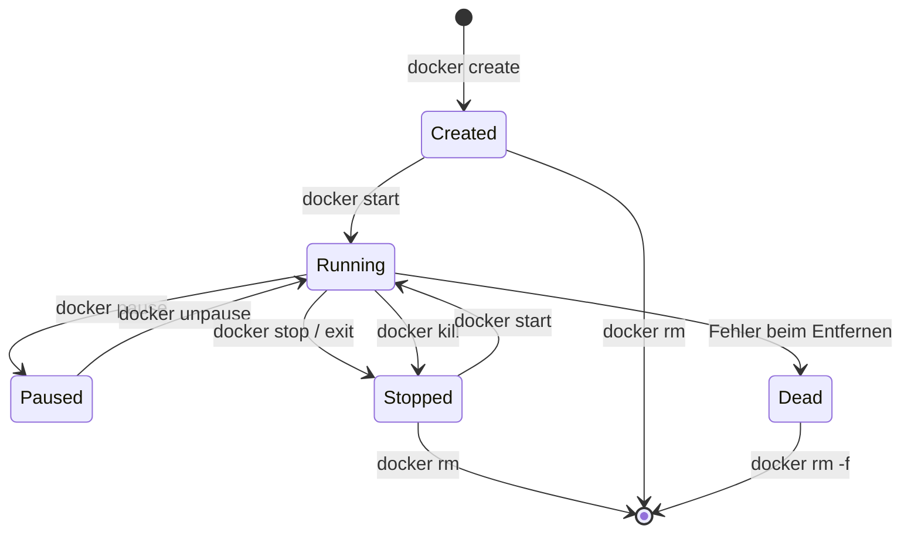

---
tags:
  - docker
  - container
  - lifecycle
  - management
---

# Container Lifecycle

> [!ABSTRACT]
> Ein Docker-Container durchläuft einen klar definierten Lebenszyklus — von der Erstellung über die Ausführung bis zur Entfernung. Diese Dokumentation beschreibt alle Zustände, Übergänge, Steuerungsbefehle, Restart Policies, Ressourcen-Limits und Housekeeping-Strategien.

---

## Container-Zustände

Jeder Docker-Container befindet sich zu jedem Zeitpunkt in genau einem der folgenden Zustände:

| Zustand | Beschreibung |
|---------|-------------|
| **Created** | Container wurde erstellt, aber noch nicht gestartet |
| **Running** | Container läuft aktiv mit einem laufenden Hauptprozess |
| **Paused** | Alle Prozesse im Container sind eingefroren (SIGSTOP) |
| **Stopped** | Der Hauptprozess wurde beendet (Exit Code verfügbar) |
| **Dead** | Container konnte nicht vollständig entfernt werden (Fehler) |

### State-Diagramm



> [!TIP] Zustand prüfen
> Der aktuelle Zustand eines Containers lässt sich jederzeit mit `docker inspect --format '{{.State.Status}}' <container>` abfragen.

---

## Container erstellen und starten

### docker create — Container erstellen

`docker create` legt einen neuen Container an, ohne ihn zu starten. Der Container befindet sich danach im Zustand **Created**.

```bash
# Container erstellen (ohne Start)
docker create --name mein-nginx nginx:alpine

# Datei in einen erstellten Container kopieren
docker cp ./nginx.conf mein-nginx:/etc/nginx/nginx.conf

# Danach starten
docker start mein-nginx
```

### docker start — Container starten

`docker start` versetzt einen **Created** oder **Stopped** Container in den Zustand **Running**.

```bash
# Container im Hintergrund starten
docker start mein-nginx

# Container starten und an STDOUT anhängen
docker start -a mein-nginx

# Container starten mit interaktivem Terminal
docker start -ai mein-nginx
```

### docker run — Erstellen und Starten kombiniert

`docker run` ist die Kombination aus `docker create` + `docker start` und der am häufigsten verwendete Befehl.

```bash
# Einfacher Container im Vordergrund
docker run nginx:alpine

# Detached Mode (Hintergrund)
docker run -d --name webserver nginx:alpine

# Interactive Mode (Shell im Container)
docker run -it --name debug ubuntu:24.04 /bin/bash

# Mit Port-Mapping und Volume
docker run -d \
  --name webserver \
  -p 8080:80 \
  -v ./html:/usr/share/nginx/html:ro \
  nginx:alpine
```

### Detached vs. Interactive Mode

| Flag | Modus | Beschreibung |
|------|-------|-------------|
| `-d` | Detached | Container läuft im Hintergrund, Terminal wird freigegeben |
| `-it` | Interactive | `-i` hält STDIN offen, `-t` weist ein Pseudo-TTY zu |
| `-dit` | Detached + Interactive | Läuft im Hintergrund, man kann sich später mit `attach` verbinden |

> [!WARNING] Vordergrund-Prozess
> Ein Container läuft nur so lange, wie sein Hauptprozess (PID 1) aktiv ist. Ein `docker run ubuntu echo "Hallo"` erstellt einen Container, gibt "Hallo" aus und stoppt sofort.

---

## Container stoppen und entfernen

### docker stop — Graceful Shutdown

`docker stop` sendet zuerst ein **SIGTERM** an den Hauptprozess und wartet eine Gnadenfrist (Standard: 10 Sekunden). Reagiert der Prozess nicht, folgt ein **SIGKILL**.

```bash
# Container stoppen (10s Gnadenfrist)
docker stop webserver

# Eigene Gnadenfrist setzen (30 Sekunden)
docker stop -t 30 webserver

# Mehrere Container gleichzeitig stoppen
docker stop webserver database cache
```

### docker kill — Sofortiges Beenden

```bash
# Sofort beenden (SIGKILL)
docker kill webserver

# Bestimmtes Signal senden
docker kill --signal=SIGHUP webserver
```

> [!WARNING] Datenverlust bei docker kill
> `docker kill` gibt dem Prozess keine Möglichkeit, Daten zu flushen oder Verbindungen sauber zu schließen. In Produktionsumgebungen immer `docker stop` bevorzugen.

### docker rm — Container entfernen

```bash
# Gestoppten Container entfernen
docker rm webserver

# Laufenden Container erzwungen entfernen
docker rm -f webserver

# Container entfernen und zugehörige anonyme Volumes löschen
docker rm -v webserver

# Alle gestoppten Container entfernen
docker rm $(docker ps -aq -f status=exited)
```

> [!TIP] Automatische Bereinigung mit --rm
> Mit `docker run --rm` wird der Container nach Beendigung automatisch entfernt. Ideal für einmalige Aufgaben:
> ```bash
> docker run --rm -it alpine sh
> docker run --rm curlimages/curl https://example.com
> ```

---

## Container inspizieren

### docker inspect — Detaillierte Metadaten

```bash
# Vollständige Inspektion
docker inspect webserver

# Nur die IP-Adresse
docker inspect --format '{{.NetworkSettings.IPAddress}}' webserver

# Nur den Zustand
docker inspect --format '{{.State.Status}}' webserver

# Mount-Points anzeigen
docker inspect --format '{{json .Mounts}}' webserver | jq
```

### docker logs — Ausgaben lesen

```bash
# Alle Logs anzeigen
docker logs webserver

# Letzte 50 Zeilen
docker logs --tail 50 webserver

# Logs in Echtzeit verfolgen
docker logs -f webserver

# Logs mit Zeitstempel
docker logs -t webserver

# Logs seit einem Zeitpunkt
docker logs --since 30m webserver

# Kombination: Letzte 20 Zeilen + Follow + Timestamps
docker logs --tail 20 -f -t webserver
```

### docker stats — Ressourcenverbrauch

```bash
# Live-Statistiken aller laufenden Container
docker stats

# Einmalige Ausgabe (kein Stream)
docker stats --no-stream

# Eigenes Format
docker stats --format "table {{.Name}}\t{{.CPUPerc}}\t{{.MemUsage}}"
```

### docker top — Prozesse im Container

```bash
# Laufende Prozesse anzeigen
docker top webserver

# Mit erweiterten Optionen
docker top webserver -eo pid,user,cmd,%mem,%cpu
```

### docker diff — Dateisystem-Änderungen

```bash
# Änderungen anzeigen (A=Added, C=Changed, D=Deleted)
docker diff webserver
```

---

## In laufende Container einsteigen

### docker exec — Befehle ausführen

`docker exec` startet einen **neuen Prozess** innerhalb eines laufenden Containers.

```bash
# Interaktive Shell öffnen
docker exec -it webserver /bin/bash
docker exec -it webserver /bin/sh

# Einzelnen Befehl ausführen
docker exec webserver cat /etc/nginx/nginx.conf

# Als bestimmter User
docker exec -u root webserver whoami

# Mit Umgebungsvariable
docker exec -e DEBUG=true webserver env

# In einem bestimmten Arbeitsverzeichnis
docker exec -w /var/log webserver ls -la
```

### docker attach — An den Hauptprozess anhängen

```bash
# An Container anhängen
docker attach webserver
```

> [!WARNING] Unterschied zwischen exec und attach
> - `docker exec` startet einen **neuen, zusätzlichen Prozess** — das Beenden der Shell stoppt den Container **nicht**
> - `docker attach` verbindet sich mit dem **Hauptprozess** (PID 1) — ein `exit` oder `Ctrl+C` kann den Container **stoppen**
>
> Zum Debuggen ist `docker exec -it` fast immer die bessere Wahl. Zum Detachen von `attach` die Tastenkombination `Ctrl+P, Ctrl+Q` verwenden.

---

## Restart Policies

Restart Policies bestimmen, ob und wann Docker einen gestoppten Container automatisch neu startet.

```bash
# Restart Policy beim Erstellen setzen
docker run -d --restart=always --name webserver nginx:alpine

# Restart Policy eines laufenden Containers ändern
docker update --restart=unless-stopped webserver
```

### Übersicht der Policies

| Policy | Neustart bei Exit | Neustart bei Fehler | Neustart bei Daemon-Start |
|--------|:-----------------:|:-------------------:|:-------------------------:|
| `no` | ❌ | ❌ | ❌ |
| `always` | ✅ | ✅ | ✅ |
| `unless-stopped` | ✅ | ✅ | ❌ (wenn manuell gestoppt) |
| `on-failure[:N]` | ❌ | ✅ (max N Versuche) | ✅ |

```bash
# Unbegrenzte Versuche bei Fehler
docker run -d --restart=on-failure --name worker myapp:latest

# Maximal 5 Neustartversuche
docker run -d --restart=on-failure:5 --name worker myapp:latest
```

> [!TIP] Policy-Wahl
> - **Produktionsservices** → `unless-stopped` (respektiert manuelles Stoppen)
> - **Kritische Infrastruktur** → `always` (läuft immer)
> - **Batch-Jobs mit Retry** → `on-failure:3` (Neustart nur bei Fehler)
> - **Einmalige Aufgaben** → `no` oder `--rm` (kein Neustart)

---

## Ressourcen-Limits

Ohne Limits kann ein einzelner Container alle Host-Ressourcen verbrauchen.

### CPU-Limits

| Flag | Beschreibung | Beispiel |
|------|-------------|---------|
| `--cpus` | Maximale Anzahl CPU-Kerne (Dezimal) | `--cpus=1.5` |
| `--cpu-shares` | Relative CPU-Gewichtung (Standard: 1024) | `--cpu-shares=512` |
| `--cpuset-cpus` | Pinning auf bestimmte CPU-Kerne | `--cpuset-cpus="0,2"` |

```bash
# Maximal 1.5 CPU-Kerne nutzen
docker run -d --cpus=1.5 --name app myapp:latest

# Auf bestimmte Kerne pinnen
docker run -d --cpuset-cpus="0,2" --name pinned myapp:latest
```

### Memory-Limits

| Flag | Beschreibung | Beispiel |
|------|-------------|---------|
| `--memory` / `-m` | Maximaler RAM | `-m 512m` |
| `--memory-swap` | RAM + Swap zusammen | `--memory-swap=1g` |
| `--memory-reservation` | Soft-Limit (Best Effort) | `--memory-reservation=256m` |

```bash
# 512 MB RAM, 1 GB Swap+RAM
docker run -d --memory=512m --memory-swap=1g --name app myapp:latest

# 256 MB RAM, kein Swap erlaubt
docker run -d --memory=256m --memory-swap=256m --name strict-app myapp:latest
```

> [!WARNING] OOM-Killer
> Wenn ein Container sein Memory-Limit überschreitet, wird er vom Linux OOM-Killer beendet (Exit Code 137). Definiere immer Memory-Limits für Produktions-Container.

### Limits nachträglich ändern

```bash
docker update --cpus=2 --memory=1g webserver
```

---

## Umgebungsvariablen

Umgebungsvariablen sind der bevorzugte Weg, um Container zur Laufzeit zu konfigurieren.

```bash
# Einzelne Variable
docker run -d -e POSTGRES_PASSWORD=geheim --name db postgres:16

# Mehrere Variablen
docker run -d \
  -e POSTGRES_USER=admin \
  -e POSTGRES_PASSWORD=geheim \
  -e POSTGRES_DB=myapp \
  --name db postgres:16

# Variable vom Host übernehmen (ohne =Wert)
export API_KEY="abc123"
docker run -d -e API_KEY --name app myapp:latest
```

### Env-File mit --env-file

```bash
# app.env
DB_HOST=database
DB_PORT=5432
DB_USER=admin
APP_ENV=production

# Container mit Env-File starten
docker run -d --env-file=app.env --name app myapp:latest
```

> [!WARNING] Sensible Daten
> Umgebungsvariablen sind über `docker inspect` sichtbar. Für echte Secrets in Produktionsumgebungen Docker Secrets (Swarm) oder externe Secret-Manager verwenden. Env-Files niemals committen.

---

## Container-Housekeeping

Ohne regelmäßige Bereinigung sammeln sich gestoppte Container, ungenutzte Images und verwaiste Volumes an.

### Disk Usage anzeigen

```bash
# Übersicht über Docker-Speicherverbrauch
docker system df

# Detaillierte Ansicht
docker system df -v
```

### Bereinigungsbefehle

| Befehl | Entfernt |
|--------|---------|
| `docker container prune` | Alle gestoppten Container |
| `docker image prune` | Dangling Images (ohne Tag) |
| `docker image prune -a` | Alle ungenutzten Images |
| `docker volume prune` | Alle ungenutzten Volumes |
| `docker network prune` | Alle ungenutzten Netzwerke |
| `docker builder prune` | Build Cache |
| `docker system prune` | Container + Images + Netzwerke + Cache |
| `docker system prune -a --volumes` | Alles Ungenutzte inkl. Volumes |

```bash
# Gestoppte Container entfernen (ohne Bestätigung)
docker container prune -f

# System-weite Bereinigung
docker system prune -a

# Mit Alters-Filter
docker system prune -a --filter "until=168h"
```

> [!DANGER] Datenverlust bei Volume-Prune
> `docker system prune --volumes` und `docker volume prune` entfernen alle Volumes, die nicht an einen laufenden Container gebunden sind. Vor dem Ausführen immer prüfen:
> ```bash
> docker volume ls -f dangling=true
> ```

---

## Verwandte Notizen

- [[Docker Index]]
- [[Docker Images]]
- [[Docker Volumes und Storage]]
- [[Docker Networking]]
- [[Docker CLI Cheatsheet]]
- [[Pods]] — Container-Lifecycle innerhalb von Kubernetes Pods
