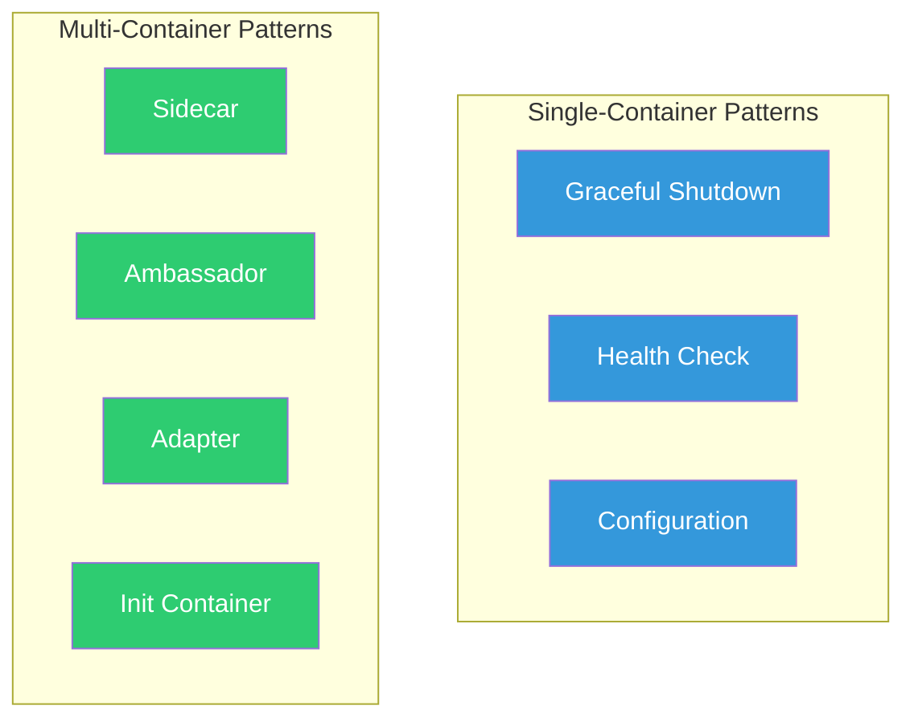

---
tags:
  - docker
  - container
  - patterns
  - architektur
  - design
---

# Docker Container Patterns

> [!ABSTRACT] TL;DR
> Bewährte Architektur-Patterns für Container-basierte Anwendungen — von Sidecar und Init-Container über Ambassador und Adapter bis hin zu Graceful Shutdown und Health Check Patterns. Diese Patterns lösen wiederkehrende Probleme beim Container-Design und sind die Grundlage für Microservice-Architekturen.

---

## Übersicht



---

## Sidecar Pattern

Ein **Sidecar-Container** erweitert den Hauptcontainer um Funktionalität, ohne dessen Code zu ändern. Er teilt sich Netzwerk oder Volumes mit dem Hauptcontainer.

### Typische Sidecar-Aufgaben

| Sidecar | Aufgabe | Beispiel |
|---------|---------|---------|
| Log-Shipper | Logs sammeln und weiterleiten | Promtail, Fluent Bit |
| Monitoring Agent | Metriken exportieren | Prometheus Exporter |
| Proxy | Traffic routen/filtern | Envoy, Nginx |
| Sync | Dateien synchronisieren | Git-Sync, S3-Sync |
| Backup | Datenbank-Dumps erstellen | pg_dump-Cron |

### Beispiel: Log-Sidecar

```yaml
services:
  app:
    image: myapp:1.0.0
    volumes:
      - app-logs:/var/log/app

  log-shipper:
    image: grafana/promtail:3.1.0
    volumes:
      - app-logs:/var/log/app:ro
    configs:
      - source: promtail-config
        target: /etc/promtail/config.yml
    command: -config.file=/etc/promtail/config.yml
    depends_on:
      - app

volumes:
  app-logs:

configs:
  promtail-config:
    file: ./promtail-config.yml
```

### Beispiel: Reverse-Proxy-Sidecar

```yaml
services:
  app:
    image: myapp:1.0.0
    # App hört nur auf localhost — nicht direkt erreichbar
    expose:
      - "8080"

  nginx-proxy:
    image: nginx:1.27-alpine
    ports:
      - "443:443"
    volumes:
      - ./nginx.conf:/etc/nginx/conf.d/default.conf:ro
      - certs:/etc/nginx/certs:ro
    depends_on:
      - app

volumes:
  certs:
```

> [!TIP] Wann Sidecar verwenden?
> Wenn eine Querschnittsfunktion (Logging, Monitoring, Proxy) **unabhängig** vom Hauptcontainer entwickelt und aktualisiert werden soll. Der Hauptcontainer bleibt schlank und fokussiert auf seine Kernaufgabe.

---

## Init Container Pattern

Ein **Init-Container** führt Vorbereitungsaufgaben aus, **bevor** der Hauptcontainer startet. Er läuft einmalig und beendet sich dann.

### Typische Init-Aufgaben

| Aufgabe | Beschreibung |
|---------|-------------|
| Datenbank-Migration | Schema-Änderungen vor dem App-Start |
| Config-Generierung | Konfiguration aus Templates erstellen |
| Dependency-Check | Warten bis Datenbank erreichbar ist |
| Datei-Download | Initiale Daten oder Modelle laden |
| Permission-Fix | Volume-Berechtigungen setzen |

### Beispiel: Datenbank-Migration

```yaml
services:
  # Init: Migration ausführen
  migrate:
    image: myapp:1.0.0
    command: ["python", "manage.py", "migrate", "--noinput"]
    environment:
      - DATABASE_URL=postgres://user:pass@db:5432/app
    depends_on:
      db:
        condition: service_healthy
    restart: "no"  # Nur einmal ausführen

  # Hauptcontainer: erst nach Migration starten
  app:
    image: myapp:1.0.0
    command: ["gunicorn", "app.wsgi:application"]
    depends_on:
      migrate:
        condition: service_completed_successfully
      db:
        condition: service_healthy

  db:
    image: postgres:16-alpine
    healthcheck:
      test: ["CMD-SHELL", "pg_isready -U user"]
      interval: 5s
      timeout: 5s
      retries: 5
```

### Beispiel: Wait-for-Dependencies

```yaml
services:
  wait-for-db:
    image: busybox:1.36
    command: >
      sh -c "
        echo 'Warte auf Datenbank...'
        until nc -z db 5432; do
          sleep 1
        done
        echo 'Datenbank erreichbar!'
      "
    depends_on:
      - db
    restart: "no"

  app:
    image: myapp:1.0.0
    depends_on:
      wait-for-db:
        condition: service_completed_successfully
```

> [!NOTE] `service_completed_successfully` (Docker Compose v2.20+)
> Diese Bedingung wartet, bis der Init-Container mit Exit-Code 0 beendet ist. Damit lässt sich die Startreihenfolge zuverlässig steuern — `depends_on` allein wartet nur auf den Container-Start, nicht auf die Bereitschaft.

---

## Ambassador Pattern

Ein **Ambassador-Container** fungiert als Proxy zur Außenwelt und abstrahiert externe Services. Die Anwendung kommuniziert nur mit dem Ambassador auf `localhost`.

### Beispiel: Datenbank-Proxy

```yaml
services:
  app:
    image: myapp:1.0.0
    environment:
      # App verbindet sich zu localhost — weiß nichts über den echten DB-Host
      - DATABASE_HOST=localhost
      - DATABASE_PORT=5432

  db-ambassador:
    image: haproxy:2.9-alpine
    network_mode: "service:app"  # Teilt Netzwerk-Namespace mit app
    configs:
      - source: haproxy-config
        target: /usr/local/etc/haproxy/haproxy.cfg

configs:
  haproxy-config:
    file: ./haproxy.cfg
```

```cfg
# haproxy.cfg
frontend db_frontend
    bind *:5432
    default_backend db_backend

backend db_backend
    server db1 production-db.example.com:5432 check
    server db2 replica-db.example.com:5432 check backup
```

### Vorteile des Ambassador Patterns

| Vorteil | Beschreibung |
|---------|-------------|
| Entkopplung | App kennt keine externen Hostnamen |
| Umgebungs-Unabhängigkeit | Dev → Staging → Production ohne App-Änderung |
| Connection Pooling | Ambassador kann Verbindungen bündeln |
| Failover | Automatisches Umschalten auf Backup-Server |
| TLS-Terminierung | Ambassador handhabt TLS, App kommuniziert im Klartext |

---

## Adapter Pattern

Ein **Adapter-Container** transformiert die Ausgabe des Hauptcontainers in ein standardisiertes Format — typischerweise für Monitoring oder Logging.

### Beispiel: Prometheus-Adapter

```yaml
services:
  # Legacy-App ohne Prometheus-Metriken
  legacy-app:
    image: legacy-app:3.2.1
    volumes:
      - app-metrics:/var/log/metrics

  # Adapter wandelt Logfiles in Prometheus-Format
  metrics-adapter:
    image: prom/statsd-exporter:v0.26.0
    volumes:
      - app-metrics:/var/log/metrics:ro
    ports:
      - "9102:9102"
    configs:
      - source: mapping-config
        target: /etc/statsd/mapping.yml
    command: ["--statsd.mapping-config=/etc/statsd/mapping.yml"]

volumes:
  app-metrics:

configs:
  mapping-config:
    file: ./statsd-mapping.yml
```

### Beispiel: Log-Format-Adapter

```yaml
services:
  app:
    image: legacy-app:1.0.0
    # App loggt in einem proprietären Format
    volumes:
      - raw-logs:/var/log/app

  log-adapter:
    image: alpine:3.20
    volumes:
      - raw-logs:/var/log/app:ro
    command: >
      sh -c "
        tail -f /var/log/app/app.log | \
        awk '{print \"{\\\"timestamp\\\":\\\"\" $$1 \"\\\",\\\"level\\\":\\\"\" $$2 \"\\\",\\\"message\\\":\\\"\" substr($$0,index($$0,$$3)) \"\\\"}\"}'
      "

volumes:
  raw-logs:
```

---

## Graceful Shutdown Pattern

Container müssen sauber herunterfahren können, um keine Daten zu verlieren und aktive Requests abzuschließen.

### Signal-Handling im Dockerfile

```dockerfile
# SCHLECHT — Shell-Form: SIGTERM erreicht Node.js nicht
CMD npm start

# GUT — Exec-Form: SIGTERM geht direkt an Node.js
CMD ["node", "server.js"]

# BEST — tini als Init-System für korrekte Signal-Weiterleitung
RUN apk add --no-cache tini
ENTRYPOINT ["/sbin/tini", "--"]
CMD ["node", "server.js"]
```

### Graceful Shutdown in der Anwendung

```javascript
// Node.js — Graceful Shutdown
const server = app.listen(3000);

process.on('SIGTERM', () => {
    console.log('SIGTERM empfangen — fahre herunter...');
    server.close(() => {
        console.log('Alle Verbindungen geschlossen');
        process.exit(0);
    });

    // Fallback: nach 30s forcieren
    setTimeout(() => {
        console.error('Erzwungener Shutdown nach Timeout');
        process.exit(1);
    }, 30000);
});
```

```python
# Python — Graceful Shutdown
import signal
import sys

def shutdown_handler(signum, frame):
    print("SIGTERM empfangen — räume auf...")
    # Verbindungen schließen, offene Tasks beenden
    cleanup()
    sys.exit(0)

signal.signal(signal.SIGTERM, shutdown_handler)
```

### Stop-Timeout konfigurieren

```yaml
# Docker Compose
services:
  app:
    stop_grace_period: 30s  # Standard: 10s
```

```bash
# Docker CLI
docker stop --time=30 mycontainer
```

> [!IMPORTANT] Standard-Timeout ist 10 Sekunden
> Nach `docker stop` sendet Docker SIGTERM und wartet 10 Sekunden. Reagiert der Container nicht, folgt SIGKILL. Für Anwendungen mit langen Requests oder Cleanup-Aufgaben muss `stop_grace_period` erhöht werden.

---

## Health Check Pattern

Health Checks ermöglichen Docker, den Zustand eines Containers zu überwachen und fehlerhafte Container zu erkennen.

### Drei Ebenen von Health Checks

| Ebene | Prüfung | Beispiel |
|-------|---------|---------|
| **Liveness** | Läuft der Prozess? | TCP-Port erreichbar |
| **Readiness** | Kann der Service Requests bearbeiten? | HTTP 200 auf `/health` |
| **Startup** | Ist die Initialisierung abgeschlossen? | `start_period` Parameter |

### Health-Check-Implementierung

```dockerfile
# Einfach: HTTP-Check
HEALTHCHECK --interval=30s --timeout=5s --retries=3 --start-period=60s \
    CMD curl -f http://localhost:8080/health || exit 1

# Ohne curl: wget (Alpine)
HEALTHCHECK CMD wget -q --spider http://localhost:8080/health || exit 1

# Datenbank: pg_isready
HEALTHCHECK CMD pg_isready -U postgres || exit 1

# Redis: redis-cli
HEALTHCHECK CMD redis-cli ping | grep PONG || exit 1

# Custom Script
HEALTHCHECK CMD /app/healthcheck.sh || exit 1
```

### Health-Endpoint Best Practices

```javascript
// Umfassender Health-Endpoint
app.get('/health', async (req, res) => {
    const checks = {
        status: 'ok',
        uptime: process.uptime(),
        timestamp: new Date().toISOString(),
        checks: {}
    };

    // Datenbank-Verbindung prüfen
    try {
        await db.query('SELECT 1');
        checks.checks.database = 'ok';
    } catch (err) {
        checks.checks.database = 'error';
        checks.status = 'degraded';
    }

    // Redis prüfen
    try {
        await redis.ping();
        checks.checks.redis = 'ok';
    } catch (err) {
        checks.checks.redis = 'error';
        checks.status = 'degraded';
    }

    const statusCode = checks.status === 'ok' ? 200 : 503;
    res.status(statusCode).json(checks);
});
```

---

## Configuration Pattern

Konfiguration sollte **nie** im Image gespeichert werden, sondern zur Laufzeit injiziert werden.

### 12-Factor-App Prinzip

```yaml
services:
  app:
    image: myapp:1.0.0

    # Methode 1: Environment-Variablen
    environment:
      - LOG_LEVEL=info
      - PORT=8080
      - NODE_ENV=production

    # Methode 2: .env-Datei
    env_file:
      - .env.production

    # Methode 3: Config-Dateien als Volume
    volumes:
      - ./config/app.yml:/app/config.yml:ro

    # Methode 4: Docker Secrets (für sensible Daten)
    secrets:
      - db_password
```

### Priorisierung der Konfigurationsquellen

| Priorität | Quelle | Verwendung |
|-----------|--------|------------|
| 1 (höchste) | CLI-Argumente | Debugging, temporäre Overrides |
| 2 | Environment-Variablen | Deployment-spezifische Werte |
| 3 | Config-Dateien (Volume) | Komplexe Konfiguration |
| 4 | Docker Secrets | Passwörter, Zertifikate, API-Keys |
| 5 (niedrigste) | Defaults im Code | Sinnvolle Standardwerte |

---

## Pattern-Auswahl

| Problem | Pattern | Lösung |
|---------|---------|--------|
| Logging/Monitoring ergänzen | **Sidecar** | Separater Container sammelt Logs/Metriken |
| Datenbank-Migrationen | **Init Container** | Migration vor App-Start ausführen |
| Externe Service-Abstraktion | **Ambassador** | Proxy für DB/API mit Failover |
| Legacy-Metriken exportieren | **Adapter** | Format-Konvertierung für Prometheus |
| Sauberes Herunterfahren | **Graceful Shutdown** | SIGTERM-Handling + tini |
| Container-Überwachung | **Health Check** | HEALTHCHECK mit Start-Period |
| Konfigurations-Trennung | **Configuration** | Env-Vars + Secrets + Volumes |

---

## Verwandte Notizen

- [[Docker Compose]] — Multi-Container-Anwendungen mit Compose
- [[Docker Compose Beispiele]] — Praxis-Beispiele
- [[Container Lifecycle]] — Container-Lebenszyklus und States
- [[Docker Networking]] — Netzwerk-Modi und Container-Kommunikation
- [[Docker Best Practices]] — Produktions-Checkliste
- [[Dockerfile]] — Dockerfile-Referenz
- [[Docker Security und Hardening]] — Sicherheits-Best-Practices
