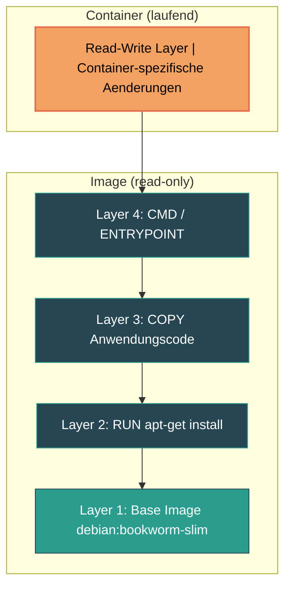
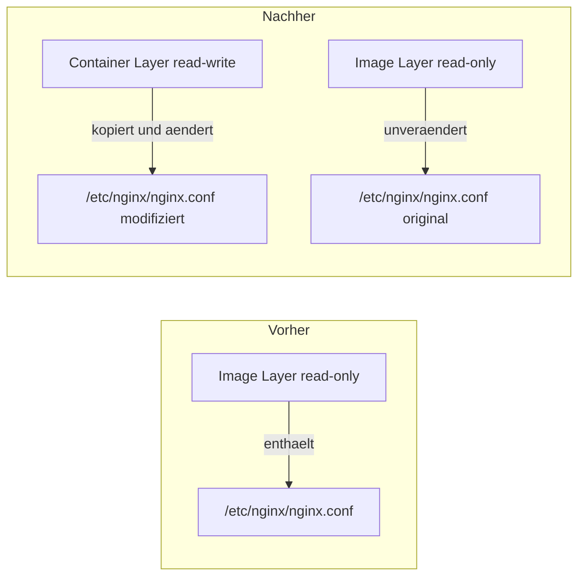

# Docker Images

> [!ABSTRACT] TL;DR
> Ein Docker Image ist ein unveränderliches, schichtbasiertes Template, aus dem Container instanziiert werden. Images bestehen aus übereinanderliegenden Layern, werden über Tags und Digests identifiziert und können durch Multi-Stage Builds, Alpine Base Images und Layer-Optimierung schlank und sicher gehalten werden.

---

## Was ist ein Docker Image?

Ein **Docker Image** ist ein schreibgeschütztes Paket, das alles enthält, was zum Ausführen einer Anwendung benötigt wird: Betriebssystem-Bibliotheken, Laufzeitumgebung, Anwendungscode, Abhängigkeiten und Konfigurationsdateien.

Images sind **unveränderlich** (immutable). Sobald ein Image gebaut wurde, ändert sich sein Inhalt nicht mehr. Jede Änderung erzeugt ein neues Image mit einem neuen Hash.

### Die Bauplan-Analogie

Der Zusammenhang zwischen Image und Container lässt sich am besten so verstehen:

| Konzept | Analogie | Beschreibung |
|---------|----------|-------------|
| **Image** | Bauplan / Klasse | Statische Vorlage mit allen Anweisungen |
| **Container** | Gebäude / Instanz | Laufende Instanz, die aus dem Image erzeugt wird |
| **Registry** | Archiv / Bibliothek | Zentraler Speicherort für Images |

Aus einem einzelnen Image können **beliebig viele Container** gleichzeitig gestartet werden — jeder mit eigenem Zustand, aber basierend auf demselben Fundament.

```bash
# Ein Image, drei Container
docker run -d --name web1 nginx:alpine
docker run -d --name web2 nginx:alpine
docker run -d --name web3 nginx:alpine
```

> [!NOTE] Unveränderlichkeit als Prinzip
> Die Immutability von Images garantiert **Reproduzierbarkeit**: Dasselbe Image verhält sich auf dem Laptop identisch wie in der Produktion. Änderungen an einem laufenden Container betreffen nur dessen beschreibbare Schicht — das zugrunde liegende Image bleibt unverändert.

---

## Image Layers

Docker Images bestehen aus einer Reihe von **Layern** (Schichten), die übereinandergestapelt werden. Jede Anweisung in einem [[Dockerfile]] erzeugt einen neuen Layer.

### Das Schichtenmodell



### Union Filesystem

Docker verwendet ein **Union Filesystem** (z. B. OverlayFS), das mehrere Layer transparent zu einem einzigen Dateisystem zusammenfasst. Aus Sicht des Containers sieht es aus wie ein normales Dateisystem — unter der Haube sind die Schichten aber getrennt.

```bash
# Layer-Informationen eines Images anzeigen
docker image inspect nginx:alpine --format '{{json .RootFS.Layers}}' | jq .
```

### Copy-on-Write (CoW)

Wenn ein Container eine Datei aus einem read-only Layer verändern möchte, wird diese Datei zuerst in den **beschreibbaren Container-Layer** kopiert und dort modifiziert. Das Original im Image-Layer bleibt unverändert.



> [!TIP] Layer-Sharing spart Speicher
> Wenn mehrere Container dasselbe Base Image verwenden, teilen sie sich die read-only Layer. Nur der jeweilige Container-Layer ist individuell. Bei 50 Containern basierend auf `node:20-alpine` existiert das Base Image trotzdem nur einmal auf der Festplatte.

### Layer-Caching beim Build

Docker cached jeden Layer. Wenn sich eine Anweisung im Dockerfile nicht ändert, wird der gecachte Layer wiederverwendet. Die **Reihenfolge** der Anweisungen ist daher entscheidend:

```dockerfile
# Schlecht: Jede Code-Änderung invalidiert den npm install Cache
COPY . /app
RUN npm install

# Gut: Dependencies werden nur bei package.json-Änderungen neu installiert
COPY package*.json /app/
RUN npm install
COPY . /app
```

> [!WARNING] Cache-Invalidierung
> Sobald ein Layer sich ändert, werden **alle darüberliegenden Layer** ebenfalls neu gebaut. Deshalb gehören selten geänderte Anweisungen (z. B. `apt-get install`) nach oben und häufig geänderte (z. B. `COPY . /app`) nach unten im Dockerfile.

---

## Image-Bezeichnung und Tags

### Naming Convention

Ein vollständiger Image-Name folgt diesem Schema:

```
[registry/][namespace/]repository[:tag][@sha256:digest]
```

| Bestandteil | Beispiel | Beschreibung |
|-------------|----------|-------------|
| **Registry** | `docker.io`, `ghcr.io`, `registry.example.com` | Hosting-Plattform (Standard: Docker Hub) |
| **Namespace** | `library`, `bitnami`, `linuxserver` | Organisation oder Benutzer |
| **Repository** | `nginx`, `postgres`, `node` | Name des Images |
| **Tag** | `latest`, `alpine`, `22-bookworm` | Version oder Variante |
| **Digest** | `sha256:a1b2c3d4...` | Eindeutiger Hash des Manifests |

### Beispiele für Image-Namen

```bash
# Kurzform (Docker Hub, library Namespace)
nginx
nginx:alpine
nginx:1.27-alpine

# Vollständige Form
docker.io/library/nginx:1.27-alpine

# Drittanbieter-Registry
ghcr.io/linuxserver/wireguard:latest
registry.example.com/myteam/myapp:v2.1.0
```

### Der `latest`-Tag

> [!WARNING] latest bedeutet nicht "neueste Version"
> `latest` ist lediglich der **Standard-Tag**, der vergeben wird, wenn kein expliziter Tag angegeben wird. Er wird nicht automatisch aktualisiert und zeigt nicht zwingend auf das neueste Image. In der Produktion sollte **immer ein spezifischer Tag** oder ein **Digest** verwendet werden.

```bash
# Nicht empfohlen für Produktion
docker pull nginx:latest
docker pull nginx          # identisch — latest ist implizit

# Empfohlen: Spezifischer Tag
docker pull nginx:1.27.3-alpine

# Maximale Reproduzierbarkeit: Digest
docker pull nginx@sha256:a1b2c3d4e5f6...
```

### Semantic Versioning bei Tags

Viele offizielle Images folgen einem Muster, bei dem mehrere Tags auf dasselbe Image zeigen:

```
nginx:1.27.3-alpine    → Exakte Version + Variante
nginx:1.27-alpine      → Minor-Version (zeigt auf 1.27.x)
nginx:1-alpine         → Major-Version (zeigt auf 1.x.x)
nginx:alpine           → Neueste Alpine-Variante
nginx:latest           → Neueste Standardvariante
```

> [!TIP] Tag-Strategie
> Für **Entwicklung** reichen Minor-Tags wie `node:22-alpine`. Für **Produktion** sollte der vollständige Tag verwendet werden, z. B. `node:22.12.0-alpine3.21`, oder noch besser der SHA256-Digest.

### Digest (SHA256)

Jedes Image-Manifest hat einen eindeutigen SHA256-Hash. Dieser ändert sich selbst dann, wenn ein Tag erneut vergeben wird:

```bash
# Digest eines Images anzeigen
docker inspect --format='{{index .RepoDigests 0}}' nginx:alpine

# Image über Digest pullen (100% reproduzierbar)
docker pull nginx@sha256:4ff1ccb3a5b902ee98425c193e31a61db5685caa006b7ed3defe8e8f2b69e827
```

---

## Images verwalten

### Übersicht der wichtigsten Befehle

| Befehl | Beschreibung |
|--------|-------------|
| `docker images` | Lokale Images auflisten |
| `docker pull` | Image aus Registry herunterladen |
| `docker push` | Image in Registry hochladen |
| `docker build` | Image aus Dockerfile bauen |
| `docker rmi` | Image löschen |
| `docker image prune` | Unbenutzte Images entfernen |
| `docker image inspect` | Detailinformationen anzeigen |
| `docker history` | Layer-Verlauf eines Images anzeigen |
| `docker tag` | Image taggen / umbenennen |
| `docker save` / `docker load` | Image als tar exportieren / importieren |

### Images auflisten

```bash
# Alle lokalen Images anzeigen
docker images

# Formatierte Ausgabe
docker images --format "table {{.Repository}}\t{{.Tag}}\t{{.Size}}\t{{.CreatedSince}}"

# Nur Image-IDs (nützlich für Scripting)
docker images -q

# Dangling Images anzeigen (ungetaggte Zwischenlayer)
docker images -f "dangling=true"

# Images eines bestimmten Repositories
docker images nginx
```

### Images herunterladen und hochladen

```bash
# Image von Docker Hub pullen
docker pull nginx:1.27-alpine

# Image von einer anderen Registry pullen
docker pull ghcr.io/linuxserver/wireguard:latest

# Alle Tags eines Images pullen
docker pull -a nginx

# Image taggen für eine eigene Registry
docker tag myapp:latest registry.example.com/myteam/myapp:v1.0.0

# Image in Registry pushen
docker push registry.example.com/myteam/myapp:v1.0.0
```

### Images untersuchen

```bash
# Detaillierte Informationen anzeigen
docker image inspect nginx:alpine

# Nur bestimmte Felder abfragen
docker image inspect nginx:alpine --format '{{.Os}}/{{.Architecture}}'
docker image inspect nginx:alpine --format '{{.Config.ExposedPorts}}'
docker image inspect nginx:alpine --format '{{.Config.Env}}'

# Layer-History anzeigen — zeigt jeden Build-Schritt
docker history nginx:alpine

# Layer-History ohne Abschneiden
docker history --no-trunc nginx:alpine

# Gesamtgröße aller lokalen Images
docker system df
```

### Images löschen und aufräumen

```bash
# Einzelnes Image löschen
docker rmi nginx:alpine

# Image per ID löschen (erzwingen)
docker rmi -f a1b2c3d4e5f6

# Alle Dangling Images entfernen (ungetaggte Zwischenlayer)
docker image prune

# Alle unbenutzten Images entfernen (nicht nur dangling)
docker image prune -a

# Images älter als 24 Stunden entfernen
docker image prune -a --filter "until=24h"

# Komplette Bereinigung (Images + Container + Volumes + Networks)
docker system prune -a --volumes
```

> [!WARNING] Vorsicht mit `docker system prune -a`
> Dieser Befehl entfernt **alle** ungenutzten Ressourcen — einschließlich Images, die aktuell von keinem Container verwendet werden. In Produktionsumgebungen sollte er nur gezielt eingesetzt werden.

### Images exportieren und importieren

```bash
# Image als tar-Datei exportieren
docker save -o nginx-alpine.tar nginx:alpine

# Mehrere Images in eine Datei
docker save -o images-backup.tar nginx:alpine postgres:16-alpine redis:7-alpine

# Image aus tar-Datei importieren
docker load -i nginx-alpine.tar

# Komprimiert exportieren
docker save nginx:alpine | gzip > nginx-alpine.tar.gz

# Komprimiert importieren
gunzip -c nginx-alpine.tar.gz | docker load
```

---

## Base Images

Das Base Image ist die erste Schicht (`FROM`-Anweisung) im [[Dockerfile]] und bestimmt maßgeblich die **Größe**, **Sicherheit** und **Kompatibilität** des finalen Images.

### Vergleich gängiger Base Images

| Base Image | Größe | Paketmanager | Shell | Eignung |
|:-----------|------:|:-------------|:------|:--------|
| `alpine:3.21` | ~7 MB | apk | ash | Minimale Images, Microservices |
| `debian:bookworm-slim` | ~74 MB | apt | bash | Allzweck, gute Kompatibilität |
| `debian:bookworm` | ~116 MB | apt | bash | Volle Debian-Installation |
| `ubuntu:24.04` | ~78 MB | apt | bash | Wenn Ubuntu-spezifische Pakete nötig |
| `gcr.io/distroless/static` | ~2 MB | keiner | keine | Statisch kompilierte Binaries (Go, Rust) |
| `gcr.io/distroless/base` | ~20 MB | keiner | keine | Dynamisch gelinkte Binaries |
| `scratch` | 0 MB | keiner | keine | Absolutes Minimum — nur die Binary |

### Alpine Linux

Alpine ist das beliebteste Base Image für schlanke Container. Es verwendet **musl libc** statt glibc und **apk** als Paketmanager.

```dockerfile
FROM alpine:3.21

RUN apk add --no-cache \
    curl \
    ca-certificates \
    tzdata

COPY myapp /usr/local/bin/myapp
ENTRYPOINT ["myapp"]
```

> [!NOTE] musl vs glibc
> Alpine verwendet **musl libc** statt der üblichen **glibc**. Die meisten Anwendungen funktionieren problemlos, aber manche Software (z. B. bestimmte Python-Pakete mit C-Extensions) kann Kompatibilitätsprobleme haben. In solchen Fällen ist `debian:bookworm-slim` die bessere Wahl.

### Distroless Images

Distroless Images von Google enthalten **kein** Betriebssystem — keine Shell, keinen Paketmanager, keine unnötigen Binaries. Sie enthalten nur die Anwendung und ihre Laufzeitabhängigkeiten.

```dockerfile
# Build-Stage mit vollen Tools
FROM golang:1.23-alpine AS builder
WORKDIR /app
COPY . .
RUN CGO_ENABLED=0 go build -o myapp .

# Minimales Runtime-Image
FROM gcr.io/distroless/static:nonroot
COPY --from=builder /app/myapp /myapp
ENTRYPOINT ["/myapp"]
```

> [!TIP] Wann welches Base Image?
> - **Alpine** → Standard-Wahl für die meisten Anwendungen
> - **Debian Slim** → Wenn glibc-Kompatibilität benötigt wird
> - **Distroless** → Für maximale Sicherheit in der Produktion
> - **Scratch** → Für statisch kompilierte Go/Rust-Binaries

---

## Image-Größe optimieren

Kleine Images haben klare Vorteile: schnelleres Deployment, geringerer Speicherverbrauch, weniger Angriffsfläche und kürzere Pull-Zeiten.

### 1. Schlankes Base Image wählen

```bash
# Größenvergleich am Beispiel Node.js
docker images --format "{{.Repository}}:{{.Tag}}\t{{.Size}}" | grep node
# node:22              → ~1.1 GB
# node:22-slim         → ~220 MB
# node:22-alpine       → ~135 MB
```

### 2. Layer minimieren

Jede `RUN`-Anweisung erzeugt einen neuen Layer. Zusammengehörige Befehle sollten kombiniert werden:

```dockerfile
# Schlecht: 3 Layer
RUN apt-get update
RUN apt-get install -y curl wget
RUN apt-get clean

# Gut: 1 Layer, inklusive Cleanup
RUN apt-get update && \
    apt-get install -y --no-install-recommends \
        curl \
        wget && \
    apt-get purge -y --auto-remove && \
    rm -rf /var/lib/apt/lists/*
```

### 3. `.dockerignore` verwenden

Die `.dockerignore`-Datei verhindert, dass unnötige Dateien in den Build-Kontext gelangen:

```text
# .dockerignore
.git
.gitignore
node_modules
*.md
README*
LICENSE
docker-compose*.yml
.env*
.vscode
.idea
__pycache__
*.pyc
tests/
docs/
```

### 4. Multi-Stage Builds

Build-Tools und Abhängigkeiten werden nur in der Build-Stage benötigt — das finale Image enthält nur das Ergebnis. Siehe [[Multi-Stage Builds]] für eine ausführliche Dokumentation.

```dockerfile
# Stage 1: Build
FROM node:22-alpine AS builder
WORKDIR /app
COPY package*.json ./
RUN npm ci --only=production
COPY . .
RUN npm run build

# Stage 2: Runtime
FROM node:22-alpine AS runtime
WORKDIR /app
COPY --from=builder /app/dist ./dist
COPY --from=builder /app/node_modules ./node_modules
EXPOSE 3000
CMD ["node", "dist/index.js"]
```

### 5. Weitere Optimierungstipps

| Technik | Ersparnis | Beschreibung |
|---------|-----------|-------------|
| `--no-install-recommends` | 20-60% | Nur explizit angeforderte Pakete installieren |
| Cache-Cleanup im selben Layer | 5-30% | `rm -rf /var/lib/apt/lists/*` nach `apt-get` |
| Alpine statt Debian | 50-90% | Deutlich kleineres Base Image |
| Multi-Stage Builds | 50-95% | Build-Tools nicht im finalen Image |
| `.dockerignore` | variabel | Kleinerer Build-Kontext, schnellerer Build |
| `COPY` statt `ADD` | minimal | `ADD` kann unerwartete Nebeneffekte haben |
| Statische Binaries + Scratch | 90-99% | Kein OS im Image nötig |

> [!TIP] Größe analysieren
> Mit `docker history <image>` kann man die Größe jedes einzelnen Layers sehen und gezielt die größten Layer optimieren. Tools wie **dive** bieten eine interaktive TUI zur Layer-Analyse.

```bash
# dive installieren und Image analysieren
docker run --rm -it \
    -v /var/run/docker.sock:/var/run/docker.sock \
    wagoodman/dive:latest nginx:alpine
```

---

## Image Sicherheit

Container Images können Schwachstellen in Betriebssystempaketen, Bibliotheken und Abhängigkeiten enthalten. Regelmäßiges Scanning ist essenziell.

### Docker Scout

Docker Scout ist in Docker Desktop und der CLI integriert und prüft Images gegen bekannte CVE-Datenbanken:

```bash
# Image auf Schwachstellen scannen
docker scout cves nginx:alpine

# Nur kritische und hohe Schwachstellen
docker scout cves --only-severity critical,high nginx:alpine

# Schnelle Übersicht
docker scout quickview nginx:alpine

# Empfehlungen für Base-Image-Updates
docker scout recommendations nginx:alpine

# Vergleich zweier Image-Versionen
docker scout compare nginx:1.27-alpine --to nginx:1.26-alpine
```

### Trivy

**Trivy** von Aqua Security ist ein Open-Source-Scanner für Container Images, Dateisysteme und Git-Repositories:

```bash
# Trivy als Container ausführen
docker run --rm \
    -v /var/run/docker.sock:/var/run/docker.sock \
    aquasec/trivy:latest image nginx:alpine

# Nur kritische Schwachstellen
docker run --rm \
    -v /var/run/docker.sock:/var/run/docker.sock \
    aquasec/trivy:latest image --severity CRITICAL nginx:alpine

# Ausgabe als JSON für Weiterverarbeitung
docker run --rm \
    -v /var/run/docker.sock:/var/run/docker.sock \
    aquasec/trivy:latest image --format json -o /dev/stdout nginx:alpine
```

### Best Practices für sichere Images

> [!IMPORTANT] Sicherheitsregeln für Docker Images
> 1. **Spezifische Tags** verwenden — niemals `latest` in der Produktion
> 2. **Regelmäßig scannen** — in die CI/CD-Pipeline integrieren
> 3. **Minimale Base Images** — Alpine oder Distroless bevorzugen
> 4. **Nicht als Root laufen** — `USER` im Dockerfile setzen
> 5. **Multi-Stage Builds** — Build-Tools nicht ins finale Image
> 6. **Images regelmäßig rebuilden** — Sicherheitspatches der Base Images einholen
> 7. **Secrets nicht im Image** — Build Args und Umgebungsvariablen nutzen

```dockerfile
# Beispiel: Sicheres Dockerfile
FROM node:22-alpine AS builder
WORKDIR /app
COPY package*.json ./
RUN npm ci --only=production
COPY . .
RUN npm run build

FROM gcr.io/distroless/nodejs22-debian12:nonroot
WORKDIR /app
COPY --from=builder /app/dist ./dist
COPY --from=builder /app/node_modules ./node_modules
EXPOSE 3000
CMD ["dist/index.js"]
```

> [!NOTE] Signed Images und Content Trust
> Mit **Docker Content Trust** (DCT) können Images kryptographisch signiert werden. Dadurch wird sichergestellt, dass nur verifizierte Images verwendet werden:
>
> ```bash
> # Content Trust aktivieren
> export DOCKER_CONTENT_TRUST=1
>
> # Ab jetzt werden nur signierte Images gepullt
> docker pull nginx:alpine
> ```

---

## Verwandte Notizen

- [[Docker Index]] — Übersicht aller Docker-Dokumentationen
- [[Dockerfile]] — Anweisungen zum Bau eigener Images
- [[Multi-Stage Builds]] — Fortgeschrittene Build-Strategie für schlanke Images
- [[Docker Registries]] — Image-Hosting und Distribution
- [[Container Lifecycle]] — Lebenszyklus eines Containers vom Image bis zur Löschung
- [[Docker CLI Cheatsheet]] — Schnellreferenz aller Docker-Befehle
- [[Docker Security und Hardening]] — Erweiterte Sicherheitskonzepte
- [[Docker Architektur]] — Client-Daemon-Registry Zusammenspiel
- [[Pods]] — Docker Images werden als Container in K8s Pods ausgeführt