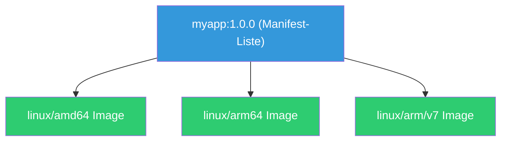

---
tags:
  - docker
  - buildx
  - multi-arch
  - arm64
  - amd64
  - cross-compilation
---

# Docker Multi-Arch Builds

> [!ABSTRACT] TL;DR
> Mit Docker Buildx und QEMU können Images für mehrere CPU-Architekturen (AMD64, ARM64, ARMv7) aus einem einzigen Dockerfile gebaut werden. Ein Multi-Arch-Image wird als **Manifest-Liste** in der Registry gespeichert — Docker wählt automatisch die passende Architektur beim Pull.

---

## Warum Multi-Arch?

| Architektur | Plattform | Beispiele |
|------------|-----------|-----------|
| `linux/amd64` | x86_64 | Standard-Server, Cloud VMs, Intel/AMD Desktop |
| `linux/arm64` | AArch64 | Apple M1–M4, AWS Graviton, Raspberry Pi 4+, NVIDIA Jetson |
| `linux/arm/v7` | ARMv7 | Raspberry Pi 2/3, ältere ARM-Boards |
| `linux/arm/v6` | ARMv6 | Raspberry Pi Zero/1 |
| `linux/s390x` | IBM Z | Mainframes |
| `linux/ppc64le` | PowerPC | IBM POWER |

> [!NOTE] ARM-Server werden immer populärer
> AWS Graviton, Ampere Altra und Apple Silicon machen ARM64 zur Standard-Architektur. Multi-Arch-Images sind essentiell für Teams mit gemischter Hardware (Intel-Server + ARM-Homelab, x86 CI + M-Mac Entwicklung).

---

## Buildx einrichten

### Installation prüfen

```bash
# Buildx ist seit Docker 19.03 als Plugin enthalten
docker buildx version

# Verfügbare Builder anzeigen
docker buildx ls
```

### Multi-Arch-Builder erstellen

```bash
# Neuen Builder mit Multi-Arch-Support erstellen
docker buildx create \
    --name multiarch \
    --driver docker-container \
    --use

# Builder starten und Plattformen prüfen
docker buildx inspect --bootstrap

# Ausgabe zeigt unterstützte Plattformen:
# Platforms: linux/amd64, linux/arm64, linux/arm/v7, ...
```

### QEMU für Cross-Platform

```bash
# QEMU Binaries registrieren (einmalig nach Reboot)
docker run --privileged --rm tonistiigi/binfmt --install all

# Prüfen welche Plattformen verfügbar sind
docker buildx ls
```

> [!NOTE] QEMU-Emulation vs. Native Builds
> QEMU emuliert fremde CPU-Architekturen im User-Space — das funktioniert zuverlässig, ist aber **5–10x langsamer** als native Builds. Für schnellere Builds können native ARM-Maschinen als Remote-Builder eingebunden werden.

---

## Multi-Arch Images bauen

### Einfacher Multi-Arch Build

```bash
# Image für AMD64 und ARM64 bauen und pushen
docker buildx build \
    --platform linux/amd64,linux/arm64 \
    -t registry.example.com/myapp:1.0.0 \
    --push \
    .
```

> [!IMPORTANT] `--push` ist bei Multi-Arch Pflicht
> Multi-Arch-Builds mit mehreren Plattformen können **nicht** mit `--load` in den lokalen Docker-Store geladen werden — der lokale Store unterstützt nur eine Architektur. Verwende `--push` um direkt in eine Registry zu pushen.

### Build für einzelne Plattform testen

```bash
# Nur ARM64 lokal bauen und laden
docker buildx build \
    --platform linux/arm64 \
    --load \
    -t myapp:arm64-test \
    .

# Testen (auf AMD64 Host via QEMU)
docker run --rm --platform linux/arm64 myapp:arm64-test
```

### Mit Build-Argumenten

```bash
# Plattform-spezifische Build-Args
docker buildx build \
    --platform linux/amd64,linux/arm64 \
    --build-arg VERSION=1.0.0 \
    --build-arg BUILD_DATE=$(date -u +%Y-%m-%dT%H:%M:%SZ) \
    -t registry.example.com/myapp:1.0.0 \
    --push \
    .
```

---

## Dockerfile für Multi-Arch

### Automatische Plattform-Variablen

Docker Buildx setzt automatisch Build-Argumente, die im Dockerfile verwendet werden können:

| Variable | Beschreibung | Beispielwert |
|----------|-------------|-------------|
| `TARGETPLATFORM` | Zielplattform | `linux/arm64` |
| `TARGETOS` | Ziel-Betriebssystem | `linux` |
| `TARGETARCH` | Ziel-Architektur | `arm64`, `amd64` |
| `TARGETVARIANT` | Architektur-Variante | `v7`, `v8` |
| `BUILDPLATFORM` | Build-Plattform | `linux/amd64` |
| `BUILDOS` | Build-Betriebssystem | `linux` |
| `BUILDARCH` | Build-Architektur | `amd64` |

### Plattformabhängige Downloads

```dockerfile
FROM alpine:3.20

ARG TARGETARCH

# Architektur-spezifische Binary herunterladen
RUN case "${TARGETARCH}" in \
        amd64) ARCH="x86_64" ;; \
        arm64) ARCH="aarch64" ;; \
        armv7) ARCH="armv7l" ;; \
        *) echo "Unsupported arch: ${TARGETARCH}" && exit 1 ;; \
    esac && \
    wget -O /usr/local/bin/tool \
        "https://github.com/example/tool/releases/download/v1.0/tool-linux-${ARCH}" && \
    chmod +x /usr/local/bin/tool
```

### Go Cross-Compilation (nativ schnell)

```dockerfile
FROM --platform=$BUILDPLATFORM golang:1.23-alpine AS build

ARG TARGETPLATFORM
ARG TARGETOS
ARG TARGETARCH

WORKDIR /app
COPY go.mod go.sum ./
RUN go mod download

COPY . .
# Go cross-kompiliert nativ — kein QEMU nötig!
RUN CGO_ENABLED=0 GOOS=${TARGETOS} GOARCH=${TARGETARCH} \
    go build -ldflags="-w -s" -o /server ./cmd/server

FROM gcr.io/distroless/static-debian12
COPY --from=build /server /server
ENTRYPOINT ["/server"]
```

> [!TIP] Go und Rust kompilieren nativ für andere Architekturen
> Go und Rust haben eingebaute Cross-Compiler. Mit `FROM --platform=$BUILDPLATFORM` wird die Build-Stage auf der **Host-Architektur** ausgeführt (schnell), während die Binary für die Zielarchitektur kompiliert wird. Kein QEMU nötig!

### Node.js Multi-Arch (mit QEMU)

```dockerfile
# Node.js braucht QEMU für native npm install auf fremder Architektur
FROM --platform=$BUILDPLATFORM node:22-alpine AS deps

WORKDIR /app
COPY package.json package-lock.json ./

# Dependencies auf der Build-Plattform installieren (schnell)
# Nur für reine JS-Dependencies! C-Extensions brauchen die Zielplattform.
RUN npm ci --ignore-scripts

FROM node:22-alpine AS production
WORKDIR /app
COPY --from=deps /app/node_modules ./node_modules
COPY . .
USER node
CMD ["node", "index.js"]
```

---

## Manifest-Listen

### Was ist eine Manifest-Liste?

Eine Manifest-Liste (auch **Image Index** genannt) ist ein Registry-Objekt, das auf mehrere plattformspezifische Images verweist:



### Manifest inspizieren

```bash
# Manifest-Liste eines Images anzeigen
docker manifest inspect nginx:latest

# Oder mit buildx
docker buildx imagetools inspect nginx:latest

# Ausgabe zeigt alle Plattformen:
# Name:      docker.io/library/nginx:latest
# MediaType: application/vnd.oci.image.index.v1+json
# Digest:    sha256:abc123...
#
# Manifests:
#   Name:      docker.io/library/nginx:latest@sha256:...
#   MediaType: application/vnd.oci.image.manifest.v1+json
#   Platform:  linux/amd64
#
#   Name:      docker.io/library/nginx:latest@sha256:...
#   Platform:  linux/arm64
#   ...
```

### Manuelle Manifest-Liste erstellen

```bash
# Einzelne Images für verschiedene Plattformen bauen
docker buildx build --platform linux/amd64 --load -t myapp:amd64 .
docker buildx build --platform linux/arm64 --load -t myapp:arm64 .

# Images taggen und pushen
docker tag myapp:amd64 registry.example.com/myapp:1.0.0-amd64
docker tag myapp:arm64 registry.example.com/myapp:1.0.0-arm64
docker push registry.example.com/myapp:1.0.0-amd64
docker push registry.example.com/myapp:1.0.0-arm64

# Manifest-Liste erstellen
docker manifest create registry.example.com/myapp:1.0.0 \
    registry.example.com/myapp:1.0.0-amd64 \
    registry.example.com/myapp:1.0.0-arm64

# Manifest-Liste pushen
docker manifest push registry.example.com/myapp:1.0.0
```

---

## CI/CD Integration

### GitHub Actions

```yaml
jobs:
  build-multiarch:
    runs-on: ubuntu-latest
    steps:
      - uses: actions/checkout@v4

      - name: Set up QEMU
        uses: docker/setup-qemu-action@v3

      - name: Set up Docker Buildx
        uses: docker/setup-buildx-action@v3

      - name: Login to GHCR
        uses: docker/login-action@v3
        with:
          registry: ghcr.io
          username: ${{ github.actor }}
          password: ${{ secrets.GITHUB_TOKEN }}

      - name: Build and Push
        uses: docker/build-push-action@v5
        with:
          context: .
          platforms: linux/amd64,linux/arm64
          push: true
          tags: ghcr.io/${{ github.repository }}:${{ github.sha }}
          cache-from: type=gha
          cache-to: type=gha,mode=max
```

### Native ARM Builder (schneller)

```bash
# Remote ARM-Maschine als Builder hinzufügen
docker buildx create \
    --name multiarch \
    --node amd64-builder \
    --platform linux/amd64

docker buildx create \
    --name multiarch \
    --append \
    --node arm64-builder \
    --platform linux/arm64 \
    ssh://user@arm-server

# Builds werden automatisch an den passenden Builder delegiert
docker buildx build \
    --builder multiarch \
    --platform linux/amd64,linux/arm64 \
    --push \
    -t myapp:latest .
```

> [!TIP] Native Builder sind 5-10x schneller
> Statt QEMU-Emulation auf einem x86-Host wird der ARM-Build direkt auf einer ARM-Maschine ausgeführt. Ideal für große Projekte mit langen Build-Zeiten. AWS Graviton oder Hetzner ARM-Server eignen sich gut als Remote-Builder.

---

## Troubleshooting

### Häufige Probleme

| Problem | Ursache | Lösung |
|---------|---------|--------|
| `exec format error` | Falsches Image für die Architektur | Multi-Arch-Image oder `--platform` verwenden |
| QEMU-Fehler bei npm install | Native C-Extensions brauchen Emulation | `FROM --platform=$BUILDPLATFORM` für Build-Stage |
| Langsame Builds | QEMU-Emulation | Native Builder oder Go/Rust Cross-Compiler nutzen |
| `--load` funktioniert nicht | Multi-Plattform kann nicht lokal geladen werden | Nur eine Plattform mit `--load`, oder `--push` nutzen |
| Segfault in emuliertem Container | QEMU-Bug | QEMU aktualisieren: `docker run --privileged --rm tonistiigi/binfmt --install all` |

### Architektur eines Images prüfen

```bash
# Lokales Image
docker inspect myapp:latest --format '{{.Architecture}}'

# Registry-Image
docker manifest inspect --verbose nginx:latest | grep architecture
```

---

## Verwandte Notizen

- [[Dockerfile]] — Dockerfile-Referenz
- [[Dockerfile Beispiele]] — Sprachspezifische Dockerfiles
- [[Multi-Stage Builds]] — Build-Optimierung
- [[Docker CI-CD Integration]] — CI/CD-Pipelines
- [[Docker Images]] — Image-Konzepte und Layer-System
- [[Docker Best Practices]] — Produktions-Checkliste
