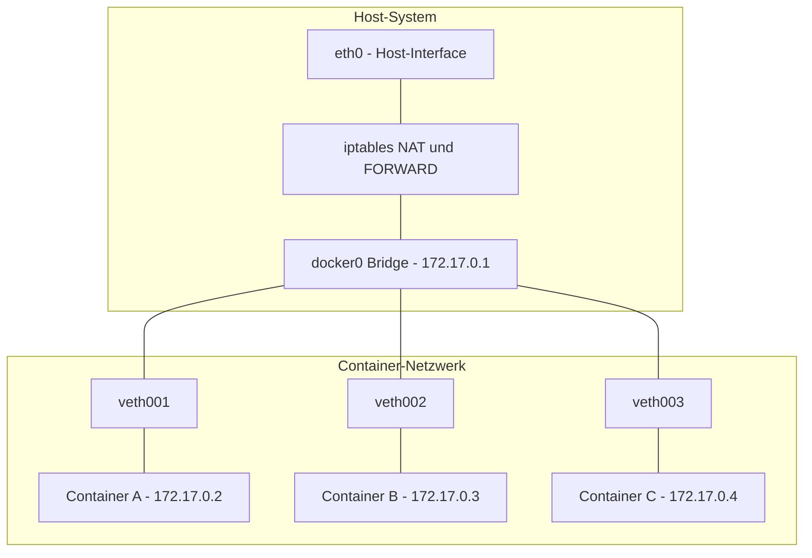
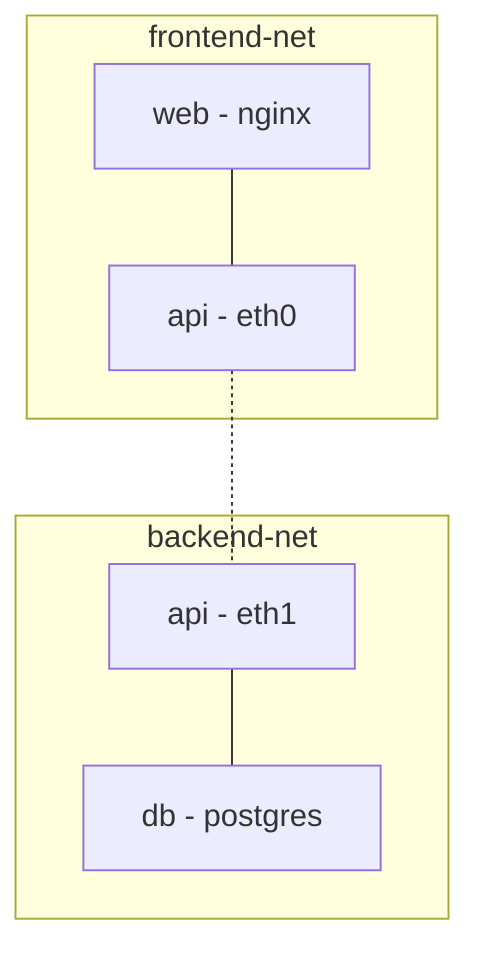

---
tags:
  - docker
  - networking
  - netzwerk
  - bridge
---

# Docker Networking

> [!ABSTRACT] TL;DR
> Docker stellt verschiedene Netzwerk-Treiber bereit, um Container untereinander und mit der Außenwelt zu verbinden. Das Standard-Bridge-Netzwerk isoliert Container auf einem Host, während benutzerdefinierte Bridges automatische DNS-Auflösung per Container-Name ermöglichen. Für Multi-Host-Szenarien gibt es Overlay-Netzwerke, für direkte LAN-Integration macvlan und ipvlan.

---

## Netzwerk-Grundlagen

Docker nutzt Linux-Kernel-Features, um Container-Netzwerke zu realisieren. Beim Start des Docker-Daemons werden automatisch Netzwerk-Ressourcen angelegt, die Container isolieren und gleichzeitig kontrollierte Kommunikation ermöglichen.

### Die docker0 Bridge

Wenn Docker installiert wird, erstellt der Daemon eine virtuelle Bridge namens `docker0`. Diese Bridge fungiert als virtueller Switch, an den alle Container im Standard-Bridge-Netzwerk angeschlossen werden.

```bash
# docker0 Bridge anzeigen
ip addr show docker0

# Typische Ausgabe:
# docker0: <BROADCAST,MULTICAST,UP,LOWER_UP> mtu 1500
#     inet 172.17.0.1/16 brd 172.17.255.255 scope global docker0
```

### veth-Pairs (Virtual Ethernet)

Für jeden Container erstellt Docker ein **veth-Pair** — ein virtuelles Ethernet-Kabelpaar:

- **Ein Ende** wird in den Netzwerk-Namespace des Containers gesteckt (erscheint dort als `eth0`)
- **Das andere Ende** wird an die `docker0` Bridge angeschlossen (erscheint auf dem Host als `vethXXXXXX`)

```bash
# veth-Interfaces auf dem Host anzeigen
ip link show type veth

# Bridge-Verbindungen anzeigen
bridge link show
```

### iptables und NAT

Docker manipuliert die `iptables`-Regeln des Hosts, um Netzwerk-Funktionalität bereitzustellen:

- **MASQUERADE** — Container-Traffic wird per NAT über die Host-IP nach außen geleitet
- **DNAT** — Port-Mappings werden als Destination-NAT-Regeln umgesetzt
- **FORWARD** — Regeln steuern, welche Container miteinander kommunizieren dürfen

```bash
# Docker-spezifische iptables-Regeln anzeigen
sudo iptables -t nat -L -n -v | grep -A 5 DOCKER
sudo iptables -L DOCKER -n -v

# Filter-Regeln für Container-Isolation
sudo iptables -L DOCKER-ISOLATION-STAGE-1 -n -v
```

> [!NOTE] Kernel-Voraussetzungen
> Docker benötigt aktiviertes IP-Forwarding auf dem Host. Der Daemon aktiviert dies automatisch via `net.ipv4.ip_forward = 1`. Bei manueller Konfiguration muss dieser Kernel-Parameter explizit gesetzt werden.

### Netzwerk-Architektur im Überblick



---

## Netzwerk-Treiber

Docker bietet sechs Netzwerk-Treiber, die unterschiedliche Anwendungsfälle abdecken. Jeder Treiber hat eigene Eigenschaften bezüglich Isolation, Performance und Konnektivität.

### Bridge

Der **Bridge-Treiber** ist der Standard für Container auf einem einzelnen Host. Container werden an eine virtuelle Bridge angeschlossen und können über IP-Adressen miteinander kommunizieren.

```bash
# Container im Standard-Bridge-Netzwerk starten
docker run -d --name web --network bridge nginx

# Standard-Bridge-Netzwerk inspizieren
docker network inspect bridge
```

**Eigenschaften:**

- Container erhalten IP-Adressen aus dem Bridge-Subnetz (Standard: `172.17.0.0/16`)
- Container können sich über IP-Adressen erreichen
- Im Standard-Bridge-Netzwerk gibt es **keine automatische DNS-Auflösung** per Container-Name
- Ports müssen explizit gemappt werden, um von außen erreichbar zu sein
- Jede Bridge bildet ein eigenes Layer-2-Segment

> [!WARNING] Standard-Bridge vs. benutzerdefinierte Bridge
> Das vorkonfigurierte `bridge`-Netzwerk (docker0) unterstützt **keine DNS-Auflösung** per Container-Name. Nur benutzerdefinierte Bridge-Netzwerke bieten automatische Service Discovery. In der Praxis sollte daher immer ein eigenes Netzwerk erstellt werden.

### Host

Der **Host-Treiber** entfernt die Netzwerk-Isolation zwischen Container und Host vollständig. Der Container nutzt den Netzwerk-Stack des Hosts direkt.

```bash
# Container im Host-Netzwerk starten
docker run -d --name web --network host nginx

# Der Container lauscht direkt auf Host-Port 80
# Kein Port-Mapping nötig oder möglich
curl http://localhost:80
```

**Eigenschaften:**

- Container teilt sich den Netzwerk-Namespace mit dem Host
- **Kein NAT** — bestmögliche Netzwerk-Performance
- Kein Port-Mapping nötig (und nicht möglich)
- Port-Konflikte mit Host-Diensten oder anderen Containern möglich
- Nur unter Linux vollständig unterstützt (unter macOS/Windows läuft Docker in einer VM)

> [!TIP] Wann Host-Networking verwenden?
> Ideal für Anwendungen, die maximale Netzwerk-Performance brauchen oder viele Ports dynamisch öffnen (z. B. Monitoring-Agents, Load Balancer). Nicht empfohlen, wenn Isolation gewünscht ist.

### None

Der **None-Treiber** deaktiviert jegliche Netzwerk-Konnektivität. Der Container hat nur ein Loopback-Interface (`lo`).

```bash
# Container ohne Netzwerk starten
docker run -d --name isolated --network none alpine sleep 3600

# Nur Loopback verfügbar
docker exec isolated ip addr
# 1: lo: <LOOPBACK,UP> inet 127.0.0.1/8
```

**Eigenschaften:**

- Komplett isoliert — kein ein- oder ausgehender Traffic
- Nützlich für Batch-Jobs, die nur lokale Daten verarbeiten
- Maximale Sicherheit für sensitive Workloads

### Overlay

Der **Overlay-Treiber** ermöglicht Netzwerke über mehrere Docker-Hosts hinweg. Er wird primär mit Docker Swarm oder in Kombination mit externen Orchestratoren verwendet.

```bash
# Overlay-Netzwerk erstellen (erfordert Swarm-Mode)
docker network create -d overlay --attachable my-overlay

# Container auf verschiedenen Hosts können sich erreichen
docker service create --name web --network my-overlay nginx
```

**Eigenschaften:**

- VXLAN-basierte Enkapsulierung für Multi-Host-Kommunikation
- Automatische Verschlüsselung möglich (`--opt encrypted`)
- Erfordert Docker Swarm Mode oder externen Key-Value-Store
- `--attachable` erlaubt auch Standalone-Containern den Zugang
- Höherer Overhead durch Enkapsulierung

### Macvlan

Der **Macvlan-Treiber** gibt jedem Container eine eigene MAC-Adresse und macht ihn als vollwertiges Gerät im physischen Netzwerk sichtbar.

```bash
# Macvlan-Netzwerk erstellen
docker network create -d macvlan \
  --subnet=192.168.1.0/24 \
  --gateway=192.168.1.1 \
  -o parent=eth0 \
  my-macvlan

# Container mit IP aus dem physischen Netzwerk
docker run -d --name db \
  --network my-macvlan \
  --ip 192.168.1.100 \
  postgres:17
```

**Eigenschaften:**

- Container erscheint als physisches Gerät im LAN
- Eigene MAC-Adresse pro Container
- Kein NAT — direkter Layer-2-Zugang
- Erfordert Promiscuous Mode auf dem Host-Interface
- Container kann den Host selbst **nicht** direkt erreichen (ohne Workaround)

> [!IMPORTANT] Promiscuous Mode
> Macvlan erfordert, dass das physische Interface den Promiscuous Mode unterstützt. In vielen Cloud-Umgebungen (AWS, Azure) ist dies nicht erlaubt. Macvlan eignet sich daher primär für Bare-Metal- oder Homelab-Setups.

### IPvlan

Der **IPvlan-Treiber** ist ähnlich wie Macvlan, aber alle Container teilen sich die MAC-Adresse des Host-Interfaces. Es gibt zwei Modi:

```bash
# IPvlan L2-Modus (ähnlich Macvlan, aber shared MAC)
docker network create -d ipvlan \
  --subnet=192.168.1.0/24 \
  --gateway=192.168.1.1 \
  -o parent=eth0 \
  -o ipvlan_mode=l2 \
  my-ipvlan-l2

# IPvlan L3-Modus (Layer-3-Routing)
docker network create -d ipvlan \
  --subnet=10.10.0.0/24 \
  -o parent=eth0 \
  -o ipvlan_mode=l3 \
  my-ipvlan-l3
```

**Eigenschaften:**

- **L2-Modus** — Ähnlich Macvlan, aber alle Container nutzen die MAC-Adresse des Hosts
- **L3-Modus** — Reines IP-Routing, kein Broadcast/Multicast
- Funktioniert in Umgebungen, die keinen Promiscuous Mode erlauben
- Geringerer Overhead als Macvlan in großen Setups

### Vergleichstabelle der Netzwerk-Treiber

| Eigenschaft | Bridge | Host | None | Overlay | Macvlan | IPvlan |
|:---|:---:|:---:|:---:|:---:|:---:|:---:|
| **Isolation** | Ja | Nein | Maximum | Ja | Teilweise | Teilweise |
| **Multi-Host** | Nein | Nein | Nein | Ja | Nein | Nein |
| **NAT** | Ja | Kein | – | Ja | Kein | Kein |
| **Performance** | Gut | Optimal | – | Mäßig | Sehr gut | Sehr gut |
| **DNS-Discovery** | Custom only | Nein | Nein | Ja | Nein | Nein |
| **Port-Mapping** | Ja | Nein | Nein | Ja | Nein | Nein |
| **Eigene MAC** | Virtuell | Host-MAC | – | Virtuell | Eigene | Host-MAC |
| **LAN-sichtbar** | Nein | Ja | Nein | Nein | Ja | Ja |
| **Use Case** | Standard | Performance | Sicherheit | Swarm/K8s | Homelab | Cloud/LAN |

---

## Benutzerdefinierte Bridge-Netzwerke

Benutzerdefinierte Bridges sind die empfohlene Methode für Container-Kommunikation auf einem einzelnen Host. Sie bieten gegenüber dem Standard-Bridge-Netzwerk erhebliche Vorteile.

### Netzwerk erstellen und verwenden

```bash
# Benutzerdefiniertes Bridge-Netzwerk erstellen
docker network create my-app-net

# Mit spezifischem Subnetz und Gateway
docker network create \
  --driver bridge \
  --subnet 10.0.0.0/24 \
  --gateway 10.0.0.1 \
  --ip-range 10.0.0.128/25 \
  my-app-net

# Container im benutzerdefinierten Netzwerk starten
docker run -d --name api --network my-app-net node:22-alpine
docker run -d --name db --network my-app-net postgres:17
```

### Automatische DNS-Auflösung

In benutzerdefinierten Bridge-Netzwerken können Container sich gegenseitig über ihren **Container-Namen** als Hostname erreichen:

```bash
# Container starten
docker run -d --name api-server --network my-app-net nginx
docker run -d --name database --network my-app-net postgres:17

# DNS-Auflösung testen — api-server kann database per Name erreichen
docker exec api-server ping -c 2 database
# PING database (10.0.0.3): 56 data bytes
# 64 bytes from 10.0.0.3: seq=0 ttl=64 time=0.089 ms

# Auch nslookup funktioniert
docker exec api-server nslookup database
# Name:      database
# Address 1: 10.0.0.3 database.my-app-net
```

> [!TIP] Container-Name als Hostname
> Den Container-Namen bewusst als DNS-Namen planen. In Anwendungskonfigurationen kann statt einer IP-Adresse direkt der Container-Name als Hostname verwendet werden, z. B. `DATABASE_HOST=database`.

### Netzwerk-Isolation

Container in unterschiedlichen Netzwerken können sich **nicht** gegenseitig erreichen — auch nicht über ihre IP-Adresse:

```bash
# Zwei isolierte Netzwerke
docker network create frontend-net
docker network create backend-net

# Container in verschiedenen Netzwerken
docker run -d --name web --network frontend-net nginx
docker run -d --name db --network backend-net postgres:17

# web kann db NICHT erreichen
docker exec web ping -c 1 db
# ping: bad address 'db'
```

### Container an mehrere Netzwerke anschließen

Ein Container kann gleichzeitig in mehreren Netzwerken Mitglied sein, um als Brücke zu fungieren:

```bash
# API-Container in beide Netzwerke einbinden
docker run -d --name api --network frontend-net node:22-alpine
docker network connect backend-net api

# api kann jetzt sowohl web als auch db erreichen
docker exec api ping -c 1 web     # Funktioniert
docker exec api ping -c 1 db      # Funktioniert
```



---

## Port-Mapping

Port-Mapping macht Container-Dienste von außerhalb des Docker-Netzwerks erreichbar, indem Host-Ports auf Container-Ports weitergeleitet werden.

### Syntax und Optionen

```bash
# Grundform: Host-Port -> Container-Port
docker run -d -p 8080:80 nginx
# Host:8080 -> Container:80

# Mehrere Port-Mappings
docker run -d -p 8080:80 -p 8443:443 nginx

# Nur auf bestimmter Host-IP binden
docker run -d -p 127.0.0.1:8080:80 nginx
# Nur über localhost erreichbar

# Auf allen Interfaces binden (Standard)
docker run -d -p 0.0.0.0:8080:80 nginx

# Zufälligen Host-Port zuweisen lassen
docker run -d -p 80 nginx
# Docker wählt automatisch einen freien Ephemeral-Port

# Alle exponierten Ports automatisch mappen
docker run -d -P nginx
# Alle EXPOSE-Ports aus dem Dockerfile werden auf zufällige Host-Ports gemappt
```

### Protokoll-Auswahl

```bash
# Standard ist TCP
docker run -d -p 8080:80/tcp nginx

# UDP explizit angeben
docker run -d -p 5353:53/udp pihole/pihole

# TCP und UDP gleichzeitig
docker run -d -p 1194:1194/tcp -p 1194:1194/udp openvpn
```

### Gemappte Ports anzeigen

```bash
# Ports eines laufenden Containers anzeigen
docker port my-container
# 80/tcp -> 0.0.0.0:8080
# 443/tcp -> 0.0.0.0:8443

# Kompakte Übersicht aller Container mit Ports
docker ps --format "table {{.Names}}\t{{.Ports}}"
```

> [!WARNING] Firewall-Bypass
> Docker manipuliert iptables direkt und kann dabei UFW- oder firewalld-Regeln umgehen. Ein mit `-p 8080:80` gestarteter Container ist unter Umständen von außen erreichbar, selbst wenn die Firewall Port 8080 blockiert. Für produktive Setups sollte das Binding auf `127.0.0.1` beschränkt oder ein Reverse Proxy vorgeschaltet werden.

---

## DNS und Service Discovery

Docker betreibt einen eingebetteten DNS-Server, der automatische Namensauflösung innerhalb von benutzerdefinierten Netzwerken ermöglicht.

### Eingebauter DNS-Server

Jeder Container in einem benutzerdefinierten Netzwerk erhält `127.0.0.11` als DNS-Server. Dieser interne DNS-Server löst Container-Namen, Service-Namen und Netzwerk-Aliase auf.

```bash
# DNS-Konfiguration im Container prüfen
docker exec my-container cat /etc/resolv.conf
# nameserver 127.0.0.11
# options ndots:0

# DNS-Auflösung testen
docker exec my-container nslookup api-server
```

### Netzwerk-Aliase

Container können zusätzliche DNS-Namen (Aliase) erhalten, unter denen sie erreichbar sind:

```bash
# Container mit Netzwerk-Alias starten
docker run -d \
  --name postgres-primary \
  --network my-app-net \
  --network-alias db \
  --network-alias database \
  postgres:17

# Erreichbar unter allen drei Namen:
# postgres-primary, db, database
```

### DNS Round-Robin

Mehrere Container können denselben Alias tragen. Der DNS-Server verteilt Anfragen im Round-Robin-Verfahren:

```bash
# Drei Container mit demselben Alias
docker run -d --name web1 --network my-net --network-alias web nginx
docker run -d --name web2 --network my-net --network-alias web nginx
docker run -d --name web3 --network my-net --network-alias web nginx

# DNS-Auflösung liefert alle drei IPs
docker exec web1 nslookup web
# Name:      web
# Address 1: 10.0.0.2
# Address 2: 10.0.0.3
# Address 3: 10.0.0.4
```

> [!NOTE] Kein echter Load Balancer
> DNS Round-Robin ist kein vollwertiger Load Balancer. Clients cachen DNS-Antworten unterschiedlich lang, und es gibt keine Health Checks. Für produktives Load Balancing sollte ein Reverse Proxy wie Traefik oder Nginx eingesetzt werden.

---

## Netzwerk-Befehle

### Übersicht aller Netzwerk-Befehle

| Befehl | Beschreibung |
|:---|:---|
| `docker network create` | Neues Netzwerk erstellen |
| `docker network ls` | Alle Netzwerke auflisten |
| `docker network inspect` | Details eines Netzwerks anzeigen |
| `docker network rm` | Netzwerk löschen |
| `docker network connect` | Container an Netzwerk anschließen |
| `docker network disconnect` | Container von Netzwerk trennen |
| `docker network prune` | Unbenutzte Netzwerke entfernen |

### Netzwerk erstellen

```bash
# Einfaches Bridge-Netzwerk
docker network create my-net

# Mit allen Optionen
docker network create \
  --driver bridge \
  --subnet 10.0.0.0/24 \
  --gateway 10.0.0.1 \
  --ip-range 10.0.0.128/25 \
  --opt "com.docker.network.bridge.name=br-mynet" \
  --opt "com.docker.network.bridge.enable_icc=true" \
  --opt "com.docker.network.driver.mtu=1500" \
  --label project=myapp \
  my-net

# IPv6-fähiges Netzwerk
docker network create \
  --ipv6 \
  --subnet fd00:dead:beef::/48 \
  my-ipv6-net
```

### Netzwerke auflisten und inspizieren

```bash
# Alle Netzwerke anzeigen
docker network ls

# Ausgabe:
# NETWORK ID     NAME        DRIVER    SCOPE
# a1b2c3d4e5f6   bridge      bridge    local
# f6e5d4c3b2a1   host        host      local
# 1a2b3c4d5e6f   none        null      local
# 9f8e7d6c5b4a   my-app-net  bridge    local

# Nur Bridge-Netzwerke
docker network ls --filter driver=bridge

# Details eines Netzwerks
docker network inspect my-app-net

# Nur die angeschlossenen Container anzeigen (mit jq)
docker network inspect my-app-net | jq '.[0].Containers'
```

### Container verbinden und trennen

```bash
# Laufenden Container an ein Netzwerk anschließen
docker network connect my-app-net my-container

# Mit fester IP-Adresse verbinden
docker network connect --ip 10.0.0.50 my-app-net my-container

# Container von einem Netzwerk trennen
docker network disconnect my-app-net my-container

# Erzwungenes Trennen (bei hängendem Container)
docker network disconnect --force my-app-net my-container
```

### Netzwerke aufräumen

```bash
# Ein bestimmtes Netzwerk löschen
docker network rm my-app-net

# Mehrere Netzwerke gleichzeitig löschen
docker network rm net1 net2 net3

# Alle ungenutzten Netzwerke entfernen
docker network prune

# Ohne Bestätigungsprompt
docker network prune -f

# Nur Netzwerke älter als 24 Stunden entfernen
docker network prune --filter "until=24h"
```

---

## Docker Compose Networking

Docker Compose erstellt automatisch ein Netzwerk für jeden Stack. Services können sich gegenseitig über ihren Service-Namen als Hostname erreichen.

### Automatisches Standard-Netzwerk

Beim Start mit `docker compose up` wird ein Bridge-Netzwerk namens `<projektordner>_default` erstellt:

```yaml
# docker-compose.yml
services:
  web:
    image: nginx:latest
    ports:
      - "8080:80"

  api:
    image: node:22-alpine
    environment:
      - DATABASE_HOST=db    # Service-Name als Hostname
      - DATABASE_PORT=5432

  db:
    image: postgres:17
    environment:
      - POSTGRES_PASSWORD=geheim
```

```bash
# Netzwerk wird automatisch erstellt
docker compose up -d

# Erstelltes Netzwerk anzeigen
docker network ls | grep default
# abc123   myproject_default   bridge   local

# Services können sich gegenseitig per Name erreichen:
# web -> api, web -> db, api -> db (alle Kombinationen)
```

### Benutzerdefinierte Netzwerke in Compose

```yaml
services:
  web:
    image: nginx:latest
    networks:
      - frontend

  api:
    image: node:22-alpine
    networks:
      - frontend
      - backend

  db:
    image: postgres:17
    networks:
      - backend

networks:
  frontend:
    driver: bridge
    ipam:
      config:
        - subnet: 10.10.1.0/24

  backend:
    driver: bridge
    ipam:
      config:
        - subnet: 10.10.2.0/24
```

> [!TIP] Netzwerk-Segmentierung in Compose
> Durch die Trennung in `frontend` und `backend` kann `web` nicht direkt auf `db` zugreifen. Nur `api` ist in beiden Netzwerken und agiert als kontrollierter Vermittler — genau wie bei einer klassischen DMZ-Architektur.

### Externe Netzwerke (stackübergreifend)

Um Container aus verschiedenen Compose-Stacks zu verbinden, werden externe Netzwerke verwendet:

```bash
# Shared Netzwerk vorher manuell erstellen
docker network create shared-net
```

```yaml
# Stack A: docker-compose.yml
services:
  api:
    image: my-api:latest
    networks:
      - shared

networks:
  shared:
    external: true
    name: shared-net
```

```yaml
# Stack B: docker-compose.yml
services:
  dashboard:
    image: my-dashboard:latest
    networks:
      - shared

networks:
  shared:
    external: true
    name: shared-net
```

### Netzwerk-Aliase in Compose

```yaml
services:
  postgres:
    image: postgres:17
    networks:
      backend:
        aliases:
          - db
          - database
          - pg-primary
```

Der Service ist dann unter `postgres`, `db`, `database` und `pg-primary` erreichbar.

---

## Netzwerk-Troubleshooting

### Netzwerk-Informationen sammeln

```bash
# Netzwerk-Details inspizieren
docker network inspect my-app-net

# Alle Container und ihre Netzwerke anzeigen
docker ps --format '{{.Names}}' | while read name; do
  echo "=== $name ==="
  docker inspect "$name" --format '{{json .NetworkSettings.Networks}}' | jq
done

# IP-Adresse eines Containers ermitteln
docker inspect -f '{{range .NetworkSettings.Networks}}{{.IPAddress}}{{end}}' my-container
```

### Konnektivität testen

```bash
# Ping zwischen Containern
docker exec container-a ping -c 3 container-b

# DNS-Auflösung prüfen
docker exec container-a nslookup container-b

# HTTP-Verbindung testen
docker exec container-a curl -s http://container-b:8080/health

# TCP-Port-Erreichbarkeit prüfen (mit nc/netcat)
docker exec container-a nc -zv container-b 5432

# Netzwerk-Interfaces im Container anzeigen
docker exec container-a ip addr show

# Routing-Tabelle im Container
docker exec container-a ip route
```

### Debug-Container verwenden

Wenn ein Container keine Netzwerk-Tools hat, kann ein Debug-Container im selben Netzwerk gestartet werden:

```bash
# nicolaka/netshoot — umfangreicher Netzwerk-Debug-Container
docker run -it --rm \
  --network my-app-net \
  nicolaka/netshoot

# Darin verfügbar: ping, curl, dig, nslookup, tcpdump,
# iperf3, netstat, ss, traceroute, mtr, nmap, etc.

# Alternativ: Debug-Container im Netzwerk-Namespace eines anderen Containers
docker run -it --rm \
  --network container:my-container \
  nicolaka/netshoot
```

### Häufige Probleme und Lösungen

> [!WARNING] Container können sich nicht per Name erreichen
> Prüfen ob beide Container im selben **benutzerdefinierten** Netzwerk sind. Das Standard-Bridge-Netzwerk unterstützt keine DNS-Auflösung per Container-Name.
>
> ```bash
> docker network inspect my-net | jq '.[0].Containers'
> ```

> [!DANGER] Port-Mapping greift nicht
> Prüfen ob der Dienst im Container auf `0.0.0.0` lauscht und nicht nur auf `127.0.0.1`. Viele Anwendungen binden sich standardmäßig nur an localhost.
>
> ```bash
> docker exec my-container ss -tlnp
> # Erwartete Ausgabe: *:80 oder 0.0.0.0:80
> # Problematisch: 127.0.0.1:80
> ```

> [!BUG] Container ohne Internetzugang
> IP-Forwarding und DNS-Konfiguration auf dem Host prüfen:
>
> ```bash
> # Auf dem Host
> sysctl net.ipv4.ip_forward
> # Muss 1 sein
>
> # Im Container
> docker exec my-container cat /etc/resolv.conf
> docker exec my-container ping -c 1 8.8.8.8
> ```

> [!FAILURE] Netzwerk lässt sich nicht löschen
> Alle Container vom Netzwerk trennen, bevor es gelöscht werden kann:
>
> ```bash
> docker network disconnect -f my-net container1
> docker network rm my-net
> ```

### Netzwerk-Traffic mitschneiden

```bash
# tcpdump im Debug-Container
docker run -it --rm \
  --network container:my-container \
  nicolaka/netshoot \
  tcpdump -i eth0 -n port 80

# Alternativ direkt auf dem Host (veth-Interface ermitteln)
VETH=$(docker exec my-container cat /sys/class/net/eth0/iflink)
HOST_IFACE=$(ip link | grep "^${VETH}:" | awk -F': ' '{print $2}' | cut -d'@' -f1)
sudo tcpdump -i "$HOST_IFACE" -n
```

---

## Verwandte Notizen

- [[Docker Index]]
- [[Container Lifecycle]]
- [[Docker Volumes und Storage]]
- [[Docker Compose]]
- [[Kubernetes Netzwerk]] — K8s erweitert Container-Networking mit CNI-Plugins
- [[Swarm Networking]] — Overlay-Netzwerke und Service Discovery im Swarm