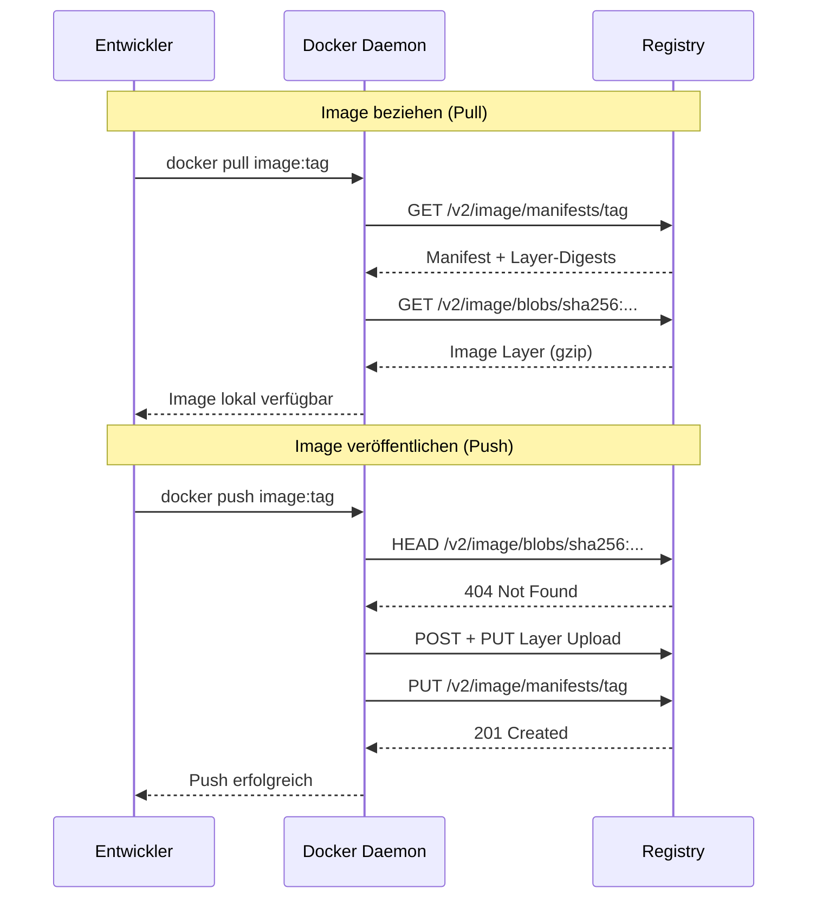

---
tags:
  - docker
  - registry
  - images
  - docker-hub
---

# Docker Registries

> [!ABSTRACT]
> Docker Registries sind zentrale Speicher für Container Images. Docker Hub ist die Standard-Registry, aber es gibt zahlreiche Alternativen — von GitHub Container Registry bis hin zu selbst gehosteten Lösungen wie Harbor oder der offiziellen Registry v2.

---

## Was ist eine Registry?

Eine **Docker Registry** ist ein Dienst zum Speichern, Verwalten und Verteilen von Docker Images. Sie fungiert als zentrale Ablage, über die Entwickler und Systeme Images veröffentlichen (`push`) und beziehen (`pull`) können.

Jedes Image wird über eine eindeutige Adresse identifiziert:

```text
registry.example.com/namespace/repository:tag
```

| Bestandteil | Beschreibung | Beispiel |
|------------|-------------|---------|
| Registry | Hostname der Registry | `docker.io`, `ghcr.io` |
| Namespace | Organisation oder Benutzer | `library`, `linuxserver` |
| Repository | Name des Images | `nginx`, `postgres` |
| Tag | Version oder Variante | `latest`, `16-alpine`, `1.27.4` |

> [!NOTE] Standard-Registry
> Wenn keine Registry angegeben wird, nutzt Docker automatisch **Docker Hub** (`docker.io`). Der Befehl `docker pull nginx` ist identisch mit `docker pull docker.io/library/nginx:latest`.

### Pull- und Push-Workflow



---

## Docker Hub

**Docker Hub** (`hub.docker.com`) ist die offizielle und größte öffentliche Registry. Sie ist die Standard-Registry des Docker Daemons.

### Image-Kategorien

| Kategorie | Beschreibung | Beispiel |
|----------|-------------|---------|
| **Official Images** | Von Docker Inc. kuratiert und geprüft | `nginx`, `postgres`, `node` |
| **Verified Publisher** | Von Unternehmen verifiziert | `bitnami/nginx`, `grafana/grafana` |
| **Community Images** | Von Nutzern erstellt, ungeprüft | `linuxserver/nginx` |

> [!TIP] Official Images bevorzugen
> Official Images folgen Best Practices, werden regelmäßig auf Sicherheitslücken gescannt und zeitnah aktualisiert. Sie sollten immer die erste Wahl sein.

### Rate Limits

| Account-Typ | Pull-Limit | Zeitfenster |
|-------------|-----------|------------|
| Anonym (ohne Login) | 100 Pulls | 6 Stunden |
| Free (eingeloggt) | 200 Pulls | 6 Stunden |
| Pro / Team / Business | Unbegrenzt | — |

> [!WARNING] Rate Limits in CI/CD
> In CI/CD-Pipelines werden die Limits schnell erreicht, wenn viele Builds parallel laufen. Entweder einen bezahlten Account nutzen, einen **Registry Mirror** einrichten oder auf alternative Registries ausweichen.

### Login bei Docker Hub

```bash
# Interaktiver Login
docker login

# Login mit Zugangsdaten (z.B. in CI/CD)
echo "$DOCKER_HUB_TOKEN" | docker login --username meinuser --password-stdin

# Logout
docker logout
```

> [!IMPORTANT] Access Tokens statt Passwort
> Docker Hub unterstützt **Personal Access Tokens (PAT)**. Diese sollten anstelle des Passworts verwendet werden — besonders in Skripten und CI/CD-Umgebungen.

---

## Alternative Registries

| Registry | Host | Kostenlos | Besonderheiten |
|---------|------|:---------:|---------------|
| **GitHub Container Registry** | `ghcr.io` | ✅ | Direkte GitHub-Integration, GITHUB_TOKEN Auth |
| **GitLab Container Registry** | `registry.gitlab.com` | ✅ | In GitLab CI/CD integriert, pro Projekt |
| **Quay.io** (Red Hat) | `quay.io` | ✅ | Security Scanning, öffentliche Repos |
| **Amazon ECR** | `*.dkr.ecr.*.amazonaws.com` | 💰 | AWS-Integration, Lifecycle Policies |
| **Azure ACR** | `*.azurecr.io` | 💰 | Azure-Integration, Geo-Replikation |
| **Google Artifact Registry** | `*-docker.pkg.dev` | 💰 | GCP-Integration, Multi-Format |
| **Harbor** | Self-Hosted | ✅ | Open Source, Enterprise-Features |
| **Docker Registry v2** | Self-Hosted | ✅ | Minimalistisch, offizielles Image |

### Login bei alternativen Registries

```bash
# GitHub Container Registry
echo "$GITHUB_TOKEN" | docker login ghcr.io --username meinuser --password-stdin

# GitLab Container Registry
docker login registry.gitlab.com --username meinuser --password "$GITLAB_TOKEN"

# Amazon ECR (benötigt AWS CLI)
aws ecr get-login-password --region eu-central-1 | \
  docker login --username AWS --password-stdin 123456789.dkr.ecr.eu-central-1.amazonaws.com

# Azure ACR
az acr login --name meineregistry

# Google Artifact Registry
gcloud auth configure-docker europe-west3-docker.pkg.dev
```

---

## Private Registry aufsetzen

Die offizielle **Docker Registry v2** kann als Container deployt werden — ideal für Homelab, Entwicklungsumgebungen oder Air-Gapped-Systeme.

### Schnellstart

```bash
# Registry starten (Port 5000)
docker run -d \
  --name registry \
  --restart always \
  -p 5000:5000 \
  -v registry-data:/var/lib/registry \
  registry:2

# Image taggen und pushen
docker tag nginx:latest localhost:5000/nginx:latest
docker push localhost:5000/nginx:latest

# Image pullen
docker pull localhost:5000/nginx:latest
```

### Docker Compose Setup

```yaml
services:
  registry:
    image: registry:2
    container_name: docker-registry
    restart: always
    ports:
      - "5000:5000"
    volumes:
      - registry-data:/var/lib/registry
      - ./config.yml:/etc/docker/registry/config.yml:ro
    environment:
      REGISTRY_STORAGE_DELETE_ENABLED: "true"

volumes:
  registry-data:
    driver: local
```

### TLS konfigurieren

> [!DANGER] Keine unverschlüsselte Registry in Produktion
> Ohne TLS werden Zugangsdaten und Images im Klartext übertragen. Eine Registry ohne TLS sollte ausschließlich lokal oder in isolierten Testumgebungen verwendet werden.

```yaml
services:
  registry:
    image: registry:2
    container_name: docker-registry-tls
    restart: always
    ports:
      - "443:443"
    volumes:
      - registry-data:/var/lib/registry
      - ./certs:/certs:ro
    environment:
      REGISTRY_HTTP_ADDR: 0.0.0.0:443
      REGISTRY_HTTP_TLS_CERTIFICATE: /certs/fullchain.pem
      REGISTRY_HTTP_TLS_KEY: /certs/privkey.pem
      REGISTRY_STORAGE_DELETE_ENABLED: "true"

volumes:
  registry-data:
    driver: local
```

### Authentifizierung (htpasswd)

```bash
# htpasswd-Datei erstellen
sudo apt install apache2-utils
htpasswd -Bc htpasswd meinuser
```

```yaml
services:
  registry:
    image: registry:2
    container_name: docker-registry-auth
    restart: always
    ports:
      - "443:443"
    volumes:
      - registry-data:/var/lib/registry
      - ./certs:/certs:ro
      - ./htpasswd:/auth/htpasswd:ro
    environment:
      REGISTRY_HTTP_ADDR: 0.0.0.0:443
      REGISTRY_HTTP_TLS_CERTIFICATE: /certs/fullchain.pem
      REGISTRY_HTTP_TLS_KEY: /certs/privkey.pem
      REGISTRY_AUTH: htpasswd
      REGISTRY_AUTH_HTPASSWD_REALM: "Docker Registry"
      REGISTRY_AUTH_HTPASSWD_PATH: /auth/htpasswd

volumes:
  registry-data:
    driver: local
```

### Registry API abfragen

```bash
# Alle Repositories auflisten
curl -s https://registry.example.com/v2/_catalog | jq

# Tags eines Repositories auflisten
curl -s https://registry.example.com/v2/nginx/tags/list | jq

# Mit Authentifizierung
curl -s -u meinuser:meinpasswort https://registry.example.com/v2/_catalog | jq
```

---

## Harbor

**Harbor** ist eine Open-Source Enterprise Registry von der CNCF. Sie baut auf der Docker Registry v2 auf und ergänzt sie um zahlreiche Features.

| Feature | Beschreibung |
|---------|-------------|
| **Web UI** | Verwaltungsoberfläche für Images, Projekte und Benutzer |
| **Vulnerability Scanning** | Integrierter Scanner (Trivy) für Sicherheitslücken |
| **RBAC** | Rollenbasierte Zugriffskontrolle pro Projekt |
| **Replikation** | Images zwischen mehreren Registries synchronisieren |
| **Image Signing** | Cosign / Notary für Image-Signaturen |
| **Audit Logs** | Vollständige Protokollierung aller Aktionen |
| **Garbage Collection** | Automatisches Aufräumen ungenutzter Layer |
| **OIDC / LDAP** | Anbindung an externe Identity Provider |

### Harbor Installation

```bash
# Installer herunterladen
HARBOR_VERSION="2.12.2"
wget "https://github.com/goharbor/harbor/releases/download/v${HARBOR_VERSION}/harbor-online-installer-v${HARBOR_VERSION}.tgz"
tar xzf "harbor-online-installer-v${HARBOR_VERSION}.tgz"
cd harbor

# Konfiguration anpassen
cp harbor.yml.tmpl harbor.yml
```

```yaml
# Wichtige Einstellungen in harbor.yml
hostname: harbor.example.com

https:
  port: 443
  certificate: /certs/fullchain.pem
  private_key: /certs/privkey.pem

harbor_admin_password: EinSicheresPasswort123!

data_volume: /data/harbor

trivy:
  ignore_unfixed: false
  security_check: vuln
```

```bash
# Installation starten
sudo ./install.sh --with-trivy

# Harbor stoppen / starten
cd /opt/harbor
docker compose down
docker compose up -d
```

> [!TIP] Harbor für Homelab
> Harbor ist ressourcenintensiver als eine einfache Registry v2, bietet dafür aber eine komfortable Web-Oberfläche und automatisches Vulnerability Scanning.

---

## Registry im Docker Daemon konfigurieren

Die zentrale Konfigurationsdatei des Docker Daemons befindet sich unter `/etc/docker/daemon.json`.

### Insecure Registries

Für Registries ohne gültiges TLS-Zertifikat (z.B. lokale Testumgebungen):

```json
{
  "insecure-registries": [
    "registry.local:5000",
    "10.0.0.50:5000"
  ]
}
```

> [!WARNING] Nur für Test- und Entwicklungsumgebungen
> Insecure Registries übertragen Daten unverschlüsselt. In Produktionsumgebungen immer TLS verwenden.

### Registry Mirror

Ein Mirror leitet alle Pulls über einen lokalen Cache — nützlich bei Rate Limits oder langsamer Internetverbindung:

```json
{
  "registry-mirrors": [
    "https://mirror.example.com"
  ]
}
```

### Daemon neu laden

```bash
# Konfiguration anwenden (Neustart erforderlich)
sudo systemctl restart docker

# Konfiguration prüfen
docker info | grep -A5 "Registry"
```

---

## Best Practices

> [!TIP] Empfehlungen für den Umgang mit Registries
> - **Niemals `latest` in Produktion** — Immer explizite Tags oder Digests verwenden
> - **Images signieren** — Cosign oder Notary für Supply-Chain-Sicherheit einsetzen
> - **Vulnerability Scanning** — Trivy oder Grype in die CI/CD-Pipeline integrieren
> - **Least Privilege** — Registry-Zugänge mit minimalen Rechten konfigurieren
> - **Garbage Collection** — Regelmäßig ungenutzte Layer und Manifeste aufräumen
> - **Multi-Stage Builds** — Kleinere Images bedeuten schnellere Pushes und Pulls

---

## Verwandte Notizen

- [[Docker Index]]
- [[Docker Images]]
- [[Docker Security und Hardening]]
- [[Pods]] — Kubernetes zieht Container-Images aus Registries via `imagePullPolicy`
- [[Deployments und ReplicaSets]] — Deployments referenzieren Registry-Images in der Pod-Spezifikation
