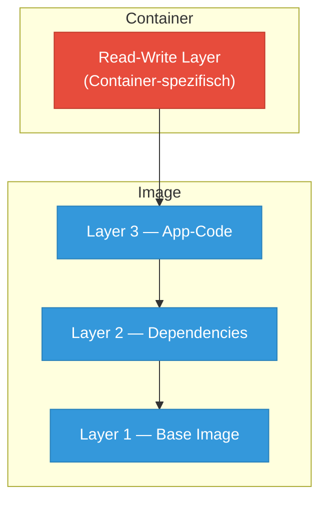
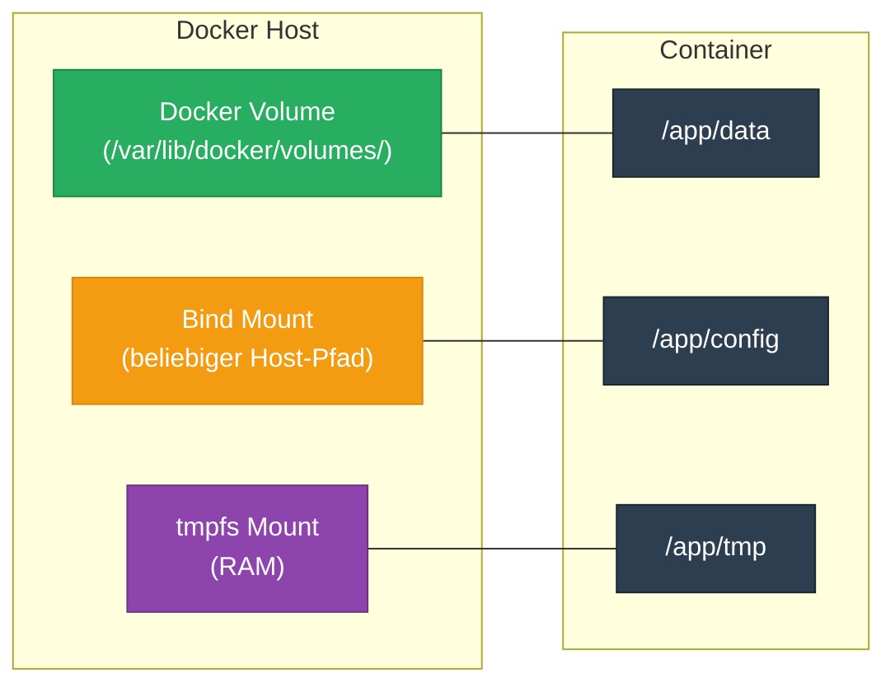

---
tags:
  - docker
  - volumes
  - storage
  - persistenz
---

# Docker Volumes und Storage

> [!ABSTRACT] TL;DR
> Docker-Container sind kurzlebig — Daten innerhalb eines Containers gehen beim Löschen verloren. Docker bietet drei Storage-Typen zur Datenpersistenz: **Volumes** (empfohlen), **Bind Mounts** und **tmpfs Mounts**. Diese Dokumentation erklärt alle drei Typen, ihre Syntax, Verwaltung und Best Practices.

---

## Das Problem — Ephemeral Container

Container sind von Natur aus **kurzlebig** (ephemeral). Das bedeutet:

- Jeder Container hat ein eigenes **beschreibbares Layer** (Read-Write Layer)
- Daten in diesem Layer existieren nur, solange der Container läuft
- Beim Löschen eines Containers (`docker rm`) gehen **alle Daten** im Container verloren
- Auch ein `docker stop` + `docker start` behält Daten — aber ein `docker rm` vernichtet sie unwiderruflich

> [!WARNING] Datenverlust
> Ohne explizite Datenpersistenz gehen Datenbank-Inhalte, Konfigurationen, Uploads und Logs beim Entfernen des Containers verloren. **Niemals** produktive Daten nur im Container-Layer speichern.

```bash
# Container erstellen und Datei anlegen
docker run -d --name test-container alpine sh -c "echo 'Wichtige Daten' > /data.txt && sleep 3600"

# Datei existiert im Container
docker exec test-container cat /data.txt
# Ausgabe: Wichtige Daten

# Container löschen
docker rm -f test-container

# Neuen Container starten — Datei ist weg
docker run --rm alpine cat /data.txt
# Fehler: No such file or directory
```

Das **Union Filesystem** (OverlayFS) von Docker erklärt dieses Verhalten:



Das Read-Write Layer (rot) ist flüchtig — die Image-Layer (blau) sind unveränderlich und werden geteilt.

---

## Storage-Typen im Überblick

Docker bietet drei Mechanismen zur Datenpersistenz:



### Vergleichstabelle

| Eigenschaft | Volume | Bind Mount | tmpfs Mount |
|:------------|:------:|:----------:|:-----------:|
| Speicherort | Docker-Verzeichnis | Beliebiger Host-Pfad | RAM |
| Von Docker verwaltet | ✅ | ❌ | ❌ |
| Persistenz nach `docker rm` | ✅ | ✅ | ❌ |
| Teilbar zwischen Containern | ✅ | ✅ | ❌ |
| Volume Drivers möglich | ✅ | ❌ | ❌ |
| Performance | Hoch | Hoch (OS-abhängig) | Sehr hoch |
| Backup via Docker CLI | ✅ | Manuell | ❌ |
| Sicherheit | Isoliert | Host-Zugriff nötig | Nur im RAM |
| Empfehlung | **Produktion** | **Entwicklung** | **Secrets / Cache** |

---

## Docker Volumes

Volumes sind der **empfohlene Weg** zur Datenpersistenz. Docker verwaltet sie vollständig unter `/var/lib/docker/volumes/` auf dem Host.

### Vorteile

- **Unabhängig vom Container-Lebenszyklus** — Volumes überleben `docker rm`
- **Docker verwaltet den Speicherort** — Kein manuelles Verzeichnis-Management
- **Teilbar** — Mehrere Container können dasselbe Volume nutzen
- **Driver-Support** — Lokale und Remote-Speicher (NFS, Cloud)
- **Portabel** — Einfach zu sichern und zu migrieren

### Volume-Verwaltung

```bash
# Volume erstellen
docker volume create mein-volume

# Alle Volumes auflisten
docker volume ls

# Volume-Details anzeigen
docker volume inspect mein-volume
```

Die Ausgabe von `docker volume inspect` zeigt den tatsächlichen Speicherort:

```json
[
    {
        "CreatedAt": "2026-03-05T10:00:00+01:00",
        "Driver": "local",
        "Labels": {},
        "Mountpoint": "/var/lib/docker/volumes/mein-volume/_data",
        "Name": "mein-volume",
        "Options": {},
        "Scope": "local"
    }
]
```

```bash
# Volume löschen (nur wenn kein Container es nutzt)
docker volume rm mein-volume

# Alle ungenutzten Volumes löschen
docker volume prune

# Alle ungenutzten Volumes löschen (ohne Bestätigung)
docker volume prune -f

# Nur Volumes löschen, die älter als 24h ungenutzt sind
docker volume prune --filter "until=24h"
```

> [!DANGER] Vorsicht mit `docker volume prune`
> Dieser Befehl löscht **alle** Volumes, die aktuell von keinem Container (auch nicht gestoppten) referenziert werden. Datenbank-Volumes, die zu gestoppten Containern gehören, können verloren gehen.

### Volume an Container mounten

```bash
# Neues Volume erstellen und mounten
docker run -d \
  --name postgres-db \
  -v db-data:/var/lib/postgresql/data \
  -e POSTGRES_PASSWORD=geheim \
  postgres:17

# Volume wird automatisch erstellt, falls es nicht existiert
docker run -d \
  --name redis-cache \
  -v redis-data:/data \
  redis:7-alpine

# Volume-Inhalt prüfen
docker volume inspect db-data --format '{{ .Mountpoint }}'
```

### Volume zwischen Containern teilen

```bash
# Container 1: Schreibt Daten
docker run -d \
  --name writer \
  -v shared-data:/data \
  alpine sh -c "while true; do date >> /data/log.txt; sleep 5; done"

# Container 2: Liest Daten
docker run --rm \
  -v shared-data:/data:ro \
  alpine cat /data/log.txt
```

---

## Bind Mounts

Bind Mounts verbinden ein **beliebiges Verzeichnis** (oder eine Datei) vom Host direkt in den Container. Sie eignen sich besonders für die **Entwicklung**.

### Verwendung

```bash
# Aktuelles Projektverzeichnis in den Container mounten
docker run -d \
  --name dev-app \
  -v $(pwd)/src:/app/src \
  -v $(pwd)/config.yaml:/app/config.yaml:ro \
  -p 3000:3000 \
  node:22-alpine npm run dev

# Windows (PowerShell)
docker run -d `
  --name dev-app `
  -v ${PWD}/src:/app/src `
  -p 3000:3000 `
  node:22-alpine npm run dev
```

### Entwicklungs-Workflow mit Live-Reload

Bind Mounts ermöglichen **Hot-Reloading** — Änderungen am Host-Code werden sofort im Container sichtbar:

```bash
# Python-Entwicklung mit Auto-Reload
docker run -d \
  --name flask-dev \
  -v $(pwd):/app \
  -p 5000:5000 \
  -e FLASK_ENV=development \
  python:3.13-slim \
  sh -c "pip install flask && flask run --host=0.0.0.0 --reload"
```

> [!TIP] Wann Bind Mounts verwenden?
> - **Entwicklung:** Quellcode live in den Container mounten
> - **Konfiguration:** Einzelne Config-Dateien read-only einbinden
> - **Build-Artefakte:** Build-Output direkt auf den Host schreiben
> - **Logs:** Log-Dateien auf dem Host zugänglich machen

> [!WARNING] Bind Mount — Sicherheitsrisiken
> - Der Container hat **direkten Zugriff** auf Host-Dateien
> - Falsche Pfade können Host-Systemdateien überschreiben
> - Berechtigungsprobleme zwischen Host-User und Container-User sind häufig
> - **Niemals** `/` oder systemkritische Verzeichnisse mounten

### Berechtigungsprobleme lösen

```bash
# Problem: Container läuft als Root, erstellt Dateien die dem Host-User nicht gehören
# Lösung 1: User-ID im Container festlegen
docker run -d \
  --name app \
  --user "$(id -u):$(id -g)" \
  -v $(pwd)/data:/app/data \
  node:22-alpine npm start

# Lösung 2: Verzeichnis-Berechtigungen vorher setzen
mkdir -p ./data && chmod 777 ./data
```

---

## tmpfs Mounts

tmpfs Mounts speichern Daten **ausschließlich im RAM** des Hosts. Sie werden nie auf die Festplatte geschrieben und verschwinden beim Stoppen des Containers.

### Verwendung

```bash
# tmpfs Mount erstellen
docker run -d \
  --name secure-app \
  --tmpfs /run/secrets:rw,noexec,nosuid,size=64m \
  alpine sh -c "echo 'API_KEY=s3cr3t' > /run/secrets/api.key && sleep 3600"

# Mit --mount Syntax (mehr Kontrolle)
docker run -d \
  --name cache-app \
  --mount type=tmpfs,destination=/app/cache,tmpfs-size=256m,tmpfs-mode=1770 \
  alpine sleep 3600
```

### Use Cases

| Use Case | Beschreibung |
|:---------|:-------------|
| **Secrets** | API-Keys, Passwörter temporär bereitstellen |
| **Caches** | Temporäre Daten, die nicht persistiert werden müssen |
| **Session-Daten** | Web-Sessions, die bei Neustart zurückgesetzt werden dürfen |
| **Scratch Space** | Temporäre Build-Artefakte, Zwischenergebnisse |

> [!NOTE] tmpfs-Einschränkungen
> - Nur auf **Linux-Hosts** nativ verfügbar
> - Daten gehen bei `docker stop` verloren (nicht nur bei `docker rm`)
> - Nicht zwischen Containern teilbar
> - Verbraucht Host-RAM — Größe mit `tmpfs-size` begrenzen

---

## Volume-Syntax — `-v` vs `--mount`

Docker bietet zwei Syntaxvarianten zum Mounten von Speicher. Beide sind funktional gleichwertig, unterscheiden sich aber in Lesbarkeit und Fehlerbehandlung.

### Vergleichstabelle

| Eigenschaft | `-v` / `--volume` | `--mount` |
|:------------|:-------------------|:----------|
| Syntax | Kompakt, Doppelpunkt-getrennt | Verbose, Key-Value-Paare |
| Lesbarkeit | Kurz, aber kryptisch | Selbstdokumentierend |
| Fehlerverhalten | Erstellt fehlende Host-Pfade | Fehler bei fehlendem Pfad |
| Empfehlung | Einfache Fälle, CLI | Compose, komplexe Setups |

### Syntax-Vergleich

```bash
# --- Volume ---
# -v Syntax
docker run -d -v mein-volume:/app/data nginx

# --mount Syntax
docker run -d --mount type=volume,source=mein-volume,target=/app/data nginx

# --- Bind Mount ---
# -v Syntax
docker run -d -v /home/user/config:/app/config:ro nginx

# --mount Syntax
docker run -d --mount type=bind,source=/home/user/config,target=/app/config,readonly nginx

# --- tmpfs ---
# --tmpfs Syntax
docker run -d --tmpfs /app/cache:rw,size=128m nginx

# --mount Syntax
docker run -d --mount type=tmpfs,destination=/app/cache,tmpfs-size=128m nginx
```

### Read-Only Mounts

Read-Only Mounts verhindern, dass der Container Daten im gemounteten Verzeichnis verändert:

```bash
# -v Syntax: Suffix :ro
docker run -d \
  -v $(pwd)/nginx.conf:/etc/nginx/nginx.conf:ro \
  -v $(pwd)/html:/usr/share/nginx/html:ro \
  nginx:alpine

# --mount Syntax: readonly Flag
docker run -d \
  --mount type=bind,source=$(pwd)/nginx.conf,target=/etc/nginx/nginx.conf,readonly \
  --mount type=volume,source=nginx-logs,target=/var/log/nginx \
  nginx:alpine
```

> [!TIP] Read-Only als Standard
> Mounte Konfigurationsdateien **immer** als `:ro`, wenn der Container sie nicht verändern muss. Das erhöht die Sicherheit und verhindert versehentliches Überschreiben.

---

## Named Volumes in Docker Compose

Docker Compose macht Volume-Management deklarativ und reproduzierbar.

### Grundlegende Volume-Definition

```yaml
# docker-compose.yml
services:
  postgres:
    image: postgres:17
    environment:
      POSTGRES_PASSWORD: geheim
      POSTGRES_DB: myapp
    volumes:
      - db-data:/var/lib/postgresql/data
      - ./init.sql:/docker-entrypoint-initdb.d/init.sql:ro
    ports:
      - "5432:5432"

  redis:
    image: redis:7-alpine
    volumes:
      - redis-data:/data
    command: redis-server --appendonly yes

volumes:
  db-data:
  redis-data:
```

> [!IMPORTANT] Die `volumes:`-Sektion auf Root-Ebene
> Volumes müssen auf der **obersten Ebene** der Compose-Datei unter `volumes:` deklariert werden. Ohne diese Deklaration erstellt Docker Compose anonyme Volumes, die bei `docker compose down` gelöscht werden können.

### Volume-Optionen in Compose

```yaml
volumes:
  # Standard-Volume (lokal)
  app-data:

  # Volume mit spezifischem Driver
  nfs-data:
    driver: local
    driver_opts:
      type: nfs
      o: addr=192.168.1.100,rw,nfsvers=4
      device: ":/exports/data"

  # Volume mit Labels
  db-data:
    labels:
      com.example.project: "myapp"
      com.example.environment: "production"
```

### Externe Volumes

Externe Volumes werden **außerhalb** von Compose erstellt und verwaltet. Sie überleben `docker compose down -v`:

```yaml
services:
  app:
    image: myapp:latest
    volumes:
      - production-data:/app/data

volumes:
  production-data:
    external: true
    # Volume muss vorher existieren:
    # docker volume create production-data
```

```bash
# Externes Volume vorher erstellen
docker volume create production-data

# Compose starten — nutzt das existierende Volume
docker compose up -d

# docker compose down -v löscht externe Volumes NICHT
docker compose down -v
```

### Shared Volumes zwischen Services

```yaml
services:
  # Service 1: Generiert Dateien
  generator:
    image: alpine
    volumes:
      - shared-files:/output
    command: sh -c "while true; do date > /output/timestamp.txt; sleep 10; done"

  # Service 2: Stellt Dateien bereit
  webserver:
    image: nginx:alpine
    volumes:
      - shared-files:/usr/share/nginx/html:ro
    ports:
      - "8080:80"

volumes:
  shared-files:
```

### Volume-Lebenszyklus in Compose

```bash
# Volumes werden beim Start erstellt
docker compose up -d

# Container stoppen und entfernen — Volumes bleiben erhalten
docker compose down

# Container UND Volumes entfernen
docker compose down -v

# Nur bestimmte Volumes entfernen
docker volume rm myproject_db-data
```

> [!WARNING] `docker compose down -v`
> Dieses Kommando löscht **alle** in der Compose-Datei definierten Volumes (außer externe). Datenbank-Inhalte und andere persistierte Daten gehen dabei verloren.

---

## Volume Drivers

Volume Drivers ermöglichen die Nutzung von **Remote-Speicher** als Docker Volumes.

### Lokaler Driver mit Optionen

```bash
# NFS-Volume erstellen
docker volume create \
  --driver local \
  --opt type=nfs \
  --opt o=addr=192.168.1.100,rw,nfsvers=4 \
  --opt device=:/exports/data \
  nfs-volume

# CIFS/SMB-Volume erstellen (Windows-Freigabe)
docker volume create \
  --driver local \
  --opt type=cifs \
  --opt o=addr=192.168.1.200,username=user,password=pass,file_mode=0777,dir_mode=0777 \
  --opt device=//192.168.1.200/share \
  smb-volume

# tmpfs-Volume mit begrenzter Größe
docker volume create \
  --driver local \
  --opt type=tmpfs \
  --opt device=tmpfs \
  --opt o=size=256m \
  memory-volume
```

### NFS-Volume in Docker Compose

```yaml
services:
  app:
    image: myapp:latest
    volumes:
      - nfs-data:/app/data

volumes:
  nfs-data:
    driver: local
    driver_opts:
      type: nfs
      o: addr=192.168.1.100,rw,nfsvers=4,soft,timeo=30
      device: ":/exports/app-data"
```

### Übersicht verfügbarer Drivers

| Driver | Speichertyp | Use Case |
|:-------|:------------|:---------|
| `local` | Lokales Dateisystem | Standard, NFS, CIFS via Optionen |
| `nfs` | Network File System | Shared Storage im LAN |
| `azure_file` | Azure File Storage | Cloud-Speicher (Azure) |
| `s3fs` | Amazon S3 | Objekt-Storage (AWS) |
| `rexray` | Diverse Cloud-Provider | Multi-Cloud-Support |
| `convoy` | NFS, EBS, DigitalOcean | Backup & Snapshot-Support |

> [!NOTE] Plugin-Installation
> Externe Volume Drivers müssen als Docker-Plugin installiert werden:
> ```bash
> docker plugin install --grant-all-permissions rexray/s3fs
> ```

---

## Backup und Restore

### Volume sichern

Die bewährte Methode: Einen temporären Container starten, der das Volume und ein Backup-Verzeichnis mountet:

```bash
# Volume in eine tar-Datei sichern
docker run --rm \
  -v db-data:/source:ro \
  -v $(pwd)/backups:/backup \
  alpine tar czf /backup/db-data-$(date +%Y%m%d_%H%M%S).tar.gz -C /source .

# Ergebnis: ./backups/db-data-20260305_100000.tar.gz
```

### Volume wiederherstellen

```bash
# Neues Volume erstellen
docker volume create db-data-restored

# Backup in das neue Volume entpacken
docker run --rm \
  -v db-data-restored:/target \
  -v $(pwd)/backups:/backup:ro \
  alpine tar xzf /backup/db-data-20260305_100000.tar.gz -C /target
```

### Daten zwischen Volumes kopieren

```bash
# Volume klonen
docker volume create db-data-clone

docker run --rm \
  -v db-data:/source:ro \
  -v db-data-clone:/target \
  alpine sh -c "cd /source && cp -a . /target/"
```

### Automatisiertes Backup-Skript

```bash
#!/bin/bash
# backup-volumes.sh — Sichert alle benannten Docker Volumes

BACKUP_DIR="/opt/backups/docker-volumes"
TIMESTAMP=$(date +%Y%m%d_%H%M%S)
RETENTION_DAYS=30

mkdir -p "$BACKUP_DIR"

# Alle Volumes sichern
for VOLUME in $(docker volume ls -q); do
    echo "Sichere Volume: $VOLUME"
    docker run --rm \
        -v "$VOLUME":/source:ro \
        -v "$BACKUP_DIR":/backup \
        alpine tar czf "/backup/${VOLUME}_${TIMESTAMP}.tar.gz" -C /source .
done

# Alte Backups aufräumen
find "$BACKUP_DIR" -name "*.tar.gz" -mtime +$RETENTION_DAYS -delete

echo "Backup abgeschlossen: $(ls -1 $BACKUP_DIR/*_${TIMESTAMP}.tar.gz | wc -l) Volumes gesichert"
```

> [!TIP] Datenbank-Backups
> Für Datenbanken ist ein **logischer Dump** (`pg_dump`, `mysqldump`) dem Dateisystem-Backup vorzuziehen. Das Volume-Backup ist ein Fallback, aber konsistente Dumps sind zuverlässiger.
>
> ```bash
> # PostgreSQL-Dump statt Volume-Backup
> docker exec postgres-db pg_dump -U postgres myapp > backup.sql
>
> # MySQL-Dump
> docker exec mysql-db mysqldump -u root -pgeheim myapp > backup.sql
> ```

---

## Best Practices

> [!TIP] Empfehlungen für den produktiven Einsatz

### 1. Named Volumes bevorzugen

```bash
# Schlecht: Anonymes Volume
docker run -d -v /var/lib/postgresql/data postgres:17

# Gut: Named Volume
docker run -d -v postgres-data:/var/lib/postgresql/data postgres:17
```

Anonyme Volumes haben kryptische Namen und sind schwer zuzuordnen. Named Volumes sind selbstdokumentierend.

### 2. Ein Volume pro Zweck

```yaml
services:
  app:
    volumes:
      - app-data:/app/data          # Anwendungsdaten
      - app-logs:/app/logs          # Logs separat
      - app-uploads:/app/uploads    # Uploads separat

volumes:
  app-data:
  app-logs:
  app-uploads:
```

### 3. Konfiguration Read-Only mounten

```yaml
services:
  nginx:
    volumes:
      - ./nginx.conf:/etc/nginx/nginx.conf:ro
      - ./certs:/etc/nginx/certs:ro
      - nginx-logs:/var/log/nginx        # Logs beschreibbar
```

### 4. Datenbank-Volumes nie teilen

```yaml
# FALSCH: Zwei DB-Instanzen auf demselben Volume
services:
  db1:
    image: postgres:17
    volumes:
      - db-data:/var/lib/postgresql/data   # Korruption!
  db2:
    image: postgres:17
    volumes:
      - db-data:/var/lib/postgresql/data   # Korruption!
```

> [!DANGER] Volume-Sharing bei Datenbanken
> Datenbank-Engines erwarten **exklusiven Zugriff** auf ihre Datendateien. Zwei Instanzen auf demselben Volume führen zu Datenkorruption.

### 5. Volume-Benennung standardisieren

```bash
# Konvention: projekt-service-typ
docker volume create myapp-postgres-data
docker volume create myapp-redis-data
docker volume create myapp-nginx-logs
```

### 6. Regelmäßig aufräumen

```bash
# Ungenutzte Volumes anzeigen
docker volume ls -f dangling=true

# Ungenutzte Volumes, Netzwerke, Images aufräumen
docker system prune --volumes

# Speicherverbrauch prüfen
docker system df -v
```

### 7. Berechtigungen korrekt setzen

```dockerfile
# Im Dockerfile: Verzeichnis erstellen und Berechtigungen setzen
FROM node:22-alpine
RUN mkdir -p /app/data && chown -R node:node /app/data
USER node
VOLUME ["/app/data"]
```

### 8. `.dockerignore` bei Bind Mounts beachten

```text
# .dockerignore — Diese Dateien nicht in den Build-Context aufnehmen
node_modules
.git
.env
*.log
data/
```

> [!NOTE] `.dockerignore` vs Bind Mounts
> Die `.dockerignore`-Datei wirkt nur beim **Build** (`docker build`). Bind Mounts umgehen sie vollständig — alle Dateien im gemounteten Verzeichnis sind sichtbar.

---

## Verwandte Notizen

- [[Docker Index]] — Übersicht aller Docker-Dokumentationen
- [[Container Lifecycle]] — Lebenszyklus von Containern (create, start, stop, rm)
- [[Docker Compose]] — Multi-Container-Anwendungen mit Compose
- [[Docker Networking]] — Netzwerke und Container-Kommunikation
- [[Persistent Volumes und Storage Classes]] — K8s abstrahiert Docker-Volume-Konzepte mit PVCs