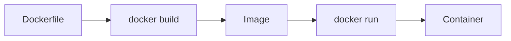
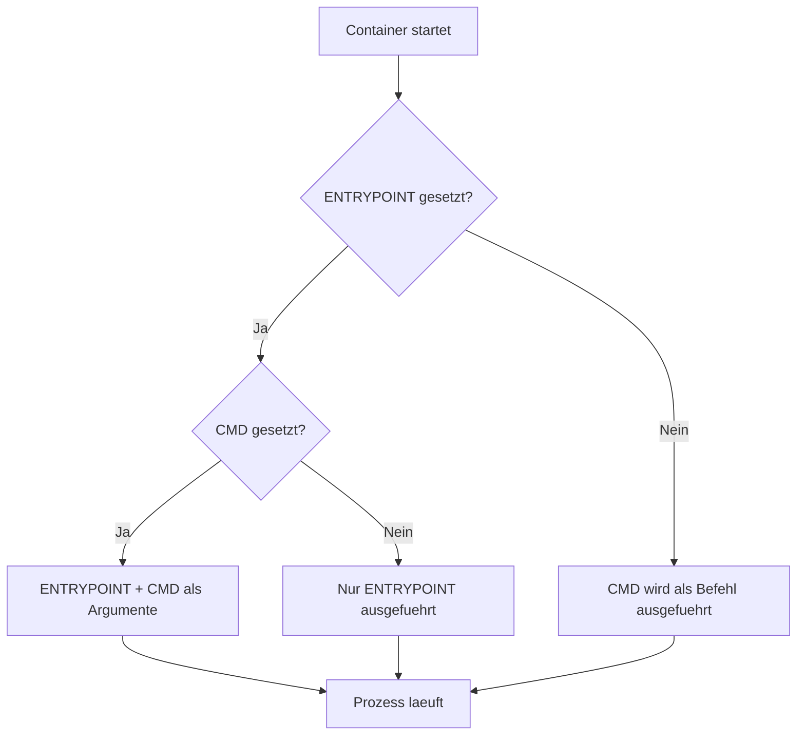
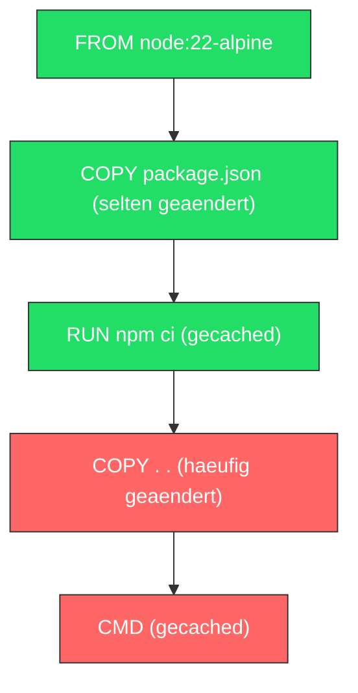
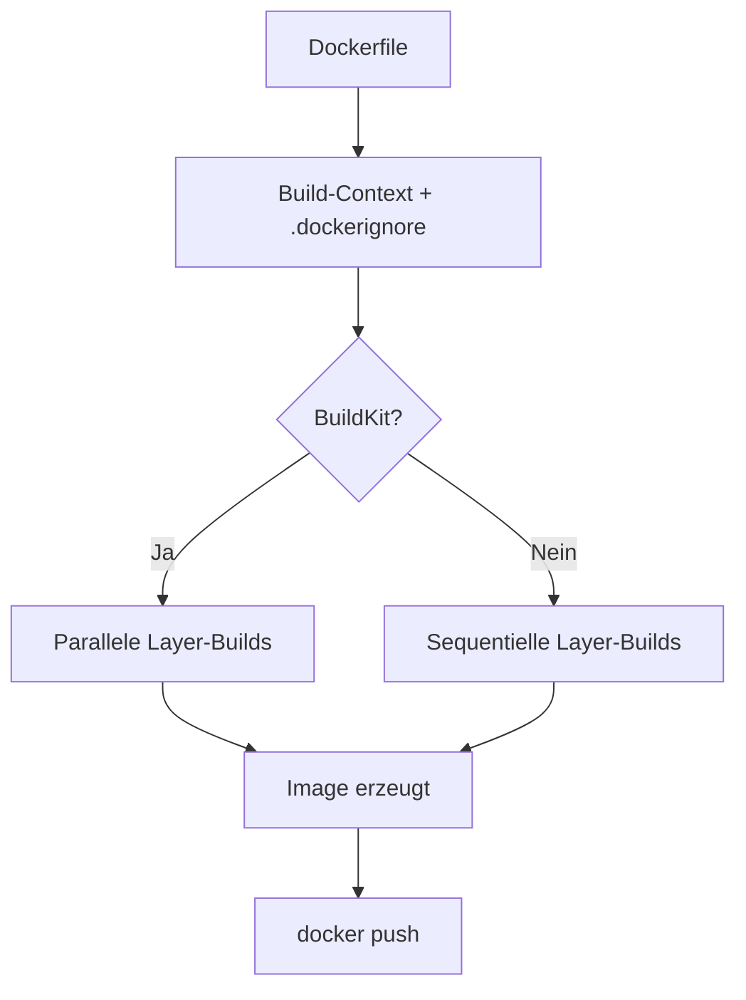

# Dockerfile

> [!ABSTRACT] TL;DR
> Ein Dockerfile ist eine textbasierte Bauanleitung, mit der Docker automatisiert Container-Images erstellt. Es definiert das Base Image, installiert Abhängigkeiten, kopiert Anwendungscode und legt den Startbefehl fest. Jede Instruktion erzeugt einen eigenen Layer im Image.

---

## Was ist ein Dockerfile?

Ein **Dockerfile** ist eine Textdatei ohne Dateiendung, die eine geordnete Abfolge von **Instruktionen** enthält. Docker liest diese Datei Zeile für Zeile und erzeugt daraus ein reproduzierbares **Container-Image**. Jede Instruktion erstellt dabei einen neuen **Layer**, der auf dem vorherigen aufbaut — vergleichbar mit transparenten Folien, die übereinander gelegt werden.

Der große Vorteil gegenüber manueller Image-Erstellung: Dockerfiles sind **versionierbar**, **teilbar** und **reproduzierbar**. Dasselbe Dockerfile erzeugt auf jedem System dasselbe Image — ein Grundpfeiler von Infrastructure as Code.

Der **Build-Prozess** funktioniert dabei in drei Schritten:



1. **Dockerfile schreiben** — Die Bauanleitung definieren
2. **Image bauen** — `docker build` liest das Dockerfile und erzeugt ein Image
3. **Container starten** — `docker run` erstellt aus dem Image einen laufenden Container

> [!NOTE] Namenskonvention
> Die Datei heißt standardmäßig `Dockerfile` (ohne Endung, großes D). Andere Namen sind möglich, müssen dann aber mit `-f` explizit angegeben werden.

---

## Grundstruktur

Ein typisches Dockerfile folgt einem bewährten Aufbaumuster. Die Reihenfolge der Instruktionen beeinflusst das **Layer-Caching** und damit die Build-Geschwindigkeit erheblich.

```dockerfile
# ============================================================
# 1. Base Image — Ausgangspunkt festlegen
# ============================================================
FROM ubuntu:24.04

# ============================================================
# 2. Metadaten — Image beschreiben
# ============================================================
LABEL maintainer="team@example.com"
LABEL version="1.0"
LABEL description="Beispiel-Image fuer die Dokumentation"

# ============================================================
# 3. Umgebung — Variablen und Arbeitsverzeichnis
# ============================================================
ENV APP_HOME=/app \
    APP_ENV=production

WORKDIR ${APP_HOME}

# ============================================================
# 4. Abhängigkeiten — Pakete installieren
# ============================================================
RUN apt-get update && \
    apt-get install -y --no-install-recommends \
        curl \
        ca-certificates && \
    rm -rf /var/lib/apt/lists/*

# ============================================================
# 5. Anwendungscode — Dateien ins Image kopieren
# ============================================================
COPY . .

# ============================================================
# 6. Port — Netzwerkschnittstelle dokumentieren
# ============================================================
EXPOSE 8080

# ============================================================
# 7. Benutzer — Nicht als root ausführen
# ============================================================
RUN useradd --create-home appuser
USER appuser

# ============================================================
# 8. Startbefehl — Was beim Container-Start passieren soll
# ============================================================
CMD ["./start.sh"]
```

> [!TIP] Reihenfolge beachten
> Instruktionen, die sich **selten ändern** (Base Image, Pakete), gehören nach oben. Instruktionen, die sich **häufig ändern** (Quellcode kopieren), gehören nach unten. So nutzt Docker das Layer-Caching optimal.

---

## Wichtige Instruktionen

### FROM — Base Image

`FROM` ist immer die **erste Instruktion** (abgesehen von `ARG`) und legt das Ausgangs-Image fest, auf dem alles aufbaut.

```dockerfile
# Offizielles Image mit spezifischem Tag
FROM node:22-alpine

# Minimales Image (nur 5 MB)
FROM alpine:3.21

# Leeres Image (fuer statisch kompilierte Binaries)
FROM scratch

# Image mit Plattformangabe
FROM --platform=linux/amd64 ubuntu:24.04
```

> [!WARNING] Keine unspezifischen Tags verwenden
> Verwende niemals `FROM node:latest` — das kann sich jederzeit ändern und den Build brechen. Nutze immer **spezifische Versions-Tags** wie `node:22-alpine`.

---

### RUN — Befehle ausführen

`RUN` führt Befehle während des **Build-Prozesses** aus und erstellt einen neuen Layer. Es gibt zwei Schreibweisen:

**Shell-Form** — wird in `/bin/sh -c` ausgeführt:

```dockerfile
RUN apt-get update && apt-get install -y curl
```

**Exec-Form** — wird direkt ohne Shell ausgeführt:

```dockerfile
RUN ["apt-get", "update"]
RUN ["/bin/bash", "-c", "echo Hello"]
```

**Mehrere Befehle verketten** — reduziert die Anzahl der Layer:

```dockerfile
# SCHLECHT: 3 Layer
RUN apt-get update
RUN apt-get install -y curl wget
RUN rm -rf /var/lib/apt/lists/*

# GUT: 1 Layer
RUN apt-get update && \
    apt-get install -y --no-install-recommends \
        curl \
        wget && \
    rm -rf /var/lib/apt/lists/*
```

> [!IMPORTANT] Cache immer aufräumen
> Der `apt-get update`-Cache und heruntergeladene Pakete vergrößern das Image unnötig. Immer im selben `RUN`-Befehl aufräumen mit `rm -rf /var/lib/apt/lists/*`.

---

### COPY und ADD — Dateien kopieren

Beide Instruktionen kopieren Dateien vom **Build-Context** ins Image, unterscheiden sich aber im Funktionsumfang.

```dockerfile
# Einzelne Datei kopieren
COPY package.json /app/

# Verzeichnis kopieren
COPY src/ /app/src/

# Mehrere Dateien kopieren
COPY package.json package-lock.json /app/

# Mit Berechtigungen (seit BuildKit)
COPY --chown=appuser:appuser . /app/

# Mit chmod (seit BuildKit)
COPY --chmod=755 entrypoint.sh /app/
```

```dockerfile
# ADD: Kann Archive automatisch entpacken
ADD app.tar.gz /app/

# ADD: Kann von URLs herunterladen (nicht empfohlen)
ADD https://example.com/file.txt /app/
```

| Eigenschaft | `COPY` | `ADD` |
|:------------|:------:|:-----:|
| Dateien kopieren | ✅ | ✅ |
| Verzeichnisse kopieren | ✅ | ✅ |
| `--chown` / `--chmod` | ✅ | ✅ |
| Archive entpacken (.tar.gz) | ❌ | ✅ |
| Von URL herunterladen | ❌ | ✅ |
| Vorhersehbares Verhalten | ✅ | ⚠️ |
| **Empfohlen** | **✅** | **Selten** |

> [!TIP] Empfehlung
> Verwende immer `COPY` — es ist expliziter und vorhersehbarer. `ADD` nur nutzen, wenn du bewusst ein Archiv entpacken willst. Für Downloads besser `RUN curl -o` oder `RUN wget` verwenden.

---

### WORKDIR — Arbeitsverzeichnis

`WORKDIR` setzt das Arbeitsverzeichnis für alle nachfolgenden `RUN`, `CMD`, `ENTRYPOINT`, `COPY` und `ADD` Instruktionen. Existiert das Verzeichnis nicht, wird es automatisch erstellt.

```dockerfile
WORKDIR /app

# Relative Pfade bauen aufeinander auf
WORKDIR /app
WORKDIR src
WORKDIR utils
# Ergebnis: /app/src/utils

# Variablen sind nutzbar
ENV APP_DIR=/opt/myapp
WORKDIR ${APP_DIR}
```

> [!WARNING] Kein `RUN cd` verwenden
> `RUN cd /app && ...` funktioniert zwar, aber das Verzeichnis gilt nur für diesen einen `RUN`-Befehl. Nutze stattdessen `WORKDIR` — es wirkt dauerhaft für alle folgenden Instruktionen.

---

### ENV — Umgebungsvariablen

`ENV` setzt Umgebungsvariablen, die sowohl zur **Build-Zeit** als auch zur **Laufzeit** des Containers verfügbar sind.

```dockerfile
# Einzelne Variable
ENV NODE_ENV=production

# Mehrere Variablen
ENV APP_HOME=/app \
    APP_PORT=3000 \
    APP_LOG_LEVEL=info

# Verwendung in anderen Instruktionen
ENV APP_HOME=/app
WORKDIR ${APP_HOME}
COPY . ${APP_HOME}
```

> [!NOTE] ENV vs ARG
> `ENV`-Variablen sind zur Build-Zeit **und** Laufzeit verfügbar. `ARG`-Variablen existieren **nur** zur Build-Zeit und sind im fertigen Container nicht mehr sichtbar.

---

### ARG — Build-Argumente

`ARG` definiert Variablen, die **nur während des Builds** verfügbar sind. Sie können beim Build-Aufruf mit `--build-arg` überschrieben werden.

```dockerfile
# Mit Standardwert
ARG NODE_VERSION=22
FROM node:${NODE_VERSION}-alpine

# Ohne Standardwert (muss beim Build übergeben werden)
ARG GIT_COMMIT
LABEL git_commit=${GIT_COMMIT}

# ARG nach FROM erneut deklarieren
ARG NODE_VERSION=22
FROM node:${NODE_VERSION}-alpine
ARG NODE_VERSION
RUN echo "Node Version: ${NODE_VERSION}"
```

```bash
# Beim Build übergeben
docker build --build-arg NODE_VERSION=20 --build-arg GIT_COMMIT=abc123 .
```

> [!DANGER] Keine Secrets in ARG
> Build-Argumente sind in der Image-Historie (`docker history`) sichtbar. Niemals Passwörter, API-Keys oder andere Secrets über `ARG` übergeben. Stattdessen Docker Secrets oder BuildKit Secret Mounts nutzen.

---

### EXPOSE — Ports dokumentieren

`EXPOSE` dokumentiert, auf welchen Ports der Container lauscht. Es öffnet **keine Ports** — das ist reine Dokumentation und wird erst mit `docker run -p` wirksam.

```dockerfile
# Einzelner Port (TCP Standard)
EXPOSE 8080

# Explizit TCP
EXPOSE 8080/tcp

# UDP Port
EXPOSE 53/udp

# Mehrere Ports
EXPOSE 80 443 8080
```

> [!INFO] Nur Dokumentation
> `EXPOSE` allein macht den Port **nicht** von außen erreichbar. Erst `docker run -p 8080:8080` mappt den Port auf den Host. `EXPOSE` dient als Hinweis für andere Entwickler und Tools wie `docker run -P` (alle exponierten Ports automatisch mappen).

---

### CMD vs ENTRYPOINT — Startbefehl

Beide Instruktionen definieren, was beim Container-Start ausgeführt wird — aber sie verhalten sich grundlegend unterschiedlich.

**CMD** — der Standardbefehl, der **überschrieben** werden kann:

```dockerfile
# Exec-Form (empfohlen)
CMD ["node", "server.js"]

# Shell-Form
CMD node server.js

# Als Standard-Argumente fuer ENTRYPOINT
CMD ["--verbose", "--port", "8080"]
```

**ENTRYPOINT** — der feste Einstiegspunkt, der **nicht einfach überschrieben** wird:

```dockerfile
# Exec-Form (empfohlen)
ENTRYPOINT ["python", "app.py"]

# In Kombination mit CMD als Standardargumente
ENTRYPOINT ["python", "app.py"]
CMD ["--port", "8080"]
```

| Eigenschaft | `CMD` | `ENTRYPOINT` |
|:------------|:-----:|:------------:|
| Zweck | Standardbefehl definieren | Festen Einstiegspunkt definieren |
| Überschreibbar mit `docker run` | ✅ Einfach | ⚠️ Nur mit `--entrypoint` |
| Mehrere erlaubt | Nur letzte gilt | Nur letzte gilt |
| Exec-Form | `CMD ["a","b"]` | `ENTRYPOINT ["a","b"]` |
| Shell-Form | `CMD a b` | `ENTRYPOINT a b` |
| Kombination | Liefert Default-Argumente | Empfängt Argumente von CMD |
| Typischer Einsatz | Einfache Apps | CLI-Tools, Wrapper-Scripts |

**Kombination in der Praxis:**

```dockerfile
# ENTRYPOINT = der Befehl, CMD = die Standardargumente
ENTRYPOINT ["python", "manage.py"]
CMD ["runserver", "0.0.0.0:8000"]
```

```bash
# Standard: python manage.py runserver 0.0.0.0:8000
docker run myapp

# Überschrieben: python manage.py migrate
docker run myapp migrate

# ENTRYPOINT überschreiben (selten noetig)
docker run --entrypoint /bin/sh myapp
```



> [!TIP] Faustregel
> Verwende **`CMD`** wenn der Container eine Anwendung startet, die der Nutzer ggf. durch einen anderen Befehl ersetzen möchte. Verwende **`ENTRYPOINT`** wenn der Container wie ein eigenständiges Tool funktionieren soll (z. B. `curl`, `pg_dump`).

---

### USER — Nicht-Root-User

`USER` wechselt den Benutzer für alle nachfolgenden `RUN`, `CMD` und `ENTRYPOINT` Instruktionen. Aus Sicherheitsgründen sollte ein Container **niemals als root** laufen.

```dockerfile
# Benutzer anlegen und wechseln
RUN groupadd --gid 1001 appgroup && \
    useradd --uid 1001 --gid appgroup --create-home appuser

USER appuser

WORKDIR /home/appuser/app
COPY --chown=appuser:appgroup . .

CMD ["node", "server.js"]
```

```dockerfile
# Alpine-Variante
RUN addgroup -g 1001 appgroup && \
    adduser -u 1001 -G appgroup -D appuser

USER appuser
```

> [!DANGER] Nicht als root laufen
> Container, die als `root` laufen, sind ein Sicherheitsrisiko. Bei einem Container-Breakout hat der Angreifer Root-Rechte auf dem Host. Immer einen dedizierten User erstellen und mit `USER` wechseln.

---

### VOLUME — Volume-Mountpoints

`VOLUME` deklariert ein Verzeichnis als **Mountpoint** für persistente Daten. Docker erstellt automatisch ein anonymes Volume.

```dockerfile
# Einzelnes Volume
VOLUME /data

# Mehrere Volumes
VOLUME ["/data", "/logs", "/config"]
```

> [!NOTE] Deklarativ vs. explizit
> `VOLUME` im Dockerfile erstellt ein **anonymes Volume**. In der Praxis ist es besser, Volumes explizit beim `docker run` mit `-v` oder in Docker Compose zu definieren, da anonyme Volumes schwer zu verwalten sind.

---

### LABEL — Metadaten

`LABEL` fügt dem Image Key-Value-Metadaten hinzu. Diese sind mit `docker inspect` abrufbar.

```dockerfile
LABEL maintainer="team@example.com"
LABEL version="2.1.0"
LABEL description="REST API Service"
LABEL org.opencontainers.image.source="https://github.com/org/repo"
LABEL org.opencontainers.image.licenses="MIT"

# Mehrere Labels in einer Instruktion
LABEL maintainer="team@example.com" \
      version="2.1.0" \
      description="REST API Service"
```

---

### HEALTHCHECK — Gesundheitsprüfung

`HEALTHCHECK` definiert einen Befehl, mit dem Docker regelmäßig prüft, ob der Container noch korrekt funktioniert.

```dockerfile
# HTTP-Healthcheck
HEALTHCHECK --interval=30s --timeout=10s --start-period=5s --retries=3 \
    CMD curl -f http://localhost:8080/health || exit 1

# Einfacher TCP-Check
HEALTHCHECK --interval=15s --timeout=5s --retries=3 \
    CMD nc -z localhost 8080 || exit 1

# Healthcheck deaktivieren (z. B. bei Orchestratoren)
HEALTHCHECK NONE
```

| Parameter | Beschreibung | Standard |
|:----------|:-------------|:---------|
| `--interval` | Prüfintervall | 30s |
| `--timeout` | Maximale Wartezeit pro Prüfung | 30s |
| `--start-period` | Wartezeit vor erster Prüfung | 0s |
| `--retries` | Fehlversuche bis `unhealthy` | 3 |

---

## Best Practices

### Layer minimieren

Jede `RUN`, `COPY` und `ADD` Instruktion erstellt einen neuen Layer. Weniger Layer bedeuten kleinere Images und schnellere Builds.

```dockerfile
# SCHLECHT: 4 Layer
RUN apt-get update
RUN apt-get install -y curl
RUN apt-get install -y wget
RUN rm -rf /var/lib/apt/lists/*

# GUT: 1 Layer
RUN apt-get update && \
    apt-get install -y --no-install-recommends \
        curl \
        wget && \
    rm -rf /var/lib/apt/lists/*
```

### Layer-Caching optimal nutzen

Docker cached jeden Layer und überspringt ihn, wenn sich die Instruktion und ihr Kontext nicht geändert haben. Die **Reihenfolge** ist entscheidend:

```dockerfile
# GUT: Abhängigkeiten VOR dem Quellcode kopieren
COPY package.json package-lock.json ./
RUN npm ci --production

# Quellcode ändert sich häufig — eigener Layer ganz unten
COPY . .
```



> [!INFO] Cache-Invalidierung
> Sobald sich ein Layer ändert, werden **alle nachfolgenden Layer** neu gebaut. Deshalb gehören stabile Instruktionen (Pakete installieren) nach oben und volatile (Quellcode kopieren) nach unten.

### Alpine-Images bevorzugen

Alpine-basierte Images sind deutlich kleiner als Debian-basierte:

| Base Image | Größe |
|:-----------|------:|
| `node:22` | ~1.1 GB |
| `node:22-slim` | ~250 MB |
| `node:22-alpine` | ~140 MB |

### Multi-Stage Builds

Build-Abhängigkeiten gehören nicht ins finale Image. Mit Multi-Stage Builds wird nur das Ergebnis übernommen:

```dockerfile
# Stage 1: Build
FROM node:22-alpine AS builder
WORKDIR /app
COPY package*.json ./
RUN npm ci
COPY . .
RUN npm run build

# Stage 2: Production
FROM node:22-alpine AS production
WORKDIR /app
RUN addgroup -g 1001 appgroup && \
    adduser -u 1001 -G appgroup -D appuser
COPY --from=builder --chown=appuser:appgroup /app/dist ./dist
COPY --from=builder --chown=appuser:appgroup /app/node_modules ./node_modules
USER appuser
EXPOSE 3000
CMD ["node", "dist/server.js"]
```

> [!TIP] Vorteile von Multi-Stage Builds
> - Kleinere finale Images (keine Build-Tools, keine Dev-Dependencies)
> - Bessere Sicherheit (weniger Angriffsfläche)
> - Saubere Trennung von Build- und Runtime-Umgebung

### Spezifische Tags verwenden

```dockerfile
# SCHLECHT
FROM node:latest
FROM python

# GUT
FROM node:22.15-alpine3.21
FROM python:3.13-slim-bookworm
```

---

## .dockerignore

Die `.dockerignore`-Datei funktioniert wie `.gitignore` und definiert, welche Dateien **nicht** in den Build-Context gesendet werden. Das beschleunigt den Build und verhindert, dass sensible Dateien ins Image gelangen.

```text
# Versionskontrolle
.git
.gitignore

# Dependencies (werden im Container installiert)
node_modules
__pycache__
*.pyc
.venv
vendor/

# Build-Artefakte
dist
build
*.o
*.a

# IDE und Editor
.vscode
.idea
*.swp
*.swo
*~

# Docker-spezifisch
Dockerfile*
docker-compose*.yml
.dockerignore

# Umgebung und Secrets
.env
.env.*
*.pem
*.key
*.crt

# Dokumentation und Tests
README.md
LICENSE
docs/
tests/
coverage/

# OS-Dateien
.DS_Store
Thumbs.db
```

> [!WARNING] Secrets im Build-Context
> Ohne `.dockerignore` wird der **gesamte Ordnerinhalt** als Build-Context an den Docker-Daemon gesendet — inklusive `.env`-Dateien, SSH-Keys und anderer Secrets. Eine `.dockerignore` ist daher Pflicht.

---

## Praktische Beispiele

### Node.js-Anwendung

Ein produktionsreifes Dockerfile für eine Node.js-REST-API:

```dockerfile
# ============================================================
# Stage 1: Dependencies installieren
# ============================================================
FROM node:22-alpine AS deps
WORKDIR /app

# Nur Dependency-Dateien kopieren (Cache-optimiert)
COPY package.json package-lock.json ./
RUN npm ci --production && \
    npm cache clean --force

# ============================================================
# Stage 2: Anwendung bauen
# ============================================================
FROM node:22-alpine AS builder
WORKDIR /app

COPY package.json package-lock.json ./
RUN npm ci
COPY . .
RUN npm run build

# ============================================================
# Stage 3: Produktions-Image
# ============================================================
FROM node:22-alpine AS production

LABEL maintainer="team@example.com"
LABEL version="1.0.0"
LABEL description="Node.js REST API"

# Sicherheit: Nicht-Root-User erstellen
RUN addgroup -g 1001 nodejs && \
    adduser -u 1001 -G nodejs -D appuser

WORKDIR /app

# Nur produktionsrelevante Dateien kopieren
COPY --from=deps --chown=appuser:nodejs /app/node_modules ./node_modules
COPY --from=builder --chown=appuser:nodejs /app/dist ./dist
COPY --from=builder --chown=appuser:nodejs /app/package.json ./

# Umgebung konfigurieren
ENV NODE_ENV=production \
    PORT=3000

EXPOSE 3000

HEALTHCHECK --interval=30s --timeout=5s --start-period=10s --retries=3 \
    CMD wget --no-verbose --tries=1 --spider http://localhost:3000/health || exit 1

USER appuser

CMD ["node", "dist/server.js"]
```

### Python-Anwendung

Ein produktionsreifes Dockerfile für eine Python-Flask-API:

```dockerfile
# ============================================================
# Stage 1: Dependencies installieren
# ============================================================
FROM python:3.13-slim-bookworm AS builder
WORKDIR /app

# System-Abhängigkeiten fuer den Build
RUN apt-get update && \
    apt-get install -y --no-install-recommends \
        gcc \
        libpq-dev && \
    rm -rf /var/lib/apt/lists/*

# Virtual Environment erstellen
RUN python -m venv /opt/venv
ENV PATH="/opt/venv/bin:$PATH"

# Abhängigkeiten installieren (Cache-optimiert)
COPY requirements.txt .
RUN pip install --no-cache-dir -r requirements.txt

# ============================================================
# Stage 2: Produktions-Image
# ============================================================
FROM python:3.13-slim-bookworm AS production

LABEL maintainer="team@example.com"
LABEL version="1.0.0"
LABEL description="Python Flask API"

# Laufzeit-Abhängigkeiten installieren (ohne Build-Tools)
RUN apt-get update && \
    apt-get install -y --no-install-recommends \
        libpq5 \
        curl && \
    rm -rf /var/lib/apt/lists/*

# Nicht-Root-User erstellen
RUN groupadd --gid 1001 python && \
    useradd --uid 1001 --gid python --create-home appuser

WORKDIR /app

# Virtual Environment aus dem Builder kopieren
COPY --from=builder --chown=appuser:python /opt/venv /opt/venv
ENV PATH="/opt/venv/bin:$PATH"

# Anwendungscode kopieren
COPY --chown=appuser:python . .

# Umgebung konfigurieren
ENV FLASK_APP=app.py \
    FLASK_ENV=production \
    PYTHONDONTWRITEBYTECODE=1 \
    PYTHONUNBUFFERED=1

EXPOSE 5000

HEALTHCHECK --interval=30s --timeout=5s --start-period=10s --retries=3 \
    CMD curl -f http://localhost:5000/health || exit 1

USER appuser

CMD ["gunicorn", "--bind", "0.0.0.0:5000", "--workers", "4", "app:create_app()"]
```

---

## Image bauen

### Grundlegende Build-Befehle

```bash
# Image bauen (Dockerfile im aktuellen Verzeichnis)
docker build -t myapp:1.0 .

# Image mit spezifischem Dockerfile bauen
docker build -f Dockerfile.prod -t myapp:prod .

# Build-Argumente übergeben
docker build --build-arg NODE_VERSION=22 -t myapp:1.0 .

# Ohne Cache bauen (komplett neu)
docker build --no-cache -t myapp:1.0 .

# Nur bis zu einem bestimmten Stage bauen
docker build --target builder -t myapp:builder .

# Mehrere Tags vergeben
docker build -t myapp:1.0 -t myapp:latest -t registry.example.com/myapp:1.0 .
```

### Build-Context

Der **Build-Context** ist das Verzeichnis, das an den Docker-Daemon gesendet wird. Alle `COPY`- und `ADD`-Pfade sind relativ dazu.

```bash
# Aktuelles Verzeichnis als Context
docker build -t myapp .

# Anderes Verzeichnis als Context
docker build -t myapp ./src

# Remote Git-Repository als Context
docker build -t myapp https://github.com/user/repo.git#main
```

> [!WARNING] Großer Build-Context
> Docker sendet den **gesamten Build-Context** an den Daemon. Ein Verzeichnis mit `node_modules` oder `.git` kann Gigabytes groß sein. Immer eine `.dockerignore` verwenden.

### Docker BuildKit

**BuildKit** ist die moderne Build-Engine von Docker mit paralleler Ausführung, besserem Caching und erweiterten Features.

```bash
# BuildKit aktivieren (ab Docker 23.0 Standard)
export DOCKER_BUILDKIT=1
docker build -t myapp .

# Oder direkt mit docker buildx
docker buildx build -t myapp .

# Multi-Plattform-Build (ARM + AMD64)
docker buildx build --platform linux/amd64,linux/arm64 -t myapp:1.0 .
```



### Nützliche Build-Optionen

| Option | Beschreibung | Beispiel |
|:-------|:-------------|:---------|
| `-t` | Image benennen und taggen | `-t myapp:1.0` |
| `-f` | Dockerfile-Pfad angeben | `-f docker/Dockerfile.prod` |
| `--build-arg` | Build-Argument setzen | `--build-arg VERSION=1.0` |
| `--no-cache` | Ohne Cache bauen | `--no-cache` |
| `--target` | Bis zu einem Stage bauen | `--target builder` |
| `--platform` | Zielplattform festlegen | `--platform linux/arm64` |
| `--progress` | Build-Ausgabe steuern | `--progress=plain` |
| `--pull` | Base Image immer neu laden | `--pull` |
| `--squash` | Alle Layer zusammenfassen | `--squash` |
| `--secret` | Secret sicher übergeben | `--secret id=key,src=./key.pem` |

> [!EXAMPLE] Typischer Produktions-Build
> ```bash
> docker buildx build \
>     --platform linux/amd64 \
>     --build-arg GIT_COMMIT=$(git rev-parse --short HEAD) \
>     --build-arg BUILD_DATE=$(date -u +"%Y-%m-%dT%H:%M:%SZ") \
>     -t registry.example.com/myapp:1.0 \
>     -t registry.example.com/myapp:latest \
>     --push \
>     .
> ```

---

## Verwandte Notizen

- [[Docker Index]]
- [[Docker Images]]
- [[Multi-Stage Builds]]
- [[Container Lifecycle]]
- [[Pods]] — Dockerfile-Images laufen als Container in K8s Pods
