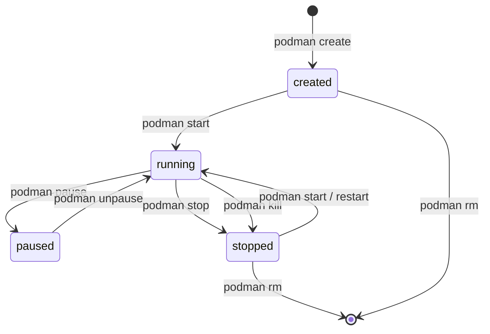

# Container Lifecycle

> [!ABSTRACT]
> Ein Container durchläuft definierte Zustände von der Erstellung bis zur Löschung. Das Verständnis des Lebenszyklus ist die Basis für korrektes Stoppen, Neustarten und Debuggen. Podman-Container sind **ephemer** — ihr Dateisystem-Status geht beim Löschen verloren, persistente Daten müssen in Volumes ausgelagert werden.

---

## Zustandsdiagramm



---

## Alle Container-Zustände

| Zustand | Beschreibung | Typischer Auslöser |
|---------|-------------|-------------------|
| `created` | Konfiguriert, aber nie gestartet | `podman create` |
| `running` | Prozess läuft | `podman start` / `podman run` |
| `paused` | Eingefroren (SIGSTOP an alle Prozesse) | `podman pause` |
| `stopped` / `exited` | Prozess beendet | `podman stop` / Exit |
| `dead` | Fehler beim Stoppen | OOM-Kill, schwerer Fehler |

---

## Lifecycle-Befehle

### Erstellen

```bash
# create — Container erstellen OHNE zu starten
podman create \
  --name webserver \
  -p 8080:80 \
  -v html:/usr/share/nginx/html:Z \
  docker.io/library/nginx:alpine

# Zustand: created
podman ps -a --filter name=webserver
# STATUS: Created
```

### Starten

```bash
# Bereits erstellten Container starten
podman start webserver

# run = create + start in einem Schritt
podman run -d --name webserver nginx

# run mit automatischem Löschen nach Exit
podman run --rm --name temp-task alpine echo "Fertig"

# Interaktiv starten
podman run -it --name shell alpine sh
```

### Stoppen und Pausieren

```bash
# Sauber stoppen (SIGTERM → 10s warten → SIGKILL)
podman stop webserver

# Mit Timeout
podman stop --time 30 webserver    # 30s warten vor SIGKILL
podman stop -t 0 webserver         # Sofort SIGKILL

# Sofort killen (SIGKILL)
podman kill webserver

# Custom Signal
podman kill --signal SIGTERM webserver
podman kill --signal SIGHUP webserver   # Reload bei vielen Daemons

# Einfrieren (alle Prozesse pausiert, kein CPU-Verbrauch)
podman pause webserver

# Fortsetzen
podman unpause webserver
```

### Neustarten

```bash
# Neustart (stop + start)
podman restart webserver

# Mit Timeout
podman restart --time 5 webserver
```

### Löschen

```bash
# Gestoppten Container löschen
podman rm webserver

# Laufenden Container force-löschen
podman rm -f webserver

# Mehrere
podman rm webserver db-container

# Alle gestoppten Container
podman container prune

# Alle Container (auch laufende) — VORSICHT!
podman rm -f $(podman ps -aq)
```

---

## Container-Status abfragen

```bash
# Alle Container (auch gestoppte)
podman ps -a

# Nur laufende
podman ps

# Nur gestoppte
podman ps -a --filter status=exited

# Exit-Code des letzten Runs
podman inspect --format "{{.State.ExitCode}}" webserver

# Laufzeit
podman inspect --format "{{.State.StartedAt}}" webserver

# Alle Status-Details
podman inspect --format "{{json .State}}" webserver | jq .
```

---

## Restart-Policies

```bash
# Kein automatischer Neustart (Standard)
podman run --restart no nginx

# Immer neustarten
podman run --restart always nginx

# Nur bei Fehler (Exit-Code != 0)
podman run --restart on-failure nginx

# Mit maximaler Wiederholungsanzahl
podman run --restart on-failure:5 nginx

# Außer wenn manuell gestoppt
podman run --restart unless-stopped nginx
```

> [!NOTE] Restart-Policies ohne systemd
> Restart-Policies funktionieren nur wenn Podman als Daemon läuft (root-Modus) oder mit systemd-Integration (Quadlet). Für rootless-Container ist Quadlet die empfohlene Lösung.

---

## Ephemere Container (--rm)

```bash
# Container wird nach Exit automatisch gelöscht
podman run --rm alpine echo "Einmalige Aufgabe"
podman run --rm python:3 python -c "import sys; print(sys.version)"

# Nützlich für:
# - Einmalige Skripte
# - Build-Umgebungen
# - Debugging
# - Tools ohne lokale Installation

# Debugging-Container (laufenden Container beitreten)
podman run --rm -it \
  --pid container:webserver \
  --network container:webserver \
  nicolaka/netshoot

# Ephemerer Debug-Container (Podman 4.1+)
podman debug webserver     # Hängt sich in laufenden Container ein
```

---

## Container-Events

```bash
# Alle Events in Echtzeit verfolgen
podman events

# Nur Start/Stop Events
podman events --filter event=start
podman events --filter event=die

# Events eines Containers
podman events --filter container=webserver

# Exit-Codes in Events
podman events --filter event=die --format json | jq '.Attributes.exitCode'

# Health-Check-Events
podman events --filter event=health_status
```

---

## Daten-Persistenz: Was überlebt den Container?

```
Container-Laufzeit:
├── Container-Dateisystem (ephemer)     → VERLOREN bei rm
│   ├── /etc, /usr, /app, /var...
│   └── Alle Änderungen im Container
│
└── Persistente Daten (bleiben erhalten):
    ├── Named Volumes (-v myvolume:/data) → überlebt rm ✅
    ├── Bind Mounts (-v /host:/container) → auf Host ✅
    └── tmpfs (/tmp)                      → nur RAM, weg bei Stop ❌
```

```bash
# Container löschen (Volume bleibt!)
podman rm webserver
podman volume ls   # Volume "html" noch vorhanden

# Container UND Volume löschen
podman rm -v webserver    # löscht anonyme Volumes
podman volume rm html     # named Volume manuell löschen
```

---

## Container-Ressourcen im Lifecycle

```bash
# Ressourcen während Laufzeit begrenzen (cgroups)
podman update --memory 512m webserver
podman update --cpus 0.5 webserver

# Top-ähnliche Ansicht
podman top webserver

# Prozesse im Container
podman top webserver pid,ppid,comm,args

# Stats
podman stats webserver --no-stream
```

---

## Verwandte Notizen

- [[Container und Images]] — Images verwalten
- [[Volumes und Storage]] — Datenpersistenz
- [[Systemd Integration]] — Quadlet für Restart-Policies
- [[Podman Troubleshooting]] — Exit-Codes debuggen
