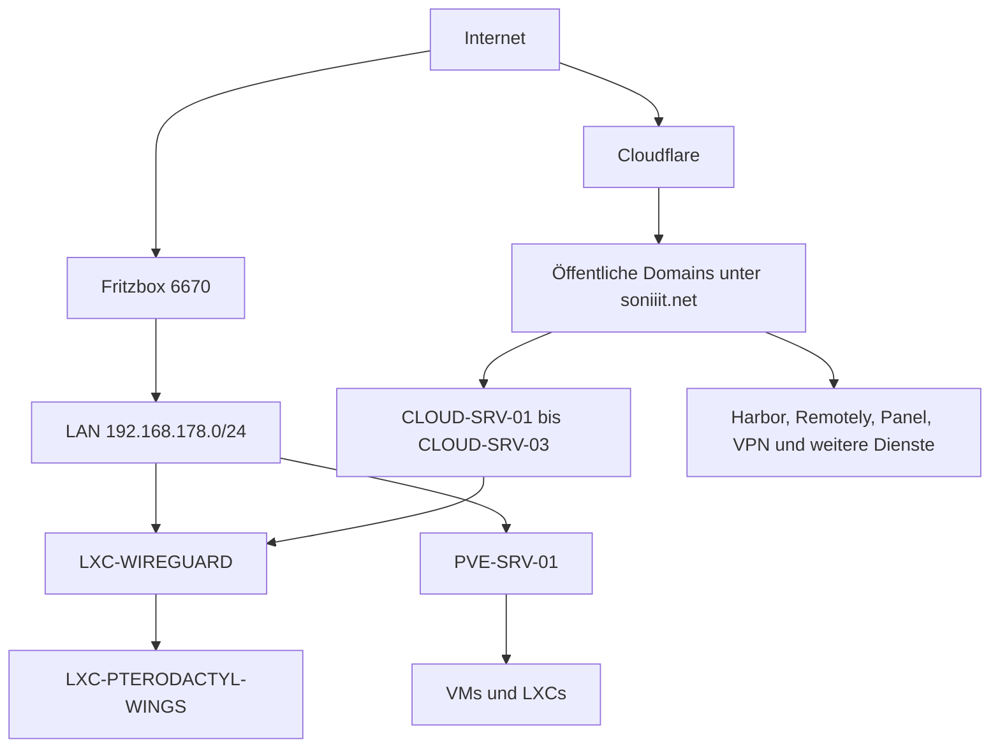

# Homelab Übersicht

> [!ABSTRACT]
> Übersicht über bekannte Hosts, zentrale Dienste, Netzsegmente und die Cloud-Anbindung des aktuellen Homelab-Setups.

---

## Server

| Hostname | Typ | Standort | Rolle | OS | Erreichbarkeit |
|----------|-----|----------|-------|----|----------------|
| [[PVE-SRV-01]] | Physisch | Homelab | Proxmox-Hypervisor | Proxmox VE 9 | Eingeschränkt |
| [[JELLYFIN-HOME-01]] | VM | Homelab | Media-Server | Ubuntu 24.04 | Eingeschränkt |
| [[LXC-BIND9]] | LXC | Homelab | Interner DNS | Ubuntu 24.04 | Offen |
| [[LXC-HARBOR]] | LXC | Homelab | Docker-Registry | Ubuntu 24.04 | Eingeschränkt |
| [[LXC-REMOTELY]] | LXC | Homelab | Remote-Support | Ubuntu 24.04 | Eingeschränkt |
| [[LXC-TELEPORT-PROXY]] | LXC | Homelab | Teleport-Proxy | Ubuntu 24.04 | Eingeschränkt |
| [[LXC-PTERODACTYL-PANEL]] | LXC | Homelab | Pterodactyl-Panel | Ubuntu 24.04 | Eingeschränkt |
| [[LXC-PTERODACTYL-WINGS]] | LXC | Homelab | Pterodactyl-Node | Ubuntu 24.04 | Eingeschränkt |
| [[LXC-WIREGUARD]] | LXC | Homelab | VPN-Server | Debian 13 | Eingeschränkt |
| [[LXC-OMADA]] | LXC | Homelab | Omada-Controller | Debian 12 | Eingeschränkt |
| [[LXC-SEMAPHORE]] | LXC | Homelab | Ansible-Automatisierung | Ubuntu 24.04 | Eingeschränkt |
| [[LXC-SCANOPY]] | LXC | Homelab | Netzwerkdokumentation | Debian 13 | Eingeschränkt |
| [[GITHUB-RUNNER-PACKER]] | LXC | Homelab | GitHub Runner für Packer | Ubuntu 24.04 | Eingeschränkt |
| [[GITHUB-RUNNER-TERRAFORM]] | LXC | Homelab | GitHub Runner für Terraform | Ubuntu 24.04 | Eingeschränkt |
| [[CLOUD-SRV-01]] | Cloud-VM | Cloud | VPN-Peer und Portweiterleitung | Ubuntu Server 24.04 | 24/7 |
| [[CLOUD-SRV-02]] | Cloud-VM | Cloud | SSO und externes Monitoring | Ubuntu 24.04 | 24/7 |
| [[CLOUD-SRV-03]] | Cloud-VM | Cloud | Teleport-Server | Ubuntu Server 24.04 | 24/7 |

---

## Dienste

| Dienst | Host | Zweck | Port/Domain | Exposure |
|--------|------|-------|-------------|----------|
| [[Bind9]] | [[LXC-BIND9]] | Interner DNS für Homelab-Server | `home.soniiit.net`, `dev.soniiit.net`, `demo.soniiit.net` | Intern |
| [[WireGuard]] | [[LXC-WIREGUARD]] | VPN für Cloud-Anbindung | `vpn.soniiit.net` | Öffentlich |
| [[Harbor]] | [[LXC-HARBOR]] | Container-Registry | `reg.soniiit.net` | Öffentlich |
| [[Remotely]] | [[LXC-REMOTELY]] | Remote-Support | `remote.soniiit.net` | Öffentlich |
| [[Pterodactyl-Panel]] | [[LXC-PTERODACTYL-PANEL]] | Verwaltung der Game-Server | `panel.soniiit.net` | Öffentlich |
| [[Pterodactyl-Wings]] | [[LXC-PTERODACTYL-WINGS]] | Ausführung der Game-Server | Offen | VPN-only / Intern |
| [[Omada]] | [[LXC-OMADA]] | Verwaltung kompatibler TP-Geräte | Offen | Intern |
| [[Semaphore]] | [[LXC-SEMAPHORE]] | Ansible-Automatisierung | Offen | Intern |
| [[Scanopy]] | [[LXC-SCANOPY]] | Automatische Netzwerkdokumentation | Offen | Intern |
| [[Authentik]] | [[CLOUD-SRV-02]] | Zentrale SSO-Plattform | `sso.soniiit.net` | Öffentlich |
| [[Teleport]] | [[CLOUD-SRV-03]] | Zugriff auf Server und interne WebUIs | `teleport.soniiit.net` | Öffentlich |
| Home Assistant | Offen | Smart-Home-Zugriff | `homeassistant.soniiit.net` | Öffentlich |
| Uptime Kuma | Offen | Externes Monitoring | `status.soniiit.net`, `uptime.soniiit.net` | Öffentlich |
| N8N | Offen | Workflow-Automatisierung | `n8n.soniiit.net` | Öffentlich |

---

## Netzwerküberblick

- Subnetze:
  - LAN: `192.168.178.0/24`
  - WireGuard `wg0`: `10.0.0.1/24`
  - WireGuard `wg1`: `10.0.10.1/24`
- VLANs: Keine bekannt
- VPN:
  - `LXC-WIREGUARD` ist der VPN-Server im Homelab.
  - Alle Cloud-Server verbinden auf `LXC-WIREGUARD`.
  - Die Cloud-Server dürfen im Homelab nur `LXC-PTERODACTYL-WINGS` erreichen.
- Reverse Proxy: Kein Reverse Proxy im Homelab bekannt
- Cloud-Anbindung:
  - `CLOUD-SRV-01` dient als VPN-Peer mit öffentlicher IP und Portweiterleitung ins Homelab.
  - `CLOUD-SRV-02` und `CLOUD-SRV-03` sind über WireGuard mit dem Homelab verbunden.
- DNS:
  - Lokaler Router: Fritzbox 6670
  - Standard-DNS lokal: Fritzbox
  - Server im Homelab nutzen Bind9
  - DNS-Provider für `soniiit.net`: Cloudflare
  - `home.soniiit.net`, `dev.soniiit.net` und `demo.soniiit.net` sind nur intern über Bind9 erreichbar
- Internet-Uplink: DS-Lite

---

## Architektur

