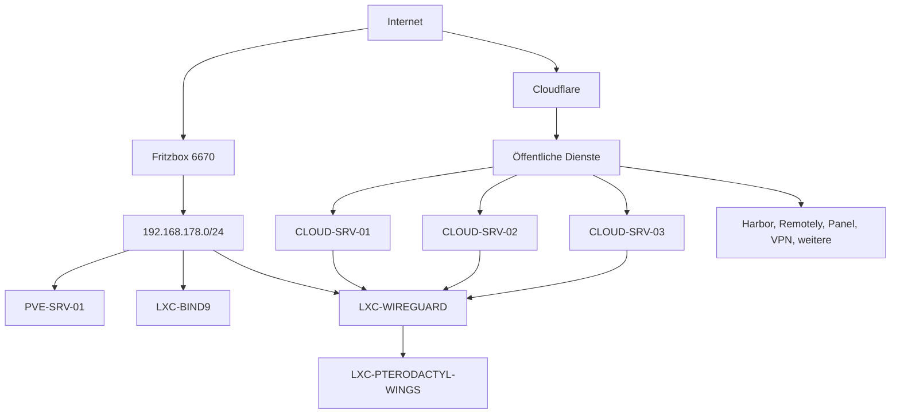

# Netzwerk-Topologie

## Übersicht

- Internet-Uplink: DS-Lite
- Öffentliche Domains:
  - `soniiit.net`
- Reverse Proxy: Keiner bekannt
- VPN:
  - Homelab-VPN-Server: [[LXC-WIREGUARD]]
  - `wg0`: `10.0.0.1/24`
  - `wg1`: `10.0.10.1/24`
- Besondere Randbedingungen:
  - Alle Cloud-Server verbinden per WireGuard ins Homelab.
  - Cloud-Server dürfen im Homelab nur [[LXC-PTERODACTYL-WINGS]] erreichen.
  - DNS-Provider für `soniiit.net` ist Cloudflare.
  - Standard-DNS im Heimnetz ist die Fritzbox 6670.
  - Homelab-Server nutzen [[LXC-BIND9]] als DNS.
  - `home.soniiit.net`, `dev.soniiit.net` und `demo.soniiit.net` sind nur intern über [[LXC-BIND9]] erreichbar.

---

## Segmente

| Segment | Subnetz | VLAN | Zweck |
|---------|---------|------|-------|
| LAN | `192.168.178.0/24` | Keins bekannt | Homelab-Hosts, Server und interne Dienste |
| WireGuard `wg0` | `10.0.0.1/24` | Nicht zutreffend | VPN-Segment, genauer Zweck noch offen |
| WireGuard `wg1` | `10.0.10.1/24` | Nicht zutreffend | VPN-Segment, genauer Zweck noch offen |

---

## Verbindungen

- Homelab zu Cloud:
  - [[CLOUD-SRV-01]], [[CLOUD-SRV-02]] und [[CLOUD-SRV-03]] verbinden auf [[LXC-WIREGUARD]].
  - Die Cloud-Seite hat nur einen eingeschränkten Zugriff ins Homelab.
- Interne Segmente:
  - Das Homelab nutzt aktuell nur das LAN und die WireGuard-Segmente.
  - Weitere VLANs oder Subnetze sind nicht bekannt.
- Exponierte Dienste:
  - `teleport.soniiit.net`
  - `sso.soniiit.net`
  - `status.soniiit.net`
  - `vpn.soniiit.net`
  - `homeassistant.soniiit.net`
  - `panel.soniiit.net`
  - `reg.soniiit.net`
  - `remote.soniiit.net`
  - `uptime.soniiit.net`
  - `n8n.soniiit.net`

---

## Topologie

