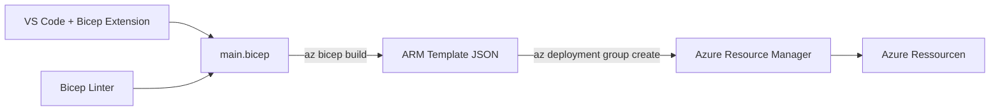
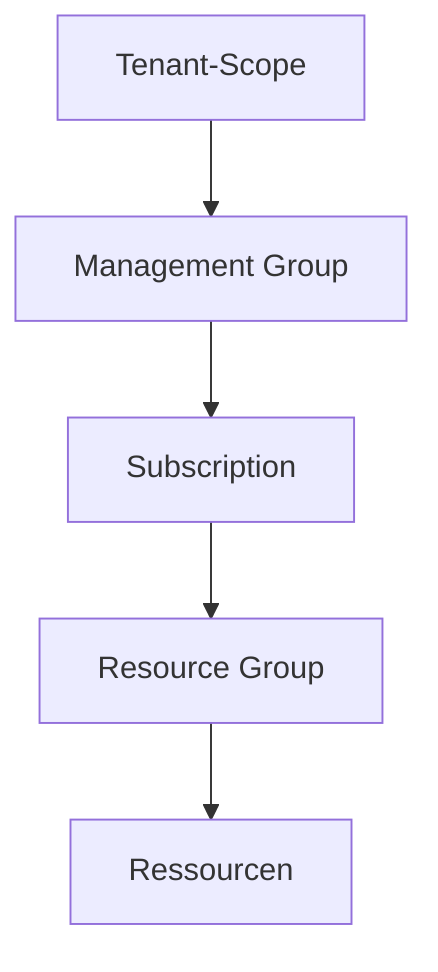

---
tags:
  - azure
  - bicep
  - iac
  - infrastruktur
  - automatisierung
aliases:
  - Bicep
  - ARM Bicep
  - Azure IaC Bicep
---

# Azure Bicep

> [!ABSTRACT] TL;DR
> **Azure Bicep** ist eine domänenspezifische Sprache (DSL) für die deklarative Infrastrukturbereitstellung in Azure. Bicep transpiliert zu ARM-Templates, ist deutlich lesbarer als JSON und ist die **von Microsoft empfohlene IaC-Sprache** für Azure-native Deployments.

---

## Was ist Azure Bicep?

Bicep ist eine **Abstraktionsschicht über ARM-Templates**. Statt hunderte Zeilen JSON zu schreiben, formuliert man Infrastructure as Code in einer klaren, lesbaren Syntax. Der Bicep-Compiler übersetzt (`transpiliert`) Bicep-Dateien automatisch in ARM-JSON.



---

## Bicep vs. ARM Templates vs. Terraform

| Merkmal | Bicep | ARM Template | Terraform |
|---------|-------|-------------|-----------|
| **Syntax** | DSL — lesbar | JSON — verbose | HCL — lesbar |
| **Typ** | Azure-nativ | Azure-nativ | Cloud-agnostisch |
| **State-Management** | Kein State-File | Kein State-File | State-File erforderlich |
| **Module** | ✅ Nativ | ✅ Linked Templates | ✅ Nativ |
| **IDE-Support** | VS Code Extension | JSON-Schema | Terraform Extension |
| **Multi-Cloud** | ❌ Azure only | ❌ Azure only | ✅ AWS, GCP, Azure |
| **Lernkurve** | Niedrig | Hoch | Mittel |
| **Microsoft Support** | Vollständig | Vollständig | Community + MS |

> [!TIP] Wann Bicep, wann Terraform?
> **Bicep** → Azure-only Projekte, Teams ohne Multi-Cloud-Anforderungen, enge ARM-Integration
> **Terraform** → Multi-Cloud, bestehende Terraform-Infrastruktur, Workspaces für Umgebungen

---

## Bicep-Grundsyntax

### Ressource deklarieren

```bicep
// Ressource: Storage Account
resource storageAccount 'Microsoft.Storage/storageAccounts@2023-01-01' = {
  name: 'stprodcontoso001'
  location: resourceGroup().location
  sku: {
    name: 'Standard_LRS'
  }
  kind: 'StorageV2'
  properties: {
    accessTier: 'Hot'
    supportsHttpsTrafficOnly: true
    minimumTlsVersion: 'TLS1_2'
  }
}
```

### Parameter

```bicep
// Parameter mit Typ und Standardwert
@description('Umgebungsbezeichnung: dev, test oder prod')
@allowed(['dev', 'test', 'prod'])
param environment string = 'dev'

@description('Azure Region für alle Ressourcen')
param location string = resourceGroup().location

@description('Anzahl VM-Instanzen')
@minValue(1)
@maxValue(10)
param instanceCount int = 2

@description('Admin-Passwort — aus Key Vault')
@secure()
param adminPassword string
```

### Variablen

```bicep
// Variable — berechnete Werte
var prefix         = 'contoso'
var storageNameRaw = '${prefix}${environment}storage'
// Bicep-Funktion: toLower für konsistente Namen
var storageName = toLower(take(storageNameRaw, 24))

var tags = {
  Environment: environment
  ManagedBy:   'Bicep'
  CostCenter:  'IT-Ops'
}
```

### Outputs

```bicep
// Werte zurückgeben (z. B. für nachfolgende Deployments)
output storageAccountId   string = storageAccount.id
output storageAccountName string = storageAccount.name
output primaryEndpoint    string = storageAccount.properties.primaryEndpoints.blob
```

---

## Module — Wiederverwendbare Komponenten

Module sind separate `.bicep`-Dateien, die als Komponenten eingebunden werden:

```bicep
// main.bicep — Hauptdatei
module networkModule './modules/network.bicep' = {
  name: 'deployNetwork'
  params: {
    vnetName:    'vnet-prod'
    location:    location
    addressSpace: '10.0.0.0/16'
  }
}

module vmModule './modules/vm.bicep' = {
  name: 'deployVM'
  dependsOn: [networkModule]
  params: {
    vmName:    'vm-web01'
    subnetId:  networkModule.outputs.subnetId
    location:  location
  }
}
```

```bicep
// modules/network.bicep
@description('Name des virtuellen Netzwerks')
param vnetName string

param location string
param addressSpace string = '10.0.0.0/16'

resource vnet 'Microsoft.Network/virtualNetworks@2023-09-01' = {
  name: vnetName
  location: location
  properties: {
    addressSpace: {
      addressPrefixes: [addressSpace]
    }
    subnets: [
      {
        name: 'snet-default'
        properties: { addressPrefix: '10.0.1.0/24' }
      }
    ]
  }
}

output vnetId   string = vnet.id
output subnetId string = vnet.properties.subnets[0].id
```

---

## Bicep Registry — Modulverteilung

Module können in einer **privaten Registry** (Azure Container Registry) oder der **öffentlichen Bicep Registry** gespeichert werden:

```bicep
// Modul aus ACR-Registry laden (private)
module storageModule 'br/myregistry.azurecr.io/bicep/modules/storage:v1.0' = {
  name: 'deployStorage'
  params: { ... }
}

// Modul aus öffentlicher Bicep Registry (Microsoft Verified Modules)
module aksCluster 'br/public:avm/res/container-service/managed-cluster:0.3.0' = {
  name: 'deployAKS'
  params: { ... }
}
```

> [!IMPORTANT] Azure Verified Modules (AVM)
> Microsoft pflegt **Azure Verified Modules** — geprüfte, standardkonforme Bicep-Module für alle wichtigen Dienste. Bevorzugen gegenüber eigengeschriebenen Modulen.

---

## Deployment Scopes

Bicep unterstützt vier Deployment-Scopes:



```bicep
// Standard: Resource Group (kein targetScope nötig)
targetScope = 'resourceGroup'

// Subscription-Level (Policy, Budget, RG erstellen)
targetScope = 'subscription'

resource rgProd 'Microsoft.Resources/resourceGroups@2023-07-01' = {
  name: 'rg-production'
  location: 'westeurope'
}

// Management Group (Policies, Subscriptions)
targetScope = 'managementGroup'

// Tenant-Level (Root Management Group)
targetScope = 'tenant'
```

---

## Loops (for-Expressions)

```bicep
// Mehrere Storage Accounts aus Array erstellen
param storageNames array = ['stdev', 'sttest', 'stprod']

resource storageAccounts 'Microsoft.Storage/storageAccounts@2023-01-01' = [
  for name in storageNames: {
    name: name
    location: location
    sku: { name: 'Standard_LRS' }
    kind: 'StorageV2'
    properties: {}
  }
]

// Mit Index (range-basiert)
resource subnets 'Microsoft.Network/virtualNetworks/subnets@2023-09-01' = [
  for i in range(0, 3): {
    name: 'snet-${i}'
    parent: vnet
    properties: { addressPrefix: '10.0.${i}.0/24' }
  }
]
```

---

## Conditions (if-Expressions)

```bicep
@description('Aktiviert erweiterte Diagnose für nicht-Dev-Umgebungen')
param environment string

// Ressource nur in Prod/Test deployen
resource diagnosticSettings 'Microsoft.Insights/diagnosticSettings@2021-05-01-preview' = if (environment != 'dev') {
  name: 'diag-${storageAccount.name}'
  scope: storageAccount
  properties: {
    logs: []
    metrics: [{ category: 'Transaction'; enabled: true }]
  }
}

// Bedingter Wert in Eigenschaft
var sku = environment == 'prod' ? 'Premium_LRS' : 'Standard_LRS'
```

---

## Existing Resources referenzieren

```bicep
// Bestehende Ressource referenzieren (kein Deployment!)
resource existingVnet 'Microsoft.Network/virtualNetworks@2023-09-01' existing = {
  name: 'vnet-shared'
  scope: resourceGroup('rg-network-shared')
}

// In neuem Subnet verwenden
resource subnet 'Microsoft.Network/virtualNetworks/subnets@2023-09-01' = {
  name: 'snet-app'
  parent: existingVnet
  properties: { addressPrefix: '10.1.5.0/24' }
}
```

---

## Bicep Linter und What-if

```bash
# Bicep installieren / update (via Azure CLI)
az bicep install
az bicep upgrade

# Syntax validieren (Linter läuft automatisch)
az bicep build --file main.bicep

# ARM-Template generieren
az bicep build --file main.bicep --outfile main.json

# What-if — Vorschau ohne Deployment
az deployment group what-if \
    --resource-group rg-prod \
    --template-file main.bicep \
    --parameters main.prod.bicepparam

# Deployment ausführen
az deployment group create \
    --resource-group rg-prod \
    --template-file main.bicep \
    --parameters main.prod.bicepparam \
    --name "deploy-$(date +%Y%m%d-%H%M%S)"
```

---

## Bicep Visualizer (VS Code)

Die **VS Code Bicep Extension** bietet:
- **Syntax-Highlighting** und IntelliSense
- **Visualizer:** Grafische Darstellung der Ressourcen-Abhängigkeiten
- **Linter-Integration:** Probleme direkt im Editor
- **Snippets** für alle Ressourcentypen

```
Extension: ms-azuretools.vscode-bicep
```

---

## CI/CD mit Bicep

### GitHub Actions

```yaml
name: Deploy Infrastructure

on:
  push:
    branches: [main]
  workflow_dispatch:

permissions:
  id-token: write
  contents: read

jobs:
  deploy:
    runs-on: ubuntu-latest
    steps:
      - name: Checkout
        uses: actions/checkout@v4

      - name: Azure Login (OIDC)
        uses: azure/login@v2
        with:
          client-id:       ${{ secrets.AZURE_CLIENT_ID }}
          tenant-id:       ${{ secrets.AZURE_TENANT_ID }}
          subscription-id: ${{ secrets.AZURE_SUBSCRIPTION_ID }}

      - name: Bicep What-if
        run: |
          az deployment group what-if \
            --resource-group rg-prod \
            --template-file infra/main.bicep \
            --parameters infra/main.prod.bicepparam

      - name: Deploy Bicep
        run: |
          az deployment group create \
            --resource-group rg-prod \
            --template-file infra/main.bicep \
            --parameters infra/main.prod.bicepparam \
            --name "gh-deploy-${{ github.run_number }}"
```

---

## Praxis-Beispiel: VNet + Subnets + NSG + VM

```bicep
// main.bicep — Vollständiges Beispiel
targetScope = 'resourceGroup'

@description('Umgebung: dev oder prod')
param environment string = 'dev'
param location    string = resourceGroup().location

@secure()
param adminPassword string

var prefix = 'contoso-${environment}'
var tags   = { Environment: environment; ManagedBy: 'Bicep' }

// NSG
resource nsg 'Microsoft.Network/networkSecurityGroups@2023-09-01' = {
  name: 'nsg-${prefix}'
  location: location
  tags: tags
  properties: {
    securityRules: [
      {
        name: 'Allow-SSH'
        properties: {
          priority: 100; protocol: 'Tcp'; access: 'Allow'
          direction: 'Inbound'
          sourceAddressPrefix: '*'; sourcePortRange: '*'
          destinationAddressPrefix: '*'; destinationPortRange: '22'
        }
      }
    ]
  }
}

// VNet mit Subnet
resource vnet 'Microsoft.Network/virtualNetworks@2023-09-01' = {
  name: 'vnet-${prefix}'
  location: location
  tags: tags
  properties: {
    addressSpace: { addressPrefixes: ['10.0.0.0/16'] }
    subnets: [
      {
        name: 'snet-app'
        properties: {
          addressPrefix: '10.0.1.0/24'
          networkSecurityGroup: { id: nsg.id }
        }
      }
    ]
  }
}

// Public IP
resource publicIp 'Microsoft.Network/publicIPAddresses@2023-09-01' = {
  name: 'pip-${prefix}-vm'
  location: location
  tags: tags
  sku: { name: 'Standard' }
  properties: { publicIPAllocationMethod: 'Static' }
}

// NIC
resource nic 'Microsoft.Network/networkInterfaces@2023-09-01' = {
  name: 'nic-${prefix}-vm'
  location: location
  tags: tags
  properties: {
    ipConfigurations: [
      {
        name: 'ipconfig1'
        properties: {
          subnet: { id: vnet.properties.subnets[0].id }
          publicIPAddress: { id: publicIp.id }
        }
      }
    ]
  }
}

// Virtuelle Maschine
resource vm 'Microsoft.Compute/virtualMachines@2023-09-01' = {
  name: 'vm-${prefix}'
  location: location
  tags: tags
  properties: {
    hardwareProfile: { vmSize: 'Standard_B2s' }
    storageProfile: {
      imageReference: {
        publisher: 'Canonical'; offer: '0001-com-ubuntu-server-jammy'
        sku: '22_04-lts-gen2'; version: 'latest'
      }
      osDisk: { createOption: 'FromImage'; managedDisk: { storageAccountType: 'Premium_LRS' } }
    }
    osProfile: {
      computerName: 'vm-${prefix}'
      adminUsername: 'azureuser'
      adminPassword: adminPassword
    }
    networkProfile: {
      networkInterfaces: [{ id: nic.id }]
    }
  }
}

// Outputs
output vmId       string = vm.id
output publicIpAddress string = publicIp.properties.ipAddress
```

---

## Verwandte Notizen
- [[Terraform für Azure]]
- [[Azure CLI]]
- [[Azure PowerShell]]
- [[GitHub Actions für Azure]]
- [[Azure DevOps]]
