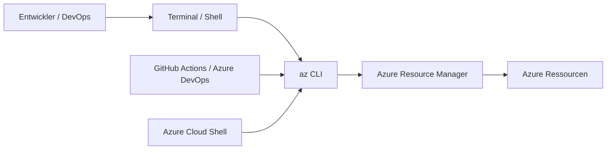

---
tags:
  - azure
  - cli
  - automatisierung
  - bash
  - infrastruktur
aliases:
  - az CLI
  - Azure Command Line
---

# Azure CLI

> [!ABSTRACT] TL;DR
> Die **Azure CLI** (`az`) ist das plattformübergreifende Kommandozeilen-Tool für Azure — optimiert für Bash-Skripting, Linux-Umgebungen und CI/CD-Pipelines. Mit JMESPath-Queries (`--query`), flexiblen Ausgabeformaten und Azure Cloud Shell ist sie das bevorzugte Tool für DevOps-Teams und Entwickler.

---

## Was ist die Azure CLI?

Die Azure CLI ist ein **Open-Source-Tool** von Microsoft für die Verwaltung von Azure-Ressourcen direkt aus dem Terminal. Sie ist in Python geschrieben, läuft auf allen Plattformen und eignet sich hervorragend für Bash-basierte Automatisierung.



---

## Installation

### Windows

```powershell
# Via winget (empfohlen)
winget install Microsoft.AzureCLI

# Via MSI-Installer
# https://aka.ms/installazurecliwindows

# Via Chocolatey
choco install azure-cli
```

### macOS

```bash
# Via Homebrew
brew install azure-cli

# Update
brew upgrade azure-cli
```

### Linux (Ubuntu / Debian)

```bash
curl -sL https://aka.ms/InstallAzureCLIDeb | sudo bash

# Oder manuell
sudo apt-get update
sudo apt-get install ca-certificates curl apt-transport-https lsb-release gnupg
curl -sLS https://packages.microsoft.com/keys/microsoft.asc | gpg --dearmor | sudo tee /etc/apt/keyrings/microsoft.gpg > /dev/null
AZ_DIST=$(lsb_release -cs)
echo "deb [arch=$(dpkg --print-architecture) signed-by=/etc/apt/keyrings/microsoft.gpg] https://packages.microsoft.com/repos/azure-cli/ $AZ_DIST main" | sudo tee /etc/apt/sources.list.d/azure-cli.list
sudo apt-get update && sudo apt-get install azure-cli
```

### Docker (CI/CD)

```bash
docker run -it mcr.microsoft.com/azure-cli
```

### Update und Version

```bash
az upgrade
az version
```

---

---

## Via Azure Portal (UI)

> [!TIP] Schnellzugriff
> [portal.azure.com](https://portal.azure.com) → **Cloud Shell (>_)**

### Schritt-für-Schritt

1. **portal.azure.com aufrufen** – Im Browser anmelden
2. **Cloud Shell öffnen** – Symbol `>_` oben rechts klicken
3. **Shell-Typ wählen** – "Bash" oder "PowerShell" auswählen
4. **Storage Account einrichten** – Einmalig für persistente Dateien (wird automatisch vorgeschlagen)
5. **Azure CLI nutzen** – `az`-Befehle sofort ausführen – `az login` nicht nötig (bereits authentifiziert)
6. **Dateien übertragen** – Über Cloud Shell hochladen/herunterladen
7. **Lokale Installation** – Für lokale Nutzung: docs.microsoft.com/cli/azure/install-azure-cli

---

## az login — Authentifizierungsmethoden

### Interaktiv (Browser)

```bash
az login

# Spezifischer Tenant
az login --tenant contoso.onmicrosoft.com

# Gerätecode (für Server ohne Browser)
az login --use-device-code
```

### Service Principal + Client Secret

```bash
az login \
  --service-principal \
  --username "app-id" \
  --password "client-secret" \
  --tenant "tenant-id"
```

### Service Principal + Zertifikat

```bash
az login \
  --service-principal \
  --username "app-id" \
  --tenant "tenant-id" \
  --password "/path/to/cert.pem"
```

### Managed Identity (innerhalb Azure)

```bash
# System-assigned
az login --identity

# User-assigned
az login --identity --username "client-id-oder-resource-id"
```

> [!TIP] OIDC in GitHub Actions
> In GitHub Actions mit Federated Credentials nutzt man `azure/login` Action mit OIDC — kein dauerhaftes Secret nötig.

---

## Wichtige Commands nach Kategorie

### Ressourcengruppen

```bash
# Auflisten
az group list --output table

# Erstellen
az group create --name rg-prod --location westeurope

# Löschen
az group delete --name rg-dev --yes --no-wait

# Tags setzen
az group update --name rg-prod --tags Environment=Production CostCenter=IT
```

### VMs

```bash
# Alle VMs auflisten
az vm list --output table

# VM mit Status
az vm list -d --query "[].{Name:name, RG:resourceGroup, Status:powerState}" -o table

# VM erstellen
az vm create \
  --resource-group rg-dev \
  --name vm-ubuntu01 \
  --image Ubuntu2204 \
  --size Standard_B2s \
  --admin-username azureuser \
  --generate-ssh-keys \
  --location westeurope

# VM starten / stoppen
az vm start  --resource-group rg-prod --name vm-web01
az vm stop   --resource-group rg-prod --name vm-web01
az vm deallocate --resource-group rg-prod --name vm-web01
```

### Netzwerk

```bash
# VNet erstellen
az network vnet create \
  --resource-group rg-network \
  --name vnet-prod \
  --address-prefix 10.0.0.0/16 \
  --subnet-name snet-default \
  --subnet-prefix 10.0.1.0/24

# NSG erstellen und Regel hinzufügen
az network nsg create --resource-group rg-network --name nsg-web
az network nsg rule create \
  --resource-group rg-network \
  --nsg-name nsg-web \
  --name Allow-HTTPS \
  --protocol Tcp \
  --direction Inbound \
  --priority 100 \
  --destination-port-range 443 \
  --access Allow
```

### Storage

```bash
# Storage Account erstellen
az storage account create \
  --name stprodcontoso001 \
  --resource-group rg-storage \
  --location westeurope \
  --sku Standard_LRS \
  --kind StorageV2

# Blob-Container erstellen
az storage container create \
  --name reports \
  --account-name stprodcontoso001 \
  --auth-mode login

# Datei hochladen
az storage blob upload \
  --account-name stprodcontoso001 \
  --container-name reports \
  --name "2024/report.xlsx" \
  --file "./report.xlsx" \
  --auth-mode login
```

### RBAC

```bash
# Rollenzuweisungen anzeigen
az role assignment list --resource-group rg-prod --output table

# Rolle zuweisen
az role assignment create \
  --assignee "user@contoso.com" \
  --role "Contributor" \
  --resource-group rg-prod

# Rolle entfernen
az role assignment delete \
  --assignee "user@contoso.com" \
  --role "Contributor" \
  --resource-group rg-prod
```

### Entra ID (AD)

```bash
# User anlegen
az ad user create \
  --display-name "Max Mustermann" \
  --user-principal-name max.mustermann@contoso.com \
  --password "TempP@ss2024!" \
  --force-change-password-next-sign-in true

# Gruppe erstellen und Mitglied hinzufügen
az ad group create --display-name "IT-Admins" --mail-nickname "it-admins"
az ad group member add --group "IT-Admins" --member-id "user-object-id"
```

---

## Output-Formate

| Format | Flag | Verwendung |
|--------|------|-----------|
| **json** | `-o json` | Standard — vollständige Objekte |
| **table** | `-o table` | Menschenlesbar — Spaltenansicht |
| **tsv** | `-o tsv` | Tab-separated — für Skripting/Variablen |
| **yaml** | `-o yaml` | Leserfreundlich — ähnlich JSON |
| **jsonc** | `-o jsonc` | JSON mit Farbmarkierung |
| **none** | `-o none` | Keine Ausgabe — nur Statuscode |

```bash
# Beispiele
az vm list -o table
az vm list -o json
az group list --query "[].name" -o tsv
az account show -o yaml
```

---

## --query mit JMESPath

JMESPath ist eine Abfragesprache für JSON — ähnlich wie XPath für XML.

### Grundlegende Abfragen

```bash
# Einzelnes Feld
az vm show -g rg-prod -n vm-web01 --query "name"

# Mehrere Felder als Objekt
az vm show -g rg-prod -n vm-web01 --query "{Name:name, Ort:location, Groesse:hardwareProfile.vmSize}"

# Array — alle Namen
az vm list --query "[].name"

# Array — Objekte mit mehreren Feldern
az vm list --query "[].{Name:name, RG:resourceGroup, OS:storageProfile.osDisk.osType}"
```

### Filtern von Arrays

```bash
# VMs in bestimmter Location
az vm list --query "[?location=='westeurope'].name" -o tsv

# Nur laufende VMs (mit powerState)
az vm list -d --query "[?powerState=='VM running'].{Name:name, RG:resourceGroup}" -o table

# Wert aus erster Array-Element
az vm list --query "[0].name" -o tsv
```

### In Bash-Variablen verwenden

```bash
# Wert in Variable speichern
RG_NAME=$(az group list --query "[?location=='westeurope'][0].name" -o tsv)
echo "Erste RG in West Europe: $RG_NAME"

# Alle Namen in Loop
az vm list --query "[].name" -o tsv | while read -r vmname; do
    echo "VM: $vmname"
done
```

---

## az config — Defaults setzen

```bash
# Standard-Ressourcengruppe setzen (kein --resource-group mehr nötig)
az config set defaults.group=rg-prod

# Standard-Location
az config set defaults.location=westeurope

# Ausgabeformat global
az config set core.output=table

# Aktuelle Konfiguration anzeigen
az config get

# Konfiguration zurücksetzen
az config unset defaults.group
```

---

## az interactive — IntelliSense

```bash
# Interaktiven Modus starten (Tab-Completion, Docs inline)
az interactive
```

> [!NOTE] Az Interactive
> `az interactive` bietet IntelliSense-Autocomplete und zeigt die Dokumentation für jeden Command direkt im Terminal an. Ideal beim Erkunden neuer Commands.

---

## Azure Cloud Shell

**Azure Cloud Shell** ist eine browser-basierte Shell direkt im Azure Portal — keine lokale Installation nötig.

| Feature | Wert |
|---------|------|
| URL | https://shell.azure.com |
| Shells | Bash + PowerShell |
| Vorinstalliert | az CLI, kubectl, helm, terraform, git, … |
| Storage | Azure File Share (persistent) |
| Authentifizierung | Automatisch via Portal-Login |
| Timeout | 20 Minuten Inaktivität |

> [!TIP] Cloud Shell für schnelle Tasks
> Für ad-hoc Verwaltungsaufgaben ist Cloud Shell ideal — sofort startklar, kein lokales Setup, immer aktuell.

---

## Praxis-Skript: VM erstellen und konfigurieren

```bash
#!/bin/bash
set -e

RG="rg-webserver"
LOCATION="westeurope"
VNET="vnet-web"
SUBNET="snet-app"
NSG="nsg-web"
VM_NAME="vm-nginx01"
ADMIN_USER="azureuser"

# Ressourcengruppe
az group create --name "$RG" --location "$LOCATION"

# VNet und Subnet
az network vnet create \
    --resource-group "$RG" \
    --name "$VNET" \
    --address-prefix "10.10.0.0/16" \
    --subnet-name "$SUBNET" \
    --subnet-prefix "10.10.1.0/24"

# NSG mit HTTPS-Regel
az network nsg create --resource-group "$RG" --name "$NSG"
az network nsg rule create \
    --resource-group "$RG" --nsg-name "$NSG" \
    --name AllowHTTPS --priority 100 \
    --destination-port-range 443 --access Allow --protocol Tcp

# VM erstellen
az vm create \
    --resource-group "$RG" \
    --name "$VM_NAME" \
    --image Ubuntu2204 \
    --size Standard_B2s \
    --vnet-name "$VNET" \
    --subnet "$SUBNET" \
    --nsg "$NSG" \
    --admin-username "$ADMIN_USER" \
    --generate-ssh-keys \
    --no-wait

echo "✓ VM '$VM_NAME' wird erstellt..."
az vm wait --resource-group "$RG" --name "$VM_NAME" --created
echo "✓ VM bereit!"
```

---

## Praxis-Skript: Bicep deployen

```bash
#!/bin/bash

SUBSCRIPTION="your-subscription-id"
RG="rg-infra"
BICEP_FILE="./main.bicep"
PARAMS_FILE="./main.prod.bicepparam"

az account set --subscription "$SUBSCRIPTION"

# What-if ausführen (Vorschau)
az deployment group what-if \
    --resource-group "$RG" \
    --template-file "$BICEP_FILE" \
    --parameters "$PARAMS_FILE"

# Deploy ausführen
az deployment group create \
    --resource-group "$RG" \
    --template-file "$BICEP_FILE" \
    --parameters "$PARAMS_FILE" \
    --name "deploy-$(date +%Y%m%d-%H%M%S)"
```

---

## Praxis-Skript: Entra ID Sign-in-Log abrufen

```bash
# Letzte 100 fehlgeschlagene Logins
az monitor activity-log list \
    --resource-group "rg-prod" \
    --status Failed \
    --max-events 100 \
    --query "[].{Zeit:eventTimestamp, Op:operationName.localizedValue, User:caller, Status:status.value}" \
    -o table
```

---

## az CLI vs. Azure PowerShell

| Kriterium | Azure CLI | Azure PowerShell |
|-----------|-----------|-----------------|
| **Syntax** | POSIX-Stil, Bash-freundlich | PowerShell Cmdlets (Verb-Nomen) |
| **Plattform** | Windows, Linux, macOS | Windows, Linux, macOS |
| **Ideal für** | Bash-Skripting, DevOps, CI/CD | Windows-Admins, komplexe Logik |
| **Output** | JSON (Standard), table, tsv | PowerShell-Objekte |
| **Piping** | Shell-Pipes (`\|`, `grep`) | PS-Pipeline (PowerShell-Objekte) |
| **Tab-Completion** | Bash/Zsh-Completion | PSReadLine-Completion |
| **Lernkurve** | Niedrig für Linux-User | Niedrig für Windows-Admins |

> [!NOTE] Wann welches Tool?
> - **az CLI:** Linux-Umgebungen, Docker, GitHub Actions, schnelle One-Liner
> - **Azure PowerShell:** Windows-Admins, komplexe Objekt-Pipeline, M365-Kombination

---

## Extension-Management

```bash
# Erweiterungen auflisten
az extension list --output table

# Erweiterung installieren (z. B. für AKS, DevOps)
az extension add --name aks-preview
az extension add --name azure-devops
az extension add --name containerapp

# Update
az extension update --name aks-preview

# Entfernen
az extension remove --name aks-preview
```

---

## Verwandte Notizen
- [[Azure PowerShell]]
- [[Azure Bicep]]
- [[Terraform für Azure]]
- [[Azure RBAC]]
