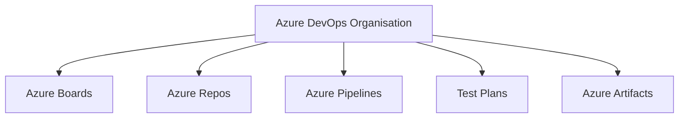
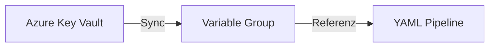
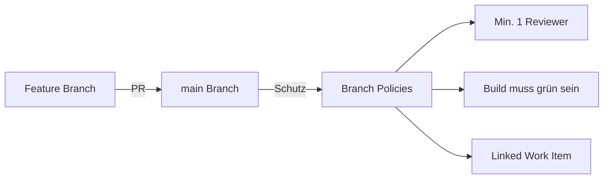

---
tags:
  - azure
  - devops
  - pipelines
  - ci-cd
  - automatisierung
aliases:
  - ADO
  - Azure DevOps Services
---

# Azure DevOps

> [!ABSTRACT] TL;DR
> Azure DevOps ist eine vollständige DevOps-Plattform von Microsoft mit Boards, Repos, Pipelines, Test Plans und Artifacts. YAML-Pipelines ermöglichen CI/CD als Code mit Stages, Jobs und Steps. Service Connections verbinden Pipelines mit Azure, GitHub und weiteren Diensten.

---

## Was ist Azure DevOps?

**Azure DevOps** ist eine cloud-basierte Plattform (auch On-Prem als Azure DevOps Server) für die gesamte Software-Entwicklung und -Auslieferung. Sie fasst fünf Dienste unter einem Dach zusammen und integriert sich tief in das Microsoft/Azure-Ökosystem.



### Die fünf Dienste im Überblick

| Dienst | Funktion |
|--------|----------|
| **Azure Boards** | Work Items, Backlogs, Sprints, Kanban-Boards |
| **Azure Repos** | Git-Repositories, Branch Policies, Pull Requests |
| **Azure Pipelines** | CI/CD-Automatisierung (YAML + Classic) |
| **Test Plans** | Manuelle und automatisierte Testplanung |
| **Azure Artifacts** | Paket-Feed für NuGet, npm, Maven, Python, Universal |

---

## Azure Pipelines: YAML vs. Classic

**YAML-Pipelines** sind der empfohlene Ansatz seit 2019. Konfiguration liegt als Code im Repository — versioniert, reviewbar und wiederverwendbar.

**Classic Pipelines** nutzen eine visuelle GUI-Oberfläche und sind weiterhin funktionsfähig, werden aber nicht mehr aktiv weiterentwickelt.

> [!TIP] Empfehlung 2024/2025
> Neue Pipelines immer als YAML anlegen. Classic Pipelines bei Gelegenheit migrieren. Microsoft stellt Classic UI-Pipelines nicht ab, aber YAML ist der Standard.

### Pipeline-Struktur: Stages → Jobs → Steps

```yaml
trigger:
  - main

stages:
  - stage: Build
    displayName: "Build Stage"
    jobs:
      - job: BuildJob
        displayName: "Build Application"
        pool:
          vmImage: "ubuntu-latest"
        steps:
          - task: UseDotNet@2
            inputs:
              version: "8.x"
          - script: dotnet build
            displayName: "dotnet build"

  - stage: Deploy
    displayName: "Deploy to Dev"
    dependsOn: Build
    condition: succeeded()
    jobs:
      - deployment: DeployDev
        environment: "dev"
        strategy:
          runOnce:
            deploy:
              steps:
                - task: AzureWebApp@1
                  inputs:
                    azureSubscription: "sc-azure-dev"
                    appName: "myapp-dev"
```

| Ebene | Beschreibung |
|-------|-------------|
| **Stage** | Logische Phase (Build, Test, Deploy) |
| **Job** | Läuft auf einem Agent, enthält Steps |
| **Deployment Job** | Spezial-Job für Deployments mit Environment-Tracking |
| **Step** | Einzelner Task oder Script |

---

## Service Connections

**Service Connections** verbinden Azure DevOps sicher mit externen Diensten. Sie werden unter *Project Settings → Service connections* verwaltet.

### Unterstützte Connection-Typen

| Typ | Verwendung |
|-----|-----------|
| **Azure Resource Manager** | Deployment in Azure Subscriptions |
| **GitHub** | Quellcode aus GitHub-Repos |
| **Docker Registry** | Push/Pull Container Images |
| **Kubernetes** | Deploy in AKS oder andere Cluster |
| **npm / NuGet** | Paket-Feeds extern |
| **SSH** | Verbindung zu Linux-Servern |

> [!NOTE] Security Best Practice
> Separate Service Connections pro Umgebung (dev/test/prod) anlegen und jede Connection auf den minimalen Scope (Resource Group statt Subscription) beschränken.

```yaml
# YAML: Service Connection referenzieren
- task: AzureCLI@2
  inputs:
    azureSubscription: "sc-production"  # Name der Service Connection
    scriptType: "bash"
    scriptLocation: "inlineScript"
    inlineScript: |
      az webapp restart --name myapp --resource-group myRG
```

---

## Variable Groups und Bibliotheken

**Variable Groups** speichern wiederverwendbare Variablen zentral in der Pipeline-Bibliothek. Integration mit Azure Key Vault ermöglicht sichere Secret-Verwaltung.

```yaml
variables:
  - group: "production-variables"  # Variable Group referenzieren
  - name: buildConfiguration
    value: "Release"
```



---

## Environments (Deployment-Ziele)

**Environments** repräsentieren logische Deployment-Ziele (Dev, QA, Production). Sie bieten:

- **Deployment-History** — Welcher Build wurde wann deployed?
- **Approval Gates** — Manuelle Freigabe vor dem Deployment
- **Resource-Tracking** — Kubernetes Pods oder VMs als Ressourcen

```yaml
# Environment mit Approval Gate
- deployment: DeployProd
  environment: "production"  # Approval Gate im Portal konfiguriert
  strategy:
    runOnce:
      deploy:
        steps:
          - script: echo "Deploying to Production"
```

> [!WARNING] Approval Gates
> Approval Gates werden im Azure DevOps Portal unter *Environments → Approvals and checks* konfiguriert, nicht im YAML.

---

## Azure Pipelines Agents

### Microsoft-Hosted Agents (2024/2025)

| Image | OS | Verfügbar |
|-------|-----|----------|
| `ubuntu-24.04` | Ubuntu 24.04 LTS | Ja (neu 2024) |
| `ubuntu-22.04` | Ubuntu 22.04 LTS | Ja |
| `windows-2025` | Windows Server 2025 | Ja (neu 2025) |
| `windows-2022` | Windows Server 2022 | Ja |
| `macos-15` | macOS 15 Sequoia | Ja (neu 2024/2025) |

> [!WARNING] Deprecations
> `ubuntu-20.04` wurde im April 2025 deprecated. Pipelines auf `ubuntu-22.04` oder `ubuntu-24.04` migrieren.

### Self-Hosted Agents

```bash
# Agent herunterladen und konfigurieren (Linux)
mkdir myagent && cd myagent
curl -O https://vstsagentpackage.azureedge.net/agent/3.x.x/vsts-agent-linux-x64-3.x.x.tar.gz
tar zxvf vsts-agent-linux-x64-3.x.x.tar.gz
./config.sh --url https://dev.azure.com/myOrg --auth PAT --token <PAT>
./svc.sh install && ./svc.sh start
```

---

## Azure Repos: Git-Workflows

**Azure Repos** bietet vollständige Git-Unterstützung mit Branch Policies, Pull Requests und erweiterten Berechtigungen.

### Branch Policies (Best Practice)



| Policy | Empfehlung |
|--------|-----------|
| Minimum reviewers | 1–2 für main/production |
| Build validation | CI-Pipeline muss erfolgreich sein |
| Require linked work items | Work Item verknüpfen |
| Require merge strategy | Squash oder Merge Commit |

---

## Azure Artifacts

**Azure Artifacts** ist ein universeller Paket-Feed für alle gängigen Paketformate.

| Format | Protokoll | Verwendung |
|--------|-----------|-----------|
| NuGet | NuGet API | .NET Pakete |
| npm | npm Registry | Node.js Pakete |
| Maven | Maven Repository | Java Pakete |
| Python | PyPI-kompatibel | Python Packages |
| Universal | REST API | Beliebige Binaries |

```yaml
# NuGet-Paket aus Azure Artifacts
- task: NuGetAuthenticate@1
- task: NuGetCommand@2
  inputs:
    command: "restore"
    feedsToUse: "select"
    vstsFeed: "myProject/myFeed"
```

---

## Work Items und Boards

### Scrum vs. Kanban

| Feature | Scrum | Kanban |
|---------|-------|--------|
| Sprint-Planung | Ja | Nein |
| Velocity | Ja | Nein |
| WIP-Limits | Optional | Ja |
| Backlog | Product + Sprint | Backlog |
| Geeignet für | Planbare Releases | kontinuierlicher Flow |

Work Items Types: **Epic → Feature → User Story / Bug → Task**

---

## Azure DevOps vs. GitHub Actions

| Kriterium | Azure DevOps | GitHub Actions |
|-----------|-------------|----------------|
| Work Items / Boards | Ja (umfangreich) | GitHub Issues (basic) |
| Private Repos | Ja | Ja |
| YAML-Pipelines | Ja | Ja |
| Self-Hosted Agents | Ja | Ja (Runners) |
| Artifact-Feeds | Azure Artifacts | GitHub Packages |
| Free Minutes | 1.800/Monat | 2.000/Monat |
| Integration Azure | Sehr tief | Tief (mit OIDC) |
| Open Source | Nein | Workflows: Nein |
| Zielgruppe | Enterprise Teams | Developer / OSS |

> [!TIP] Wann welches Tool?
> **Azure DevOps**: Enterprises mit Scrum/Kanban Bedarf, Test Plans, Multi-Stage Pipelines, komplexem Genehmigungsworkflow.
> **GitHub Actions**: Developer-zentrierte Projekte, Open-Source, einfache CI/CD-Workflows.

---

## Azure DevOps Services vs. Server (On-Prem)

| Merkmal | Azure DevOps Services (Cloud) | Azure DevOps Server (On-Prem) |
|---------|-------------------------------|-------------------------------|
| Hosting | Microsoft Cloud | Eigene Infrastruktur |
| Updates | Automatisch | Manuell (alle 3 Monate) |
| Verfügbarkeit | SLA 99,9 % | Eigene Verantwortung |
| Integration AAD/Entra | Nativ | Möglich |
| Kosten | Pro User / Parallel Jobs | Serverlizenz + CALs |

---

## Praxis-Pipeline: Build + Test + Deploy zu Azure App Service

```yaml
trigger:
  branches:
    include:
      - main

variables:
  azureServiceConnection: "sc-azure-production"
  appName: "myapp-prod"
  resourceGroup: "rg-myapp-prod"

stages:
  - stage: CI
    displayName: "Build and Test"
    jobs:
      - job: Build
        pool:
          vmImage: "ubuntu-24.04"
        steps:
          - task: UseDotNet@2
            inputs:
              version: "8.x"

          - script: |
              dotnet restore
              dotnet build --configuration Release
            displayName: "Restore and Build"

          - script: dotnet test --no-build --logger trx
            displayName: "Run Tests"

          - task: PublishTestResults@2
            inputs:
              testResultsFormat: "VSTest"
              testResultsFiles: "**/*.trx"

          - task: DotNetCoreCLI@2
            inputs:
              command: "publish"
              arguments: "--configuration Release --output $(Build.ArtifactStagingDirectory)"

          - task: PublishBuildArtifacts@1
            inputs:
              artifactName: "drop"

  - stage: Deploy
    displayName: "Deploy to Production"
    dependsOn: CI
    condition: succeeded()
    jobs:
      - deployment: DeployProd
        environment: "production"
        pool:
          vmImage: "ubuntu-24.04"
        strategy:
          runOnce:
            deploy:
              steps:
                - task: AzureWebApp@1
                  inputs:
                    azureSubscription: "$(azureServiceConnection)"
                    appType: "webApp"
                    appName: "$(appName)"
                    package: "$(Pipeline.Workspace)/drop/**/*.zip"
```

---

## Kosten (2024/2025)

| Komponente | Kostenlos | Kostenpflichtig |
|-----------|-----------|----------------|
| Benutzer (Stakeholder) | Unbegrenzt | — |
| Benutzer (Basic) | 5 | ~6 USD/User/Monat |
| Microsoft-Hosted Parallel Job | 1 (bis 1.800 Min/Monat) | ~40 USD/parallel Job |
| Self-Hosted Parallel Job | 1 | ~15 USD/parallel Job |
| Azure Artifacts Storage | 2 GB | ~2 USD/GB |
| Test Plans | — | ~52 USD/User/Monat |

> [!NOTE] GitHub Advanced Security
> Ab 2025 ist GitHub Advanced Security (Secret Scanning, Code Scanning, Dependency Scanning) auch in Azure DevOps verfügbar — kostenpflichtig als Add-on.

---

## Verwandte Notizen
- [[GitHub Actions für Azure]]
- [[Azure Bicep]]
- [[Terraform für Azure]]
- [[GitHub vs Azure DevOps Vergleich]]
