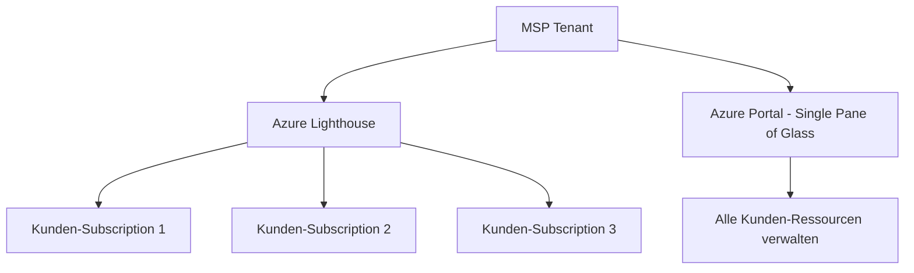
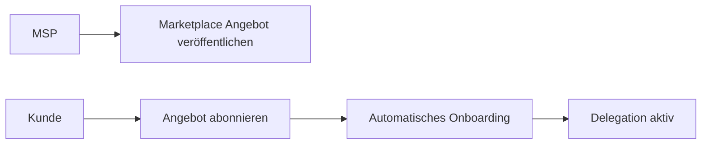
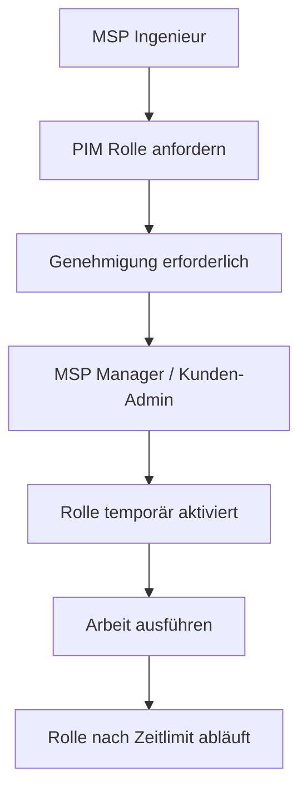
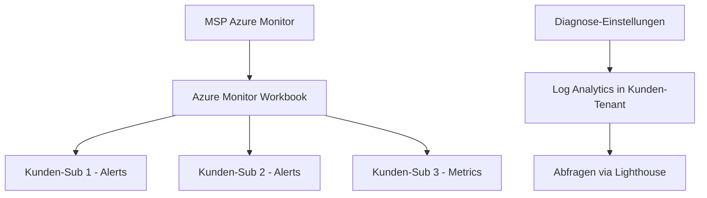
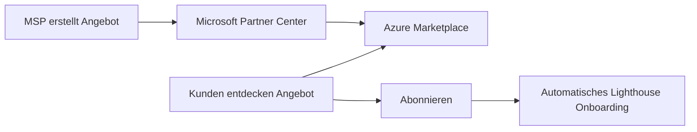
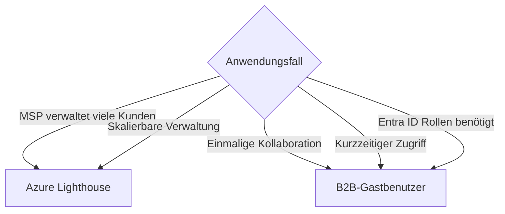

---
tags:
  - azure
  - lighthouse
  - msp
  - multi-tenant
  - rbac
aliases:
  - Azure Lighthouse
  - Delegiertes Ressourcen-Management
---

# Azure Lighthouse

> [!ABSTRACT] TL;DR
> Azure Lighthouse ermöglicht Managed Service Providern (MSPs), Azure-Ressourcen von Kunden-Tenants aus dem eigenen Tenant zu verwalten — ohne B2B-Gastkonten. Delegiertes Ressourcen-Management, PIM-Integration für JIT-Zugriff und cross-Tenant Monitoring machen Lighthouse zur Plattform für professionelles Multi-Tenant Management.

---

## Was ist Azure Lighthouse?

**Azure Lighthouse** ist ein Azure-Dienst, der eine sichere, skalierbare **delegierte Verwaltung** von Azure-Ressourcen über Tenant-Grenzen hinweg ermöglicht.



### Kernvorteile gegenüber B2B-Gastkonten

| Merkmal | B2B-Gastbenutzer | Azure Lighthouse |
|---------|-----------------|-----------------|
| Konten im Kunden-Tenant | Ja (Gastkonten) | Nein |
| Skalierbarkeit | Aufwendig (pro User/Tenant) | Einfach (Gruppen-basiert) |
| Audit-Spur | Im Kunden-Tenant sichtbar | Beide Tenants sichtbar |
| RBAC-Granularität | Wie normale Benutzer | Wie normale RBAC + Einschränkungen |
| PIM-Integration | Begrenzt | Vollständig |
| Kunden-Kontrolle | Eingeschränkt | Kunden können jederzeit widerrufen |
| Geeignet für | Einzelne Kollaborationen | MSP-Verwaltung vieler Kunden |

> [!NOTE] Lighthouse für M365
> Azure Lighthouse gilt **nur für Azure-Ressourcen**. Für die Verwaltung von Microsoft 365-Tenants (Exchange, Teams, etc.) wird **GDAP (Granular Delegated Admin Privileges)** im Partner Center verwendet.

---

---

## Via Azure Portal (UI)

> [!TIP] Schnellzugriff
> [portal.azure.com](https://portal.azure.com) → **Azure Lighthouse** → **Meine Kunden**

### Schritt-für-Schritt

1. **Dienstanbieter-Ansicht** – portal.azure.com → "Azure Lighthouse" suchen → "Meine Kunden"
2. **Kunden-Onboarding** – ARM-Template deployen ODER Marketplace-Angebot nutzen
3. **Kunden-Seite** – portal.azure.com → Azure Lighthouse → "Dienstanbieter" → Angebote anzeigen und Delegierungen genehmigen
4. **Delegierungen verwalten** – Nach Genehmigung: Dienstanbieter sieht Kunden-Ressourcen unter "Meine Kunden" → Delegierungen
5. **Ressourcen verwalten** – Delegierte Ressourcen können direkt im Portal verwaltet werden (Subscription oder Resource Group auswählen)

---

## Onboarding-Methoden

### Methode 1: ARM Template / Bicep

```json
// lighthouseOffer.json (ARM Template)
{
    "$schema": "https://schema.management.azure.com/schemas/2019-04-01/deploymentTemplate.json#",
    "contentVersion": "1.0.0.0",
    "parameters": {
        "mspOfferName": {
            "type": "string",
            "defaultValue": "Contoso MSP - Azure Management"
        },
        "mspOfferDescription": {
            "type": "string",
            "defaultValue": "Managed Services by Contoso MSP"
        }
    },
    "variables": {
        "managedByTenantId": "<MSP_TENANT_ID>",
        "authorizations": [
            {
                "principalId": "<MSP_GROUP_OBJECT_ID>",
                "principalIdDisplayName": "MSP Admins",
                "roleDefinitionId": "b24988ac-6180-42a0-ab88-20f7382dd24c"
            }
        ]
    },
    "resources": [
        {
            "type": "Microsoft.ManagedServices/registrationDefinitions",
            "apiVersion": "2022-10-01",
            "name": "[guid(parameters('mspOfferName'))]",
            "properties": {
                "registrationDefinitionName": "[parameters('mspOfferName')]",
                "description": "[parameters('mspOfferDescription')]",
                "managedByTenantId": "[variables('managedByTenantId')]",
                "authorizations": "[variables('authorizations')]"
            }
        }
    ]
}
```

```powershell
# ARM Template deployen (aus Kunden-Tenant)
New-AzDeployment `
    -Location "westeurope" `
    -TemplateFile "lighthouseOffer.json" `
    -Scope "Subscription"
```

### Methode 2: Azure Marketplace

MSPs können **Managed Service Angebote** im Azure Marketplace veröffentlichen. Kunden abonnieren das Angebot direkt im Marketplace — automatisches Onboarding ohne manuelle Template-Deployments.



---

## Delegated Resource Management

Nach dem Onboarding erscheinen die delegierten Subscriptions/Resource Groups des Kunden im Azure Portal des MSPs unter *My customers*.

```powershell
# Delegierte Subscriptions anzeigen (MSP-Tenant)
Get-AzSubscription | Where-Object { $_.TenantId -ne "<MSP_TENANT_ID>" }

# Ressourcen in Kunden-Subscription abrufen
$customerSub = "<KUNDEN_SUB_ID>"
Get-AzResource -SubscriptionId $customerSub | Select-Object Name, ResourceType, Location

# Mit Kunden-Kontext arbeiten
Set-AzContext -SubscriptionId $customerSub
Get-AzVM  # Zeigt VMs des Kunden
```

### Was kann delegiert werden?

| Scope | Unterstützt |
|-------|------------|
| Einzelne Subscription | ✅ |
| Einzelne Resource Group | ✅ |
| Mehrere Subscriptions | ✅ (mehrere Delegationen) |
| Management Group | ❌ Nicht direkt |

---

## Lighthouse-Autorisierungen: RBAC-Konfiguration

Autorisierungen definieren, **welche MSP-Gruppen oder -User** welche **RBAC-Rollen** auf Kunden-Ressourcen erhalten.

### Empfohlene Rollen-Struktur

| MSP-Gruppe | Rolle | Beschreibung |
|-----------|-------|-------------|
| MSP-Admins | Contributor | Vollständige Ressourcenverwaltung |
| MSP-Monitoring | Monitoring Reader | Nur lesen, keine Änderungen |
| MSP-Security | Security Reader | Defender-Status lesen |
| MSP-Automation | Automation Contributor | Runbooks und Skripte |
| MSP-Billing | Cost Management Reader | Kosten-Daten lesen |

> [!WARNING] Einschränkungen
> Folgende Rollen können **nicht** über Lighthouse delegiert werden:
> - Owner
> - User Access Administrator (außer für Lighthouse selbst)
> - Azure AD / Entra ID Rollen

---

## Permanent vs. JIT-Zugriff (PIM for Lighthouse)

### Permanent Access (Standard)

Standardmäßig haben MSP-Benutzer dauerhaft die delegierten Rollen. Dies ist unpraktisch für hochprivilegierte Rollen.

### Just-in-Time Zugriff mit PIM



**PIM-Konfiguration im ARM Template:**

```json
{
    "principalId": "<MSP_GROUP_ID>",
    "principalIdDisplayName": "MSP Senior Admins (JIT)",
    "roleDefinitionId": "b24988ac-6180-42a0-ab88-20f7382dd24c",
    "delegatedRoleDefinitionIds": [
        "b24988ac-6180-42a0-ab88-20f7382dd24c"
    ],
    "justInTimeAccessPolicy": {
        "multiFactorAuthProvider": "Azure",
        "maximumActivationDuration": "PT8H",
        "managedByTenantApprovers": [
            {
                "principalId": "<MSP_APPROVER_GROUP_ID>",
                "principalIdDisplayName": "MSP Approval Group"
            }
        ]
    }
}
```

> [!TIP] PIM Voraussetzung
> Für PIM in Azure Lighthouse benötigt der **MSP-Tenant** Entra ID P2-Lizenzen. Kunden-Tenants benötigen keine P2-Lizenzen für Lighthouse-PIM.

---

## Lighthouse + Azure Policies (Cross-Tenant)

Azure Policies können über Lighthouse auf alle Kunden-Subscriptions ausgerollt werden.

```powershell
# Policy-Definition über alle delegierten Subscriptions deployen
$customers = Get-AzSubscription | Where-Object { $_.TenantId -ne "<MSP_TENANT_ID>" }

foreach ($sub in $customers) {
    Set-AzContext -SubscriptionId $sub.Id

    # Naming Convention Policy zuweisen
    New-AzPolicyAssignment `
        -Name "enforce-tagging" `
        -PolicyDefinition (Get-AzPolicyDefinition -Name "require-tag-resourcegroup") `
        -Scope "/subscriptions/$($sub.Id)" `
        -PolicyParameter @{
            tagName  = "CostCenter"
            tagValue = "Required"
        }

    Write-Host "Policy deployed to: $($sub.Name)"
}
```

---

## Lighthouse Monitoring: Cross-Tenant Azure Monitor

**Zentrale Überwachung** aller Kunden-Ressourcen aus dem MSP-Tenant:



```powershell
# KQL: Alle kritischen Alerts über alle delegierten Subs
# (Ausführen im Kontext des MSP-Tenants mit Lighthouse)
$query = @"
AlertsManagementResources
| where type == 'microsoft.alertsmanagement/alerts'
| where properties.essentials.severity == 'Sev1' or properties.essentials.severity == 'Sev0'
| where properties.essentials.alertState == 'New'
| project name, subscriptionId, properties.essentials.targetResourceType,
          properties.essentials.startDateTime
| order by properties.essentials.startDateTime desc
"@

Search-AzGraph -Query $query -ManagementGroup "<MSP_MG_ID>"
```

---

## Lighthouse Auditing

Alle Aktionen von MSP-Benutzern in Kunden-Tenants werden im **Activity Log** des Kunden-Tenants protokolliert.

```powershell
# Activity Log des Kunden auf Lighthouse-Aktionen prüfen
Get-AzActivityLog `
    -StartTime (Get-Date).AddDays(-7) `
    -EndTime (Get-Date) |
    Where-Object { $_.Claims."http://schemas.microsoft.com/identity/claims/tenantid" -ne "<KUNDEN_TENANT_ID>" } |
    Select-Object EventTimestamp, Caller, OperationName, ResourceId |
    Format-Table -AutoSize
```

> [!NOTE] Transparenz für Kunden
> Kunden können jederzeit im Azure Portal unter *Service providers → Activity log* sehen, welche MSP-Benutzer wann welche Aktionen durchgeführt haben.

---

## Managed Service Offers im Azure Marketplace

MSPs können ihre Lighthouse-Konfigurationen als **Managed Service Angebote** im Azure Marketplace veröffentlichen:



**Angebotstypen:**
- **Public Offer:** Für alle Azure-Kunden sichtbar
- **Private Offer:** Nur für spezifische Kunden-Tenants

---

## Lighthouse vs. B2B-Gastbenutzer



---

## Best Practices für MSPs

> [!TIP] Empfehlungen (2024/2025)
> - **PIM für alle privilegierten Rollen** aktivieren — kein Dauerlogin mit Owner/Contributor
> - **Resource Group-Level Delegation** bevorzugen (Least Privilege), nicht Subscription-Level
> - **Separate Lighthouse-Gruppen** für verschiedene Service-Levels (Monitoring, Operations, Admin)
> - **Onboarding-Templates** in Git versionieren und automatisiert deployen
> - **Azure Workbook** für Cross-Tenant Übersicht erstellen
> - **Regelmäßige Überprüfung** der Delegationen — inaktive Kunden offboarden
> - **Log Analytics Workspace** im Kunden-Tenant für Compliance und Datensouveränität

---

## Kosten

> [!NOTE] Azure Lighthouse ist kostenlos
> Azure Lighthouse selbst verursacht **keine zusätzlichen Kosten**. Die Kosten entstehen durch die verwalteten Azure-Ressourcen (VMs, Storage etc.) in den Kunden-Tenants.
> 
> Für PIM-Features wird **Entra ID P2** im MSP-Tenant benötigt (~8 EUR/User/Monat).

---

## Verwandte Notizen
- [[Azure RBAC]]
- [[Azure Policy]]
- [[Privileged Identity Management]]
- [[Microsoft 365 DSC]]
