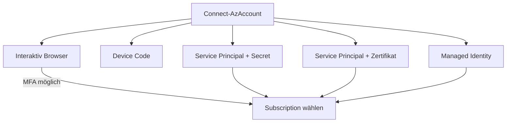

---
tags:
  - azure
  - powershell
  - automatisierung
  - az-modul
  - infrastruktur
aliases:
  - Az PowerShell
  - Azure PS
---

# Azure PowerShell

> [!ABSTRACT] TL;DR
> Das **Az PowerShell-Modul** ist das offizielle Microsoft-Modul zur Verwaltung von Azure-Ressourcen per PowerShell. Es ersetzt das veraltete AzureRM-Modul vollständig und unterstützt Windows, Linux und macOS (PowerShell 7+). Mit `Connect-AzAccount` authentifiziert man sich interaktiv, per Service Principal oder Managed Identity.

---

## Az vs. AzureRM

| Merkmal | Az (aktuell) | AzureRM (veraltet) |
|---------|-------------|-------------------|
| **Status** | Aktiv — empfohlen | ⚠️ Eingestellt |
| **PowerShell** | 5.1 + 7+ | 5.1 only |
| **Plattform** | Windows, Linux, macOS | Windows |
| **Kompatibilitäts-Alias** | `Enable-AzureRmAlias` | — |
| **Support** | Aktiv | End of Life Feb 2024 |

> [!DANGER] AzureRM abschalten
> AzureRM hat seit Februar 2024 keinen Support mehr. Alle Skripte auf **Az** migrieren.

---

## Installation und Update

```powershell
# Neueste Version installieren
Install-Module -Name Az -Scope CurrentUser -AllowClobber -Force

# Spezifische Version (für reproduzierbare Umgebungen)
Install-Module -Name Az -RequiredVersion 13.0.0 -Scope CurrentUser

# Update auf neueste Version
Update-Module -Name Az

# Installierte Version prüfen
Get-InstalledModule -Name Az | Select-Object Name, Version

# Einzelne Submodule (kleiner Footprint)
Install-Module Az.Accounts, Az.Compute, Az.Network, Az.Storage -Scope CurrentUser
```

---

---

## Via Azure Portal (UI)

> [!TIP] Schnellzugriff
> [portal.azure.com](https://portal.azure.com) → **Cloud Shell (>_)** → PowerShell

### Schritt-für-Schritt

1. **portal.azure.com aufrufen** – Im Browser anmelden
2. **Cloud Shell öffnen** – Symbol `>_` oben rechts klicken
3. **PowerShell wählen** – Falls Bash angezeigt wird, oben in der Leiste auf "PowerShell" umschalten
4. **Storage Account einrichten** – Einmalig für Datei-Persistenz
5. **Az-Module nutzen** – Sind vorinstalliert – keine separate Installation nötig
6. **Bereits angemeldet** – `Connect-AzAccount` nicht erforderlich
7. **Lokale Installation** – `Install-Module -Name Az` für lokale PowerShell-Umgebung

---

## Connect-AzAccount — Authentifizierungsmethoden



### Interaktiv (Browser / MFA)

```powershell
# Standard-Login mit Browser
Connect-AzAccount

# Tenant explizit angeben
Connect-AzAccount -Tenant "contoso.onmicrosoft.com"

# Spezifische Subscription direkt wählen
Connect-AzAccount -Subscription "sub-name-or-id"
```

### Service Principal + Client Secret (CI/CD)

```powershell
$clientSecret = ConvertTo-SecureString "your-secret" -AsPlainText -Force
$credential   = New-Object System.Management.Automation.PSCredential("app-id", $clientSecret)

Connect-AzAccount `
    -ServicePrincipal `
    -Credential $credential `
    -Tenant "your-tenant-id"
```

### Service Principal + Zertifikat (sicherer)

```powershell
Connect-AzAccount `
    -ServicePrincipal `
    -ApplicationId "your-app-id" `
    -Tenant "your-tenant-id" `
    -CertificateThumbprint "ABC123..."
```

### Managed Identity (innerhalb Azure)

```powershell
# System-assigned oder User-assigned Managed Identity
Connect-AzAccount -Identity

# User-assigned mit spezifischer Client-ID
Connect-AzAccount -Identity -AccountId "user-assigned-mi-client-id"
```

> [!TIP] Managed Identity bevorzugen
> Managed Identities benötigen keine Secrets. Für Azure-interne Automation (Runbooks, Functions, VMs) immer bevorzugen.

---

## Kontext-Management (mehrere Subscriptions)

```powershell
# Alle verfügbaren Subscriptions anzeigen
Get-AzSubscription | Select-Object Name, Id, State

# Aktiven Kontext wechseln
Set-AzContext -Subscription "sub-name-or-id"

# Kontext speichern und laden
Save-AzContext -Path "~/.azure/context.json"
Import-AzContext -Path "~/.azure/context.json"

# Alle gespeicherten Kontexte
Get-AzContext -ListAvailable

# Kontext umbenennen
Rename-AzContext -SourceName "Default" -TargetName "Production"

# Kontext löschen
Clear-AzContext -Force
```

---

## Az-Submodule nach Kategorie

| Submodul | Cmdlet-Präfix | Zuständig für |
|----------|--------------|--------------|
| **Az.Accounts** | `AzAccount`, `AzContext` | Auth, Subscriptions |
| **Az.Compute** | `AzVM`, `AzDisk`, `AzImage` | VMs, VMSS, Disks |
| **Az.Network** | `AzVirtualNetwork`, `AzNSG` | VNets, NSGs, Load Balancer |
| **Az.Storage** | `AzStorageAccount`, `AzBlob` | Storage Accounts, Blobs |
| **Az.KeyVault** | `AzKeyVault`, `AzKeyVaultSecret` | Key Vault, Secrets, Certs |
| **Az.Resources** | `AzResourceGroup`, `AzTag` | RGs, Tags, ARM Deployments |
| **Az.Monitor** | `AzMetric`, `AzAlertRule` | Monitoring, Alerts |
| **Az.Sql** | `AzSqlServer`, `AzSqlDatabase` | Azure SQL |
| **Az.ContainerService** | `AzAksCluster` | AKS |
| **Az.WebSites** | `AzWebApp`, `AzAppServicePlan` | App Service |

---

## Wichtige Cmdlets: Compute (VMs)

```powershell
# Alle VMs einer Subscription
Get-AzVM | Select-Object Name, ResourceGroupName, Location, 
    @{N="Status"; E={$_.PowerState}}

# VM-Status detailliert (mit PowerState)
Get-AzVM -ResourceGroupName "rg-prod" -Name "vm-web01" -Status |
    Select-Object -ExpandProperty Statuses

# VM starten / stoppen
Start-AzVM -ResourceGroupName "rg-prod" -Name "vm-web01"
Stop-AzVM  -ResourceGroupName "rg-prod" -Name "vm-web01" -Force

# VM erstellen (vereinfacht)
New-AzVm `
    -ResourceGroupName "rg-dev" `
    -Name "vm-dev01" `
    -Location "westeurope" `
    -Image "UbuntuLTS" `
    -Size "Standard_B2s" `
    -Credential (Get-Credential)

# VM löschen
Remove-AzVM -ResourceGroupName "rg-dev" -Name "vm-dev01" -Force
```

---

## Wichtige Cmdlets: Netzwerk

```powershell
# VNet erstellen
$vnet = New-AzVirtualNetwork `
    -ResourceGroupName "rg-network" `
    -Location "westeurope" `
    -Name "vnet-prod" `
    -AddressPrefix "10.0.0.0/16"

# Subnet hinzufügen
Add-AzVirtualNetworkSubnetConfig `
    -Name "snet-web" `
    -VirtualNetwork $vnet `
    -AddressPrefix "10.0.1.0/24"
$vnet | Set-AzVirtualNetwork

# NSG-Regeln auflisten
Get-AzNetworkSecurityGroup -ResourceGroupName "rg-network" |
    ForEach-Object {
        $_.SecurityRules | Select-Object Name, Priority, Direction,
            Access, Protocol, SourcePortRange, DestinationPortRange
    }
```

---

## Wichtige Cmdlets: Storage

```powershell
# Storage Account erstellen
New-AzStorageAccount `
    -ResourceGroupName "rg-storage" `
    -Name "stprodcontoso001" `
    -Location "westeurope" `
    -SkuName "Standard_LRS" `
    -Kind "StorageV2" `
    -AccessTier "Hot"

# Storage Context holen (für Blob-Operationen)
$ctx = (Get-AzStorageAccount -ResourceGroupName "rg-storage" -Name "stprodcontoso001").Context

# Blob-Container erstellen und Datei hochladen
New-AzStorageContainer -Name "reports" -Context $ctx -Permission Off
Set-AzStorageBlobContent -File "./report.xlsx" -Container "reports" -Blob "2024/report.xlsx" -Context $ctx
```

---

## Wichtige Cmdlets: RBAC

```powershell
# Rollenverteilung anzeigen
Get-AzRoleAssignment -ResourceGroupName "rg-prod" |
    Select-Object DisplayName, RoleDefinitionName, Scope

# Rolle zuweisen
New-AzRoleAssignment `
    -ObjectId "user-or-sp-object-id" `
    -RoleDefinitionName "Contributor" `
    -ResourceGroupName "rg-prod"

# Rolle entfernen
Remove-AzRoleAssignment `
    -ObjectId "user-or-sp-object-id" `
    -RoleDefinitionName "Contributor" `
    -ResourceGroupName "rg-prod"

# Alle verfügbaren Rollen
Get-AzRoleDefinition | Select-Object Name, IsCustom | Sort-Object Name
```

---

## Praxis-Skript: VM-Report

```powershell
Connect-AzAccount

$report = Get-AzVM -Status | Select-Object `
    Name,
    ResourceGroupName,
    Location,
    @{N="VMSize";        E={$_.HardwareProfile.VmSize}},
    @{N="OS";           E={$_.StorageProfile.OsDisk.OsType}},
    @{N="PowerState";   E={($_.Statuses | Where-Object Code -like "PowerState*").DisplayStatus}},
    @{N="PrivateIP";    E={
        $nic = Get-AzNetworkInterface -ResourceId $_.NetworkProfile.NetworkInterfaces[0].Id
        $nic.IpConfigurations[0].PrivateIpAddress
    }}

$report | Export-Csv "vm_report.csv" -NoTypeInformation -Encoding UTF8
$report | Format-Table -AutoSize
```

---

## Praxis-Skript: Tags auf Ressourcen setzen

```powershell
Connect-AzAccount -Subscription "prod"

$standardTags = @{
    Environment = "Production"
    CostCenter  = "IT-Ops"
    Owner       = "Platform Team"
    ManagedBy   = "Terraform"
}

# Alle ungetaggten Ressourcen finden und taggen
$resources = Get-AzResource | Where-Object { $_.Tags.Count -eq 0 }
Write-Host "Ressourcen ohne Tags: $($resources.Count)"

foreach ($resource in $resources) {
    try {
        Update-AzTag -ResourceId $resource.Id -Tag $standardTags -Operation Merge
        Write-Host "✓ Getaggt: $($resource.Name)"
    }
    catch {
        Write-Warning "✗ Fehler bei $($resource.Name): $($_.Exception.Message)"
    }
}
```

---

## Praxis-Skript: NSG-Regeln auflisten

```powershell
Connect-AzAccount

$allNSGs = Get-AzNetworkSecurityGroup
$report  = foreach ($nsg in $allNSGs) {
    foreach ($rule in $nsg.SecurityRules) {
        [PSCustomObject]@{
            NSG              = $nsg.Name
            ResourceGroup    = $nsg.ResourceGroupName
            Regelname        = $rule.Name
            Prioritaet       = $rule.Priority
            Richtung         = $rule.Direction
            Zugriff          = $rule.Access
            Protokoll        = $rule.Protocol
            Quelle           = $rule.SourceAddressPrefix
            Ziel             = $rule.DestinationAddressPrefix
            Port             = $rule.DestinationPortRange
        }
    }
}
$report | Sort-Object NSG, Richtung, Prioritaet | Format-Table -AutoSize
```

---

## Fehlerbehandlung

```powershell
# $Error-Variable und Try/Catch
try {
    $vm = Get-AzVM -ResourceGroupName "rg-prod" -Name "vm-nonexistent" -ErrorAction Stop
}
catch [Microsoft.Azure.Commands.Compute.Common.ComputeCloudException] {
    Write-Error "VM nicht gefunden: $($_.Exception.Message)"
}
catch {
    Write-Error "Unbekannter Fehler: $($_.Exception.GetType().Name) — $($_.Exception.Message)"
}

# Letzten Fehler anzeigen
$Error[0] | Format-List * -Force
```

---

## Pipeline-kompatible Cmdlets

Az-Cmdlets sind vollständig Pipeline-kompatibel:

```powershell
# Alle gestoppten VMs starten
Get-AzVM -Status |
    Where-Object { ($_.Statuses | Where-Object Code -eq "PowerState/deallocated") } |
    Start-AzVM

# Alle Ressourcen einer RG nach anderem Abonnement verschieben
Get-AzResource -ResourceGroupName "rg-old" |
    Move-AzResource -DestinationResourceGroupName "rg-new" -DestinationSubscriptionId "sub-id"
```

---

## Best Practices

- **PowerShell 7** für maximale Kompatibilität und Performance
- **Managed Identity** statt gespeicherter Secrets in Automations
- **`-ErrorAction Stop`** immer in produktiven Skripten
- **Kontext explizit setzen** mit `Set-AzContext` bei Multi-Subscription
- **Module aktuell halten:** `Update-Module Az` regelmäßig ausführen
- **Secrets im Key Vault** statt in Skripten
- **`What-If` testen:** `New-AzResourceGroupDeployment -WhatIf` vor Deployments
- **Logging** aller kritischen Operationen

---

## Verwandte Notizen
- [[Azure CLI]]
- [[PowerShell für Microsoft 365]]
- [[Azure RBAC]]
- [[Azure Bicep]]
