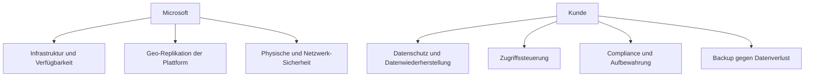
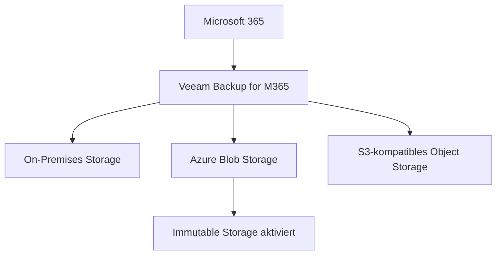
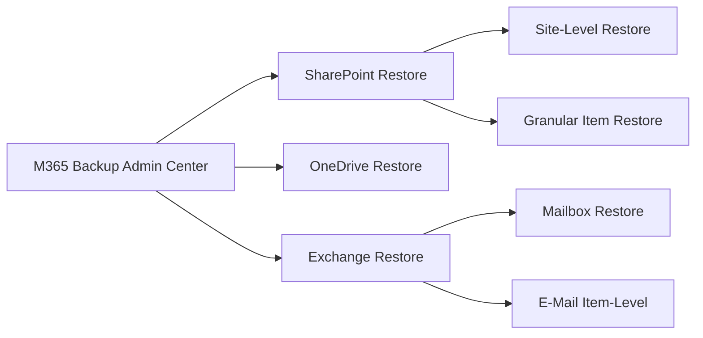
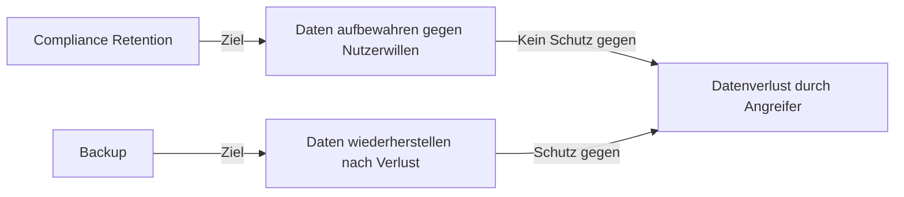
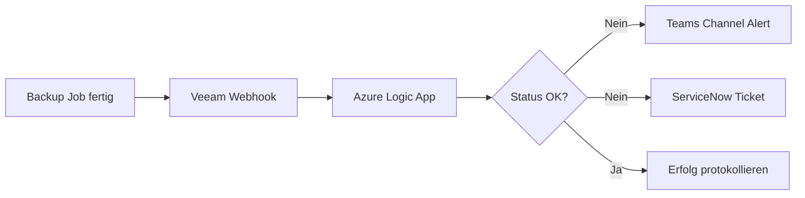
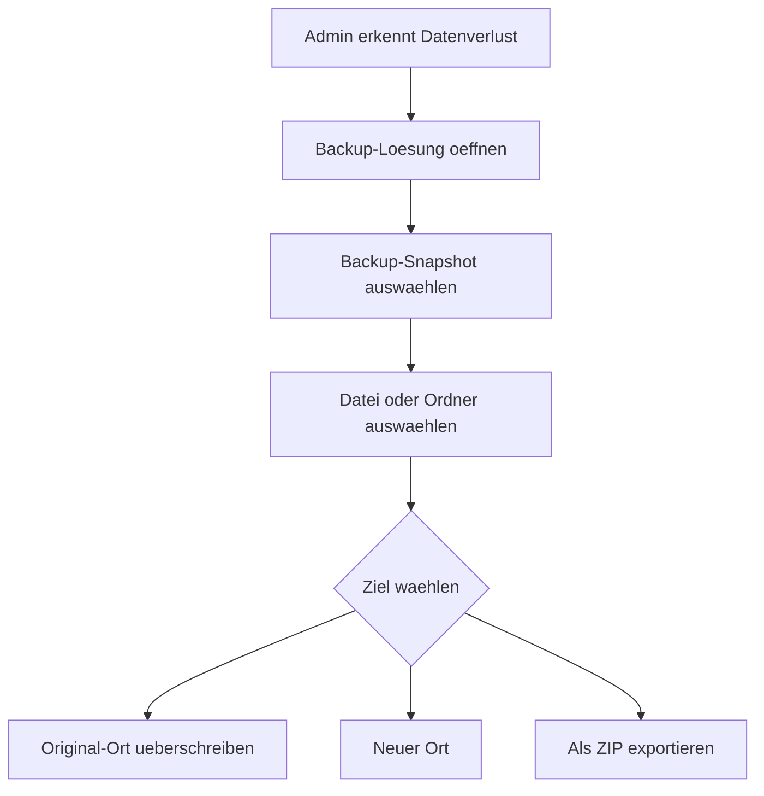
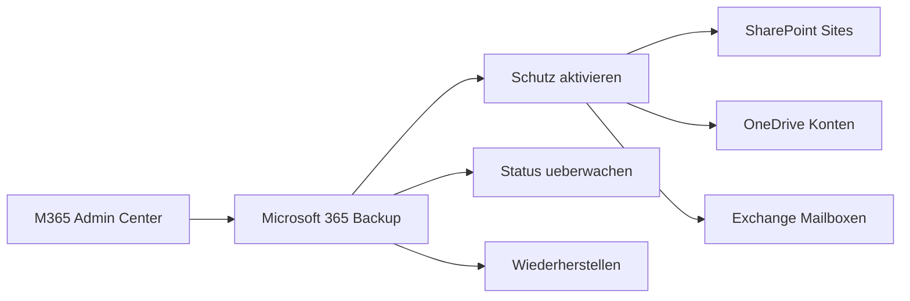
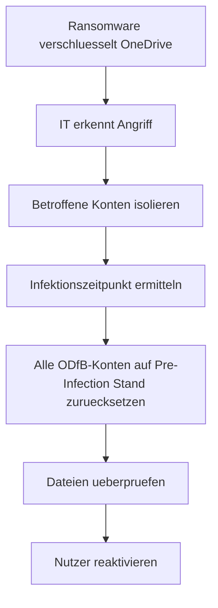

---
tags:
  - microsoft365
  - backup
  - datenschutz
  - business-continuity
  - ransomware
aliases:
  - M365 Backup
  - Office 365 Backup
---

# Backup-Strategien für M365

> [!ABSTRACT] TL;DR
> Microsoft schützt die M365-Infrastruktur, aber **nicht die Kundendaten** — das ist die Verantwortung des Kunden (Shared Responsibility Model). Native Retention deckt Ransomware, versehentliches Löschen nach Ablauf und böswillige Handlungen nicht ausreichend ab. Drittanbieter wie Veeam oder AvePoint sowie das native Microsoft 365 Backup (Add-on, 2024) schließen diese Lücken.

---

## Warum M365-Backup? Das Shared Responsibility Model

Microsoft beschreibt in seinen Service-Bedingungen explizit eine **geteilte Verantwortung**:



> [!IMPORTANT] Microsoft-Statement
> Microsoft empfiehlt in seinen eigenen Servicebedingungen ausdrücklich, dass Kunden ihre M365-Daten mit Drittanbieter-Lösungen sichern. Geo-Replikation ist **kein Backup** — sie repliziert auch Löschungen und Ransomware-Verschlüsselung.

---

## Was deckt native Retention NICHT ab?

| Szenario | Nativ geschützt? |
|----------|-----------------|
| Kurzfristiges versehentliches Löschen (< 93 Tage) | ✅ Teilweise (Recycle Bin) |
| Löschen nach Ablauf der Retention-Periode | ❌ Nein |
| **Ransomware-Verschlüsselung** | ❌ Nein (repliziert sich) |
| **Böswillige Mitarbeiter** (Mass Deletion) | ❌ Nein |
| Fehlerhaftes Skript löscht alle Postfächer | ❌ Nein |
| Langfristige Archivierung (> 30 Jahre) | ❌ Nein |
| Granulare Wiederherstellung älterer Versionen | ❌ Begrenzt |
| Tenant-weite Korruption | ❌ Nein |

### Native Schutzmechanismen von Microsoft

| Mechanismus | Schutz | Dauer |
|-------------|--------|-------|
| SharePoint / OneDrive Recycle Bin | Gelöschte Dateien | 93 Tage |
| Exchange Deleted Items | Gelöschte E-Mails | 14–30 Tage (konfigurierbar) |
| Exchange Recoverable Items | Soft-Deleted Items | 14–30 Tage |
| File Versioning (SharePoint/OneDrive) | Frühere Dateiversionen | Konfigurierbar (Standard 500 Versionen) |
| Teams Channel Nachrichten Retention | Nachrichten-Retention | Konfigurierbar |
| Litigation Hold / In-Place Hold | E-Mails und Dokumente | Unbegrenzt (Compliance-Zweck) |

> [!WARNING] Retention ≠ Backup
> Retention Policies dienen der **Compliance** (Daten aufbewahren, die Nutzer löschen möchten). Sie sind **kein Ersatz** für ein Backup (Daten wiederherstellen, die unbeabsichtigt oder böswillig verloren gingen).

---

## Backup-Lösungen im Vergleich

### Drittanbieter-Übersicht

| Anbieter | Stärken | Schwächen |
|----------|---------|-----------|
| **Veeam Backup for M365** | Immutable Storage, granulare Restore, On-Prem oder Cloud | Komplex in der Verwaltung |
| **AvePoint Cloud Backup** | Breite Workload-Abdeckung inkl. Power Platform, Marketplace-Integration | Höhere Kosten |
| **Spanning Backup (Kaseya)** | Einfach, SMB-freundlich | Weniger Enterprise-Features |
| **Druva inSync** | Cloud-native, Compliance-Features | SaaS only |
| **Backupify (Datto)** | MSP-freundlich, einfache UI | Begrenzte Restore-Optionen |
| **Microsoft 365 Backup** | Nativ von Microsoft, einfache Verwaltung | Add-on Kosten, begrenzte Workloads |

---

## Veeam Backup for Microsoft 365

**Veeam Backup for Microsoft 365** ist die führende Drittanbieter-Lösung.

### Abgedeckte Workloads

| Workload | Veeam v8 (2024) |
|----------|----------------|
| Exchange Online | ✅ Vollständig |
| SharePoint Online | ✅ Vollständig |
| OneDrive for Business | ✅ Vollständig |
| Microsoft Teams | ✅ Channels, Chats, Meetings |
| Microsoft Groups | ✅ Vollständig |

### Architektur-Optionen



```powershell
# Veeam Backup for M365 PowerShell: Backup-Statistiken
Add-PSSnapin VeeamPSSnapIn
$org = Get-VBOOrganization -Name "contoso.onmicrosoft.com"
$stats = Get-VBORepositoryData -Repository (Get-VBORepository)
$stats | Select-Object Name, UsedSpace, FreeSpace
```

> [!TIP] Immutable Backup (Anti-Ransomware)
> Immutable Storage (v7+) schreibt Backup-Daten mit einem **Object Lock** in S3/Azure Blob. Selbst wenn Ransomware die gesamte Umgebung kompromittiert, können die Backup-Daten nicht gelöscht oder verschlüsselt werden.

---

## AvePoint Cloud Backup

**AvePoint Cloud Backup** bietet die breiteste Workload-Abdeckung, inklusive Power Platform.

### Abgedeckte Workloads (2024)

| Workload | AvePoint |
|----------|---------|
| Exchange Online | ✅ |
| SharePoint Online | ✅ |
| OneDrive for Business | ✅ |
| Microsoft Teams | ✅ |
| Microsoft 365 Groups | ✅ |
| Power BI | ✅ |
| Power Apps | ✅ |
| Power Automate | ✅ |
| Project Online | ✅ |
| Planner | ✅ |

---

## Microsoft 365 Backup (Natives Microsoft-Angebot)

Microsoft hat 2024 ein **natives Backup-Produkt** eingeführt — als kostenpflichtiges Add-on.

> [!NOTE] Microsoft 365 Backup (2024)
> Microsoft 365 Backup ist ein offizielles Microsoft-Angebot für schnelle, skalierbare Wiederherstellung. Es ergänzt, aber ersetzt nicht vollständig Drittanbieter-Lösungen.

### Abgedeckte Workloads

| Workload | Unterstützt |
|----------|------------|
| SharePoint Online | ✅ Site-Level und Item-Level Restore |
| OneDrive for Business | ✅ Account-Level und File-Level Restore |
| Exchange Online | ✅ Mailbox Restore |
| Teams | ❌ (noch nicht, Stand 2024) |

### Granulare Restore-Optionen



**Kosten:** Bezahlung pro GB gesicherter Daten + GB wiederhergestellter Daten.

---

## RTO/RPO-Überlegungen

| Lösung | RPO (Recovery Point Objective) | RTO (Recovery Time Objective) |
|--------|-------------------------------|-------------------------------|
| Native Retention (SharePoint) | Keine garantierte Snapshot-Zeit | Stunden bis Tage |
| Veeam for M365 | 1–24 Stunden (konfigurierbar) | Minuten bis Stunden |
| AvePoint Cloud Backup | 1–12 Stunden | Minuten bis Stunden |
| Microsoft 365 Backup | Point-in-Time (letzte 30 Tage) | Minuten (Express Recovery) |

> [!TIP] Definitions-Erinnerung
> **RPO** = Maximaler Datenverlust (wie viele Daten darf ich verlieren?) — bestimmt Backup-Frequenz
> **RTO** = Maximale Wiederherstellungszeit (wie lange darf die Wiederherstellung dauern?) — bestimmt Restore-Methode

---

## Compliance vs. Backup



**Schlüsselfrage:** Retention Policies schützen vor **absichtlichem Löschen durch Nutzer** (für eDiscovery/Legal Hold). Backup schützt vor **unbeabsichtigtem oder bösartigem Datenverlust**.

---

## Best Practices

> [!TIP] Empfehlungen für M365-Backup
> - **3-2-1-Regel anwenden**: 3 Kopien, 2 verschiedene Medien, 1 extern
> - **Immutable Storage** aktivieren (Anti-Ransomware)
> - **Restore-Tests** quartalsweise durchführen
> - **RPO/RTO** pro Workload definieren und dokumentieren
> - **Granulare Wiederherstellung** testen (einzelne Mails, Dateien)
> - **Backup-Monitoring** und Alerting einrichten
> - **Backup-Daten getrennt** vom Produktionssystem aufbewahren

| Best Practice | Begründung |
|---------------|-----------|
| Immutable Backup | Schutz vor Ransomware und versehentlichem Löschen |
| Separate Backup-Tenant / -Konto | Kompromittierter Admin löscht keine Backups |
| Regelmäßige Restore-Tests | Backup ist wertlos, wenn der Restore nicht funktioniert |
| Backup-Abdeckung dokumentieren | Was wird gesichert? Was nicht? |
| SLA für RTO/RPO definieren | Klare Erwartungen für den Business-Betrieb |

---

## Lizenzierungsvergleich

| Anbieter | Modell | Kosten (ca.) |
|----------|--------|-------------|
| Veeam for M365 | Per User/Jahr | ab 3–6 EUR/User/Jahr |
| AvePoint Cloud Backup | Per User/Jahr | ab 4–8 EUR/User/Jahr |
| Microsoft 365 Backup | Per GB | ~0,07 USD/GB/Monat |
| Spanning | Per User/Jahr | ab 4 EUR/User/Jahr |
| Druva inSync | Per User/Jahr | ab 5 EUR/User/Jahr |

> [!NOTE] Preise
> Preise variieren stark je nach Volumen, Partner-Rabatt und Vertragslaufzeit. Offizielle Angebote bei Anbietern einholen.

---

## Backup-Überwachung und Alerting

### Veeam: Backup-Jobs überwachen

```powershell
# Veeam PowerShell: Fehlgeschlagene Backup-Jobs prüfen
Add-PSSnapin VeeamPSSnapIn

Get-VBOJob | ForEach-Object {
    $job = $_
    $lastSession = Get-VBOJobSession -Job $job |
        Sort-Object EndTime -Descending | Select-Object -First 1
    [PSCustomObject]@{
        JobName  = $job.Name
        Status   = $lastSession.Status
        EndTime  = $lastSession.EndTime
    }
} | Where-Object { $_.Status -ne "Success" } | Format-Table -AutoSize
```

### Backup-Monitoring via Logic App



---

## Restore-Prozesse im Detail

### SharePoint / OneDrive: Granularer Restore



### Exchange Online: Mailbox Restore

```powershell
# Exchange: Gelöschte Items aus Retention wiederherstellen
Connect-ExchangeOnline

# In Recoverable Items suchen und in Admin-Postfach verschieben
Search-Mailbox -Identity "user@contoso.com" `
    -SearchQuery "Received:2024-01-01..2024-01-31" `
    -DeletedItemsOnly `
    -TargetMailbox "admin@contoso.com" `
    -TargetFolder "RestoredItems-Jan2024" `
    -LogLevel Full

# Soft-Deleted Mailbox reaktivieren
Undo-SoftDeletedMailbox -SoftDeletedObject "deleted-user@contoso.com" `
    -WindowsLiveID "new-upn@contoso.com" `
    -Password (ConvertTo-SecureString "TempPass!" -AsPlainText -Force)
```

---

## Microsoft 365 Backup Admin Center (2024)

| Funktion | Beschreibung |
|----------|-------------|
| **Backup Policy** | Schutzumfang und Aufbewahrungsdauer konfigurieren |
| **Restore** | Site, Konto oder Mailbox zu Zeitpunkt wiederherstellen |
| **Granular Restore** | Einzelne Dateien oder E-Mails aus Backup |
| **Express Restore** | Schnelle Massenwiederherstellung bei Ransomware |
| **Backup Reports** | Status aller geschützten Objekte |



---

## Disaster Recovery Szenarien

### Szenario 1: Ransomware-Angriff



**Empfehlung:** Microsoft 365 Backup bietet "Express Restore" für tenant-weite Wiederherstellung. Für ältere Snapshots oder vollständige Abdeckung Drittanbieter nutzen.

### Szenario 2: Versehentliches Massenlöschen

```powershell
# Veeam: OneDrive-Dateien eines Nutzers von gestern wiederherstellen
$org = Get-VBOOrganization -Name "contoso.onmicrosoft.com"
$user = Get-VBOOrganizationUser -Organization $org -UserName "user@contoso.com"
$restoreSession = Start-VBORestoreSession `
    -Organization $org `
    -BackupDate (Get-Date).AddDays(-1)

Restore-VBOOneDrive `
    -RestoreSession $restoreSession `
    -User $user `
    -RestoreTo "OriginalLocation" `
    -Overwrite
```

### Szenario 3: Böswilliger Administrator

- **Native Lösung:** `Litigation Hold` auf betroffene Postfächer setzen — hält Daten trotz Löschung durch Administratoren
- **Drittanbieter:** Auf externen, isolierten Backup-Snapshot zurückgreifen
- **Prävention:** Admin-Aktivitäten über **Microsoft Purview Audit** protokollieren und regelmäßig reviewen

---

## Checkliste: Backup-Implementierung

| Schritt | Beschreibung |
|---------|-------------|
| Workload-Inventar | Welche M365-Daten müssen gesichert werden? |
| RPO / RTO definieren | Maximalen Datenverlust und Wiederherstellungszeit festlegen |
| Lösung auswählen | Veeam, AvePoint, M365 Backup oder Kombination |
| App Registration | Service-Konto für automatisierten Backup-Zugriff |
| Backup-Jobs konfigurieren | Zeitplan, Scope, Aufbewahrungsdauer |
| Immutable Storage | Object Lock aktivieren für Anti-Ransomware-Schutz |
| Monitoring | Alerting bei fehlgeschlagenen Backup-Jobs einrichten |
| Restore-Test | Quartalsweise Testwiederherstellung mit Dokumentation |
| Notfallplan | Restore-Prozess und Verantwortlichkeiten schriftlich festhalten |

> [!TIP] Restore-Tests sind Pflicht
> Ein Backup ohne regelmäßigen Restore-Test bietet keine Sicherheit. Quartalsweise Wiederherstellungen mit dokumentierten Ergebnissen durchführen und für Audits aufbewahren.

---

## Verwandte Notizen
- [[Azure Backup]]
- [[Retention Policies und Labels]]
- [[Microsoft 365 Reporting]]
- [[Lizenzmanagement]]
