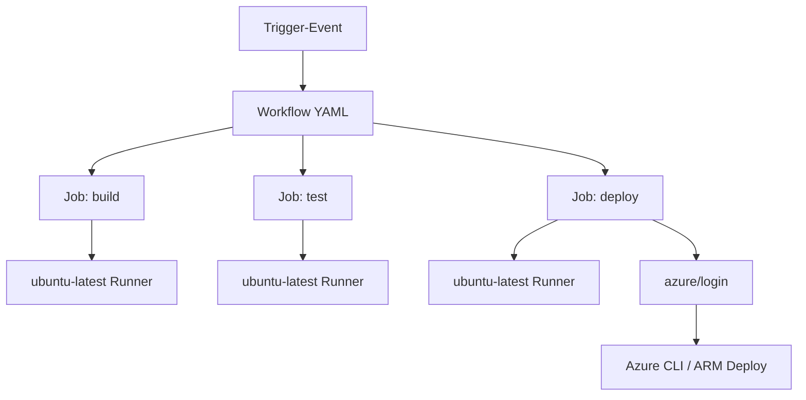
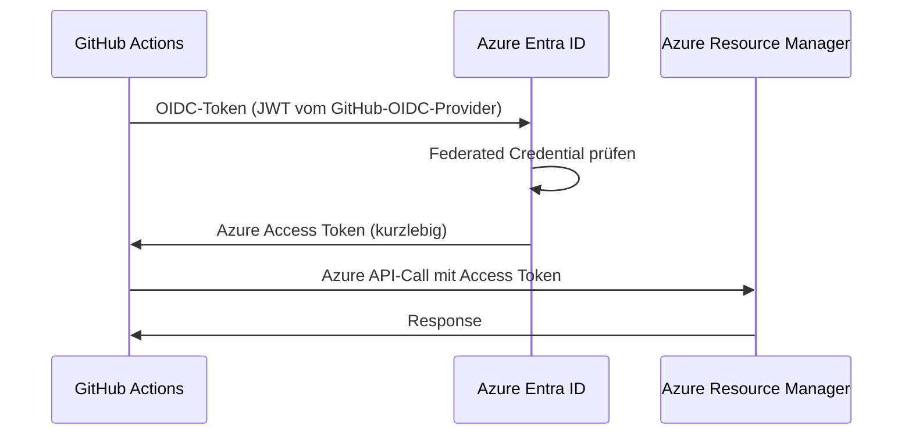

---
tags:
  - azure
  - github-actions
  - ci-cd
  - automatisierung
  - devops
aliases:
  - GitHub Actions Azure
  - GHA Azure
  - GitHub CI/CD Azure
---

# GitHub Actions für Azure

> [!ABSTRACT] TL;DR
> **GitHub Actions** ist die native CI/CD-Plattform von GitHub — direkt in Repositories integriert. Mit der **azure/login Action** und **OIDC (Federated Credentials)** authentifiziert man sich sicher bei Azure, ohne dauerhaftes Secrets zu speichern. Für AKS, Functions, Container Apps und Bicep-Deployments gibt es fertige Actions.

---

## Was sind GitHub Actions?

GitHub Actions ermöglicht die Automatisierung von Software-Workflows direkt im GitHub-Repository. **Workflows** werden durch Events (Push, PR, Schedule, Manual) ausgelöst und bestehen aus **Jobs** mit **Steps**.



---

## Workflow-Grundsyntax

```yaml
name: Workflow-Name                    # Anzeigename im GitHub UI

on:                                    # Trigger-Events
  push:
    branches: [main, develop]
    paths: ['infra/**', 'src/**']
  pull_request:
    branches: [main]
  schedule:
    - cron: '0 2 * * 1'              # Montags 02:00 UTC
  workflow_dispatch:                   # Manueller Trigger
    inputs:
      environment:
        description: 'Zielumgebung'
        required: true
        default: 'dev'
        type: choice
        options: [dev, test, prod]

env:                                   # Globale Umgebungsvariablen
  AZURE_REGION: westeurope

jobs:
  build:
    name: Build und Test
    runs-on: ubuntu-latest             # Runner (ubuntu, windows, macos)
    
    steps:
      - name: Checkout Code
        uses: actions/checkout@v4      # Action verwenden

      - name: Setup Node.js
        uses: actions/setup-node@v4
        with:
          node-version: '20'

      - name: Install und Test
        run: |                         # Shell-Befehle
          npm ci
          npm test

  deploy:
    name: Deploy nach Azure
    runs-on: ubuntu-latest
    needs: [build]                     # Abhängigkeit: erst nach build
    environment: production            # GitHub Environment mit Gates
    
    steps:
      - uses: actions/checkout@v4
      - name: Deploy
        run: echo "Deployment hier"
```

---

---

## Via Azure Portal (UI)

> [!TIP] Schnellzugriff
> [portal.azure.com](https://portal.azure.com) → **Microsoft Entra ID** → **App-Registrierungen** → **+ Neue Registrierung**

### Schritt-für-Schritt

1. **App-Registrierung erstellen** – portal.azure.com → Microsoft Entra ID → App-Registrierungen → + Neue Registrierung (für OIDC/Service Principal)
2. **Verbundene Anmeldeinformationen** – Registrierte App → "Zertifikate und Geheimnisse" → "Verbundene Anmeldeinformationen" → + Anmeldeinformation → GitHub Actions-Workflow
3. **GitHub Secrets** – github.com → Repository → Settings → Secrets and variables → Actions → New repository secret (AZURE_CLIENT_ID, AZURE_TENANT_ID, AZURE_SUBSCRIPTION_ID)
4. **Rollenzuweisung** – Azure Portal → Subscriptions → IAM → Rollenzuweisung → App-Registrierung als Contributor hinzufügen
5. **Workflow-Datei** – Im Repo unter `.github/workflows/` erstellen oder bearbeiten

---

## Azure Login — azure/login Action

### OIDC / Federated Credentials (empfohlen — kein dauerhaftes Secret)

```yaml
permissions:
  id-token: write    # OIDC-Token anfordern
  contents: read

steps:
  - name: Azure Login via OIDC
    uses: azure/login@v2
    with:
      client-id:       ${{ secrets.AZURE_CLIENT_ID }}
      tenant-id:       ${{ secrets.AZURE_TENANT_ID }}
      subscription-id: ${{ secrets.AZURE_SUBSCRIPTION_ID }}
      # Kein client-secret nötig!
```

### Service Principal mit Client Secret (Legacy)

```yaml
steps:
  - name: Azure Login via Service Principal
    uses: azure/login@v2
    with:
      creds: ${{ secrets.AZURE_CREDENTIALS }}
      # Format: {"clientId":"...","clientSecret":"...","subscriptionId":"...","tenantId":"..."}
```

> [!IMPORTANT] OIDC bevorzugen
> Federated Credentials mit OIDC sind die **moderne Best Practice**. Sie erzeugen kurzlebige Tokens (15 Min.), benötigen kein gespeichertes Secret und reduzieren das Angriffspotenzial erheblich.

---

## OIDC einrichten: Schritt-für-Schritt



```bash
# 1. App Registration erstellen
APP_ID=$(az ad app create --display-name "sp-github-actions-prod" --query appId -o tsv)
SP_ID=$(az ad sp create --id "$APP_ID" --query id -o tsv)

# 2. Federated Credential konfigurieren
az ad app federated-credential create \
    --id "$APP_ID" \
    --parameters '{
        "name": "github-main-branch",
        "issuer": "https://token.actions.githubusercontent.com",
        "subject": "repo:myorg/myrepo:ref:refs/heads/main",
        "audiences": ["api://AzureADTokenExchange"]
    }'

# 3. RBAC-Rolle zuweisen
SUBSCRIPTION_ID=$(az account show --query id -o tsv)
az role assignment create \
    --assignee "$SP_ID" \
    --role "Contributor" \
    --scope "/subscriptions/$SUBSCRIPTION_ID/resourceGroups/rg-prod"

# 4. In GitHub Secrets speichern:
# AZURE_CLIENT_ID      = $APP_ID
# AZURE_TENANT_ID      = $(az account show --query tenantId -o tsv)
# AZURE_SUBSCRIPTION_ID = $SUBSCRIPTION_ID
```

---

## Wichtige Azure Actions

| Action | Verwendung | Version |
|--------|-----------|---------|
| `azure/login` | Azure Authentifizierung | v2 |
| `azure/arm-deploy` | ARM/Bicep-Deployments | v1 |
| `azure/webapps-deploy` | App Service Deployment | v3 |
| `azure/functions-action` | Azure Functions | v1 |
| `azure/aks-set-context` | AKS kubectl-Kontext | v4 |
| `azure/container-apps-deploy` | Container Apps | v1 |
| `azure/acr-login` | ACR Login für Docker | v1 |
| `azure/key-vault-get-secrets` | Key Vault Secrets laden | v1 |

---

## Environments und Schutzregeln

GitHub **Environments** erlauben Deployment-Gates, Required Reviewers und Environment-spezifische Secrets.

```yaml
jobs:
  deploy-prod:
    runs-on: ubuntu-latest
    environment:
      name: production
      url: 'https://myapp.azurewebsites.net'  # Deployment-URL
    steps:
      - name: Deploy
        run: echo "Deployment nach Production..."
```

**Environment konfigurieren** (GitHub Settings → Environments):
- **Required Reviewers:** Wer muss approven?
- **Wait Timer:** Wartezeit vor Deployment (z. B. 5 Min.)
- **Deployment Branches:** Nur von `main` deployen
- **Environment Secrets:** Pro-Umgebung unterschiedliche Credentials

---

## Secrets Management

### GitHub Secrets

```yaml
steps:
  - name: Deploy mit Secret
    env:
      API_KEY: ${{ secrets.API_KEY }}
      DB_PASS: ${{ secrets.PROD_DB_PASSWORD }}
    run: |
      echo "API_KEY=$API_KEY" >> .env
```

### Azure Key Vault Integration

```yaml
steps:
  - name: Azure Login
    uses: azure/login@v2
    with:
      client-id:       ${{ secrets.AZURE_CLIENT_ID }}
      tenant-id:       ${{ secrets.AZURE_TENANT_ID }}
      subscription-id: ${{ secrets.AZURE_SUBSCRIPTION_ID }}

  - name: Secrets aus Key Vault laden
    uses: azure/key-vault-get-secrets@v1
    with:
      keyvault: 'kv-myapp-prod'
      secrets: 'db-password, api-key, smtp-password'
    id: kv

  - name: Secrets verwenden
    run: |
      echo "DB-Passwort gesetzt: ${{ steps.kv.outputs.db-password != '' }}"
```

---

## Reusable Workflows (DRY für CI/CD)

```yaml
# .github/workflows/deploy-to-azure.yml (wiederverwendbarer Workflow)
name: Reusable Azure Deploy

on:
  workflow_call:                      # Kann von anderen Workflows aufgerufen werden
    inputs:
      environment:
        required: true
        type: string
      resource-group:
        required: true
        type: string
    secrets:
      AZURE_CLIENT_ID:
        required: true
      AZURE_TENANT_ID:
        required: true
      AZURE_SUBSCRIPTION_ID:
        required: true

jobs:
  deploy:
    runs-on: ubuntu-latest
    environment: ${{ inputs.environment }}
    permissions:
      id-token: write
      contents: read
    steps:
      - uses: actions/checkout@v4
      - uses: azure/login@v2
        with:
          client-id:       ${{ secrets.AZURE_CLIENT_ID }}
          tenant-id:       ${{ secrets.AZURE_TENANT_ID }}
          subscription-id: ${{ secrets.AZURE_SUBSCRIPTION_ID }}
      - name: Deploy Bicep
        run: |
          az deployment group create \
            --resource-group ${{ inputs.resource-group }} \
            --template-file infra/main.bicep \
            --name "deploy-${{ github.run_number }}"
```

```yaml
# .github/workflows/production-deploy.yml (aufrufender Workflow)
name: Production Deploy

on:
  push:
    branches: [main]

jobs:
  deploy-prod:
    uses: ./.github/workflows/deploy-to-azure.yml
    with:
      environment: production
      resource-group: rg-prod
    secrets:
      AZURE_CLIENT_ID:       ${{ secrets.AZURE_CLIENT_ID }}
      AZURE_TENANT_ID:       ${{ secrets.AZURE_TENANT_ID }}
      AZURE_SUBSCRIPTION_ID: ${{ secrets.AZURE_SUBSCRIPTION_ID }}
```

---

## Matrix Builds — Mehrere Umgebungen parallel

```yaml
jobs:
  deploy-multi-region:
    strategy:
      matrix:
        region: [westeurope, northeurope, eastus]
        environment: [test]
        include:
          - region: westeurope
            rg: rg-prod-we
            environment: prod
    
    runs-on: ubuntu-latest
    name: Deploy zu ${{ matrix.region }}
    
    steps:
      - uses: actions/checkout@v4
      - uses: azure/login@v2
        with:
          client-id:       ${{ secrets.AZURE_CLIENT_ID }}
          tenant-id:       ${{ secrets.AZURE_TENANT_ID }}
          subscription-id: ${{ secrets.AZURE_SUBSCRIPTION_ID }}
      - name: Deploy
        run: |
          az deployment group create \
            --resource-group rg-${{ matrix.environment }}-${{ matrix.region }} \
            --template-file infra/main.bicep \
            --parameters location=${{ matrix.region }}
```

---

## Praxis-Workflow: Bicep Deploy

```yaml
name: Infrastructure Deploy (Bicep)

on:
  push:
    branches: [main]
    paths: ['infra/**']
  workflow_dispatch:

permissions:
  id-token: write
  contents: read

jobs:
  deploy:
    runs-on: ubuntu-latest
    environment: production
    
    steps:
      - name: Checkout
        uses: actions/checkout@v4

      - name: Azure Login
        uses: azure/login@v2
        with:
          client-id:       ${{ secrets.AZURE_CLIENT_ID }}
          tenant-id:       ${{ secrets.AZURE_TENANT_ID }}
          subscription-id: ${{ secrets.AZURE_SUBSCRIPTION_ID }}

      - name: Bicep Validate
        run: |
          az bicep build --file infra/main.bicep
          az deployment group validate \
            --resource-group rg-prod \
            --template-file infra/main.bicep \
            --parameters infra/main.prod.bicepparam

      - name: Bicep What-if
        run: |
          az deployment group what-if \
            --resource-group rg-prod \
            --template-file infra/main.bicep \
            --parameters infra/main.prod.bicepparam

      - name: Bicep Deploy
        uses: azure/arm-deploy@v1
        with:
          resourceGroupName: rg-prod
          template: infra/main.bicep
          parameters: infra/main.prod.bicepparam
          deploymentName: gh-deploy-${{ github.run_number }}
          failOnStdErr: false
```

---

## Praxis-Workflow: Docker Build und Push zu ACR

```yaml
name: Build und Push Container

on:
  push:
    branches: [main]
    tags: ['v*']

permissions:
  id-token: write
  contents: read

env:
  ACR_NAME: myappregistry
  IMAGE_NAME: myapp

jobs:
  build-push:
    runs-on: ubuntu-latest
    
    steps:
      - uses: actions/checkout@v4

      - name: Azure Login
        uses: azure/login@v2
        with:
          client-id:       ${{ secrets.AZURE_CLIENT_ID }}
          tenant-id:       ${{ secrets.AZURE_TENANT_ID }}
          subscription-id: ${{ secrets.AZURE_SUBSCRIPTION_ID }}

      - name: ACR Login
        run: az acr login --name ${{ env.ACR_NAME }}

      - name: Docker Build und Push
        run: |
          IMAGE_TAG="${{ env.ACR_NAME }}.azurecr.io/${{ env.IMAGE_NAME }}:${{ github.sha }}"
          docker build -t "$IMAGE_TAG" .
          docker push "$IMAGE_TAG"
          echo "IMAGE_TAG=$IMAGE_TAG" >> $GITHUB_ENV

      - name: Container Image scannen
        run: az acr task run --registry ${{ env.ACR_NAME }} --name quick-scan
```

---

## Praxis-Workflow: AKS Deploy

```yaml
name: Deploy zu AKS

on:
  push:
    branches: [main]

permissions:
  id-token: write
  contents: read

jobs:
  deploy-aks:
    runs-on: ubuntu-latest
    environment: production
    
    steps:
      - uses: actions/checkout@v4

      - name: Azure Login
        uses: azure/login@v2
        with:
          client-id:       ${{ secrets.AZURE_CLIENT_ID }}
          tenant-id:       ${{ secrets.AZURE_TENANT_ID }}
          subscription-id: ${{ secrets.AZURE_SUBSCRIPTION_ID }}

      - name: AKS Kontext setzen
        uses: azure/aks-set-context@v4
        with:
          resource-group: rg-prod
          cluster-name:   aks-prod

      - name: Kubernetes Manifest deployen
        run: |
          kubectl apply -f k8s/
          kubectl rollout status deployment/myapp --timeout=300s
```

---

## Praxis-Workflow: Azure Functions Deploy

```yaml
name: Deploy Azure Functions

on:
  push:
    branches: [main]
    paths: ['functions/**']

permissions:
  id-token: write
  contents: read

jobs:
  deploy-functions:
    runs-on: ubuntu-latest
    
    steps:
      - uses: actions/checkout@v4

      - name: Setup Python
        uses: actions/setup-python@v5
        with:
          python-version: '3.11'

      - name: Install Dependencies
        run: |
          cd functions
          pip install -r requirements.txt --target .python_packages/lib/site-packages

      - name: Azure Login
        uses: azure/login@v2
        with:
          client-id:       ${{ secrets.AZURE_CLIENT_ID }}
          tenant-id:       ${{ secrets.AZURE_TENANT_ID }}
          subscription-id: ${{ secrets.AZURE_SUBSCRIPTION_ID }}

      - name: Deploy Azure Function
        uses: azure/functions-action@v1
        with:
          app-name:    'func-myapp-prod'
          package:     './functions'
          scm-do-build-during-deployment: true
```

---

## Self-Hosted Runners in Azure

Für Szenarien mit privatem VNet-Zugriff oder speziellen Anforderungen:

| Typ | Beschreibung | Einsatz |
|-----|-------------|---------|
| **Azure VM** | Klassische VM als Runner | Persistente Workloads |
| **ACI (Container)** | Kurzlebige Container-Runner | Kostengünstig, ephemer |
| **AKS (Pod)** | Kubernetes-basierte Runner | Skalierbar, Enterprise |
| **Azure VMSS** | Auto-Scaling Runner-Pool | Hoher Durchsatz |

```yaml
jobs:
  deploy-internal:
    runs-on: self-hosted        # Self-hosted Runner
    # oder spezifischer:
    # runs-on: [self-hosted, azure, linux]
    steps:
      - run: echo "Läuft auf Azure Self-hosted Runner"
```

---

## Verwandte Notizen
- [[Azure DevOps]]
- [[Azure Bicep]]
- [[Terraform für Azure]]
- [[GitHub Actions]]
