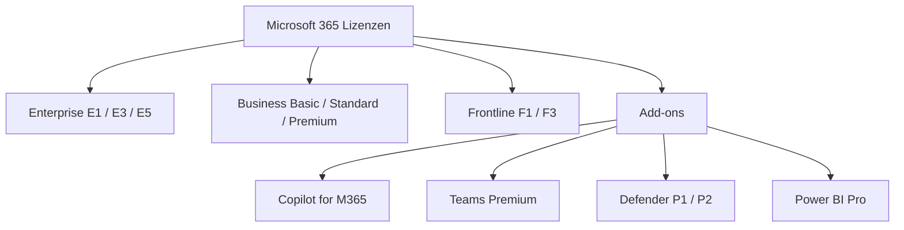
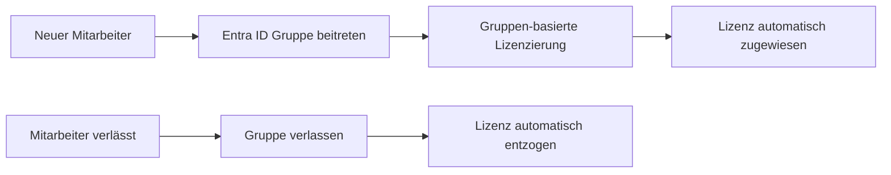
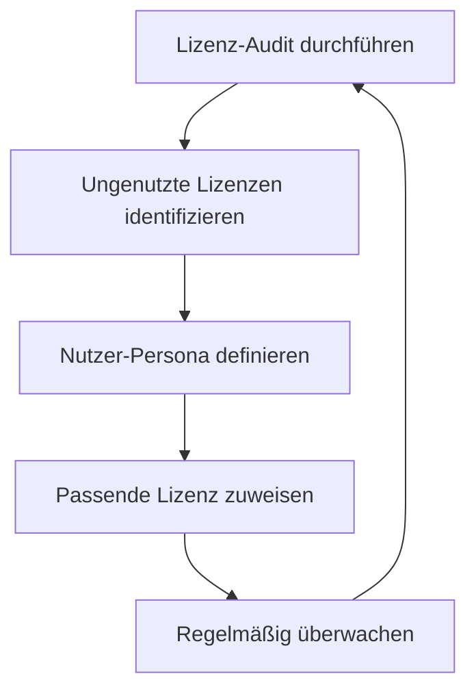
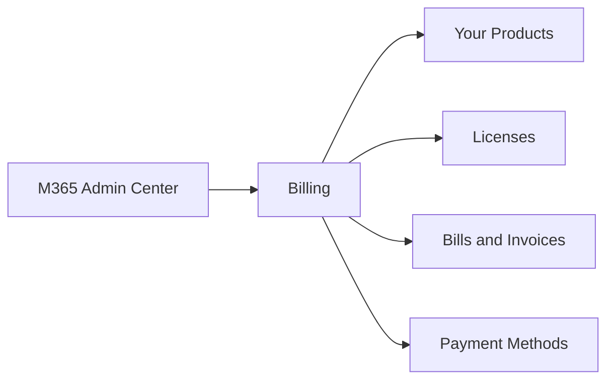
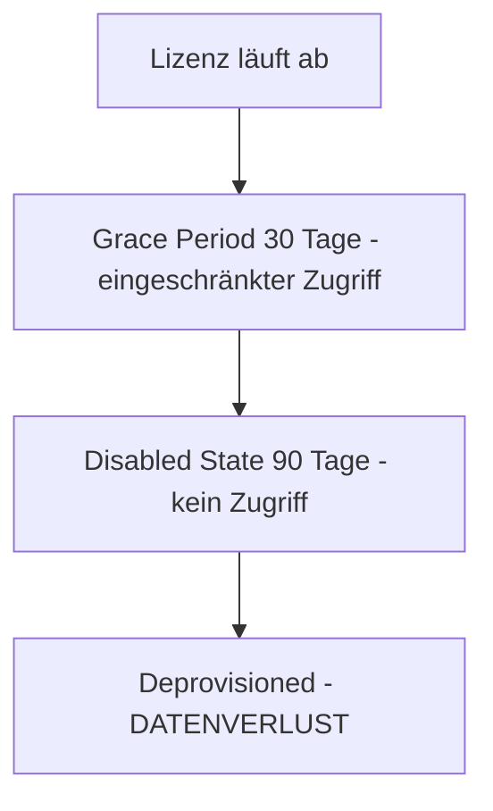

---
tags:
  - microsoft365
  - lizenzierung
  - kostenoptimierung
  - entra-id
  - automatisierung
aliases:
  - M365 Lizenzmanagement
  - Office 365 Lizenzen
---

# Lizenzmanagement

> [!ABSTRACT] TL;DR
> Microsoft 365 bietet verschiedene Lizenzmodelle (E1/E3/E5, Business, F-Lizenzen). Gruppen-basierte Lizenzierung in Entra ID automatisiert die Zuweisung. Regelmäßige Lizenz-Audits, Automatisierung per Graph API und License-as-Code mit M365DSC optimieren Kosten und Compliance.

---

## Microsoft 365 Lizenzmodelle

### Enterprise-Lizenzen

| Lizenz | Zielgruppe | Preis (ca.) | Highlights |
|--------|-----------|-------------|-----------|
| **M365 E1** | Einfache Zusammenarbeit | ~8 EUR/User/Monat | Web-Apps, Teams, Exchange, keine Desktop-Apps |
| **M365 E3** | Standard-Wissensarbeiter | ~30 EUR/User/Monat | Desktop-Apps, Advanced Compliance, EDiscovery |
| **M365 E5** | Erweiterte Sicherheit/Compliance | ~55 EUR/User/Monat | Defender, Purview Advanced, Power BI Pro, Teams Phone |

### Business-Lizenzen (bis 300 User)

| Lizenz | Preis (ca.) | Highlights |
|--------|-------------|-----------|
| **M365 Business Basic** | ~5,60 EUR/User/Monat | Web-Apps, Teams, Exchange |
| **M365 Business Standard** | ~11,70 EUR/User/Monat | Desktop-Apps, Booking, MFA |
| **M365 Business Premium** | ~19,70 EUR/User/Monat | Intune, Defender for Business, Entra ID P1 |

### Frontline-Lizenzen (F-Lizenzen)

| Lizenz | Preis (ca.) | Zielgruppe |
|--------|-------------|-----------|
| **M365 F1** | ~2,10 EUR/User/Monat | Schichtarbeiter, kein E-Mail-Postfach |
| **M365 F3** | ~7,50 EUR/User/Monat | Frontline mit E-Mail und Apps |



> [!TIP] Lizenz-Visualisierung
> m365maps.com bietet eine interaktive Karte aller M365-Features pro Lizenz — ideal für Vergleiche und Beratungsgespräche.

---

## Gruppen-basierte Lizenzierung

**Gruppen-basierte Lizenzierung** (Group-Based Licensing, GBL) weist Lizenzen automatisch über Entra ID Gruppen zu.

### Voraussetzungen

| Anforderung | Details |
|-------------|---------|
| Entra ID Plan | P1 oder höher (oder M365 E3/E5/Business Premium) |
| Gruppen-Typ | Security Groups oder M365 Groups |
| Admin-Rolle | License Administrator oder User Administrator |

### Einrichtung im Admin Center

1. `Entra Admin Center → Groups → [Gruppe auswählen]`
2. `Licenses → Assignments`
3. Lizenz auswählen und Service Plans aktivieren/deaktivieren



### PowerShell: Gruppen-Lizenzierung mit Graph SDK

```powershell
Connect-MgGraph -Scopes "Group.ReadWrite.All", "Organization.Read.All"

# SKU-IDs der verfügbaren Lizenzen ermitteln
Get-MgSubscribedSku | Select-Object SkuPartNumber, SkuId

# Lizenz einer Gruppe zuweisen
$groupId = "12345678-1234-1234-1234-123456789abc"
$skuId = "6fd2c87f-b296-42f0-b197-1e91e994b900"  # M365 E3

$params = @{
    AddLicenses = @(
        @{
            SkuId = $skuId
            DisabledPlans = @()  # Alle Plans aktivieren
        }
    )
    RemoveLicenses = @()
}

Set-MgGroupLicense -GroupId $groupId -BodyParameter $params
```

---

## Lizenz-Konflikte bei Gruppen-Lizenzierung

> [!WARNING] Lizenz-Konflikte
> Wenn ein Nutzer in mehreren Gruppen mit überlappenden Lizenz-Plänen ist, können Konflikte entstehen — besonders wenn Service Plans in einer Gruppe deaktiviert, in einer anderen aktiviert sind.

### Häufige Konflikte

| Konflikt | Ursache | Lösung |
|----------|---------|--------|
| Doppelzuweisung | User in zwei Gruppen mit gleicher Lizenz | Redundanz entfernen oder konsolidieren |
| Plan-Deaktivierungskonflikt | Plan A deaktiviert, Plan A aktiviert | Konsistente Plan-Konfiguration |
| Lizenz-Erschöpfung | Keine freien Lizenzen verfügbar | Weitere Lizenzen kaufen |

```powershell
# Nutzer mit Lizenz-Fehlern identifizieren
Get-MgUser -Filter "assignedLicenses/any(x:x/disabledPlans/any())" -All |
    Select-Object DisplayName, UserPrincipalName |
    ForEach-Object {
        $user = Get-MgUser -UserId $_.UserPrincipalName -Property LicenseAssignmentStates
        $errors = $user.LicenseAssignmentStates | Where-Object { $_.Error -ne $null }
        if ($errors) {
            [PSCustomObject]@{
                UPN   = $_.UserPrincipalName
                Error = $errors.Error
            }
        }
    }
```

---

## Lizenz-Berichte

### Überblick: Verfügbar vs. Genutzt

```powershell
# Lizenz-Übersicht: Verfügbare, genutzte und ungenutzte Lizenzen
Get-MgSubscribedSku | ForEach-Object {
    [PSCustomObject]@{
        Lizenz      = $_.SkuPartNumber
        Verfügbar   = $_.PrepaidUnits.Enabled
        Genutzt     = $_.ConsumedUnits
        Ungenutzt   = $_.PrepaidUnits.Enabled - $_.ConsumedUnits
        Auslastung  = "$([math]::Round($_.ConsumedUnits / $_.PrepaidUnits.Enabled * 100, 1))%"
    }
} | Sort-Object Ungenutzt -Descending | Format-Table -AutoSize
```

### Inaktive Lizenzen identifizieren

```powershell
# Nutzer mit E5-Lizenz aber wenig Aktivität (Sign-In > 30 Tage)
$inaktivSeit = (Get-Date).AddDays(-30).ToString("yyyy-MM-ddTHH:mm:ssZ")

Get-MgUser -All -Property DisplayName, UserPrincipalName, SignInActivity, AssignedLicenses |
    Where-Object {
        $_.SignInActivity.LastSignInDateTime -lt $inaktivSeit -and
        $_.AssignedLicenses.Count -gt 0
    } |
    Select-Object DisplayName, UserPrincipalName,
        @{N="LetzterLogin"; E={$_.SignInActivity.LastSignInDateTime}} |
    Export-Csv "C:\Reports\InaktiveLizenzen.csv" -NoTypeInformation
```

---

## Lizenzen optimieren

### Downgrade-Szenarien

| Szenario | Aktuell | Optimiert | Ersparnis |
|----------|---------|-----------|-----------|
| Nutzer braucht kein Defender | E5 | E3 + Defender P1 | ~10–15 EUR/User/Monat |
| Schichtarbeiter ohne Desktop | E3 | F3 | ~22 EUR/User/Monat |
| Nur Webzugriff benötigt | E3 | E1 | ~22 EUR/User/Monat |
| Kein Teams Phone benötigt | E5 | E3 | ~25 EUR/User/Monat |

### Optimierungsprozess



---

## Microsoft 365 Admin Center → Billing



Im Billing-Bereich werden alle aktiven Abonnements, deren Laufzeiten und Verlängerungsdaten angezeigt.

---

## Microsoft Cost Management für M365-Lizenzen

```powershell
# Azure Cost Management API: M365-Kosten aus EA-Enrollment
$headers = @{
    Authorization = "Bearer $token"
    "Content-Type" = "application/json"
}

# Kosten nach M365-Produktfamilie filtern (Marketplace / EA)
$body = @{
    type = "Usage"
    timeframe = "MonthToDate"
    dataset = @{
        granularity = "Monthly"
        filter = @{
            dimensions = @{
                name = "ServiceFamily"
                operator = "In"
                values = @("Productivity")
            }
        }
    }
} | ConvertTo-Json -Depth 5
```

---

## Automatisierung der Lizenzvergabe

### PowerShell + Graph API: Onboarding-Automation

```powershell
function Set-UserLicense {
    param(
        [string]$UserPrincipalName,
        [string]$Department
    )

    Connect-MgGraph -Scopes "User.ReadWrite.All"

    # Lizenz basierend auf Abteilung
    $licenseMap = @{
        "IT"        = "6fd2c87f-b296-42f0-b197-1e91e994b900"  # E5
        "Sales"     = "05e9a617-0261-4cee-bb44-138d3ef5d965"  # E3
        "Warehouse" = "66b55226-6b4f-492c-910c-a3b7a3c9d993"  # F3
    }

    $skuId = $licenseMap[$Department]
    if (-not $skuId) {
        Write-Warning "Keine Lizenz für Abteilung: $Department"
        return
    }

    $params = @{
        AddLicenses = @(@{ SkuId = $skuId })
        RemoveLicenses = @()
    }

    Set-MgUserLicense -UserId $UserPrincipalName -BodyParameter $params
    Write-Host "Lizenz zugewiesen: $Department → $UserPrincipalName"
}

# Verwendung
Set-UserLicense -UserPrincipalName "max.muster@contoso.com" -Department "IT"
```

---

## License-as-Code mit M365DSC

```powershell
# M365DSC: Lizenz-Konfiguration als Code
Configuration LicenseBaseline
{
    Import-DscResource -ModuleName Microsoft365DSC

    node localhost
    {
        # Gruppen-basierte Lizenzierung definieren
        AADGroupLicenseAssignment IT_E5_Licenses
        {
            GroupName    = "GRP-IT-E5-Licenses"
            LicenseSku   = "ENTERPRISEPREMIUM"  # E5
            Ensure       = "Present"
            TenantId     = $TenantId
            ApplicationId = $AppId
            CertificateThumbprint = $CertThumbprint
        }
    }
}
```

---

## Add-on Lizenzen (2024/2025)

| Add-on | Basis-Lizenz erforderlich | Preis (ca.) |
|--------|--------------------------|-------------|
| **Copilot for M365** | E3 oder E5 | ~28 EUR/User/Monat |
| **Teams Premium** | Teams in beliebiger Lizenz | ~7 EUR/User/Monat |
| **Microsoft Defender P2** | E3 | ~5 EUR/User/Monat |
| **Entra ID P2** | E3 | ~6 EUR/User/Monat |
| **Power BI Pro** | Enthalten in E5 | ~9 EUR/User/Monat |
| **Teams Phone** | Enthalten in E5 | ~8 EUR/User/Monat |
| **Microsoft Purview Add-on** | E3 | ~7 EUR/User/Monat |

---

## CSP vs. Direct vs. EA Lizenzierung

| Merkmal | CSP (Cloud Solution Provider) | Direct (MOSP) | Enterprise Agreement (EA) |
|---------|-------------------------------|---------------|--------------------------|
| Mindestgröße | 1 User | 1 User | 500 User |
| Billing | Monatlich über Partner | Monatlich/Jährlich | Jährlich |
| Flexibilität | Hoch (monatl. Anpassung) | Mittel | Gering |
| Rabatte | Partner-Rabatt | Standard | Volumenrabatt |
| Support | Über CSP-Partner | Microsoft Direct | Microsoft Premier |
| Geeignet für | KMU und MSP-Kunden | Einzelne Käufe | Großunternehmen |

> [!TIP] 2024: EA-Migrationen
> Microsoft migriert viele EA-Kunden zu **Microsoft Customer Agreement (MCA-E)** — flexibler mit ähnlichen Volumenrabatten. CSP bietet die größte Flexibilität für monatliche Anpassungen.

---

## Lizenz-Ablauf und Datenverlust-Risiken



| Phase | Dauer | Zustand |
|-------|-------|---------|
| Active | Bis Ablauf | Vollzugriff |
| Grace Period | 30 Tage | Eingeschränkter Admin-Zugriff |
| Disabled | 90 Tage | Kein Zugriff, Daten gespeichert |
| Deprovisioned | Ab Tag 120 | **Daten gelöscht** |

> [!DANGER] Datenverlust-Risiko
> Nach 120 Tagen ohne aktive Lizenz werden Tenant-Daten unwiderruflich gelöscht. Rechtzeitig verlängern oder Daten exportieren!

---

## Verwandte Notizen
- [[Microsoft 365 Reporting]]
- [[PowerShell für Microsoft 365]]
- [[Microsoft Graph API]]
- [[Microsoft 365 DSC]]
