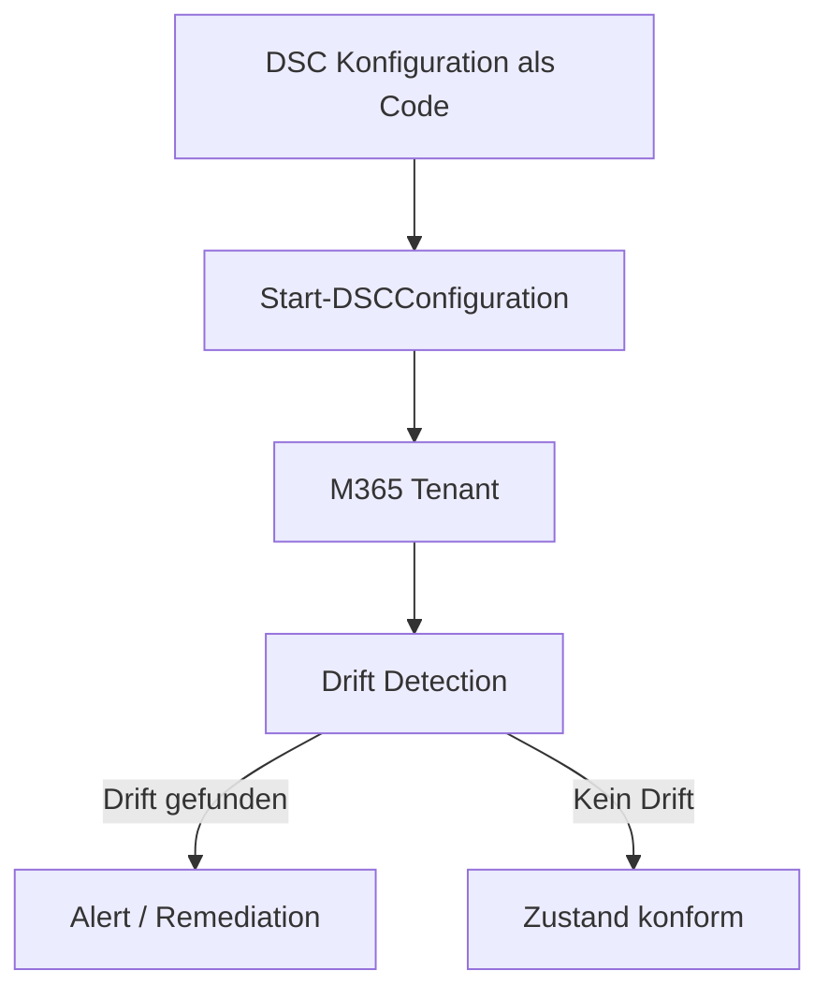
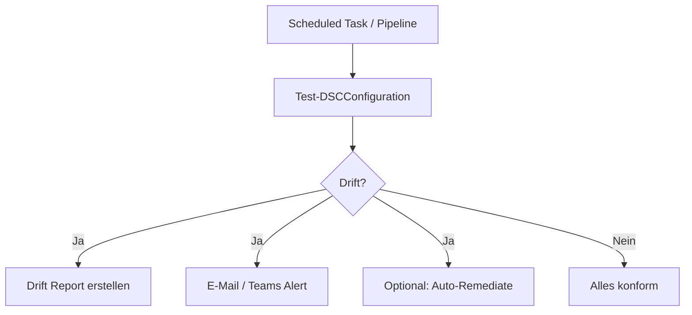

---
tags:
  - microsoft365
  - dsc
  - automatisierung
  - desired-state
  - powershell
aliases:
  - M365DSC
  - Microsoft365DSC
---

# Microsoft 365 DSC

> [!ABSTRACT] TL;DR
> Microsoft365DSC ist ein Open-Source-PowerShell-Modul, das Desired State Configuration (DSC) auf M365-Tenants anwendet. Es ermöglicht Export der aktuellen Konfiguration, Drift Detection, automatisiertes Deployment und CI/CD-Integration — kurz: Infrastruktur-as-Code für den M365-Tenant.

---

## Was ist Microsoft365DSC?

**Microsoft365DSC** ist ein von Microsoft entwickeltes (und auf GitHub öffentlich gepflegtes) PowerShell-Modul, das das Konzept der **Desired State Configuration (DSC)** auf Microsoft 365-Tenant-Einstellungen überträgt.

Der Kern-Ansatz: Der gewünschte Zustand des Tenants wird als PowerShell-Code beschrieben. Das Modul prüft, ob der aktuelle Zustand dem gewünschten entspricht, und kann Abweichungen erkennen und beheben.



### Kernfunktionen

| Funktion | Beschreibung |
|----------|-------------|
| **Export** | Aktuellen Tenant-Zustand als DSC-Config exportieren |
| **Deployment** | Konfiguration auf Tenant anwenden |
| **Drift Detection** | Abweichungen erkennen und melden |
| **Assessment Report** | HTML-Report über Compliance-Status |
| **CI/CD-Integration** | GitHub Actions / Azure DevOps Workflows |
| **Multi-Tenant** | Mehrere Tenants verwalten (MSP-Use-Case) |

---

## Unterstützte Workloads

Microsoft365DSC unterstützt über **900 Ressourcen** über alle M365-Workloads hinweg (Stand 2024/2025):

| Workload | Beispiel-Ressourcen |
|----------|-------------------|
| **Exchange Online** | Postfach-Richtlinien, Connector, Transport Rules |
| **Microsoft Teams** | Meeting Policies, Messaging Policies, Channels |
| **SharePoint Online** | Tenant-Einstellungen, Site Collections, Policies |
| **Intune** | Compliance Policies, Configuration Profiles, App Policies |
| **Entra ID (Azure AD)** | Conditional Access, Named Locations, Auth Methods |
| **Security & Compliance** | Retention Labels, DLP-Richtlinien, Sensitivity Labels |
| **Power Platform** | Power Apps Policies, Dataverse |
| **Microsoft Fabric** | Fabric Tenant-Einstellungen |
| **Defender for Office 365** | Safe Links, Safe Attachments, Anti-Phishing |

---

---

## Via Azure Portal (UI)

> [!TIP] Schnellzugriff
> [portal.azure.com](https://portal.azure.com) → **Microsoft Entra ID** → **App-Registrierungen**

### Schritt-für-Schritt

1. **Ist-Zustand dokumentieren** – admin.microsoft.com → Einstellungen → Microsoft 365-Einstellungen als Referenz
2. **App-Registrierung** – portal.azure.com → Microsoft Entra ID → App-Registrierungen → + Neue Registrierung (für Zertifikats-Authentifizierung)
3. **API-Berechtigungen** – App-Registrierung → "API-Berechtigungen" → Berechtigungen für alle M365-Workloads hinzufügen → Admin-Zustimmung erteilen
4. **Zertifikat hochladen** – Zertifikat erstellen und unter "Zertifikate und Geheimnisse" hochladen
5. **IDs notieren** – Tenant-ID und App-ID für die DSC-Konfiguration speichern

> [!NOTE]
> Microsoft 365 DSC ist primär ein PowerShell-Tool – kein eigenes Portal vorhanden. Die Portal-Schritte dienen der Vorbereitung der Authentifizierung.

---

## Installation und Authentifizierung

### Modul installieren

```powershell
# Aktuellste Version installieren
Install-Module Microsoft365DSC -Force -AllowClobber

# Version prüfen
Get-Module Microsoft365DSC -ListAvailable | Select-Object Version

# Abhängigkeiten aktualisieren
Update-M365DSCDependencies
```

### Authentifizierung: App Registration mit Zertifikat (empfohlen)

> [!NOTE] Authentifizierungsoptionen
> Microsoft365DSC unterstützt drei Authentifizierungsmethoden: **App Registration + Zertifikat** (empfohlen für Automation), **App Registration + Client Secret** (einfacher, weniger sicher) und **Credentials** (interaktiv, nicht für CI/CD geeignet).

```powershell
# App Registration für Microsoft365DSC anlegen
# (Führt assistierten Setup durch)
Update-M365DSCAllowedGraphScopes -ResourceNameList @("AADConditionalAccessPolicy", "TeamsMeetingPolicy") -Type "Application"

# Zertifikat erstellen (Self-Signed für Dev/Test)
$cert = New-SelfSignedCertificate `
    -DnsName "M365DSC" `
    -CertStoreLocation "Cert:\CurrentUser\My" `
    -NotAfter (Get-Date).AddYears(2)

# Zertifikat exportieren
Export-Certificate -Cert $cert -FilePath "C:\certs\M365DSC.cer"
```

```powershell
# Authentifizierung in DSC-Config (App + Zertifikat)
$CertThumbprint = "A1B2C3D4..."
$TenantId = "contoso.onmicrosoft.com"
$AppId = "12345678-1234-1234-1234-123456789abc"

<#
    Configuration TenantBaseline
    {
        param()
        Import-DscResource -ModuleName Microsoft365DSC

        node localhost
        {
            EXOMailboxSettings ExchangeSettings
            {
                DisplayName          = "Default Mailbox Settings"
                Ensure               = "Present"
                TenantId             = $TenantId
                ApplicationId        = $AppId
                CertificateThumbprint = $CertThumbprint
            }
        }
    }
#>
```

---

## Export: Aktuellen Tenant-Stand exportieren

Der Export-Befehl erstellt eine vollständige DSC-Konfigurationsdatei aus dem aktuellen Tenant-Zustand — ideal als Startpunkt oder Backup.

```powershell
# Vollständigen Export (dauert 30–60 Minuten)
Export-M365DSCConfiguration `
    -Path "C:\M365DSC\TenantExport" `
    -TenantId "contoso.onmicrosoft.com" `
    -ApplicationId "12345678-..." `
    -CertificateThumbprint "A1B2C3..." `
    -Workloads @("EXO", "Teams", "SPO", "AAD", "SC")

# Nur bestimmte Ressourcen exportieren
Export-M365DSCConfiguration `
    -Path "C:\M365DSC\ConditionalAccess" `
    -Components @("AADConditionalAccessPolicy", "AADNamedLocationPolicy") `
    -TenantId "contoso.onmicrosoft.com" `
    -ApplicationId "12345678-..." `
    -CertificateThumbprint "A1B2C3..."
```

> [!TIP] Workload-Kürzel
> `EXO` = Exchange Online, `Teams` = Microsoft Teams, `SPO` = SharePoint Online, `AAD` = Entra ID (Azure AD), `SC` = Security & Compliance, `Intune` = Intune, `PP` = Power Platform

---

## Deployment: Konfiguration anwenden

```powershell
# DSC-Konfiguration kompilieren
. "C:\M365DSC\TenantBaseline.ps1"
TenantBaseline -OutputPath "C:\M365DSC\MOF"

# Konfiguration anwenden (WhatIf / Test)
Test-DSCConfiguration -Path "C:\M365DSC\MOF" -Verbose

# Konfiguration tatsächlich anwenden
Start-DSCConfiguration `
    -Path "C:\M365DSC\MOF" `
    -Wait `
    -Verbose `
    -Force
```

---

## Drift Detection

**Drift Detection** vergleicht den aktuellen Tenant-Zustand mit der gespeicherten Konfiguration und meldet Abweichungen.

```powershell
# Drift testen (ohne Änderungen)
Test-M365DSCConfiguration `
    -ConfigurationPath "C:\M365DSC\TenantBaseline.ps1" `
    -TenantId "contoso.onmicrosoft.com" `
    -ApplicationId "12345678-..." `
    -CertificateThumbprint "A1B2C3..."
```



> [!WARNING] Auto-Remediation
> Automatische Remediation (Start-DSCConfiguration) in Produktions-Tenants nur mit Approval Gate empfehlen. Drift-Erkennung ohne automatische Korrektur ist oft die sicherere Wahl.

---

## Assessment Report (HTML)

Der **Assessment Report** erstellt einen übersichtlichen HTML-Bericht über den Compliance-Status des Tenants gegenüber einer Baseline.

```powershell
# Assessment Report generieren
New-M365DSCReportFromConfiguration `
    -Type "HTML" `
    -ConfigurationPath "C:\M365DSC\TenantBaseline.ps1" `
    -OutputPath "C:\M365DSC\Report.html" `
    -TenantId "contoso.onmicrosoft.com" `
    -ApplicationId "12345678-..." `
    -CertificateThumbprint "A1B2C3..."

# Vergleich zwischen zwei Konfigurationen (Delta Report)
New-M365DSCDeltaReport `
    -Source "C:\M365DSC\Baseline.ps1" `
    -Destination "C:\M365DSC\CurrentState.ps1" `
    -OutputPath "C:\M365DSC\Delta.html" `
    -Type "HTML"
```

---

## CI/CD-Integration: GitHub Actions

```yaml
# .github/workflows/m365dsc-drift-check.yml
name: M365DSC Drift Detection

on:
  schedule:
    - cron: "0 6 * * *"  # Täglich um 06:00 UTC
  workflow_dispatch:

jobs:
  drift-check:
    runs-on: windows-latest

    steps:
      - name: Checkout
        uses: actions/checkout@v4

      - name: Install M365DSC
        shell: pwsh
        run: |
          Install-Module Microsoft365DSC -Force -AllowClobber
          Update-M365DSCDependencies

      - name: Run Drift Detection
        shell: pwsh
        env:
          TENANT_ID: ${{ secrets.TENANT_ID }}
          APP_ID: ${{ secrets.APP_ID }}
          CERT_THUMBPRINT: ${{ secrets.CERT_THUMBPRINT }}
        run: |
          $result = Test-M365DSCConfiguration `
            -ConfigurationPath "./configurations/TenantBaseline.ps1" `
            -TenantId $env:TENANT_ID `
            -ApplicationId $env:APP_ID `
            -CertificateThumbprint $env:CERT_THUMBPRINT
          
          if (-not $result.InDesiredState) {
            Write-Error "Drift detected! Review the configuration."
            exit 1
          }

      - name: Generate HTML Report
        if: always()
        shell: pwsh
        run: |
          New-M365DSCReportFromConfiguration `
            -Type "HTML" `
            -ConfigurationPath "./configurations/TenantBaseline.ps1" `
            -OutputPath "./reports/compliance-report.html"

      - name: Upload Report
        if: always()
        uses: actions/upload-artifact@v4
        with:
          name: compliance-report
          path: ./reports/compliance-report.html
```

---

## Multi-Tenant-Verwaltung (MSP-Use-Case)

```powershell
# Mehrere Tenants mit unterschiedlichen Credentials
$tenants = @(
    @{ TenantId = "customer1.onmicrosoft.com"; AppId = "...; CertThumb = "..." },
    @{ TenantId = "customer2.onmicrosoft.com"; AppId = "...; CertThumb = "..." }
)

foreach ($tenant in $tenants) {
    Write-Host "Checking: $($tenant.TenantId)"
    Test-M365DSCConfiguration `
        -ConfigurationPath "./baseline.ps1" `
        -TenantId $tenant.TenantId `
        -ApplicationId $tenant.AppId `
        -CertificateThumbprint $tenant.CertThumb
}
```

---

## Praxis-Anwendungsfälle

| Anwendungsfall | Beschreibung |
|----------------|-------------|
| **Tenant-Hardening** | Security-Baseline deployen (MFA, CA-Policies, Defender) |
| **Baseline-Durchsetzung** | CIS-/NIST-Benchmark als Code |
| **Tenant-Dokumentation** | Automatisch aktuellen Zustand als Code exportieren |
| **Change-Management** | Alle Änderungen als Pull Requests in Git |
| **Disaster Recovery** | Tenant-Konfiguration nach Incident wiederherstellen |
| **Tenant-Migration** | Konfiguration von Quell-Tenant zu Ziel-Tenant übertragen |
| **MSP-Compliance** | Kunden-Tenants täglich auf Konformität prüfen |

---

## Community-Ressourcen

- **GitHub:** github.com/microsoft/Microsoft365DSC
- **Dokumentation:** microsoft365dsc.com
- **Discord:** M365DSC Community Discord
- **Releases:** Monatliche Updates mit neuen Ressourcen
- **ORCA-Tool:** Automatisierter Security-Assessment für Exchange-Einstellungen

> [!TIP] Einstieg
> Empfehlung: Zuerst nur einzelne Workloads exportieren und als Read-Only DSC nutzen, bevor Konfigurationen automatisch angewendet werden.

---

## Verwandte Notizen
- [[PowerShell für Microsoft 365]]
- [[GitHub Actions für Azure]]
- [[Lizenzmanagement]]
- [[Microsoft 365 Reporting]]
