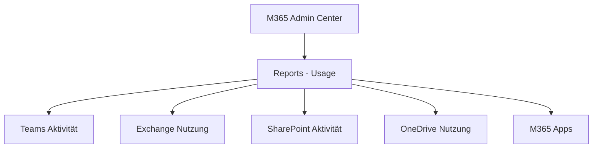
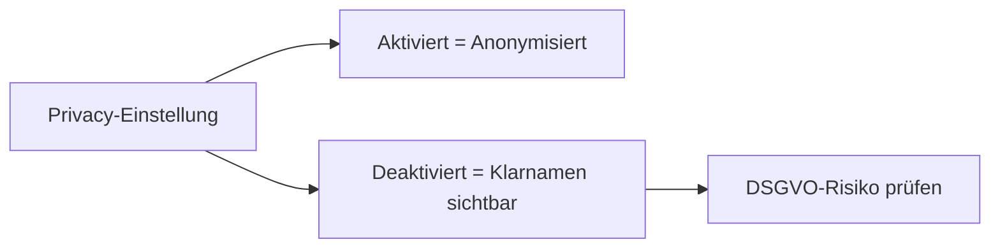
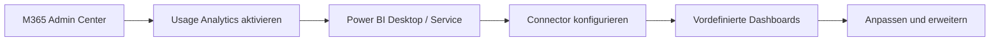
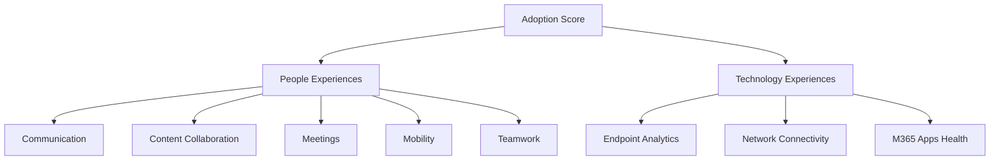
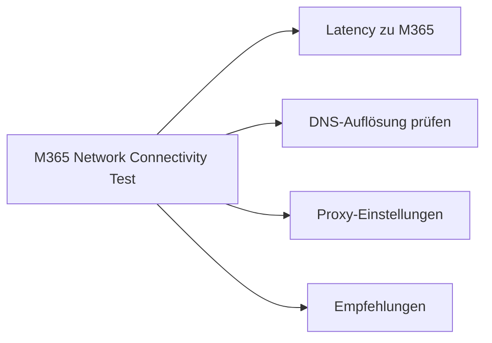

---
tags:
  - microsoft365
  - reporting
  - graph-api
  - power-bi
  - monitoring
aliases:
  - M365 Reporting
  - Office 365 Berichte
---

# Microsoft 365 Reporting

> [!ABSTRACT] TL;DR
> Microsoft 365 bietet Nutzungsberichte im Admin Center, die Graph Reporting API für programmatischen Zugriff, Power BI-Integration und Analyse-Tools wie Adoption Score und Viva Insights. Datenschutz-Einstellungen steuern die Anonymisierung von Nutzerdaten in Berichten.

---

## Berichte im M365 Admin Center

Das **Microsoft 365 Admin Center** unter `admin.microsoft.com` bietet unter *Reports → Usage* eine Vielzahl von Nutzungsberichten für alle M365-Dienste.

### Verfügbare Nutzungsberichte

| Dienst | Berichttypen |
|--------|-------------|
| **Microsoft Teams** | Aktivität, Gerätenutzung, App-Nutzung |
| **Exchange / E-Mail** | Aktivität, Postfachnutzung, App-Nutzung |
| **SharePoint** | Seitenaufrufe, aktive Dateien, Seitenzugriff |
| **OneDrive** | Aktivität, Nutzung, Dateianzahl |
| **Yammer / Viva Engage** | Aktivität, Gerätenutzung, Gruppenaktivität |
| **Microsoft 365 Apps** | Aktivierung, Nutzung, Versionen |
| **Forms** | Aktivität |
| **Skype for Business** | (Legacy — Aktivität, Konferenzen) |



### Zeiträume

Berichte sind für folgende Zeiträume verfügbar: **7 Tage**, **30 Tage**, **90 Tage**, **180 Tage**. Für längere Historien müssen Daten regelmäßig exportiert und extern gespeichert werden.

---

## Privacy-Einstellungen für Berichte (Anonymisierung)

> [!IMPORTANT] Datenschutz in Berichten
> Standardmäßig werden in EU-Tenants Benutzernamen und E-Mail-Adressen in Berichten **anonymisiert** (z.B. `User_abc1234`). Diese Einstellung kann von Admins geändert werden — mit datenschutzrechtlichen Konsequenzen (DSGVO beachten!).



**Einstellung ändern:**
`M365 Admin Center → Settings → Org settings → Services → Reports`

---

---

## Via Microsoft 365 Admin Center (UI)

> [!TIP] Schnellzugriff
> [admin.microsoft.com](https://admin.microsoft.com) → **Berichte** → **Nutzung**

### Schritt-für-Schritt

1. **admin.microsoft.com → Berichte → Nutzung** – Zur Berichtsübersicht navigieren
2. **Dienst auswählen** – Microsoft 365, Exchange, SharePoint, Teams, OneDrive oder Yammer
3. **Zeitraum filtern** – 7, 30, 90 oder 180 Tage
4. **Detailberichte** – Aktivität, Gerätenutzung oder Benutzeraktivität aufrufen
5. **CSV-Export** – "Herunterladen" in jedem Bericht verfügbar
6. **Anonymisierung** – Berichte → Einstellungen → Nutzername anzeigen oder verbergen
7. **Power BI** – Berichte → Power BI → "Microsoft 365 Usage Analytics" App installieren

---

## Microsoft Graph Reporting API

Die **Microsoft Graph API** bietet programmatischen Zugriff auf alle M365-Nutzungsberichte. Ideal für Custom Dashboards, Power BI-Integration oder automatisierte Exports.

### Wichtige Endpunkte

| Endpunkt | Beschreibung |
|----------|-------------|
| `/reports/getOffice365ActiveUserDetail` | Aktive Nutzer aller Dienste |
| `/reports/getOffice365ServicesUserCounts` | Nutzeranzahl pro Dienst |
| `/reports/getTeamsUserActivityUserDetail` | Teams-Aktivität pro Nutzer |
| `/reports/getEmailActivityUserDetail` | E-Mail-Aktivität pro Nutzer |
| `/reports/getSharePointSiteUsageDetail` | SharePoint-Nutzung pro Site |
| `/reports/getOneDriveUsageAccountDetail` | OneDrive-Nutzung pro Konto |
| `/reports/getM365AppUserDetail` | M365 Apps Nutzung pro Nutzer |

### Berechtigungen

```powershell
# Benötigte Graph-Berechtigungen (App-Berechtigung)
# Reports.Read.All
```

### Beispiel: Graph API mit PowerShell

```powershell
# Microsoft Graph SDK verwenden
Connect-MgGraph -Scopes "Reports.Read.All"

# Teams-Aktivitätsbericht (letzte 30 Tage)
$report = Get-MgReportTeamUserActivityUserDetail -Period "D30"
$report | ConvertFrom-Json | Select-Object UserPrincipalName, LastActivityDate, IsLicensed

# Aktive Nutzer aller Dienste
$activeUsers = Get-MgReportOffice365ActiveUserDetail -Period "D30"
```

### Beispiel: Graph API direkt (REST)

```bash
# Token holen und Bericht abrufen
ACCESS_TOKEN="<bearer_token>"

curl -H "Authorization: Bearer $ACCESS_TOKEN" \
  "https://graph.microsoft.com/v1.0/reports/getOffice365ActiveUserDetail(period='D30')" \
  --output report.csv
```

---

## PowerShell für M365-Berichte

```powershell
# Exchange-Postfachnutzung
Get-EXOMailboxStatistics -ResultSize Unlimited |
    Select-Object DisplayName, TotalItemSize, ItemCount |
    Sort-Object TotalItemSize -Descending |
    Export-Csv -Path "C:\Reports\Mailbox-Usage.csv" -NoTypeInformation

# Inaktive Postfächer (kein Login seit 90 Tagen)
Get-MgAuditLogSignIn -Filter "createdDateTime ge 2024-01-01" |
    Group-Object userPrincipalName |
    Where-Object { $_.Count -eq 0 }

# Lizenz-Zuweisungsreport via Graph SDK
Get-MgUser -All -Property DisplayName, UserPrincipalName, AssignedLicenses |
    ForEach-Object {
        [PSCustomObject]@{
            Name    = $_.DisplayName
            UPN     = $_.UserPrincipalName
            Lizenzen = ($_.AssignedLicenses | Measure-Object).Count
        }
    } | Export-Csv "C:\Reports\Lizenzen.csv" -NoTypeInformation
```

---

## Power BI M365 Usage Analytics App

Die **Microsoft 365 Usage Analytics** Power BI Template App ist eine vorgefertigte Lösung für Adoption-Reporting direkt aus dem Admin Center.

### Einrichtung



1. `M365 Admin Center → Reports → Usage → Power BI Content Pack`
2. Tenant-ID notieren
3. In Power BI: *Get Data → Microsoft 365 Usage Analytics*
4. Tenant-ID eingeben und Verbindung herstellen

### Verfügbare Berichte in der App

| Bericht | Inhalt |
|---------|--------|
| **Overview** | Gesamtüberblick Aktivierung und Adoption |
| **Activation** | Lizenz-Aktivierungen pro Produkt |
| **Usage** | Nutzungsintensität pro Dienst |
| **Communication** | Teams, E-Mail, Yammer Nutzung |
| **Collaboration** | OneDrive, SharePoint Zusammenarbeit |
| **Mobility** | Gerätetypen und mobile Nutzung |

---

## Viva Insights

**Microsoft Viva Insights** bietet organisationsweite Analysen zu Collaboration-Mustern, Wellbeing und Produktivität.

| Ebene | Beschreibung | Lizenz |
|-------|-------------|--------|
| **Personal Insights** | Eigene Arbeitsgewohnheiten (Meetings, Focus Time) | Inklusive in M365 |
| **Manager Insights** | Aggregierte Team-Daten | Viva Insights Add-on |
| **Leader Insights** | Org-weite Trends | Viva Insights Add-on |
| **Advanced Insights** | Custom Analyst Workbench | Viva Insights Add-on |

> [!NOTE] Datenschutz
> Viva Insights aggregiert alle Daten und zeigt nur Gruppenauswertungen (Minimum 10 Personen). Individuelle Daten sind für Manager nicht einsehbar.

---

## Microsoft Adoption Score

Der **Adoption Score** misst, wie effektiv die Organisation Microsoft 365 und Copilot nutzt — mit Empfehlungen für Verbesserungen.

### Kategorien (2024/2025)



| Bereich | Max. Punkte | Beschreibung |
|---------|-------------|-------------|
| Communication | 100 | E-Mail, Teams, Yammer Adoption |
| Meetings | 100 | Teams-Meeting-Features genutzt |
| Content Collaboration | 100 | OneDrive, SharePoint, co-authoring |
| Teamwork | 100 | Kanal-Nachrichten, Gruppen |
| Mobility | 100 | Mobile App-Nutzung |
| Endpoint Analytics | 100 | PC-Performance und App-Stabilität |

> [!TIP] Zugriff
> `M365 Admin Center → Reports → Adoption Score` — benötigt Global Admin oder Reports Reader Rolle.

---

## Microsoft 365 Network Connectivity Test



**URL:** `connectivity.office.com`

Prüft Netzwerkpfade zu Microsoft 365 und gibt Optimierungsempfehlungen (Split-Tunneling, SD-WAN, lokale DNS-Auflösung).

---

## Message Center

Das **Message Center** informiert über bevorstehende Änderungen und Updates in Microsoft 365.

```powershell
# Message Center via Graph API abfragen
Connect-MgGraph -Scopes "ServiceMessage.Read.All"

# Alle aktiven Messages
Get-MgServiceAnnouncementMessage -Filter "status eq 'active'" |
    Select-Object Title, StartDateTime, EndDateTime, Classification |
    Sort-Object StartDateTime -Descending
```

| Klassifikation | Beschreibung |
|---------------|-------------|
| **ActionRequired** | Admin-Aktion notwendig |
| **PlanForChange** | Bevorstehende Änderung |
| **StayInformed** | Informationshinweis |

---

## Service Health Dashboard

```powershell
# Service Health via Graph API
Get-MgServiceAnnouncementHealthOverview -All |
    Where-Object { $_.Status -ne "serviceOperational" } |
    Select-Object Service, Status, StatusDisplayName
```

---

## Licensing Reports

```powershell
# Überblick: Gekaufte vs. genutzte Lizenzen
Get-MgSubscribedSku | Select-Object SkuPartNumber,
    @{N="Verfügbar"; E={$_.PrepaidUnits.Enabled}},
    @{N="Genutzt"; E={$_.ConsumedUnits}},
    @{N="Ungenutzt"; E={$_.PrepaidUnits.Enabled - $_.ConsumedUnits}} |
    Sort-Object Ungenutzt -Descending
```

---

## Custom Reporting mit Graph + Power BI

### Power BI Dataflow aus Graph API

```json
// Power Query M-Code für Graph API
let
    TenantId = "contoso.onmicrosoft.com",
    ClientId = "12345678-...",
    BaseUrl = "https://graph.microsoft.com/v1.0",
    
    TokenUrl = "https://login.microsoftonline.com/" & TenantId & "/oauth2/v2.0/token",
    
    TokenResponse = Json.Document(
        Web.Contents(TokenUrl, [
            Content = Text.ToBinary(
                "client_id=" & ClientId & 
                "&grant_type=client_credentials" &
                "&scope=https://graph.microsoft.com/.default" &
                "&client_secret=<SECRET>"
            )
        ])
    ),
    AccessToken = TokenResponse[access_token],
    
    ReportUrl = BaseUrl & "/reports/getOffice365ActiveUserDetail(period='D30')",
    Report = Csv.Document(
        Web.Contents(ReportUrl, [Headers = [Authorization = "Bearer " & AccessToken]])
    )
in
    Report
```

---

## Verwandte Notizen
- [[Microsoft Graph API]]
- [[PowerShell für Microsoft 365]]
- [[Service Health und Monitoring]]
- [[Lizenzmanagement]]
