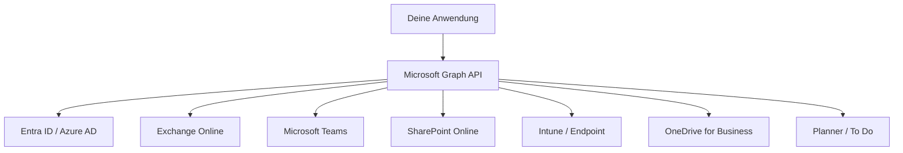
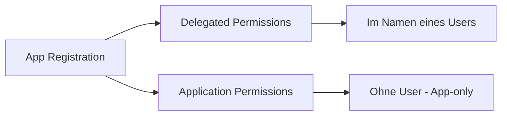
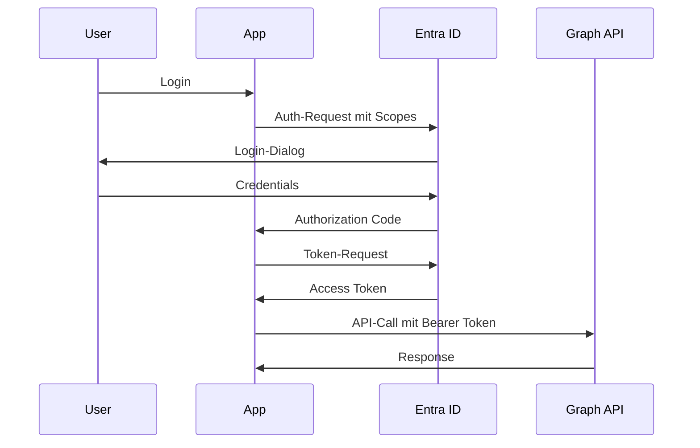
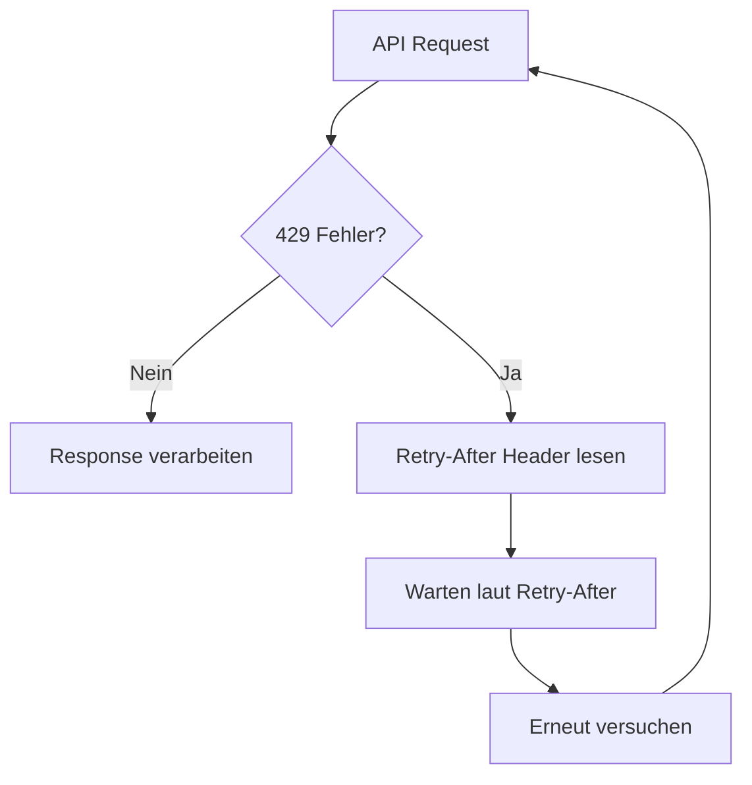
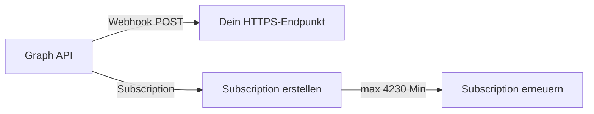

---
tags:
  - azure
  - microsoft-365
  - graph-api
  - rest-api
  - automatisierung
aliases:
  - Graph API
  - MS Graph
---

# Microsoft Graph API

> [!ABSTRACT] TL;DR
> Die Microsoft Graph API ist die **einheitliche REST-API** für alle Microsoft-Cloud-Dienste. Über einen einzigen Endpunkt (`https://graph.microsoft.com`) lassen sich Daten aus Microsoft 365, Azure AD/Entra ID, Teams, SharePoint, Exchange, Intune und mehr abrufen und verwalten.

---

## Was ist die Microsoft Graph API?

Microsoft Graph ist das **Gateway** zu Daten und Diensten in der Microsoft Cloud. Statt mehrerer separater APIs für Exchange, SharePoint, Teams etc. bietet Graph eine **unified REST API** — eine URL, ein Token, alle Dienste.



**Basis-URL:** `https://graph.microsoft.com/{version}/{resource}`

---

## Endpunkte: v1.0 vs. beta

| Endpunkt | URL | Verwendung |
|----------|-----|------------|
| **v1.0** | `https://graph.microsoft.com/v1.0/` | Produktiv — stabile, unterstützte APIs |
| **beta** | `https://graph.microsoft.com/beta/` | Preview-Features — nicht für Produktion |

> [!WARNING] Beta-Endpunkt
> Der `beta`-Endpunkt kann sich jederzeit ändern und bietet keine SLA. Nur für Tests und Entwicklung verwenden.

---

## Authentifizierung mit OAuth 2.0

Graph nutzt **OAuth 2.0** mit Microsoft Entra ID (Azure AD) als Identity Provider. Es gibt zwei grundlegende Permission-Typen:



### Delegated vs. Application Permissions

| Typ | Beschreibung | Verwendung | Consent |
|-----|-------------|------------|---------|
| **Delegated** | Im Namen eines angemeldeten Users | Interaktive Apps | User-Consent möglich |
| **Application** | App handelt eigenständig, kein User | Background Services, Automation | Admin-Consent erforderlich |

### Auth-Flow: Authorization Code Flow (Delegated)



> [!TIP] Least Privilege Prinzip
> Immer nur die **minimal nötigen Scopes** anfordern. Statt `User.Read.All` lieber `User.Read`, wenn nur der eigene User benötigt wird.

---

## Admin Consent und Berechtigungen

Application Permissions erfordern immer **Admin Consent** — ein globaler Admin muss der App explizit erlauben, im Namen der Organisation zu handeln.

```powershell
# Admin Consent URL generieren
$tenantId = "your-tenant-id"
$clientId = "your-app-client-id"
$consentUrl = "https://login.microsoftonline.com/$tenantId/adminconsent?client_id=$clientId"
Start-Process $consentUrl
```

---

## Wichtige Ressourcen (Resources)

| Ressource | Endpunkt | Beschreibung |
|-----------|----------|-------------|
| **Users** | `/users` | Benutzer verwalten |
| **Groups** | `/groups` | Gruppen und Teams |
| **Mail** | `/users/{id}/messages` | E-Mails lesen/senden |
| **Calendar** | `/users/{id}/calendar` | Kalender-Zugriff |
| **Files** | `/users/{id}/drive` | OneDrive-Dateien |
| **Teams** | `/teams` | Teams-Verwaltung |
| **Devices** | `/devices` | Geräte-Inventar |
| **Applications** | `/applications` | App Registrations |
| **Sites** | `/sites` | SharePoint Sites |
| **DirectoryRoles** | `/directoryRoles` | Entra ID Rollen |

---

## Graph SDKs

Microsoft bietet offizielle SDKs für alle gängigen Sprachen, die Authentication, Throttling-Retries und Pagination automatisch handhaben:

| SDK | Paket | Status |
|-----|-------|--------|
| **.NET / C#** | `Microsoft.Graph` (NuGet) | GA |
| **Python** | `msgraph-sdk` (PyPI) | GA |
| **JavaScript / TypeScript** | `@microsoft/msgraph-sdk-javascript` | GA |
| **Java** | `com.microsoft.graph:microsoft-graph` | GA |
| **Go** | `github.com/microsoftgraph/msgraph-sdk-go` | GA |
| **PowerShell** | `Microsoft.Graph` (PSGallery) | GA |
| **PHP** | `microsoft/microsoft-graph` | GA |

> [!TIP] SDK-Vorteile
> SDKs handhaben automatisch: Token-Refresh, Retry bei HTTP 429 (Throttling), Pagination via `@odata.nextLink`, und typsichere Modelle.

---

## Graph Explorer

Der **Graph Explorer** (https://developer.microsoft.com/graph/graph-explorer) ist ein interaktives Web-Tool zum Testen von API-Calls ohne Codierung.

**Features:**
- Login mit eigenem Microsoft-Account oder Demo-Tenant
- Vorgefertigte Sample-Queries
- Syntax-Highlighting für Responses
- Permissions-Panel zeigt benötigte Scopes
- Direkter Link zu Dokumentation

---

## Throttling und Best Practices

Microsoft Graph begrenzt Requests, um Stabilität zu gewährleisten. Bei Überschreitung → **HTTP 429 Too Many Requests**.

### Globale Limits (2024/2025)

| Limit | Wert |
|-------|------|
| Global pro App (alle Tenants) | 130.000 Requests / 10 Sek. |
| Pro Tenant pro App | Abhängig vom Dienst |
| Exchange-Mailbox-Operationen | 10.000 Req / 10 Min |



### Batching — bis zu 20 Requests in einem Call

```json
POST https://graph.microsoft.com/v1.0/$batch

{
  "requests": [
    {
      "id": "1",
      "method": "GET",
      "url": "/users/user1@contoso.com"
    },
    {
      "id": "2",
      "method": "GET",
      "url": "/users/user2@contoso.com"
    }
  ]
}
```

### Delta Queries — nur Änderungen abrufen

```http
GET https://graph.microsoft.com/v1.0/users/delta
```

Beim ersten Call → vollständige Liste + `@odata.deltaLink`
Folge-Calls → nur Änderungen seit letztem Call.

> [!IMPORTANT] Delta Queries
> Delta Queries reduzieren Traffic drastisch bei regelmäßigen Sync-Jobs. Immer bevorzugen gegenüber kompletter Neuabfrage.

---

## Webhooks / Change Notifications

Graph unterstützt **Echtzeit-Benachrichtigungen** via Webhooks (Change Notifications), wenn sich Ressourcen ändern.



```powershell
# Webhook-Subscription erstellen
$body = @{
    changeType             = "created,updated"
    notificationUrl        = "https://myapp.azurewebsites.net/api/webhook"
    resource               = "users"
    expirationDateTime     = (Get-Date).AddMinutes(4230).ToString("o")
    clientState            = "secretClientValue"
} | ConvertTo-Json

Invoke-RestMethod -Method POST `
    -Uri "https://graph.microsoft.com/v1.0/subscriptions" `
    -Headers @{ Authorization = "Bearer $accessToken" } `
    -Body $body -ContentType "application/json"
```

> [!NOTE] Subscription-Ablauf
> Subscriptions laufen nach maximal **4.230 Minuten** (~3 Tage) ab und müssen erneuert werden. Plant einen Renewal-Job ein.

---

## Microsoft Graph Data Connect

**Graph Data Connect** ermöglicht den **Bulk-Export** von Microsoft 365-Daten direkt in Azure Data Lake / Azure Synapse für Analytics-Szenarien.

| Feature | Wert |
|---------|------|
| Ziel | Azure Data Lake Gen2, Azure Blob Storage |
| Daten | E-Mails, Kalender, Teams-Nachrichten, etc. |
| Frequenz | Täglich oder nach Bedarf |
| Governance | Admin-Genehmigung erforderlich |
| Kosten | Getrennte Abrechnung (kein kostenloses Tier) |

---

## Microsoft Graph Toolkit

Der **Graph Toolkit** bietet vorgefertigte **Web Components** für schnelle UI-Integration:

```html
<!-- Login-Button -->
<mgt-login></mgt-login>

<!-- User-Karte -->
<mgt-person person-query="me" view="twolines"></mgt-person>

<!-- Agenda -->
<mgt-agenda></mgt-agenda>

<!-- Datei-Liste -->
<mgt-file-list></mgt-file-list>
```

---

## Praxis-Beispiele

### User anlegen

```powershell
Connect-MgGraph -Scopes "User.ReadWrite.All"

$newUser = @{
    accountEnabled    = $true
    displayName       = "Max Mustermann"
    mailNickname      = "max.mustermann"
    userPrincipalName = "max.mustermann@contoso.com"
    passwordProfile   = @{
        forceChangePasswordNextSignIn = $true
        password                      = "TempP@ss2024!"
    }
}
New-MgUser -BodyParameter $newUser
```

### E-Mail senden via Graph

```powershell
$message = @{
    subject = "Test via Graph API"
    body    = @{ contentType = "Text"; content = "Hallo aus PowerShell!" }
    toRecipients = @(@{ emailAddress = @{ address = "empfaenger@contoso.com" } })
}
Send-MgUserMail -UserId "absender@contoso.com" -Message $message -SaveToSentItems
```

### Teams-Nachricht posten

```powershell
$teamId    = "xxxxxxxx-xxxx-xxxx-xxxx-xxxxxxxxxxxx"
$channelId = "19:xxxxxxxxxxxxxxxx@thread.tacv2"

$chatMessage = @{
    body = @{ content = "Deployment erfolgreich! 🚀" }
}
New-MgTeamChannelMessage -TeamId $teamId -ChannelId $channelId -BodyParameter $chatMessage
```

### Gruppe verwalten

```powershell
# Mitglieder einer Gruppe abrufen
Get-MgGroupMember -GroupId "group-object-id" | Select-Object Id

# Mitglied hinzufügen
New-MgGroupMember -GroupId "group-id" -DirectoryObjectId "user-id"

# Mitglied entfernen
Remove-MgGroupMemberByRef -GroupId "group-id" -DirectoryObjectId "user-id"
```

### REST-Call mit Invoke-RestMethod

```powershell
# Token holen (Client Credentials Flow)
$tokenUrl = "https://login.microsoftonline.com/$tenantId/oauth2/v2.0/token"
$tokenBody = @{
    grant_type    = "client_credentials"
    client_id     = $clientId
    client_secret = $clientSecret
    scope         = "https://graph.microsoft.com/.default"
}
$token = (Invoke-RestMethod -Method POST -Uri $tokenUrl -Body $tokenBody).access_token

# Users abrufen mit $select und $filter
$headers = @{ Authorization = "Bearer $token" }
$users = Invoke-RestMethod `
    -Uri "https://graph.microsoft.com/v1.0/users?`$select=displayName,userPrincipalName,assignedLicenses&`$top=100" `
    -Headers $headers
$users.value | Format-Table displayName, userPrincipalName
```

---

## OData Query Parameters

| Parameter | Funktion | Beispiel |
|-----------|----------|---------|
| `$select` | Felder einschränken | `$select=displayName,mail` |
| `$filter` | Filtern | `$filter=department eq 'IT'` |
| `$top` | Anzahl begrenzen | `$top=50` |
| `$orderby` | Sortieren | `$orderby=displayName asc` |
| `$search` | Volltextsuche | `$search="displayName:Max"` |
| `$expand` | Relationen einbetten | `$expand=memberOf` |
| `$count` | Anzahl zurückgeben | `$count=true` |

---

## Verwandte Notizen
- [[PowerShell für Microsoft 365]]
- [[Azure PowerShell]]
- [[Azure CLI]]
- [[Microsoft Entra ID Grundlagen]]
