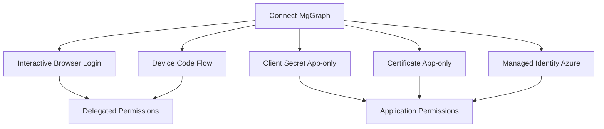

---
tags:
  - powershell
  - microsoft-365
  - automatisierung
  - graph-sdk
  - exchange-online
aliases:
  - M365 PowerShell
  - Microsoft 365 PowerShell
---

# PowerShell für Microsoft 365

> [!ABSTRACT] TL;DR
> PowerShell ist das Standard-Werkzeug für Microsoft 365-Automatisierung. Das **Microsoft Graph PowerShell SDK** hat ältere Module (MSOnline, AzureAD) abgelöst. Daneben bleiben **ExchangeOnlineManagement**, **MicrosoftTeams** und **PnP.PowerShell** unverzichtbar für spezialisierte Aufgaben.

---

## Überblick: Die wichtigsten M365-Module

| Modul | Verwendung | Install |
|-------|-----------|---------|
| **Microsoft.Graph** | Users, Groups, Licences, Teams, Intune | `Install-Module Microsoft.Graph` |
| **ExchangeOnlineManagement** | Exchange-Postfächer, Regeln, Reports | `Install-Module ExchangeOnlineManagement` |
| **MicrosoftTeams** | Teams, Kanäle, Policies | `Install-Module MicrosoftTeams` |
| **PnP.PowerShell** | SharePoint, Inhalte, Sites | `Install-Module PnP.PowerShell` |
| **MSOnline** | ⚠️ Veraltet — zu Graph migrieren | — |
| **AzureAD** | ⚠️ Veraltet — zu Graph migrieren | — |

> [!WARNING] Veraltete Module
> **MSOnline** und **AzureAD** werden von Microsoft eingestellt. Alle neuen Skripte müssen **Microsoft.Graph** nutzen.

---

## Microsoft Graph PowerShell SDK

### Installation und Update

```powershell
# Vollständiges SDK installieren (alle Submodule)
Install-Module Microsoft.Graph -Scope CurrentUser -Force

# Nur bestimmte Submodule (empfohlen für Produktion)
Install-Module Microsoft.Graph.Users -Scope CurrentUser
Install-Module Microsoft.Graph.Groups -Scope CurrentUser
Install-Module Microsoft.Graph.Teams -Scope CurrentUser

# Update
Update-Module Microsoft.Graph

# Installierte Version prüfen
Get-InstalledModule Microsoft.Graph | Select-Object Name, Version
```

### Connect-MgGraph — Authentifizierungsmethoden



#### Interaktiv (Browser-Login)

```powershell
Connect-MgGraph -Scopes "User.Read.All", "Group.ReadWrite.All", "Reports.Read.All"

# Context prüfen
Get-MgContext | Select-Object Account, Scopes, TenantId, AuthType
```

#### Device Code (für Server ohne Browser)

```powershell
Connect-MgGraph -Scopes "User.Read.All" -UseDeviceCode
# Ausgabe: "Open https://microsoft.com/devicelogin and enter code ABCD-EFGH"
```

#### Certificate-Based Authentication (CBA) — empfohlen für Automation

```powershell
# Zertifikat erstellen (selbstsigniert für Test)
$cert = New-SelfSignedCertificate `
    -Subject "CN=GraphAutomation" `
    -CertStoreLocation "Cert:\CurrentUser\My" `
    -KeyExportPolicy Exportable `
    -KeySpec Signature `
    -ValidityInDays 365

# Verbindung per Certificate
Connect-MgGraph `
    -ClientId "your-app-client-id" `
    -TenantId "your-tenant-id" `
    -CertificateThumbprint $cert.Thumbprint
```

#### Client Secret (einfacher, aber weniger sicher)

```powershell
$clientSecret = ConvertTo-SecureString "your-secret" -AsPlainText -Force
$credential = New-Object System.Management.Automation.PSCredential("client-id", $clientSecret)

Connect-MgGraph `
    -TenantId "your-tenant-id" `
    -ClientSecretCredential $credential
```

#### Managed Identity (Azure Automation / Azure Functions)

```powershell
Connect-MgGraph -Identity
# Kein Secret nötig — Azure verwaltet die Identität automatisch
```

---

## ExchangeOnlineManagement

```powershell
# Installation
Install-Module ExchangeOnlineManagement -Scope CurrentUser

# Verbinden (interaktiv, MFA-fähig)
Connect-ExchangeOnline -UserPrincipalName admin@contoso.com

# Verbinden per Certificate (CBA — für Automation)
Connect-ExchangeOnline `
    -AppId "your-app-id" `
    -CertificateThumbprint "thumbprint" `
    -Organization "contoso.com"

# Sitzung beenden
Disconnect-ExchangeOnline -Confirm:$false
```

---

## MicrosoftTeams

```powershell
Install-Module MicrosoftTeams -Scope CurrentUser

# Verbinden
Connect-MicrosoftTeams

# Alle Teams auflisten
Get-Team | Select-Object DisplayName, GroupId, Visibility

# Team erstellen
New-Team -DisplayName "Projekt Alpha" -Description "Projektteam" -Visibility Private

# Kanal hinzufügen
Add-TeamChannel -GroupId "team-group-id" -DisplayName "Allgemein" -MembershipType Standard
```

---

## PnP.PowerShell

```powershell
Install-Module PnP.PowerShell -Scope CurrentUser

# Verbinden mit Site
Connect-PnPOnline -Url "https://contoso.sharepoint.com/sites/intranet" -Interactive

# Site-Gruppen abrufen
Get-PnPGroup | Select-Object Title, LoginName

# Dokument hochladen
Add-PnPFile -Path "./report.xlsx" -Folder "Shared Documents/Reports"
```

---

## Praxis-Skript: Lizenz-Report

```powershell
Connect-MgGraph -Scopes "User.Read.All", "Organization.Read.All"

# Alle Lizenzen des Tenants
$skus = Get-MgSubscribedSku | Select-Object SkuPartNumber,
    @{N="Gesamt"; E={$_.PrepaidUnits.Enabled}},
    @{N="Genutzt"; E={$_.ConsumedUnits}},
    @{N="Verfügbar"; E={$_.PrepaidUnits.Enabled - $_.ConsumedUnits}}
$skus | Format-Table -AutoSize

# User ohne Lizenz
$unlicensed = Get-MgUser -All -Filter "assignedLicenses/`$count eq 0" `
    -CountVariable count -ConsistencyLevel eventual `
    -Select "displayName,userPrincipalName,accountEnabled"
Write-Host "Unlizenzierte User: $($unlicensed.Count)"
$unlicensed | Export-Csv -Path "unlicensed_users.csv" -NoTypeInformation -Encoding UTF8
```

---

## Praxis-Skript: MFA-Status aller User

```powershell
Connect-MgGraph -Scopes "UserAuthenticationMethod.Read.All", "User.Read.All"

$users = Get-MgUser -All -Select "displayName,userPrincipalName,accountEnabled"
$report = foreach ($user in $users) {
    $methods = Get-MgUserAuthenticationMethod -UserId $user.Id
    $mfaMethods = $methods | Where-Object { $_.AdditionalProperties["@odata.type"] -ne "#microsoft.graph.passwordAuthenticationMethod" }
    [PSCustomObject]@{
        DisplayName       = $user.DisplayName
        UPN               = $user.UserPrincipalName
        AccountEnabled    = $user.AccountEnabled
        MFAMethodsCount   = $mfaMethods.Count
        MFARegistered     = $mfaMethods.Count -gt 0
    }
}
$report | Export-Csv -Path "mfa_report.csv" -NoTypeInformation -Encoding UTF8
Write-Host "MFA registriert: $(($report | Where-Object MFARegistered).Count) / $($report.Count)"
```

---

## Praxis-Skript: Inaktive Gastbenutzer finden

```powershell
Connect-MgGraph -Scopes "User.Read.All", "AuditLog.Read.All"

$cutoffDate = (Get-Date).AddDays(-90)
$guests = Get-MgUser -All `
    -Filter "userType eq 'Guest'" `
    -Select "displayName,userPrincipalName,signInActivity,createdDateTime"

$inactiveGuests = $guests | Where-Object {
    $lastSignIn = $_.SignInActivity.LastSignInDateTime
    (-not $lastSignIn) -or ([datetime]$lastSignIn -lt $cutoffDate)
}

Write-Host "Inaktive Gäste (>90 Tage): $($inactiveGuests.Count)"
$inactiveGuests | Select-Object DisplayName, UserPrincipalName,
    @{N="LetzterLogin"; E={$_.SignInActivity.LastSignInDateTime}},
    @{N="Erstellt"; E={$_.CreatedDateTime}} |
    Export-Csv "inactive_guests.csv" -NoTypeInformation -Encoding UTF8
```

---

## Praxis-Skript: Exchange-Postfach-Report

```powershell
Connect-ExchangeOnline -AppId $appId -CertificateThumbprint $thumbprint -Organization "contoso.com"

$mailboxes = Get-Mailbox -ResultSize Unlimited | Select-Object DisplayName,
    UserPrincipalName, RecipientTypeDetails, ProhibitSendQuota

$report = foreach ($mb in $mailboxes) {
    $stats = Get-MailboxStatistics -Identity $mb.UserPrincipalName -ErrorAction SilentlyContinue
    [PSCustomObject]@{
        Name           = $mb.DisplayName
        UPN            = $mb.UserPrincipalName
        Typ            = $mb.RecipientTypeDetails
        GroesseMB      = [math]::Round($stats.TotalItemSize.Value.ToMB(), 2)
        ItemCount      = $stats.ItemCount
        QuotaGB        = $mb.ProhibitSendQuota
    }
}
$report | Export-Csv "mailbox_report.csv" -NoTypeInformation -Encoding UTF8
Disconnect-ExchangeOnline -Confirm:$false
```

---

## Praxis-Skript: Teams-Übersicht

```powershell
Connect-MicrosoftTeams

$teams = Get-Team
$report = foreach ($team in $teams) {
    $members = Get-TeamUser -GroupId $team.GroupId
    [PSCustomObject]@{
        Name       = $team.DisplayName
        Sichtbar   = $team.Visibility
        Archiviert = $team.Archived
        Mitglieder = ($members | Where-Object Role -ne "owner").Count
        Eigentuemer= ($members | Where-Object Role -eq "owner").Count
    }
}
$report | Sort-Object Mitglieder -Descending | Format-Table -AutoSize
```

---

## Fehlerbehandlung und Logging

```powershell
function Write-Log {
    param([string]$Message, [string]$Level = "INFO")
    $timestamp = Get-Date -Format "yyyy-MM-dd HH:mm:ss"
    $logEntry = "[$timestamp] [$Level] $Message"
    Add-Content -Path "m365_automation.log" -Value $logEntry
    if ($Level -eq "ERROR") { Write-Host $logEntry -ForegroundColor Red }
    else { Write-Host $logEntry }
}

try {
    Connect-MgGraph -Scopes "User.Read.All" -ErrorAction Stop
    Write-Log "Verbindung zu Graph hergestellt"

    $users = Get-MgUser -All -ErrorAction Stop
    Write-Log "Gefunden: $($users.Count) User"
}
catch {
    Write-Log "Fehler: $($_.Exception.Message)" -Level "ERROR"
    Write-Log "StackTrace: $($_.ScriptStackTrace)" -Level "ERROR"
}
finally {
    Disconnect-MgGraph -ErrorAction SilentlyContinue
    Write-Log "Verbindung getrennt"
}
```

---

## PowerShell 7 vs. Windows PowerShell

| Feature | Windows PowerShell 5.1 | PowerShell 7 |
|---------|----------------------|--------------|
| **Plattform** | Windows only | Windows, Linux, macOS |
| **Performance** | Standard | Schneller |
| **ForEach -Parallel** | ❌ | ✅ |
| **Graph SDK** | ✅ (eingeschränkt) | ✅ (empfohlen) |
| **ExchangeOnline** | ✅ | ✅ |
| **Support** | Bug-fixes only | Aktiv entwickelt |

> [!TIP] PowerShell 7 empfohlen
> Für neue M365-Skripte immer **PowerShell 7** verwenden. Installation: `winget install Microsoft.PowerShell`

---

## Parallelisierung mit ForEach-Object -Parallel

```powershell
# PowerShell 7 — parallele Verarbeitung
$users = Get-MgUser -All

$results = $users | ForEach-Object -Parallel {
    Import-Module Microsoft.Graph.Users
    $user = $_
    $licenses = Get-MgUserLicenseDetail -UserId $user.Id
    [PSCustomObject]@{
        UPN      = $user.UserPrincipalName
        Lizenzen = ($licenses | Select-Object -ExpandProperty SkuPartNumber) -join ", "
    }
} -ThrottleLimit 10  # max. parallele Threads

$results | Export-Csv "license_details.csv" -NoTypeInformation -Encoding UTF8
```

> [!WARNING] Throttling bei Parallelisierung
> Bei zu vielen parallelen Graph-Calls droht HTTP 429. `-ThrottleLimit 5-10` ist ein sicherer Startwert.

---

## Best Practices

- **Modulversionen pinnen:** `Install-Module Microsoft.Graph -RequiredVersion 2.x.x`
- **Immer Disconnect:** `Disconnect-MgGraph` und `Disconnect-ExchangeOnline` am Ende
- **Scopes minimieren:** Nur benötigte Scopes in `Connect-MgGraph` angeben
- **App Registration für Automation:** Nicht mit persönlichem Admin-Account automatisieren
- **CBA statt Client Secret:** Zertifikat ist sicherer als dauerhaftes Secret
- **`-All` Flag nutzen:** Paginierung automatisch abhandeln lassen
- **Logging:** Immer in Datei loggen für Audit-Zwecke
- **`-ErrorAction Stop` in Try/Catch:** Fehler korrekt abfangen

---

## Verwandte Notizen
- [[Microsoft Graph API]]
- [[Azure PowerShell]]
- [[Microsoft 365 Reporting]]
- [[Exchange Online PowerShell]]
