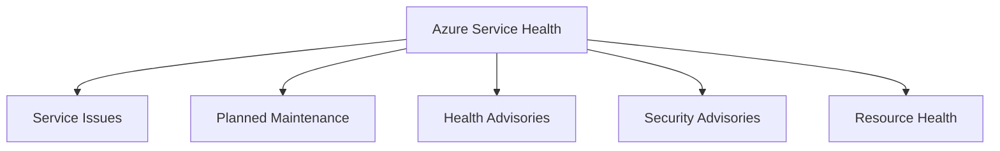
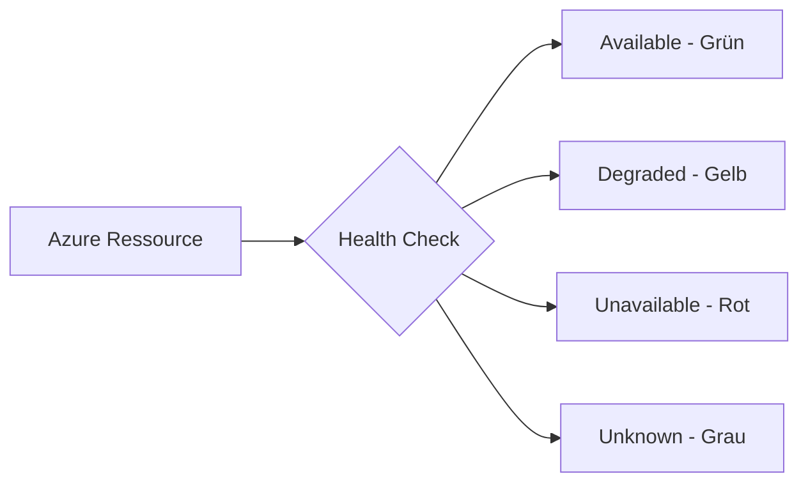
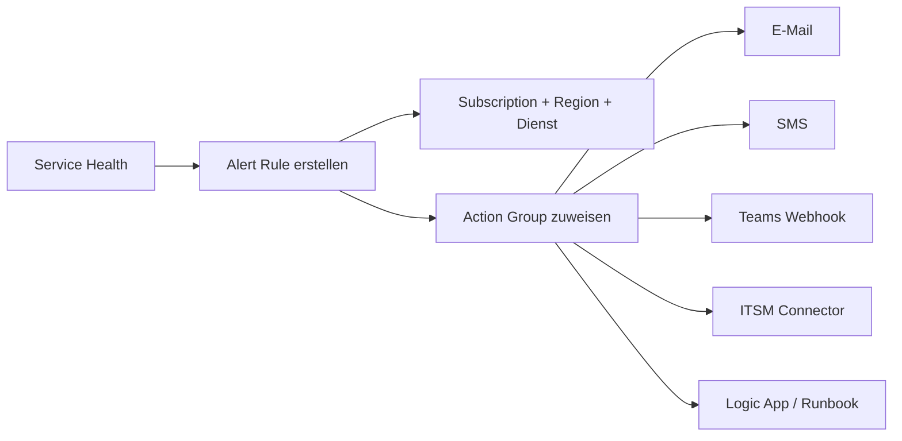
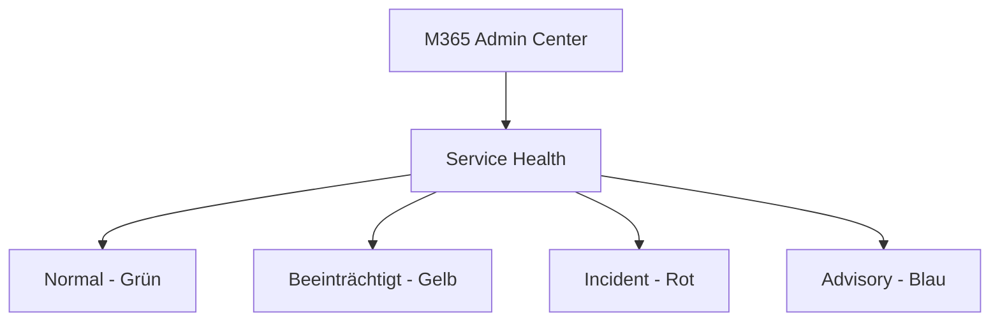
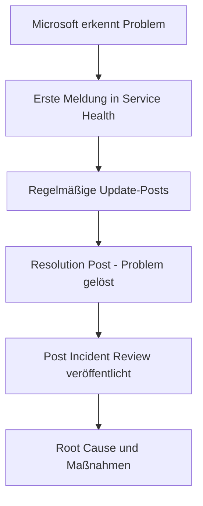
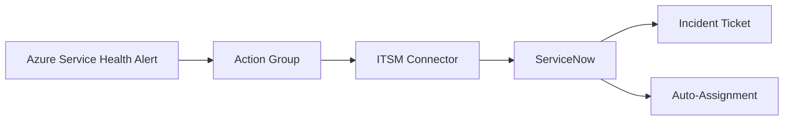

---
tags:
  - azure
  - monitoring
  - service-health
  - microsoft365
  - incident-management
aliases:
  - Azure Service Health
  - M365 Service Health
---

# Service Health und Monitoring

> [!ABSTRACT] TL;DR
> Azure Service Health überwacht Azure-Infrastruktur-Ereignisse (Ausfälle, Wartungen, Advisories). Microsoft 365 Service Health überwacht M365-Dienste separat. Beide lassen sich mit Alerts, ITSM-Tools und Action Groups in bestehende Monitoring-Workflows integrieren.

---

## Azure Service Health vs. Microsoft 365 Service Health

| Merkmal | Azure Service Health | M365 Service Health |
|---------|---------------------|-------------------|
| **Scope** | Azure-Infrastruktur (VMs, DBs, etc.) | M365-Dienste (Teams, Exchange, etc.) |
| **Zugriff** | Azure Portal → Service Health | M365 Admin Center → Service Health |
| **API** | Azure Resource Manager API | Microsoft Graph API |
| **Alert-System** | Azure Monitor Action Groups | Graph API / Admin Center |
| **Kosten** | Kostenlos | Kostenlos |
| **SLA-Relevanz** | Azure-Ressourcen SLAs | M365-Dienst-SLAs |

---

## Azure Service Health: Komponenten

**Azure Service Health** besteht aus vier Bereichen im Azure Portal:



### Service Issues (Störungen)

Aktive oder vergangene Azure-Störungen, die von Microsoft bestätigt wurden. Enthält:
- Betroffene Regionen und Dienste
- Zeitleiste der Updates
- Workarounds (falls verfügbar)
- **Post Incident Review (PIR)** nach Abschluss

### Planned Maintenance (Geplante Wartungen)

Bevorstehende Wartungsfenster, die Ressourcen potenziell beeinflussen. Gibt Administratoren Zeit zur Vorbereitung oder Gegenwehr (z.B. Live Migration).

### Health Advisories

Nicht-dringende Empfehlungen und Änderungen, die in der Zukunft Auswirkungen haben könnten (z.B. API-Deprecations, Feature-Retirements).

### Security Advisories

Sicherheitsrelevante Mitteilungen — oft mit Handlungsbedarf (Patches, Konfigurationsänderungen).

---

---

## Via Azure Portal / Admin Center (UI)

> [!TIP] Schnellzugriff
> [portal.azure.com](https://portal.azure.com) → **Service Health** | [admin.microsoft.com](https://admin.microsoft.com) → **Integrität**

### Schritt-für-Schritt

1. **Azure Service Health** – portal.azure.com → "Service Health" suchen → Dashboard öffnen
2. **Filter anpassen** – Subscription, Service und Region filtern
3. **Status einsehen** – Aktuelle Probleme, geplante Wartungen und Health-Advisories prüfen
4. **Integritätswarnungen** – "+ Integritätswarnung hinzufügen" → E-Mail, SMS oder Webhook konfigurieren
5. **Ressourcenintegrität** – portal.azure.com → Ressource → "Ressourcenintegrität" (linke Sidebar)
6. **M365 Dienststatus** – admin.microsoft.com → Integrität → Dienststatus → Alle Dienste und aktive Vorfälle
7. **Message Center** – admin.microsoft.com → Integrität → Nachrichtencenter (geplante Änderungen)

---

## Azure Status Page (Öffentlicher Status)

Die öffentliche **Azure Status Page** zeigt den globalen Zustand aller Azure-Dienste und -Regionen.

**URL:** `status.azure.com`

> [!NOTE] Azure Status Page vs. Service Health
> Die öffentliche Status Page zeigt nur **weit verbreitete** Ausfälle. **Azure Service Health** im Portal ist personalisiert und zeigt nur Ereignisse, die die eigenen Subscriptions und Regionen betreffen. Immer Service Health bevorzugen!

---

## Resource Health

**Resource Health** zeigt den Gesundheitszustand **einzelner Azure-Ressourcen** — im Gegensatz zu Service Health, das plattformweite Ereignisse meldet.

### Zustandswerte

| Zustand | Bedeutung |
|---------|----------|
| **Available** | Ressource ist gesund und erreichbar |
| **Unavailable** | Ressource nicht verfügbar (platform- oder nutzerseitig) |
| **Degraded** | Ressource verfügbar, aber eingeschränkte Performance |
| **Unknown** | Gesundheitsstatus kann nicht ermittelt werden |



**Zugriff:** `Azure Portal → Ressource → Resource Health`  
oder `Azure Portal → Service Health → Resource Health`

---

## Health Alerts: Automatische Benachrichtigungen

### Service Health Alert anlegen (Portal)



### Service Health Alert per ARM Template

```json
{
    "type": "microsoft.insights/activitylogalerts",
    "name": "ServiceHealthAlert-AllCritical",
    "properties": {
        "enabled": true,
        "scopes": ["/subscriptions/<SUB_ID>"],
        "condition": {
            "allOf": [
                {
                    "field": "category",
                    "equals": "ServiceHealth"
                },
                {
                    "field": "properties.incidentType",
                    "containsAny": ["Incident", "Security"]
                }
            ]
        },
        "actions": {
            "actionGroups": [
                {
                    "actionGroupId": "/subscriptions/<SUB_ID>/resourceGroups/rg-monitoring/providers/microsoft.insights/actionGroups/ag-critical"
                }
            ]
        }
    }
}
```

### Resource Health Alert per PowerShell

```powershell
# Action Group referenzieren
$actionGroup = Get-AzActionGroup -ResourceGroupName "rg-monitoring" -Name "ag-critical"
$actionGroupId = New-AzActionGroup -ActionGroupId $actionGroup.Id

# Resource Health Alert für alle VMs in einer RG
$condition = New-AzActivityLogAlertCondition `
    -Field "category" -Equal "ResourceHealth"

Add-AzActivityLogAlert `
    -Name "ResourceHealthAlert-VMs" `
    -ResourceGroupName "rg-monitoring" `
    -Location "global" `
    -Scope "/subscriptions/<SUB_ID>/resourceGroups/rg-production" `
    -Condition $condition `
    -ActionGroup $actionGroupId
```

---

## M365 Admin Center: Service Health

Das **Service Health Dashboard** im M365 Admin Center zeigt den Status aller Microsoft 365 Dienste für die eigene Organisation.

### Verfügbare Ansichten

| Ansicht | Beschreibung |
|---------|-------------|
| **Overview** | Ampel-Status aller Dienste |
| **All services** | Detaillierter Status mit History |
| **Issue history** | Vergangene Incidents (letzte 30 Tage) |



### Graph API: M365 Service Health

```powershell
Connect-MgGraph -Scopes "ServiceMessage.Read.All"

# Alle Dienst-Statuse
Get-MgServiceAnnouncementHealthOverview -All |
    Select-Object Service, Status, StatusDisplayName |
    Where-Object { $_.Status -ne "serviceOperational" }

# Aktive Incidents
Get-MgServiceAnnouncementIssue -Filter "status ne 'resolved'" |
    Select-Object Title, Service, Status, LastModifiedDateTime |
    Sort-Object LastModifiedDateTime -Descending
```

---

## M365 Message Center: Bevorstehende Änderungen

Das **Message Center** ist der offizielle Kanal für Ankündigungen bevorstehender Änderungen an M365-Diensten.

```powershell
# Neue Messages der letzten 7 Tage
$since = (Get-Date).AddDays(-7).ToString("yyyy-MM-ddTHH:mm:ssZ")
Get-MgServiceAnnouncementMessage `
    -Filter "lastModifiedDateTime ge $since" |
    Select-Object Title, Classification, StartDateTime, ActionRequiredByDateTime |
    Sort-Object StartDateTime
```

| Klassifikation | Handlungsbedarf |
|---------------|----------------|
| **actionRequired** | Admin muss aktiv werden |
| **planForChange** | Änderung kommt — vorbereiten |
| **stayInformed** | Information, kein Handlungsbedarf |

---

## Incident-Management-Prozess

Wie kommuniziert Microsoft bei Azure/M365-Ausfällen?



### Incident-Schweregrade (Azure)

| Grad | Beschreibung | Reaktionszeit |
|------|-------------|--------------|
| **Sev 0** | Krit. Ausfall — viele Kunden betroffen | Sofort |
| **Sev 1** | Erhebliche Auswirkung | < 2 Stunden |
| **Sev 2** | Moderate Auswirkung | < 4 Stunden |
| **Sev 3** | Geringe Auswirkung / Advisory | < 24 Stunden |

---

## Post Incident Reviews (PIR)

Nach schwerwiegenden Incidents veröffentlicht Microsoft einen **Post Incident Review (PIR)** mit:

- **Root Cause Analysis (RCA)** — Was war die Ursache?
- **Zeitleiste** — Wann wurde was erkannt und behoben?
- **Maßnahmen** — Was wird verbessert?

PIRs sind im Azure Portal unter *Service Health → Service Issues → Issue History* verfügbar (dauert typisch 3–5 Werktage nach Incident-Abschluss).

---

## Azure Monitor Service Health Workbook

Azure Monitor bietet ein vorgefertigtes **Service Health Workbook** für visuelle Auswertung:

```powershell
# Service Health Events via KQL (Log Analytics)
AzureActivity
| where CategoryValue == "ServiceHealth"
| where ActivityStatusValue == "Active"
| project TimeGenerated, OperationNameValue, Description, Properties
| order by TimeGenerated desc
```

---

## SLA-Tracking

### Azure SLAs (Beispiele 2024/2025)

| Dienst | SLA |
|--------|-----|
| Azure Virtual Machines (2+ VMs, Availability Set) | 99,95 % |
| Azure Virtual Machines (Availability Zones) | 99,99 % |
| Azure SQL Database (Business Critical, Zone-redundant) | 99,995 % |
| Azure Blob Storage (RA-GRS) | 99,99 % |
| M365 Exchange Online | 99,9 % |
| M365 Teams | 99,9 % |
| M365 SharePoint Online | 99,9 % |

> [!TIP] SLA-Berechnung
> Monatliche SLA = (Gesamtminuten - Ausfallminuten) / Gesamtminuten × 100
> Bei 99,9 % SLA sind max. ~43,8 Minuten Downtime/Monat erlaubt.

---

## Integration mit ITSM-Tools

### ServiceNow via ITSM Connector



**Einrichtung:**
1. ITSM Connector in Azure Monitor konfigurieren
2. ServiceNow OAuth-Verbindung einrichten
3. Action Group → ITSM Notification-Type auswählen
4. Mapping: Azure Severity → ServiceNow Priority

```powershell
# ITSM Connector via PowerShell prüfen
Get-AzOperationalInsightsWorkspace -ResourceGroupName "rg-monitoring" |
    ForEach-Object {
        Get-AzOperationalInsightsDataSource `
            -ResourceGroupName $_.ResourceGroupName `
            -WorkspaceName $_.Name `
            -Kind "ItsConnector"
    }
```

---

## Best Practices

> [!TIP] Empfehlungen
> - **Service Health Alerts** für alle relevanten Subscriptions und Regionen anlegen
> - **PIR-Prozess** intern dokumentieren — Lernen aus Microsoft-Ausfällen
> - **Message Center** wöchentlich reviewen — bevorstehende Änderungen planen
> - **Resource Health Alerts** für kritische Produktions-Ressourcen aktivieren
> - **Dashboard** in Azure Portal pinnen für täglichen Überblick

---

## Verwandte Notizen
- [[Microsoft 365 Reporting]]
- [[Azure Update Manager]]
- [[Azure Monitor]]
- [[Microsoft 365 DSC]]
