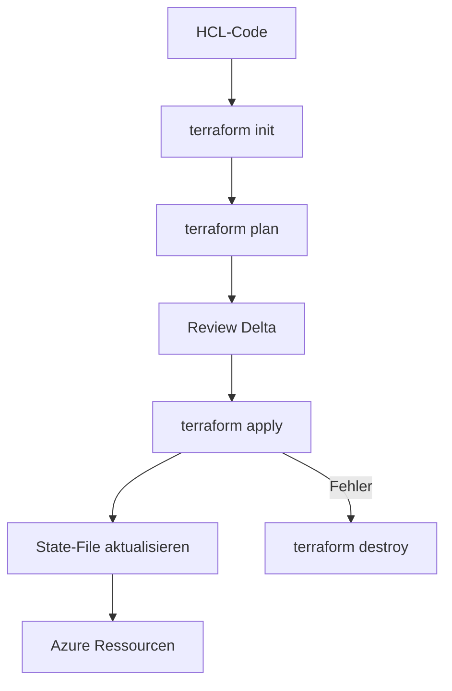
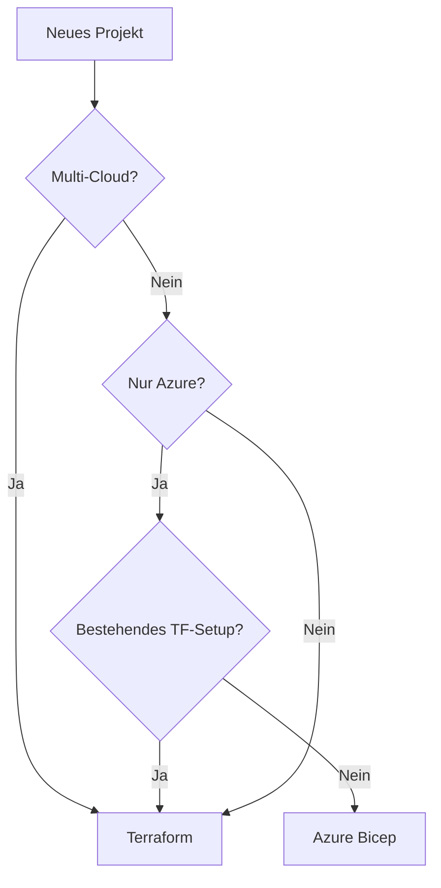

---
tags:
  - azure
  - terraform
  - iac
  - infrastruktur
  - automatisierung
aliases:
  - Terraform Azure
  - TF Azure
  - AzureRM Provider
---

# Terraform für Azure

> [!ABSTRACT] TL;DR
> **Terraform** von HashiCorp ist das führende Cloud-agnostische IaC-Tool. Für Azure gibt es den **AzureRM Provider** (stabile GA-Ressourcen) und den **AzAPI Provider** (neue/Preview-Features direkt über ARM-APIs). Remote State in Azure Blob Storage macht Terraform team-tauglich.

---

## Was ist Terraform?

Terraform ist ein **deklaratives IaC-Tool**, das Infrastructure as Code in der **HCL-Sprache** (HashiCorp Configuration Language) beschreibt. Es verwaltet einen **State**, der den Ist-Zustand der Infrastruktur abbildet, und berechnet bei jedem `plan` das Delta zwischen Soll- und Ist-Zustand.



---

## AzureRM Provider vs. AzAPI Provider

| Merkmal | AzureRM | AzAPI |
|---------|---------|-------|
| **Entwickler** | HashiCorp + Microsoft | Microsoft (Azure) |
| **Ressourcen** | Stabile GA-Ressourcen | Alle ARM-Ressourcen inkl. Preview |
| **Syntax** | HCL-Abstraktionen | Direkte ARM-API-Eigenschaften |
| **Versionierung** | Terraform Registry | Terraform Registry |
| **Einsatz** | Standard-Produktiv | Neue Features, Migrationspfad |
| **Docs** | registry.terraform.io/azurerm | registry.terraform.io/azapi |

> [!NOTE] AzAPI als Ergänzung
> AzAPI nicht als Ersatz, sondern als **Ergänzung** verwenden: AzureRM für stabile Ressourcen, AzAPI wenn AzureRM eine Ressource noch nicht unterstützt. Sobald AzureRM nachzieht → migrieren.

```hcl
# providers.tf — beide Provider kombiniert
terraform {
  required_providers {
    azurerm = {
      source  = "hashicorp/azurerm"
      version = "~> 4.0"
    }
    azapi = {
      source  = "Azure/azapi"
      version = "~> 2.0"
    }
  }
}

provider "azurerm" {
  features {}
}

provider "azapi" {}
```

---

## Terraform-Struktur

Empfohlene Dateistruktur für Azure-Projekte:

```
infra/
├── main.tf           # Ressourcen-Definitionen
├── variables.tf      # Input-Variablen
├── outputs.tf        # Output-Werte
├── providers.tf      # Provider-Konfiguration
├── terraform.tfvars  # Variablen-Werte (nicht ins Git!)
├── backend.tf        # Remote State Konfiguration
└── modules/
    ├── network/
    │   ├── main.tf
    │   ├── variables.tf
    │   └── outputs.tf
    └── vm/
        ├── main.tf
        ├── variables.tf
        └── outputs.tf
```

---

---

## Via Azure Portal (UI)

> [!TIP] Schnellzugriff
> [portal.azure.com](https://portal.azure.com) → **Cloud Shell** → `terraform version`

### Schritt-für-Schritt

1. **Cloud Shell öffnen** – portal.azure.com → Cloud Shell `>_` → Bash wählen
2. **Terraform prüfen** – `terraform version` – ist in Cloud Shell vorinstalliert
3. **Storage Account für State** – portal.azure.com → Speicherkonten → + Erstellen → Container "tfstate" anlegen
4. **Service Principal erstellen** – portal.azure.com → Microsoft Entra ID → App-Registrierungen → + Neue Registrierung → Geheimnis erstellen
5. **Subscription-ID kopieren** – portal.azure.com → Abonnements → ID in die Zwischenablage kopieren
6. **State-Backend konfigurieren** – Terraform-Code auf den erstellten Storage Account zeigen lassen

---

## Wichtige Terraform-Befehle

| Befehl | Funktion |
|--------|---------|
| `terraform init` | Provider herunterladen, Backend initialisieren |
| `terraform validate` | Syntax prüfen |
| `terraform fmt` | HCL-Code formatieren |
| `terraform plan` | Änderungen berechnen (dry-run) |
| `terraform apply` | Änderungen anwenden |
| `terraform destroy` | Infrastruktur löschen |
| `terraform state list` | State-Ressourcen auflisten |
| `terraform state show` | Ressource im State anzeigen |
| `terraform import` | Bestehende Ressource in State importieren |
| `terraform output` | Output-Werte anzeigen |
| `terraform refresh` | State mit echten Ressourcen abgleichen |

```bash
# Typischer Workflow
terraform init
terraform fmt --recursive
terraform validate
terraform plan -out=tfplan
terraform apply tfplan

# Mit Variablen-Datei
terraform plan -var-file="environments/prod.tfvars"
terraform apply -var-file="environments/prod.tfvars" -auto-approve
```

---

## Remote State in Azure Blob Storage

Terraform State lokal zu speichern ist für Einzelpersonen möglich, aber **nicht team-tauglich**. Remote State in Azure Blob Storage bietet:
- **State-Locking** (verhindert parallele Applies)
- **Versionierung** (Blob-Versioning)
- **Verschlüsselung** (Azure Storage Encryption)
- **Zugriffskontrolle** (RBAC)

```bash
# Storage Account für Remote State erstellen (einmalig)
RESOURCE_GROUP="rg-terraform-state"
STORAGE_ACCOUNT="stterraformstate$(openssl rand -hex 4)"
CONTAINER="tfstate"

az group create --name "$RESOURCE_GROUP" --location westeurope
az storage account create \
    --name "$STORAGE_ACCOUNT" \
    --resource-group "$RESOURCE_GROUP" \
    --sku Standard_LRS \
    --encryption-services blob \
    --min-tls-version TLS1_2
az storage container create \
    --name "$CONTAINER" \
    --account-name "$STORAGE_ACCOUNT" \
    --auth-mode login
```

```hcl
# backend.tf
terraform {
  backend "azurerm" {
    resource_group_name  = "rg-terraform-state"
    storage_account_name = "stterraformstate1234"
    container_name       = "tfstate"
    key                  = "prod/main.tfstate"
  }
}
```

> [!IMPORTANT] State-Datei schützen
> Die State-Datei enthält **Klartext-Secrets** (Passwörter, IDs). Niemals in Git einchecken! `.gitignore` mit `*.tfstate` und `*.tfvars` pflegen.

---

## Variablen und Outputs

```hcl
# variables.tf
variable "environment" {
  description = "Umgebungsbezeichnung"
  type        = string
  validation {
    condition     = contains(["dev", "test", "prod"], var.environment)
    error_message = "Muss dev, test oder prod sein."
  }
}

variable "location" {
  description = "Azure Region"
  type        = string
  default     = "westeurope"
}

variable "admin_password" {
  description = "VM Admin-Passwort"
  type        = string
  sensitive   = true  # Nicht in Logs anzeigen
}

variable "instance_count" {
  type    = number
  default = 2
}
```

```hcl
# outputs.tf
output "resource_group_id" {
  description = "ID der Ressourcengruppe"
  value       = azurerm_resource_group.main.id
}

output "vm_public_ips" {
  description = "Öffentliche IPs aller VMs"
  value       = [for vm in azurerm_public_ip.vm : vm.ip_address]
}

output "storage_account_name" {
  value     = azurerm_storage_account.main.name
  sensitive = false
}
```

---

## Terraform Module

```hcl
# Lokales Modul verwenden
module "network" {
  source = "./modules/network"

  resource_group_name = azurerm_resource_group.main.name
  location            = var.location
  vnet_name           = "vnet-${var.environment}"
  address_space       = ["10.0.0.0/16"]
  subnets = {
    app = "10.0.1.0/24"
    db  = "10.0.2.0/24"
  }
}

# Modul aus Terraform Registry
module "aks" {
  source  = "Azure/aks/azurerm"
  version = "~> 8.0"

  resource_group_name = azurerm_resource_group.main.name
  location            = var.location
  cluster_name        = "aks-${var.environment}"
  kubernetes_version  = "1.29"
  node_count          = var.environment == "prod" ? 3 : 1
}
```

---

## Workspaces — Umgebungen trennen

```bash
# Workspace erstellen
terraform workspace new dev
terraform workspace new test
terraform workspace new prod

# Aktiven Workspace anzeigen
terraform workspace show

# Zu Workspace wechseln
terraform workspace select prod

# Alle Workspaces
terraform workspace list
```

```hcl
# Workspace in Konfiguration nutzen
locals {
  environment = terraform.workspace
  vm_size     = terraform.workspace == "prod" ? "Standard_D4s_v3" : "Standard_B2s"
}

resource "azurerm_resource_group" "main" {
  name     = "rg-${terraform.workspace}-myapp"
  location = var.location
}
```

---

## Service Principal für Terraform

### Client Secret

```bash
# Service Principal erstellen
az ad sp create-for-rbac \
    --name "sp-terraform-prod" \
    --role "Contributor" \
    --scopes "/subscriptions/your-subscription-id"
```

```bash
# Umgebungsvariablen setzen
export ARM_CLIENT_ID="your-client-id"
export ARM_CLIENT_SECRET="your-client-secret"
export ARM_TENANT_ID="your-tenant-id"
export ARM_SUBSCRIPTION_ID="your-subscription-id"
```

### OIDC (empfohlen für GitHub Actions)

```hcl
# providers.tf mit OIDC
provider "azurerm" {
  features {}
  use_oidc = true
  # ARM_CLIENT_ID, ARM_TENANT_ID, ARM_SUBSCRIPTION_ID als Env-Vars
}
```

---

## Terraform mit GitHub Actions (OIDC)

```yaml
name: Terraform Deploy

on:
  push:
    branches: [main]
  pull_request:
    branches: [main]

permissions:
  id-token: write
  contents: read
  pull-requests: write

env:
  ARM_CLIENT_ID:       ${{ secrets.AZURE_CLIENT_ID }}
  ARM_TENANT_ID:       ${{ secrets.AZURE_TENANT_ID }}
  ARM_SUBSCRIPTION_ID: ${{ secrets.AZURE_SUBSCRIPTION_ID }}
  ARM_USE_OIDC:        "true"

jobs:
  terraform:
    runs-on: ubuntu-latest
    defaults:
      run:
        working-directory: infra

    steps:
      - name: Checkout
        uses: actions/checkout@v4

      - name: Setup Terraform
        uses: hashicorp/setup-terraform@v3
        with:
          terraform_version: "~1.9"

      - name: Azure Login (OIDC)
        uses: azure/login@v2
        with:
          client-id:       ${{ secrets.AZURE_CLIENT_ID }}
          tenant-id:       ${{ secrets.AZURE_TENANT_ID }}
          subscription-id: ${{ secrets.AZURE_SUBSCRIPTION_ID }}

      - name: Terraform Init
        run: terraform init

      - name: Terraform Validate
        run: terraform validate

      - name: Terraform Plan
        id: plan
        run: terraform plan -out=tfplan -no-color
        continue-on-error: true

      - name: Terraform Apply
        if: github.ref == 'refs/heads/main' && github.event_name == 'push'
        run: terraform apply tfplan
```

---

## Typische Azure-Module (Beispiele)

### VNet-Modul

```hcl
# modules/network/main.tf
resource "azurerm_virtual_network" "main" {
  name                = var.vnet_name
  resource_group_name = var.resource_group_name
  location            = var.location
  address_space       = var.address_space
  tags                = var.tags
}

resource "azurerm_subnet" "subnets" {
  for_each = var.subnets

  name                 = each.key
  resource_group_name  = var.resource_group_name
  virtual_network_name = azurerm_virtual_network.main.name
  address_prefixes     = [each.value]
}
```

### SQL-Datenbank-Modul

```hcl
resource "azurerm_mssql_server" "main" {
  name                         = "sql-${var.environment}-${random_string.suffix.result}"
  resource_group_name          = var.resource_group_name
  location                     = var.location
  version                      = "12.0"
  administrator_login          = var.admin_username
  administrator_login_password = var.admin_password
  minimum_tls_version          = "1.2"

  azuread_administrator {
    login_username = var.aad_admin_name
    object_id      = var.aad_admin_object_id
  }
}

resource "azurerm_mssql_database" "main" {
  name         = var.db_name
  server_id    = azurerm_mssql_server.main.id
  collation    = "SQL_Latin1_General_CP1_CI_AS"
  sku_name     = var.environment == "prod" ? "S2" : "Basic"
  zone_redundant = var.environment == "prod"
}
```

---

## Terraform vs. Bicep — Wann welches?



| Szenario | Empfehlung |
|----------|-----------|
| Azure-only, kein bestehendes TF | **Bicep** |
| Multi-Cloud (AWS, GCP, Azure) | **Terraform** |
| Bestehendes Terraform-Ökosystem | **Terraform** |
| Enge ARM-Integration, ARM-Preview | **Bicep + AzAPI** |
| Team kennt Terraform gut | **Terraform** |
| Microsoft-Support bevorzugt | **Bicep** |

---

## terragrunt — Überblick

**Terragrunt** ist ein dünnes Wrapper-Tool über Terraform für große Infrastrukturen:

- **DRY-Backend-Konfiguration:** Backend einmal definieren, automatisch für alle Module
- **Dependency-Graph:** Module mit expliziten Abhängigkeiten
- **Multi-Account/Region:** Strukturierte Verwaltung vieler Umgebungen
- **Remote State Helpers:** Automatische State-Bucket-Erstellung

```bash
# Typisches terragrunt-Verzeichnis
infra/
├── terragrunt.hcl          # Root-Konfiguration
├── dev/
│   ├── network/terragrunt.hcl
│   └── vm/terragrunt.hcl
└── prod/
    ├── network/terragrunt.hcl
    └── vm/terragrunt.hcl
```

---

## Verwandte Notizen
- [[Azure Bicep]]
- [[GitHub Actions für Azure]]
- [[Azure CLI]]
- [[Azure RBAC]]
