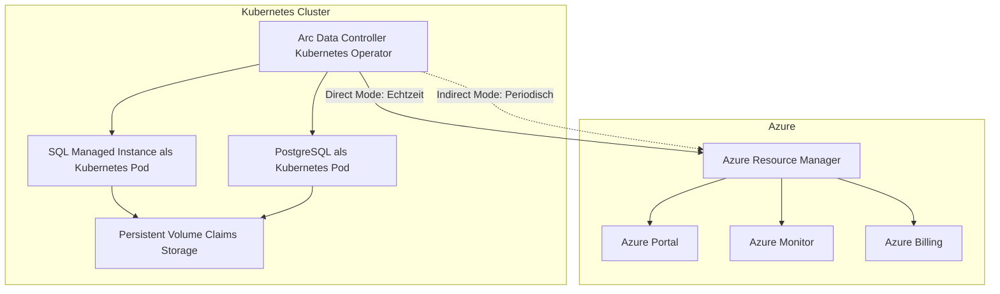
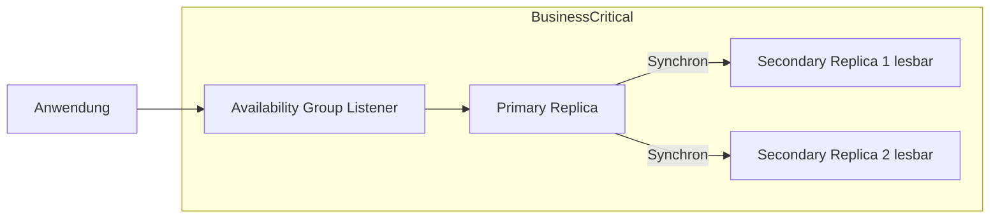
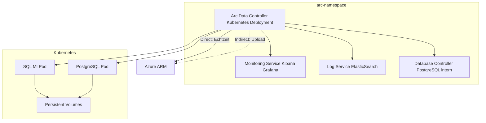
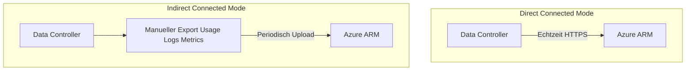
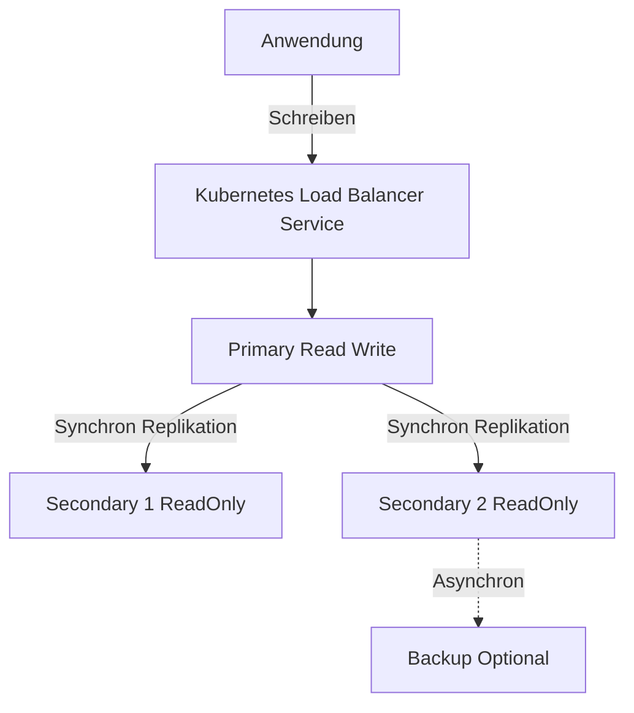
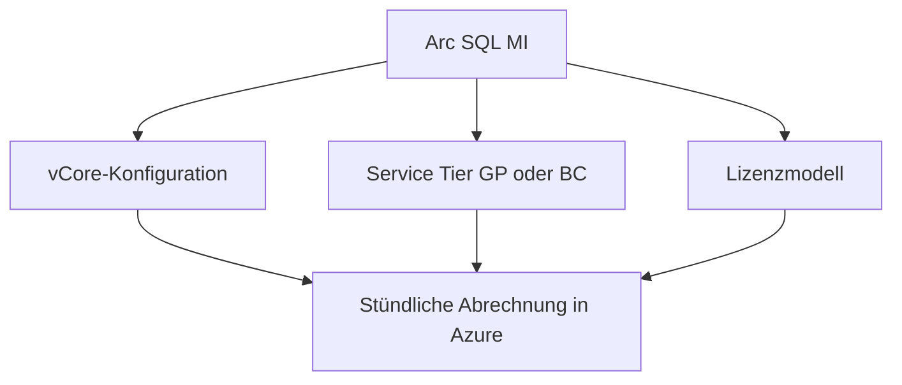
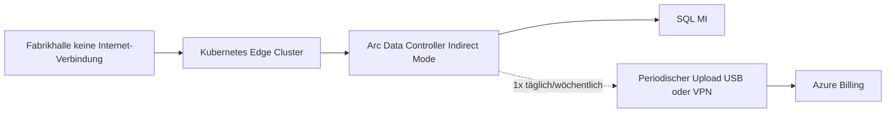

---
tags:
  - azure
  - arc
  - data-services
  - sql-managed-instance
  - postgresql
  - kubernetes
aliases:
  - Arc Data Services
  - Arc-enabled Data Services
  - Arc SQL MI
---

# Arc-enabled Data Services

> [!ABSTRACT] TL;DR
> Azure Arc-enabled Data Services bringen Azure-Datenbankdienste (SQL Managed Instance, PostgreSQL) auf beliebige Kubernetes-Infrastrukturen. Der **Arc Data Controller** als Kubernetes-basierter Control Plane verwaltet den Lebenszyklus. Verbindungsmodi: **Direct** (volle Azure-Integration) und **Indirect** (Air-Gapped/Offline-Szenarien).

---

## Was sind Arc-enabled Data Services?

**Azure Arc-enabled Data Services** ermöglichen es, Azure-PaaS-Datenbankdienste **on-premises, in anderen Clouds oder am Edge** zu betreiben — auf beliebiger Kubernetes-Infrastruktur. Die Dienste werden über Kubernetes-Operatoren verwaltet, bieten aber dieselbe Management-Erfahrung wie native Azure-Dienste.

**Kerngedanke:** Statt Daten in die Cloud zu migrieren (aus Compliance- oder Latenzgründen), bringt man die Cloud-Dienste zu den Daten.



---

---

## Via Azure Portal (UI)

> [!TIP] Schnellzugriff
> [portal.azure.com](https://portal.azure.com) → **Azure Arc** → **Datendienste** → **+ Data Controller erstellen**

### Schritt-für-Schritt

1. **portal.azure.com → Azure Arc → Datendienste** – Zur Datendienste-Übersicht navigieren
2. **+ Data Controller erstellen** – Neuen Datencontroller anlegen
3. **Verbindungsmodus wählen** – Direkt (empfohlen) oder Indirekt
4. **Kubernetes-Cluster auswählen** – Muss bereits Arc-fähig sein
5. **Konfiguration** – Namespace, Storage Class und Monitoring konfigurieren
6. **Managed Instance erstellen** – Nach Data Controller-Bereitstellung: "+ Azure SQL Managed Instance" oder "+ PostgreSQL"
7. **Service Tier wählen** – General Purpose oder Business Critical

---

## Azure SQL Managed Instance auf Arc

**SQL Managed Instance enabled by Azure Arc** (kurz: Arc SQL MI) ist eine containerisierte Version von SQL Server, die auf Kubernetes läuft und durch den Arc Data Controller verwaltet wird.

### Service Tiers

| Tier | Beschreibung | HA | Use Case |
|---|---|---|---|
| **General Purpose** | Basis-Tier, Standard-HA via Kubernetes | Kubernetes-native Resilienz | Entwicklung, Test, Standard-Produktion |
| **Business Critical** | Premium-Tier, Always On Availability Groups | 3 Replicas (Primary + 2 Secondary) | Unternehmenskritische Workloads, geringe RPO/RTO |



### Arc SQL MI Deployment

```bash
# Arc SQL MI im Direct Connected Mode erstellen
az sql mi-arc create \
  --name "mySQLMI" \
  --resource-group "myRG" \
  --location "westeurope" \
  --custom-location "my-custom-location" \
  --tier "GeneralPurpose" \
  --cores-limit 4 \
  --cores-request 2 \
  --memory-limit "8Gi" \
  --memory-request "4Gi" \
  --storage-class-data "managed-premium" \
  --storage-class-logs "managed-premium" \
  --volume-size-data "30Gi" \
  --volume-size-logs "10Gi" \
  --admin-login "sqladmin" \
  --admin-password "<password>"

# Business Critical Tier
az sql mi-arc create \
  --name "mySQLMI-BC" \
  --resource-group "myRG" \
  --custom-location "my-custom-location" \
  --tier "BusinessCritical" \
  --replicas 3
```

### Feature-Vergleich Arc SQL MI vs. Azure SQL MI

| Feature | Arc SQL MI | Azure SQL MI |
|---|---|---|
| SQL Server Engine | ✅ Identisch | ✅ |
| Always On AG | ✅ Business Critical | ✅ |
| Automated Backups | ✅ | ✅ |
| Point-in-Time Restore | ✅ | ✅ |
| Entra ID Auth | ✅ | ✅ |
| Elastic Scale (Autoscaling) | ❌ (manuell) | ✅ |
| Serverless | ❌ | ✅ |
| Geo-Replication | ❌ | ✅ |
| Air-Gapped Deployment | ✅ | ❌ |

---

## PostgreSQL auf Arc

**PostgreSQL enabled by Azure Arc** ermöglicht das Betreiben von PostgreSQL-Clustern auf Kubernetes via Arc:

```bash
# PostgreSQL auf Arc erstellen
az postgres arc-server create \
  --name "myPostgres" \
  --resource-group "myRG" \
  --custom-location "my-custom-location" \
  --cores-limit 4 \
  --memory-limit "8Gi" \
  --storage-class-data "managed-premium" \
  --volume-size-data "30Gi" \
  --admin-login "pgadmin" \
  --admin-password "<password>"

# Verbindungsinfo abrufen
az postgres arc-server endpoint list \
  --name "myPostgres" \
  --resource-group "myRG"
```

> [!NOTE] PostgreSQL Hyperscale (Citus) auf Arc
> Die frühere **Hyperscale (Citus)**-Erweiterung für Arc-PostgreSQL befindet sich im Überarbeitungszyklus. Für neue Deployments wird aktuell empfohlen, den Standard-PostgreSQL-Arc-Modus zu nutzen.

---

## Arc Data Controller

Der **Arc Data Controller** ist der zentrale Kubernetes-Operator, der alle Arc-Datenbankdienste auf einem Cluster verwaltet.

### Architektur



### Data Controller Deployment (Direct Mode)

```bash
# Voraussetzungen: Custom Location erstellen
az customlocation create \
  --name "my-data-location" \
  --resource-group "myRG" \
  --location "westeurope" \
  --cluster-extension-ids "<extensionId>" \
  --host-resource-id "<connectedClusterId>" \
  --namespace "arc-data"

# Arc Data Controller im Direct Mode erstellen
az arcdata dc create \
  --name "my-data-controller" \
  --resource-group "myRG" \
  --location "westeurope" \
  --connectivity-mode "direct" \
  --custom-location "my-data-location" \
  --storage-class "managed-premium" \
  --profile-name "azure-arc-aks-premium-storage"
```

### Data Controller Deployment (Indirect Mode)

```bash
# Arc Data Controller im Indirect Mode (kubectl)
kubectl create namespace arc-data

az arcdata dc create \
  --name "my-data-controller" \
  --resource-group "myRG" \
  --location "westeurope" \
  --connectivity-mode "indirect" \
  --k8s-namespace "arc-data" \
  --use-k8s \
  --storage-class "local-storage"
```

### Data Controller Upgrades

```bash
# Verfügbare Versionen anzeigen
az arcdata dc list-upgrades --k8s-namespace "arc-data" --use-k8s

# Data Controller upgraden
az arcdata dc upgrade \
  --desired-version "<version>" \
  --k8s-namespace "arc-data" \
  --use-k8s
```

---

## Verbindungsmodi: Direct vs. Indirect

Die Wahl des Verbindungsmodus ist eine **Deployment-Entscheidung** und kann nachträglich nicht geändert werden (Neu-Deployment erforderlich).



### Vergleich der Modi

| Merkmal | Direct Connected | Indirect Connected |
|---|---|---|
| **Konnektivität** | Permanente Azure-Verbindung | Periodisch oder manuell |
| **Azure Portal** | Vollständige Verwaltung | Nur Inventory, kein Mgmt |
| **Billing** | Echtzeit-Abrechnung | Manuelle Uploads |
| **Monitoring** | Azure Monitor (direkt) | Lokale Tools + Export |
| **Deployment** | Azure Portal / CLI / ARM | kubectl / azdata |
| **RBAC** | Azure RBAC | Lokales Kubernetes-RBAC |
| **Entra ID Auth** | ✅ | ❌ (nur SQL Auth) |
| **Air-Gapped** | ❌ | ✅ |
| **Regulierte Umgebungen** | Eingeschränkt | ✅ (kein permanenter Traffic) |

> [!IMPORTANT] Connectivity-Mode ist unveränderlich
> Der Verbindungsmodus wird beim Erstellen des Data Controllers festgelegt und kann **nicht nachträglich geändert** werden. Eine Änderung erfordert einen neuen Data Controller und die Migration der Datenbankinstanzen.

---

## Unterstützte Kubernetes-Plattformen

| Plattform | Direct Mode | Indirect Mode |
|---|---|---|
| **AKS (Azure)** | ✅ | ✅ |
| **AKS on Azure Stack HCI** | ✅ | ✅ |
| **EKS (AWS)** | ✅ | ✅ |
| **GKE (Google Cloud)** | ✅ | ✅ |
| **OpenShift** | ✅ | ✅ |
| **K3s / RKE2** | ✅ | ✅ |
| **Vanilla Kubernetes** | ✅ | ✅ |
| **Kubeadm** | ✅ | ✅ |

---

## Hochverfügbarkeit: Business Critical Tier

Der **Business Critical**-Tier nutzt **SQL Server Always On Availability Groups**, die automatisch vom Arc Data Controller konfiguriert werden:



- **Automatisches Failover** bei Ausfall des Primary
- **Lesbare Sekundärreplikas** für Reporting-Workloads
- **RPO = 0** (synchrone Replikation, kein Datenverlust)
- **RTO = 30–60 Sekunden** (automatisches Failover)

---

## Billing und Lizenzierung



| Lizenzmodell | Kosten | Geeignet für |
|---|---|---|
| **BasePrice (PAYG)** | Lizenz im Preis enthalten | Kein bestehendes SQL Server Recht |
| **LicenseIncluded** | Standard Azure SQL MI Preis | Neue Deployments |
| **BasePrice + AHB** | Reduzierter Preis mit Hybrid Benefit | SQL Server mit SA |
| **Developer** | Kostenlos | Nur Dev/Test, kein Produktivbetrieb |

---

## Use Cases

### Air-Gapped Umgebungen



**Typische Use Cases:**
- Fertigungsindustrie (OT-Netzwerke ohne Internet)
- Militär- und Regierungsanwendungen (Classified Networks)
- Offshore-Anlagen (Schiffe, Plattformen)
- Medizinische Umgebungen mit strengen Datenschutzanforderungen

### Regulatory Compliance

Für Branchen mit strikten Datenlokalisierungsanforderungen (DSGVO, FINMA, HIPAA):
- Daten verlassen die definierte Gerichtsbarkeit nie
- Compliance-Reporting trotzdem über Azure Policy möglich
- Lokales Backup und Disaster Recovery

---

## Vergleich zu Azure PaaS

| Merkmal | Azure SQL MI (Cloud) | Arc SQL MI (Hybrid) |
|---|---|---|
| **Standort** | Azure-Rechenzentrum | Beliebig |
| **Latenz zu App** | Abhängig von Azure-Region | Lokal (sub-ms möglich) |
| **Autoscaling** | ✅ | ❌ |
| **Serverless** | ✅ | ❌ |
| **SLA** | 99,99% | Kubernetes-Cluster-SLA |
| **Air-Gapped** | ❌ | ✅ |
| **Kosten** | Azure-Verbrauchskosten | Hardware + Azure-Soft-Kosten |
| **Verwaltungsaufwand** | Gering (vollständig managed) | Höher (Kubernetes-Betrieb) |

---

## Verwandte Notizen
- [[Azure Arc Grundlagen]]
- [[Arc-fähige Kubernetes]]
- [[Arc-fähige SQL Server]]
- [[Azure Stack HCI]]
