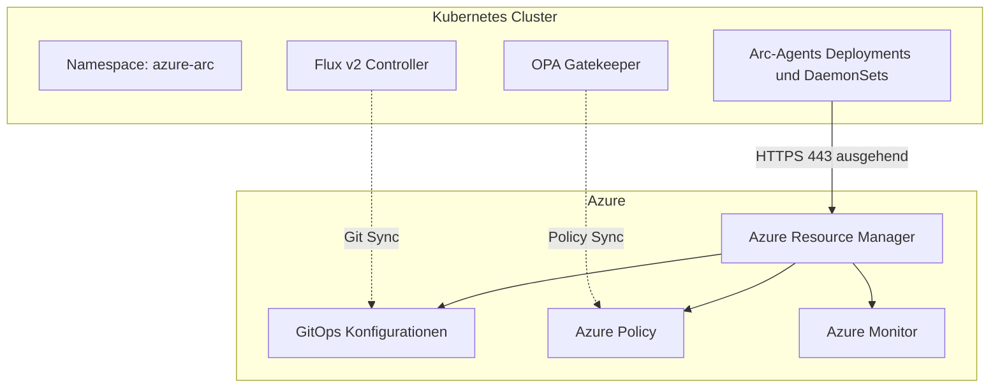
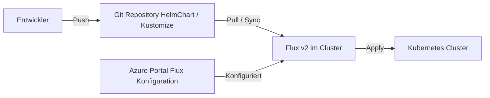
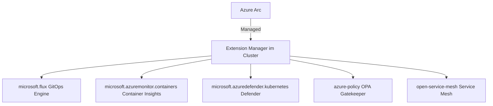
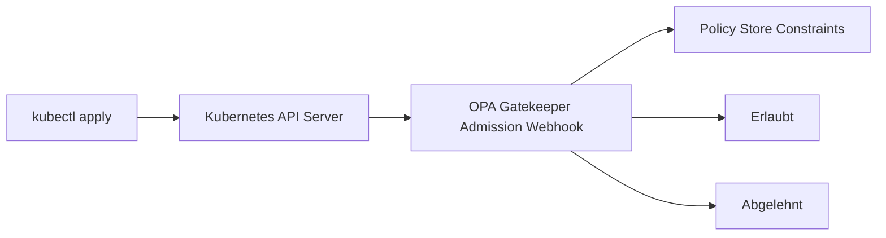
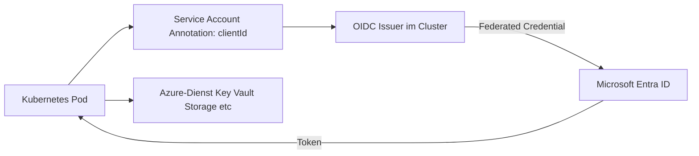
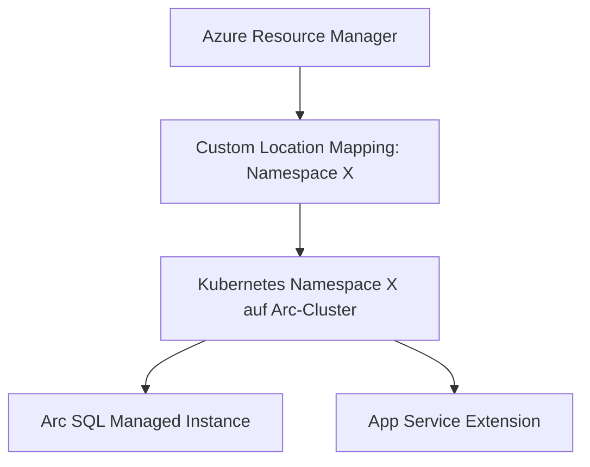

---
tags:
  - azure
  - arc
  - kubernetes
  - gitops
  - hybrid-cloud
aliases:
  - Arc-enabled Kubernetes
  - Arc Kubernetes
  - Connected Kubernetes
---

# Arc-fähige Kubernetes

> [!ABSTRACT] TL;DR
> Arc-fähige Kubernetes (Arc-enabled Kubernetes) verbindet beliebige Kubernetes-Cluster mit Azure — unabhängig von Distribution oder Standort. Zentrale Features sind **GitOps mit Flux v2**, **Cluster Extensions** (Monitor, Defender, Policy), **Azure RBAC** mit Entra ID und **Custom Locations** für das Deployment von Azure-Diensten direkt auf Arc-Kubernetes-Clustern.

---

## Was ist Arc-enabled Kubernetes?

**Azure Arc-enabled Kubernetes** projiziert beliebige Kubernetes-Cluster in den Azure Resource Manager. Der Cluster wird als Ressource vom Typ `microsoft.kubernetes/connectedclusters` registriert und kann dann über Azure-Tools verwaltet werden.

Das Onboarding erfolgt über den **Arc-Kubernetes-Agent**, der als Kubernetes-Deployment in den Namespaces `azure-arc` auf dem Cluster läuft. Der Agent stellt eine ausgehende Verbindung zu Azure her — eingehende Verbindungen sind nicht notwendig.



---

## Unterstützte Kubernetes-Distributionen

Arc-enabled Kubernetes funktioniert mit **jeder CNCF-konformen** Kubernetes-Distribution:

| Distribution | Anbieter | Umgebung |
|---|---|---|
| **AKS** | Microsoft | Azure |
| **AKS on Azure Stack HCI** | Microsoft | On-Premises |
| **AKS on Windows Server** | Microsoft | On-Premises |
| **EKS (Elastic Kubernetes Service)** | Amazon Web Services | AWS |
| **GKE (Google Kubernetes Engine)** | Google | GCP |
| **OpenShift** | Red Hat | On-Premises / Cloud |
| **K3s** | Rancher/SUSE | Edge / On-Premises |
| **RKE2** | Rancher/SUSE | On-Premises |
| **Tanzu Kubernetes Grid** | VMware | On-Premises / Cloud |
| **Vanilla Kubernetes** | Community | Beliebig |
| **Kind / MicroK8s** | Community | Dev/Test |

> [!NOTE] Kubernetes-Version
> Unterstützt werden die letzten **3 stable Kubernetes-Releases** (N, N-1, N-2). Ältere Versionen können technisch funktionieren, sind aber offiziell nicht supportet.

---

## Onboarding: Az connectedk8s connect

### Voraussetzungen

```bash
# Benötigte Azure CLI Extensions installieren
az extension add --name connectedk8s
az extension add --name k8s-extension
az extension add --name k8s-configuration

# Resource Provider registrieren
az provider register --namespace Microsoft.Kubernetes
az provider register --namespace Microsoft.KubernetesConfiguration
az provider register --namespace Microsoft.ExtendedLocation
```

### Cluster verbinden

```bash
# Kubernetes-Cluster mit Azure Arc verbinden
az connectedk8s connect \
  --name "myCluster" \
  --resource-group "myRG" \
  --location "westeurope" \
  --tags "Environment=Production" \
  --correlation-id "<correlationId>"

# Verbindungsstatus prüfen
az connectedk8s show \
  --name "myCluster" \
  --resource-group "myRG"

# Agent-Pods im azure-arc Namespace anzeigen
kubectl get pods -n azure-arc
```

### Cluster trennen (Offboarding)

```bash
# Arc-Verbindung entfernen (Agents werden deinstalliert)
az connectedk8s delete \
  --name "myCluster" \
  --resource-group "myRG"
```

---

## GitOps mit Flux v2

**GitOps** ist ein Betriebsmodell, bei dem der gewünschte Zustand eines Clusters in einem Git-Repository deklariert und automatisch synchronisiert wird. Azure Arc verwendet **Flux v2** als GitOps-Engine.



### Flux v2 Extension installieren

```bash
# microsoft.flux Extension auf Arc-Cluster installieren
az k8s-extension create \
  --cluster-type connectedClusters \
  --cluster-name "myCluster" \
  --resource-group "myRG" \
  --name "flux" \
  --extension-type "microsoft.flux"
```

### Flux-Konfiguration erstellen

```bash
# GitOps-Konfiguration für Git-Repository erstellen
az k8s-configuration flux create \
  --cluster-type connectedClusters \
  --cluster-name "myCluster" \
  --resource-group "myRG" \
  --name "my-app-config" \
  --namespace "flux-system" \
  --url "https://github.com/myOrg/myRepo" \
  --branch "main" \
  --kustomization name=infra path=./infrastructure prune=true \
  --kustomization name=apps path=./apps/production prune=true dependsOn=infra
```

### Unterstützte Quellen in Flux v2

| Quelle | Typ | Beschreibung |
|---|---|---|
| Git Repository | `GitRepository` | GitHub, Azure DevOps, GitLab, etc. |
| Helm Repository | `HelmRepository` | OCI- oder HTTP-Helm-Repos |
| Helm Chart | `HelmRelease` | Direkte Helm-Chart-Deployments |
| Azure Blob Storage | `Bucket` | Kustomize-Manifeste in Storage Account |
| OCI Repository | `OCIRepository` | Container Registry als Source |

> [!TIP] Multi-Tenancy mit Flux
> Flux v2 unterstützt **Namespace-Scoping**: Verschiedene Teams können eigene Flux-Konfigurationen in dedizierten Namespaces haben, ohne gegenseitige Interferenz. Dies ermöglicht sichere Multi-Tenancy auf demselben Cluster.

---

## Cluster Extensions

**Cluster Extensions** sind verwaltete Kubernetes-Workloads, die über Azure auf Arc-Clustern deployt und gewartet werden:



| Extension | Typ | Funktion |
|---|---|---|
| **microsoft.flux** | GitOps | Flux v2 für deklaratives Config-Management |
| **microsoft.azuremonitor.containers** | Monitoring | Container Insights (Logs/Metriken zu Log Analytics) |
| **microsoft.azuredefender.kubernetes** | Security | Defender for Containers — Threat Detection |
| **azure-policy** | Governance | OPA Gatekeeper für Policy Enforcement |
| **open-service-mesh** | Networking | Service Mesh für mTLS, Traffic Management |
| **microsoft.dapr** | Application | Dapr Runtime für Microservices |

```bash
# Azure Monitor Container Insights Extension installieren
az k8s-extension create \
  --cluster-type connectedClusters \
  --cluster-name "myCluster" \
  --resource-group "myRG" \
  --name "azuremonitor-containers" \
  --extension-type "microsoft.azuremonitor.containers" \
  --configuration-settings "logAnalyticsWorkspaceResourceID=<workspaceId>"
```

---

## Azure Policy für Kubernetes

Azure Policy nutzt **OPA Gatekeeper** als Admission Controller auf Arc-Kubernetes-Clustern. Policies werden als Kubernetes-Ressourcen (`ConstraintTemplate`, `Constraint`) im Cluster deployt.



**Beispiel-Policies für Kubernetes:**

| Policy | Beschreibung |
|---|---|
| Privilegierte Container verbieten | Kein `privileged: true` in Pod-Specs |
| Host-Namespace verbieten | Kein `hostNetwork`, `hostPID`, `hostIPC` |
| Erlaubte Images erzwingen | Nur Images aus genehmigten Registries |
| Resource Limits erzwingen | CPU/Memory Limits müssen gesetzt sein |
| Pod Security Standards | Baseline oder Restricted PSS erzwingen |

```bash
# Policy-Erweiterung auf Arc-Cluster installieren
az k8s-extension create \
  --cluster-type connectedClusters \
  --cluster-name "myCluster" \
  --resource-group "myRG" \
  --name "azure-policy" \
  --extension-type "azure-policy" \
  --configuration-settings "auditInterval=60"

# Compliance-Status prüfen
az policy state list \
  --resource "/subscriptions/<subId>/resourceGroups/myRG/providers/Microsoft.Kubernetes/connectedClusters/myCluster"
```

---

## Azure RBAC für Arc-Kubernetes

Arc-Kubernetes unterstützt **Entra ID-basiertes RBAC**. Benutzer und Gruppen aus Entra ID können direkt als Kubernetes-RBAC-Subjects verwendet werden.

| Arc-Kubernetes-Rolle | Beschreibung |
|---|---|
| **Azure Arc Kubernetes Viewer** | Namespace-spezifische Leseberechtigung |
| **Azure Arc Kubernetes Writer** | Namespace-spezifische Schreibberechtigung (kein Cluster-Admin) |
| **Azure Arc Kubernetes Admin** | Volle Admin-Rechte im Namespace |
| **Azure Arc Kubernetes Cluster Admin** | Volle Cluster-Administratorrechte |

```bash
# Entra ID-Gruppe als Cluster-Admin zuweisen
az role assignment create \
  --assignee "<groupObjectId>" \
  --role "Azure Arc Kubernetes Cluster Admin" \
  --scope "/subscriptions/<subId>/resourceGroups/myRG/providers/Microsoft.Kubernetes/connectedClusters/myCluster"

# Kubeconfig mit Entra ID-Authentifizierung abrufen
az connectedk8s proxy \
  --name "myCluster" \
  --resource-group "myRG"
```

> [!IMPORTANT] Entra ID RBAC aktivieren
> Entra ID-basiertes RBAC muss beim Onboarding oder nachträglich explizit aktiviert werden:
> ```bash
> az connectedk8s enable-features \
>   --name "myCluster" \
>   --resource-group "myRG" \
>   --features azure-rbac
> ```

---

## Workload Identity auf Arc-Kubernetes

**Workload Identity** ermöglicht Kubernetes-Workloads die Authentifizierung gegenüber Azure-Diensten über **Managed Identity** — ohne Secrets in Pods speichern zu müssen.



---

## Custom Locations

**Custom Locations** abstrahieren einen Kubernetes-Namespace als "Azure-Standort". Azure-Dienste können so direkt in diesen Namespace deployt werden — aus Azure-Sicht wie ein reguläres Azure-Deployment.



```bash
# Custom Location erstellen
az customlocation create \
  --name "my-custom-location" \
  --resource-group "myRG" \
  --location "westeurope" \
  --cluster-extension-ids "<extensionId>" \
  --host-resource-id "<connectedClusterId>" \
  --namespace "my-namespace"
```

**Dienste, die Custom Locations nutzen:**
- Arc-enabled Data Services (SQL MI, PostgreSQL)
- Azure App Service on Kubernetes
- Azure Logic Apps on Kubernetes
- Azure Functions on Kubernetes
- Event Grid on Kubernetes

---

## Azure Arc Jumpstart

Das Community-Projekt **Azure Arc Jumpstart** (jumpstart.azure.com) bietet:

- Vorgefertigte Automatisierungsskripte (Bicep, ARM, Terraform)
- End-to-End-Szenarien für alle Arc-Features
- Jumpstart ArcBox: Vollständige Testumgebung in Azure
- Jumpstart Agora: Industrielle IoT-Szenarien
- Video-Tutorials und Dokumentation

> [!TIP] ArcBox für Tests
> **ArcBox** deployt in einem Azure-Abonnement eine vollständige Arc-Testumgebung mit mehreren VMs, einem K3s-Cluster und allen konfigurierten Arc-Features — ideal zum Lernen ohne eigene On-Premises-Infrastruktur.

---

## Diagnose und Troubleshooting

```bash
# Agent-Pods Status prüfen
kubectl get pods -n azure-arc
kubectl describe pod <pod-name> -n azure-arc

# Arc-Agenten-Logs abrufen
kubectl logs <agent-pod> -n azure-arc

# Verbindungsstatus vom Agent
kubectl get connectedclusters -n azure-arc

# Arc-Diagnose-Paket erstellen
az connectedk8s troubleshoot \
  --name "myCluster" \
  --resource-group "myRG"
```

**Häufige Probleme:**

| Problem | Ursache | Lösung |
|---|---|---|
| Agent-Pods in CrashLoopBackOff | Netzwerk-Konnektivität fehlt | Firewall-Regeln zu `*.arc.azure.com` prüfen |
| GitOps nicht synchronisierend | Git-Credentials falsch | Secret im `flux-system` Namespace prüfen |
| Policy nicht angewendet | Gatekeeper-Pod nicht bereit | `azure-policy` Extension-Status prüfen |
| RBAC-Fehler | Entra ID RBAC nicht aktiviert | Feature via `az connectedk8s enable-features` aktivieren |

---

## Verwandte Notizen
- [[Azure Arc Grundlagen]]
- [[Arc-fähige Server]]
- [[Arc-enabled Data Services]]
- [[Azure Policy]]
- [[Azure RBAC]]
