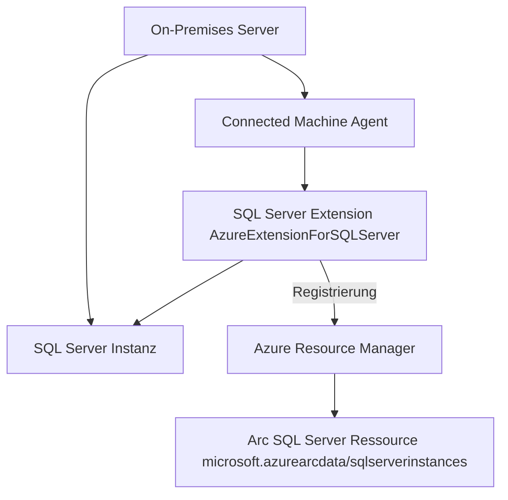
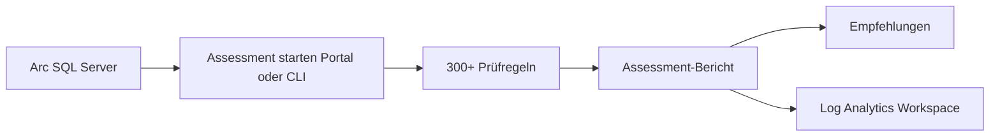
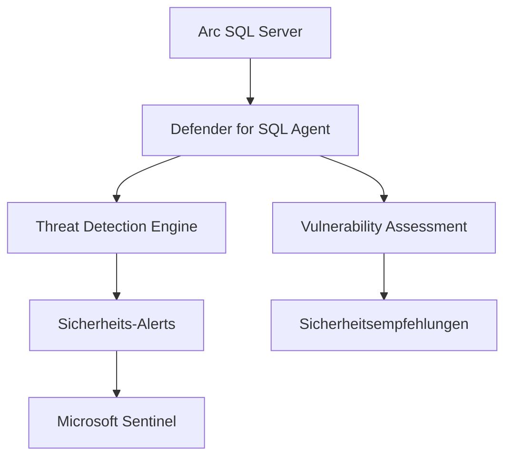
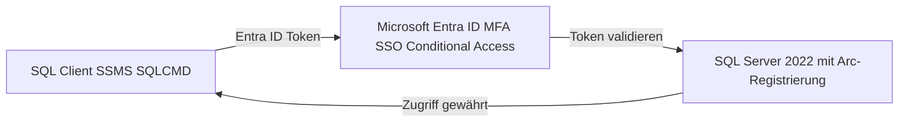
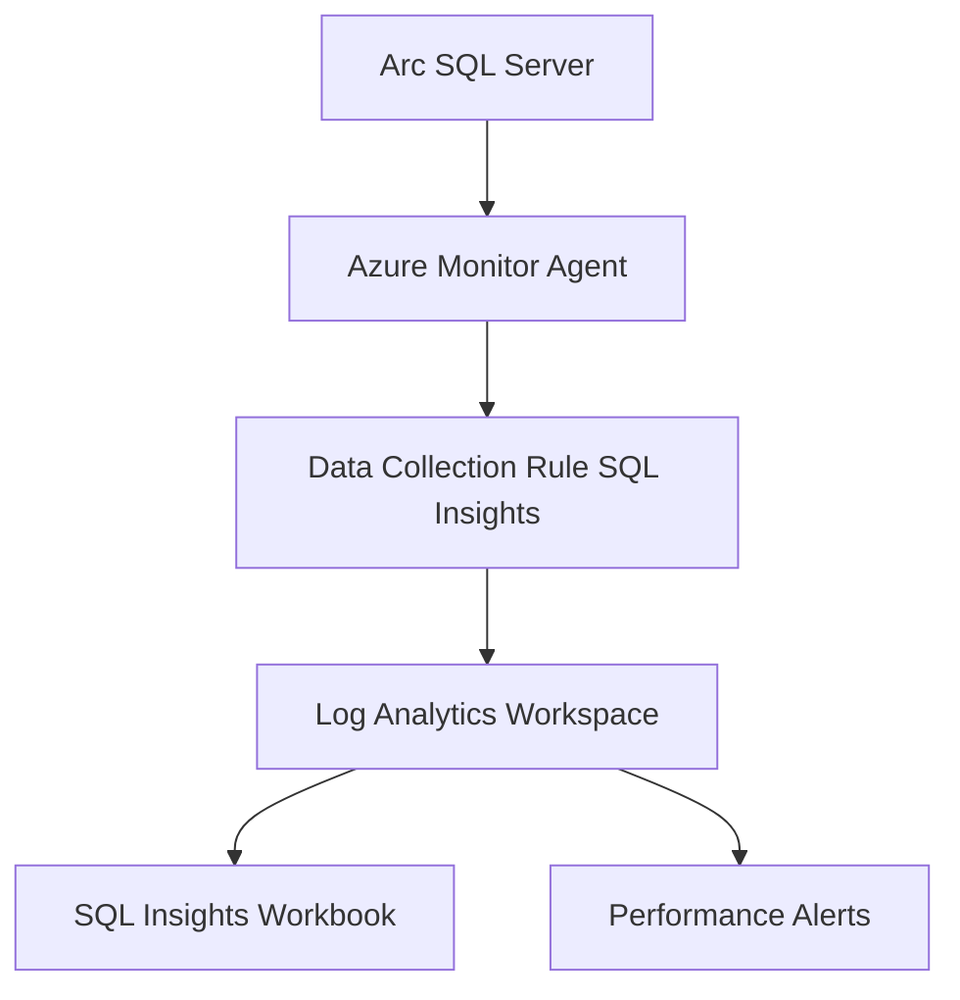
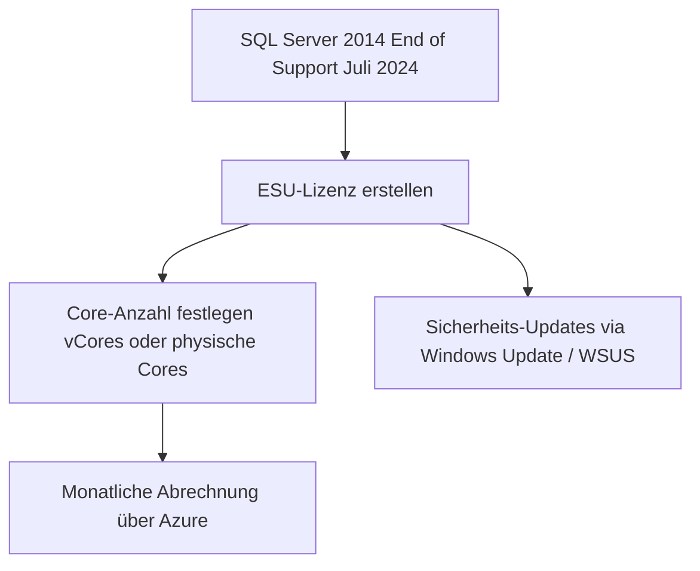

---
tags:
  - azure
  - arc
  - sql-server
  - hybrid-cloud
  - datenbank
aliases:
  - Arc-enabled SQL Server
  - SQL Server Arc
  - Connected SQL Server
---

# Arc-fähige SQL Server

> [!ABSTRACT] TL;DR
> Arc-fähige SQL Server (Arc-enabled SQL Server) verbinden On-Premises- und Cloud-SQL-Server-Instanzen mit Azure. Kernfeatures sind **Extended Security Updates (ESU)** für SQL Server 2012/2014, **Best Practices Assessment**, **Microsoft Defender for SQL**, **Entra ID-Authentifizierung** (SQL 2022+) und zentrales **Inventory via Azure Resource Graph**.

---

## Was ist Arc-enabled SQL Server?

**Arc-enabled SQL Server** ist eine Erweiterung des Azure Connected Machine Agent, die SQL Server-Instanzen auf Arc-verwalteten Servern automatisch erkennt und als separate Ressourcen (`microsoft.azurearcdata/sqlserverinstances`) im Azure Resource Manager registriert.

Dies ermöglicht:
- Zentrales SQL-Server-Inventory über alle Umgebungen hinweg
- Sicherheits- und Compliance-Features ohne Migration in die Cloud
- Extended Security Updates für veraltete SQL-Versionen
- Best Practices Assessment direkt aus dem Azure Portal



---

## Unterstützte SQL Server-Versionen

| SQL Server Version | End of Support | ESU via Arc | Entra ID Auth |
|---|---|---|---|
| **SQL Server 2012** | Juli 2022 | ✅ (bis Juli 2025) | ❌ |
| **SQL Server 2014** | Juli 2024 | ✅ (bis Juli 2027) | ❌ |
| **SQL Server 2016** | Juli 2026 | ❌ (noch im Support) | ❌ |
| **SQL Server 2017** | Oktober 2027 | ❌ | ❌ |
| **SQL Server 2019** | Januar 2030 | ❌ | ❌ |
| **SQL Server 2022** | Januar 2033 | ❌ | ✅ |

> [!IMPORTANT] SQL Server 2014 ESU
> Ab **Juli 2024** sind Extended Security Updates für SQL Server 2014 über Azure Arc verfügbar. Die Abdeckung gilt bis Juli 2027 (3 Jahre). Wie bei SQL Server 2012 ist kein Produktschlüssel erforderlich — die Aktivierung erfolgt über die Arc-Registrierung.

---

---

## Via Azure Portal (UI)

> [!TIP] Schnellzugriff
> [portal.azure.com](https://portal.azure.com) → **Azure Arc** → **SQL Server** → **+ Hinzufügen**

### Schritt-für-Schritt

1. **portal.azure.com → Azure Arc → SQL Server** – Zur SQL Server-Übersicht navigieren
2. **+ Hinzufügen** – "SQL Server mit Azure Arc verbinden" auswählen
3. **Verbindungsmethode wählen** – "Connected Machine Agent schon installiert" oder "Agent installieren"
4. **Konfiguration** – Subscription, Resource Group und SQL Server-Instanz auswählen
5. **Best Practices Assessment** – Im Portal unter "Bewertungen" aktivierbar
6. **ESU-Aktivierung** – Unter "Lizenzen" für Extended Security Updates

---

## Onboarding-Prozess

### Voraussetzungen

```powershell
# Resource Provider registrieren
az provider register --namespace Microsoft.AzureArcData
az provider register --namespace Microsoft.HybridCompute

# Benötigte Berechtigung: Azure Connected Machine Onboarding
# Scope: Subscription oder Resource Group
```

### Automatisches Onboarding (empfohlen)

Wenn der **Connected Machine Agent** auf einem Server installiert wird, auf dem SQL Server läuft, erkennt die **AzureExtensionForSQLServer**-Extension automatisch alle SQL-Instanzen und registriert sie:

```bash
# Arc-Server-Onboarding — SQL wird automatisch erkannt
az connectedmachine connect \
  --resource-group "myRG" \
  --location "westeurope" \
  --subscription-id "<subId>"

# SQL Server Extension-Status prüfen
az connectedmachine extension list \
  --resource-group "myRG" \
  --machine-name "mySQLServer"
```

### Manuelles SQL-Extension-Onboarding

```powershell
# SQL Server Extension manuell installieren (Windows)
az connectedmachine extension create \
  --resource-group "myRG" \
  --machine-name "mySQLServer" \
  --name "AzureExtensionForSQLServer" \
  --type "AzureExtensionForSQLServer" \
  --publisher "Microsoft.AzureData" \
  --location "westeurope"
```

---

## Best Practices Assessment

Das **SQL Server Best Practices Assessment** analysiert SQL-Server-Konfigurationen anhand von Microsoft-Empfehlungen aus dem Support-Erfahrungswissen.



**Geprüfte Bereiche:**
- Sicherheitskonfiguration (Encryption, Auth-Modus)
- Backup-Strategien und -Konfiguration
- High Availability und Disaster Recovery
- Performance (TempDB, Index-Maintenance, Query Store)
- Konfigurationseinstellungen (max. Speicher, Parallelismus)
- Deprecated Features und Kompatibilitätsstufen

```bash
# Assessment konfigurieren und starten
az sql server-arc assessment create \
  --name "myAssessment" \
  --resource-group "myRG" \
  --server-name "mySQLServer" \
  --workspace-id "<logAnalyticsWorkspaceId>"

# Assessment-Ergebnisse abrufen
az sql server-arc assessment show \
  --name "myAssessment" \
  --resource-group "myRG" \
  --server-name "mySQLServer"
```

> [!TIP] Regelmäßige Assessments
> Microsoft empfiehlt, Assessments **wöchentlich** oder nach größeren Änderungen auszuführen. Die Ergebnisse werden in einem **Log Analytics Workspace** gespeichert und können in Azure Monitor-Dashboards visualisiert werden.

---

## Microsoft Defender for SQL via Arc

**Microsoft Defender for SQL** bietet erweiterten Bedrohungsschutz für Arc-SQL-Server:



### Erkannte Bedrohungstypen

| Bedrohung | Beschreibung |
|---|---|
| SQL Injection | Erkennung von SQL-Injection-Angriffsmustern |
| Brute Force | Wiederholte fehlgeschlagene Anmeldeversuche |
| Anomale Abfragen | Ungewöhnliche Datenzugriffsmuster |
| Privilege Escalation | Versuche, Datenbankberechtigungen zu erhöhen |
| Data Exfiltration | Ungewöhnlich große Datenexporte |
| Suspicious Principals | Anmeldungen von unerwarteten Quellen |

```bash
# Defender for SQL auf Arc-Server aktivieren
az security sql-vulnerability-assessment create \
  --vm-resource-id "/subscriptions/<subId>/resourceGroups/myRG/providers/Microsoft.HybridCompute/machines/mySQLServer" \
  --workspace-id "<workspaceId>"
```

---

## Entra ID Authentifizierung (SQL Server 2022+)

**Microsoft Entra ID** (ehemals Azure Active Directory) kann als Authentifizierungsprovider für SQL Server 2022 via Arc genutzt werden:



**Vorteile gegenüber SQL-Authentifizierung:**
- Multi-Factor Authentication (MFA)
- Single Sign-On (SSO) mit Windows-Credentials
- Conditional Access Policies
- Passwortloses Anmelden (FIDO2, Windows Hello)
- Zentrale Identitätsverwaltung in Entra ID

```sql
-- Entra ID Login auf SQL Server 2022 erstellen
CREATE LOGIN [user@contoso.onmicrosoft.com]
FROM EXTERNAL PROVIDER;

-- Entra ID Gruppe als Login
CREATE LOGIN [SQL-Admins-Group]
FROM EXTERNAL PROVIDER;

-- Entra ID User als DB-User anlegen
USE [myDatabase];
CREATE USER [user@contoso.onmicrosoft.com]
FOR LOGIN [user@contoso.onmicrosoft.com];
```

> [!WARNING] Nur SQL Server 2022
> Entra ID-Authentifizierung über Arc ist ausschließlich für **SQL Server 2022** verfügbar. Ältere Versionen (2012–2019) müssen weiterhin Windows- oder SQL-Authentifizierung verwenden.

---

## Überwachung via Azure Monitor

Arc-SQL-Server können über den **Azure Monitor Agent (AMA)** und spezifische Data Collection Rules überwacht werden:



**Gesammelte Metriken (SQL Insights):**
- Wait Statistics (Wartezeiten nach Typ)
- Database I/O (Lese-/Schreiboperationen)
- SQL Performance Counters
- Active Connections und Sessions
- Error Log Events
- Backup Status und History

```bash
# SQL Insights DCR erstellen
az monitor data-collection-rule create \
  --resource-group "myRG" \
  --name "sql-insights-dcr" \
  --location "westeurope" \
  --rule-file "sql-insights-dcr.json"
```

---

## Extended Security Updates (ESU) via Arc

### Lizenzierungsmodell



**ESU-Preisstruktur (SQL Server 2014):**

| Jahr | Preis | Zeitraum |
|---|---|---|
| Jahr 1 | 75% des SA-Listenpreises | Juli 2024 – Juli 2025 |
| Jahr 2 | 100% | Juli 2025 – Juli 2026 |
| Jahr 3 | 125% | Juli 2026 – Juli 2027 |

```powershell
# ESU-Lizenz für SQL Server 2014 erstellen
az sql server-arc esu-license create \
  --resource-group "myRG" \
  --name "SQL2014-ESU-License" \
  --location "westeurope" \
  --version "SQL Server 2014" \
  --edition "Enterprise" \
  --core-type "vCore" \
  --cores 16 \
  --activation-state "Activated"
```

> [!NOTE] Kein Produktschlüssel nötig
> ESU via Arc erfordert keine manuellen Produktschlüssel. Die Aktivierung erfolgt automatisch durch die Arc-Registrierung. Updates werden über die normalen Windows Update-Kanäle geliefert.

---

## SQL Server Lizenzverwaltung via Arc

Arc ermöglicht die **Pay-as-you-go**-Lizenzierung oder die Nutzung von **BYOL (Bring Your Own License)**:

| Lizenzmodell | Beschreibung | Geeignet für |
|---|---|---|
| **Pay-as-you-go** | Stündliche Abrechnung über Azure | Temporäre Workloads, Compliance-Check |
| **BYOL (SA)** | Eigene SQL-Lizenzen mit Software Assurance | Produktiv-Server mit bestehenden Lizenzen |
| **ESU Subscription** | Monatliche ESU-Gebühren | End-of-Support SQL Versionen |
| **Developer/Express** | Kostenlos, eingeschränkte Features | Dev/Test-Umgebungen |

```bash
# Lizenztyp eines Arc-SQL-Servers ändern
az sql server-arc update \
  --name "mySQLInstance" \
  --resource-group "myRG" \
  --license-type "PAYG"
  # Optionen: PAYG, Paid, LicenseOnly, DisasterRecovery
```

---

## Inventory und Compliance via Azure Resource Graph

```bash
# Alle Arc-SQL-Server auflisten
az graph query -q "Resources
| where type == 'microsoft.azurearcdata/sqlserverinstances'
| project name, location, properties.version, properties.edition, properties.status
| order by properties.version asc"

# SQL-Server ohne ESU-Abdeckung finden (End of Support)
az graph query -q "Resources
| where type == 'microsoft.azurearcdata/sqlserverinstances'
| where properties.version in ('SQL Server 2012', 'SQL Server 2014')
| where properties.esuEnabled == false
| project name, resourceGroup, properties.version"

# SQL-Server ohne Defender for SQL
az graph query -q "Resources
| where type == 'microsoft.azurearcdata/sqlserverinstances'
| where properties.defenderStatus != 'Protected'
| project name, resourceGroup, properties.defenderStatus"
```

---

## Automatische Backups via Azure Backup

Für Arc-SQL-Server kann **Azure Backup** genutzt werden, um Datenbanken direkt zu sichern:


- **Vollständige Datenbank-Backups** täglich
- **Differenzielle Backups** alle 12 Stunden
- **Log-Backups** alle 15–120 Minuten
- **Aufbewahrung** bis 35 Tage (Standard) oder Jahre (Long-Term Retention)

---

## Verwandte Notizen
- [[Azure Arc Grundlagen]]
- [[Arc-fähige Server]]
- [[Arc-enabled Data Services]]
- [[Azure Monitor]]
- [[Azure Backup]]
