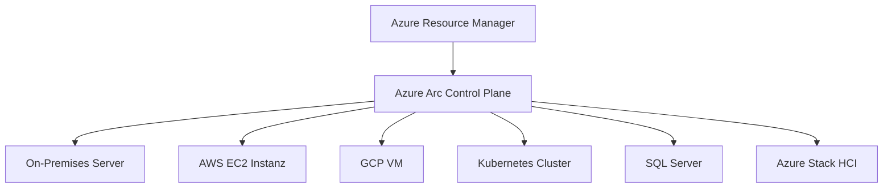
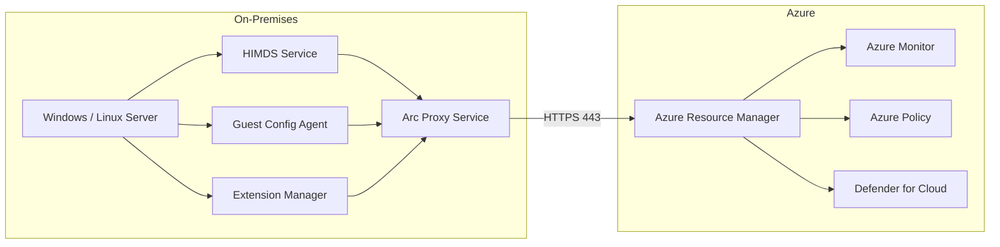
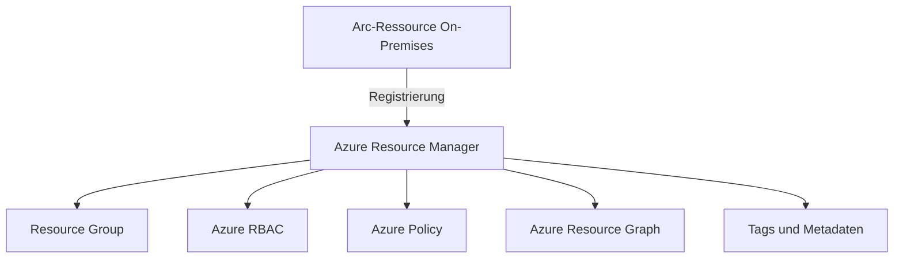
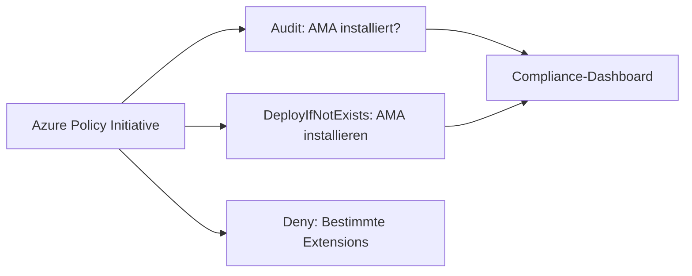
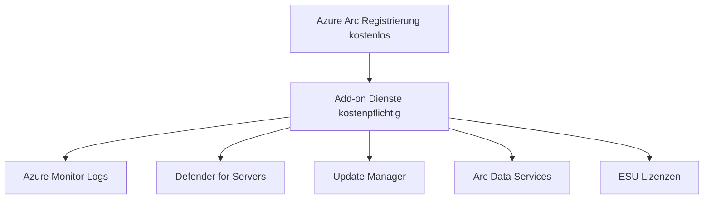
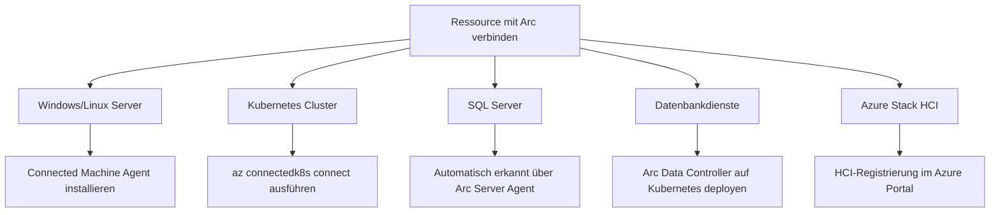
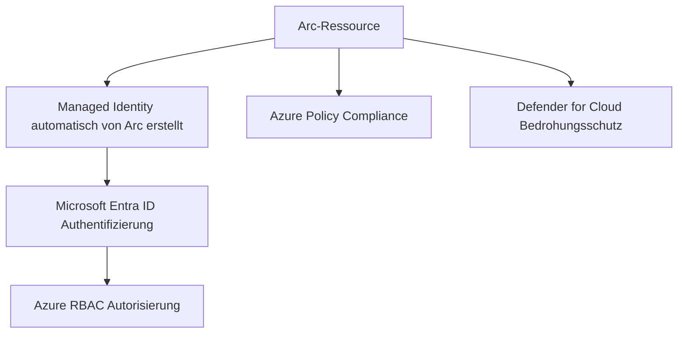

---
tags:
  - azure
  - arc
  - hybrid-cloud
  - grundlagen
aliases:
  - Azure Arc Overview
  - Arc Übersicht
---

# Azure Arc Grundlagen

> [!ABSTRACT] TL;DR
> Azure Arc ist Microsofts hybride Management-Plattform, die Azure-Dienste, -Governance und -Sicherheit auf beliebige Infrastrukturen außerhalb von Azure ausweitet — On-Premises, andere Clouds, Edge. Ressourcen werden über den Azure Resource Manager (ARM) zentral verwaltet, als wären sie native Azure-Ressourcen.

---

## Was ist Azure Arc?

**Azure Arc** ist eine Brücken-Technologie, die den Azure Control Plane auf externe Infrastrukturen ausdehnt. Statt Workloads in Azure zu migrieren, bringt Azure Arc Azure-Management zu den Workloads — egal ob sie in einem eigenen Rechenzentrum, bei AWS/GCP oder am Edge laufen.

Das Kernprinzip: Jede Arc-verwaltete Ressource erhält eine **Azure Resource ID** und erscheint im Azure Portal, als wäre sie eine native Azure-Ressource. Dadurch werden Azure-Tools wie Policy, RBAC, Monitor und Defender nutzbar — überall.

> [!NOTE] Azure Arc ist kostenlos
> Der Arc-Dienst selbst (Registrierung, Inventory, ARM-Projektion) ist kostenlos. Kosten entstehen erst durch Add-ons wie Azure Monitor, Defender for Cloud, Update Manager oder Arc-enabled Data Services.

---

## Azure Arc als Management-Ebene

Azure Arc funktioniert als einheitliche **Management-Ebene (Control Plane)** für hybride und Multi-Cloud-Umgebungen:



Alle Arc-Ressourcen werden über denselben ARM-Endpunkt verwaltet. Administratoren sehen im Azure Portal eine einheitliche Ansicht aller Ressourcen — unabhängig vom Standort.

---

## Unterstützte Ressourcentypen

| Ressourcentyp | Beschreibung | Hauptnutzen |
|---|---|---|
| **Arc-fähige Server** | Windows/Linux-Server überall | Extensions, ESU, Monitoring |
| **Arc-fähige Kubernetes** | Beliebige K8s-Distributionen | GitOps, Policy, Defender |
| **Arc-fähige SQL Server** | SQL Server 2012–2022 | ESU, Assessment, Defender |
| **Arc-enabled Data Services** | SQL MI, PostgreSQL auf K8s | Azure-PaaS on-premises |
| **VMware vSphere VMs** | VMs auf vSphere/vCenter | Lifecycle-Management via Azure |
| **SCVMM VMs** | Hyper-V VMs via SCVMM | Hybride VM-Verwaltung |
| **Azure Stack HCI** | Hyperkonvergente Infrastruktur | Arc-native HCI-Verwaltung |
| **Azure VMware Solution** | VMware in Azure | Einheitliches Management |

---

## Arc-Architektur: Connected Machine Agent

Das Herzstück von Azure Arc für Server ist der **Azure Connected Machine Agent** (kurz: Arc-Agent). Er wird auf jedem verwalteten System installiert und stellt die Verbindung zu Azure her.



### Agent-Komponenten

| Komponente | Funktion |
|---|---|
| **HIMDS** | Hybrid Instance Metadata Service — Identität und Verbindung zu Azure |
| **Guest Config Agent** | Policy-Compliance prüfen und erzwingen (OPA/DSC) |
| **Extension Manager** | VM Extensions installieren, aktualisieren, entfernen |
| **Arc Proxy Service** | Bündelt den ausgehenden Agent-Traffic (ab Agent v1.51) |

> [!TIP] Arc Proxy Service
> Ab Agent-Version 1.51+ startet der Proxy Service automatisch und optimiert den Netzwerkverkehr. Er ermöglicht die Nutzung eines **Azure Arc Gateway** zur Minimierung der erforderlichen Firewall-Ausnahmen.

---

## Azure Arc Control Plane

Der **Azure Arc Control Plane** ist keine separate Infrastruktur, sondern eine Erweiterung des regulären Azure Resource Manager. Registrierte Arc-Ressourcen erhalten:

- Eine eindeutige **Azure Resource ID** (`/subscriptions/.../resourceGroups/.../providers/Microsoft.HybridCompute/machines/<name>`)
- **Tags** für Kategorisierung und Kostenzuordnung
- **Azure Policy**-Zuweisungen
- **RBAC**-Berechtigungen
- Zugriff auf **Azure Resource Graph** für Inventarisierung



---

## Azure Arc vs. Azure Stack

Ein häufiges Missverständnis: **Azure Arc ≠ Azure Stack**. Beide sind hybride Lösungen, aber mit unterschiedlichem Ansatz:

| Merkmal | Azure Arc | Azure Stack |
|---|---|---|
| **Prinzip** | Management kommt zu Ressourcen | Azure-Dienste on-premises deployen |
| **Hardware** | Beliebige Hardware (keine Anforderungen) | Zertifizierte Hardware erforderlich |
| **Deployment** | Software-only (Agent/Operator) | Vollständige Azure-Stack-Infrastruktur |
| **Zielgruppe** | Bestandsinfrastruktur verwalten | Neue Azure-Dienste on-premises |
| **Beispiele** | Vorhandene Server, K8s-Cluster | Azure Stack HCI, Stack Hub, Stack Edge |
| **Kosten** | Arc selbst kostenlos | Subscription + Hardware |

> [!IMPORTANT] Kombinierbar
> Azure Stack HCI und Azure Stack Edge sind selbst **Arc-fähige Ressourcentypen**. Sie nutzen Arc als Verwaltungsschicht. Beide Ansätze schließen sich also nicht aus — sie ergänzen sich.

---

## Governance via Azure Policy

Azure Policy lässt sich auf Arc-Ressourcen genauso anwenden wie auf native Azure-Ressourcen. Dies ermöglicht eine **einheitliche Compliance-Strategie** für alle Umgebungen.

**Typische Policy-Szenarien für Arc-Server:**



- **Guest Configuration**: Überprüft Betriebssystem-Einstellungen (z.B. Passwort-Richtlinien, Auditing)
- **DeployIfNotExists**: Automatische Installation von Agents (Azure Monitor Agent, Defender)
- **Audit-Richtlinien**: Compliance-Bewertung ohne Eingriff

---

## RBAC für Arc-Ressourcen

Azure RBAC funktioniert vollständig auf Arc-Ressourcen. Einige Arc-spezifische Built-in-Rollen:

| Rolle | Beschreibung |
|---|---|
| **Azure Connected Machine Onboarding** | Berechtigung zum Registrieren neuer Arc-Server (minimale Rechte) |
| **Azure Connected Machine Resource Administrator** | Vollzugriff auf Arc-Server-Ressourcen |
| **Kubernetes Cluster - Azure Arc Onboarding** | Berechtigung für K8s-Cluster-Registrierung |
| **Arc-enabled Kubernetes Cluster User Role** | Zugriff auf Cluster-Credentials über Azure |

> [!NOTE] Least Privilege für Onboarding
> Die **Connected Machine Onboarding**-Rolle ist bewusst minimal gehalten. Sie erlaubt ausschließlich die Registrierung neuer Maschinen, aber keine Verwaltung bestehender Arc-Ressourcen.

---

## Azure Resource Graph für Arc

**Azure Resource Graph** ermöglicht schnelle, skalierbare Abfragen über alle Arc-Ressourcen. Nützliche Beispielabfragen:

```bash
# Alle Arc-fähigen Server auflisten
az graph query -q "Resources | where type == 'microsoft.hybridcompute/machines' | project name, location, properties.status, properties.osType"

# Arc-Server ohne AMA-Extension finden
az graph query -q "Resources | where type == 'microsoft.hybridcompute/machines' | where properties.extensions !contains 'AzureMonitorWindowsAgent'"

# Arc-Server nach OS-Typ gruppieren
az graph query -q "Resources | where type == 'microsoft.hybridcompute/machines' | summarize count() by tostring(properties.osType)"
```

---

## Lizenzierung und Kosten



| Dienst | Kosten (ca.) | Abrechnung |
|---|---|---|
| Arc Registrierung | Kostenlos | — |
| Azure Monitor Agent (AMA) | ~2,76 $/Server/Monat (Log Analytics) | Pro überwachter Ressource |
| Defender for Servers Plan 2 | ~15 $/Server/Monat | Pro Arc-Server |
| Azure Update Manager | ~5 $/Server/Monat | Pro verwalteter Maschine |
| ESU Windows Server 2012 | Je nach Core-Anzahl | Jährlich gestaffelt |
| Arc Data Services SQL MI | Je nach vCore-Tier | Stündlich |

---

## Arc als Brücke zu Azure-Diensten On-Premises

Azure Arc ermöglicht es, folgende Azure-Dienste direkt auf externer Infrastruktur zu nutzen:

- **Azure Monitor**: Logs und Metriken von Arc-Servern zu Log Analytics Workspace senden
- **Microsoft Defender for Cloud**: Sicherheitsbewertungen und Bedrohungsschutz für Arc-Ressourcen
- **Azure Update Manager**: Patch-Management für Arc-Server und HCI
- **Azure Backup**: Backup von Arc-Servern über den MARS-Agent oder Azure Backup Server
- **Azure Automation**: DSC/Update-Konfiguration für Arc-Server
- **Azure Key Vault**: Zertifikate auf Arc-Servern verwalten
- **Azure AD / Entra ID**: Authentifizierung für Arc-SQL-Server (SQL 2022+)

---

## Roadmap und aktuelle Features 2024/2025

### Allgemein verfügbar (GA) in 2024/2025
- Arc Proxy Service mit HTTP-Unterstützung (Agent v1.51+)
- SSH-Zugang zu Arc-Servern ohne öffentliche IP
- Azure Stack HCI 23H2 mit vollständiger Arc-Integration
- AKS enabled by Azure Arc auf HCI 23H2 (GA)
- Azure Virtual Desktop auf Azure Stack HCI (GA)
- ESU für SQL Server 2014 (ab Juli 2024)

### In Preview
- Automatische Agent-Upgrades für Arc-Server
- Arc Gateways zur Vereinfachung von Firewall-Regeln
- Erweiterte Disconnected-Mode-Unterstützung für Kubernetes

> [!TIP] Azure Arc Jumpstart
> Das Community-Projekt **Azure Arc Jumpstart** (jumpstart.azure.com) bietet umfangreiche Labs, Szenarien und Automatisierungsskripte zum Ausprobieren aller Arc-Features in einer Testumgebung.

---

## Onboarding-Übersicht nach Ressourcentyp



---

---

## Via Azure Portal (UI)

> [!TIP] Schnellzugriff
> [portal.azure.com](https://portal.azure.com) → **Azure Arc** → **Übersicht**

### Schritt-für-Schritt

1. **portal.azure.com aufrufen** – Im Browser öffnen und anmelden
2. **Suche "Azure Arc"** – In der Suchleiste oben eingeben und den Dienst öffnen
3. **Übersicht erkunden** – Zeigt Arc-fähige Ressourcen: Server, Kubernetes, SQL, Datendienste
4. **Ressource-Typ auswählen** – Gewünschten Typ in der linken Sidebar wählen
5. **+ Hinzufügen klicken** – Onboarding-Prozess starten

---

## Schnellstart-Befehle

### Arc-Server-Onboarding (Service Principal)

```powershell
# Resource Provider registrieren (einmalig pro Subscription)
az provider register --namespace Microsoft.HybridCompute
az provider register --namespace Microsoft.GuestConfiguration
az provider register --namespace Microsoft.HybridConnectivity

# Service Principal für Onboarding erstellen
az ad sp create-for-rbac `
  --name "arc-onboarding-sp" `
  --role "Azure Connected Machine Onboarding" `
  --scopes "/subscriptions/<subId>/resourceGroups/<rg>"
```

### Arc-Kubernetes-Onboarding

```bash
# CLI-Extensions installieren
az extension add --name connectedk8s
az extension add --name k8s-extension

# Cluster verbinden
az connectedk8s connect \
  --name "myCluster" \
  --resource-group "myRG" \
  --location "westeurope"
```

### Arc-Ressourcen im Resource Graph abfragen

```bash
# Alle Arc-Ressourcen in einer Subscription auflisten
az graph query -q "Resources
| where type startswith 'microsoft.hybridcompute'
    or type startswith 'microsoft.kubernetes/connected'
    or type startswith 'microsoft.azurearcdata'
| project name, type, location, resourceGroup
| order by type asc"
```

---

## Sicherheitsmodell

Arc-Ressourcen erben das Azure-Sicherheitsmodell vollständig:



**Managed Identity für Arc-Ressourcen:**
Jeder Arc-Server erhält automatisch eine **System-assigned Managed Identity**. Diese Identität kann genutzt werden, um sich gegenüber anderen Azure-Diensten zu authentifizieren — z.B. Azure Key Vault oder Azure Storage — ohne Credentials auf dem Server zu speichern.

```powershell
# Managed Identity Token auf Arc-Server abrufen (Windows)
$response = Invoke-WebRequest `
  -Uri "http://localhost:40342/metadata/identity/oauth2/token?api-version=2020-06-01&resource=https://management.azure.com/" `
  -Headers @{Metadata="true"}
$token = ($response.Content | ConvertFrom-Json).access_token
```

---

## Verwandte Notizen
- [[Arc-fähige Server]]
- [[Arc-fähige Kubernetes]]
- [[Arc-fähige SQL Server]]
- [[Arc-enabled Data Services]]
- [[Azure Stack HCI]]
- [[Azure Stack Edge]]
- [[Azure Policy]]
- [[Azure RBAC]]
