---
tags:
  - azure
  - arc
  - edge-computing
  - iot
  - appliance
aliases:
  - Stack Edge
  - Azure Stack Edge Pro
  - ASE
---

# Azure Stack Edge

> [!ABSTRACT] TL;DR
> Azure Stack Edge ist Microsofts Hardware-as-a-Service-Familie für Edge-Computing. Die Appliances bringen Azure-Computing (VMs, Container, Kubernetes, KI/ML mit GPU) direkt an Standorte mit eingeschränkter oder keiner Azure-Verbindung — für IoT-Datenverarbeitung, Machine Learning am Edge und hybride Szenarien.

---

## Was ist Azure Stack Edge?

**Azure Stack Edge** ist eine Linie von Cloud-managed Hardware-Appliances, die Azure-Compute, -Storage und -KI-Dienste am Edge bereitstellen. Im Gegensatz zu Azure Stack HCI (Standard-Server-Hardware) sind Azure Stack Edge-Geräte **von Microsoft designte und gelieferte Appliances**.

Das Grundprinzip: Daten lokal verarbeiten, bevor sie — gefiltert und reduziert — in die Azure Cloud hochgeladen werden.

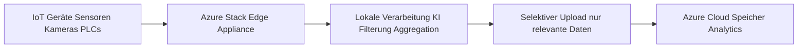

---

## Edge-Computing-Szenarien

**Warum Edge-Computing?**

| Szenario | Problem | Azure Stack Edge Lösung |
|---|---|---|
| **Niedrige Latenz** | Cloud-Roundtrip zu langsam für Echtzeit | Lokale Inferenz in <10ms |
| **Hohe Datenmenge** | Alle Rohdaten in Azure zu teuer | Lokale Vorverarbeitung, nur Ergebnisse in Cloud |
| **Schlechte Konnektivität** | Offshore, Fabrik ohne stabiles Internet | Offline-fähiger Betrieb |
| **Compliance** | Daten dürfen Standort nicht verlassen | Lokale Verarbeitung, nur Aggregate in Cloud |
| **Echtzeit-KI** | Bildverarbeitung, Anomalieerkennung | NVIDIA GPU für lokale Inferenz |

---

## Produktfamilie

### Überblick aller SKUs

| Modell | Formfaktor | GPU | Use Case |
|---|---|---|---|
| **Pro 2** | 1U Rack | 1–2x NVIDIA A2 (optional) | Rechenzentrum, Edge-Standorte |
| **Pro R** | Robuste 1U Box | 1x NVIDIA T4 | Raue Umgebungen, Outdoor |
| **Mini R** | Ultra-Portabel | Intel VPU | Taktische Edge, Feldarbeit |

### Azure Stack Edge Pro 2

Der **Pro 2** ist die aktuelle Hauptversion für Unternehmenseinsatz:

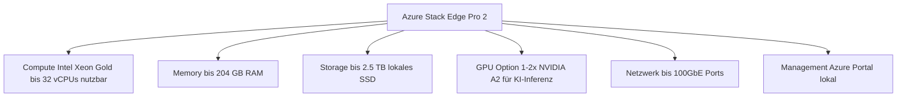

**Technische Spezifikationen Pro 2:**

| Komponente | Spezifikation |
|---|---|
| CPU | Intel Xeon Gold, bis 32 nutzbare vCPUs |
| RAM | Bis 204 GB |
| Storage | Bis 2,5 TB SSD lokal |
| GPU | Optional: 1–2x NVIDIA A2 (16 GB VRAM je) |
| Netzwerk | 2x 1GbE (Management), 4x 25GbE oder 2x 100GbE (Data) |
| Formfaktor | 1U Rack |

### Azure Stack Edge Pro R

Der **Pro R** ist für **raue Umgebungen** ausgelegt:

| Merkmal | Beschreibung |
|---|---|
| **Zertifizierungen** | MIL-STD-810H, IP-54-Schutz |
| **Temperaturen** | -20°C bis +65°C Betrieb |
| **Erschütterungen** | Stoß- und vibrationsfest |
| **Stromversorgung** | Redundante USV integriert |
| **GPU** | NVIDIA T4 (16 GB VRAM) |
| **Use Cases** | Militär, Offshore, Fahrzeugmontage, Baustellen |

### Azure Stack Edge Mini R

Der **Mini R** ist das ultra-portable Modell für Feldeinsätze:

| Merkmal | Beschreibung |
|---|---|
| **Gewicht** | ca. 3 kg |
| **Formfaktor** | Tragbares Gerät mit Handgriff |
| **Compute** | Intel VPU für KI-Inferenz |
| **Konnektivität** | WiFi + LTE (SIM-Karte) |
| **Akku** | Integrierter Akku |
| **Use Cases** | Militär, Katastrophenschutz, Feldforschung |

> [!NOTE] Subscription-Modell
> Azure Stack Edge wird als **Hardware-as-a-Service** angeboten: Monatliche Azure-Subscription inkl. Hardware-Support und Ersatz. Keine einmaligen Kaufkosten, stattdessen laufende opex-basierte Kosten.

---

## Azure Stack Edge als Arc-fähiges Gerät

Azure Stack Edge-Geräte sind **Arc-fähige Ressourcen** und werden über Azure Arc verwaltet:

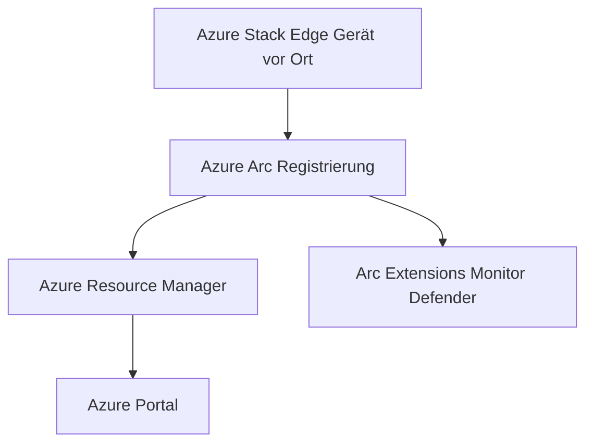

**Was Arc auf ASE ermöglicht:**
- Zentrale Inventarisierung aller Edge-Geräte
- Azure Policy für Compliance-Überprüfung
- Remote-Diagnose und Troubleshooting
- Extension-Deployment (Azure Monitor Agent, Defender)
- Softwareupdate-Management via Azure Update Manager

---

## IoT Edge auf Azure Stack Edge

**Azure IoT Edge** kann auf Azure Stack Edge als Workload deployt werden:

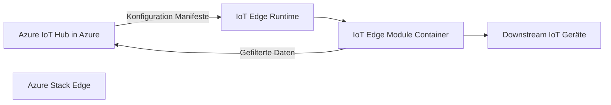

**Typische IoT Edge-Module auf ASE:**
- Stream Analytics Edge (lokale Datenverarbeitung)
- Custom Vision (Bildanalyse am Edge)
- Anomalie-Detection-Module
- OPC UA Bridge (Industrie-4.0-Protokoll)
- Zeit-Reihen-Datenbank (InfluxDB, TimescaleDB)

---

## Azure Kubernetes Service auf Edge

Azure Stack Edge kann einen **Kubernetes-Cluster** hosten, der über Azure Arc verwaltet wird:

```bash
# Kubernetes auf ASE ist automatisch aktiviert
# Zugriff via kubectl über lokales Profil
kubectl get nodes

# Arc-Verbindung für ASE-Kubernetes
az connectedk8s connect \
  --name "myASE-K8s" \
  --resource-group "myRG" \
  --location "westeurope" \
  --kube-config "/path/to/ase-kubeconfig"
```

**Kubernetes-Workloads auf ASE:**
- Container-Applikationen (Microservices)
- Machine Learning Inferenz-Services (TensorFlow Serving, ONNX)
- IoT Edge-Module als Kubernetes-Pods
- Lokale Datenbank-Container

---

## Compute: VMs, Container, Kubernetes

Azure Stack Edge unterstützt drei Compute-Paradigmen:

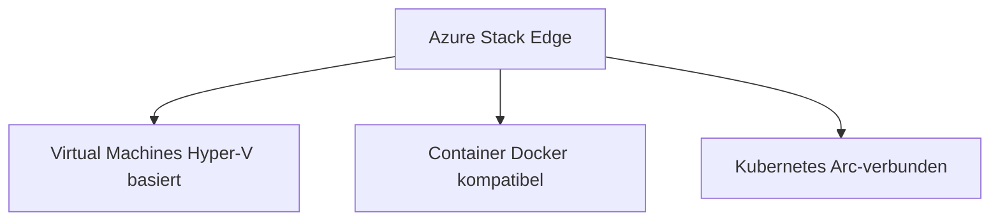

### Virtual Machines auf ASE

VMs auf Azure Stack Edge werden über den **Lokalen Azure Resource Manager** (lokaler ARM-Endpunkt) oder das Azure Portal verwaltet:

```powershell
# VM über lokalen ARM-Endpunkt erstellen (PowerShell)
$password = ConvertTo-SecureString "<password>" -AsPlainText -Force
$cred = New-Object System.Management.Automation.PSCredential("admin", $password)

New-AzVM `
  -ResourceGroupName "localRG" `
  -Name "myEdgeVM" `
  -Location "dbelocal" `
  -Image "Win2019Datacenter" `
  -Credential $cred `
  -Size "Standard_D2s_v3"
```

---

## Lokaler Azure Resource Manager

Ein einzigartiges Feature von Azure Stack Edge ist der **lokale ARM-Endpunkt** — ein vollständiger Azure Resource Manager, der lokal auf der Appliance läuft:

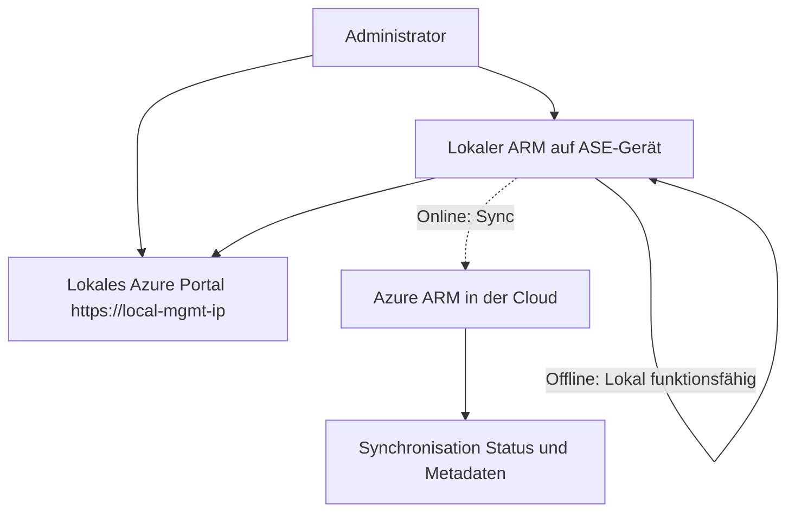

**Lokaler ARM ermöglicht:**
- VM- und Container-Deployment **offline** (ohne Azure-Verbindung)
- Lokales Portal für Geräteverwaltung
- ARM-Templates für konsistentes lokales Deployment
- Identische Erfahrung wie in der Azure Cloud

---

## Netzwerk-Konfiguration

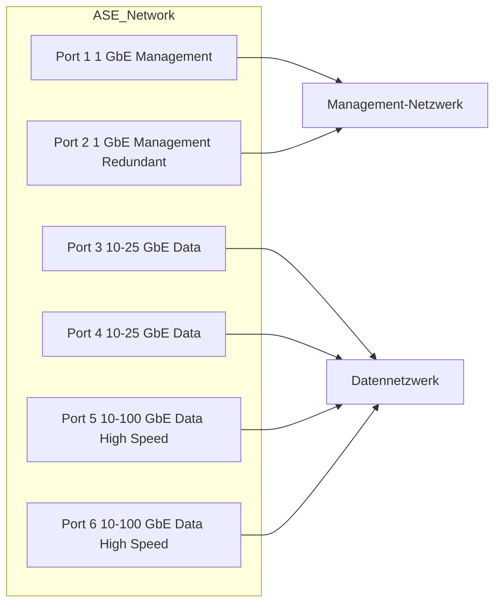

### VPN-Konfiguration

```powershell
# VPN auf Azure Stack Edge konfigurieren (PowerShell via lokaler ARM)
New-AzVirtualNetworkGateway `
  -Name "myASE-VPN" `
  -ResourceGroupName "localRG" `
  -Location "dbelocal" `
  -GatewayType "Vpn" `
  -VpnType "RouteBased"
```

---

## Storage: Lokale Freigaben und Blob-Endpunkt

Azure Stack Edge bietet lokalen Speicher, der mit Azure Blob Storage synchronisiert werden kann:

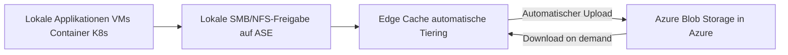

**Storage-Typen:**
- **Edge Shares**: SMB/NFS-Freigaben, die mit Azure Blob synchronisieren
- **Local Shares**: Rein lokale Freigaben (kein Cloud-Sync)
- **Edge Local Storage**: Direkte Kubernetes Persistent Volumes
- **Blob-Endpunkt**: Lokaler S3-kompatibler Blob-Endpunkt

```bash
# Blob-Endpunkt auf ASE verwenden (Azure CLI)
az storage blob upload \
  --account-name "myASEAccount" \
  --account-key "<key>" \
  --container-name "myContainer" \
  --file "localdata.csv" \
  --name "data/localdata.csv" \
  --connection-string "DefaultEndpointsProtocol=https;AccountName=myASE;AccountKey=<key>;BlobEndpoint=https://<ASE-IP>:11002/myASE;"
```

---

## Deployment-Szenarien

### Szenario 1: Vollständig verbunden (Connected)

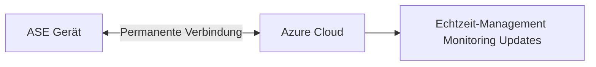

### Szenario 2: Zeitweise verbunden (Semi-connected)

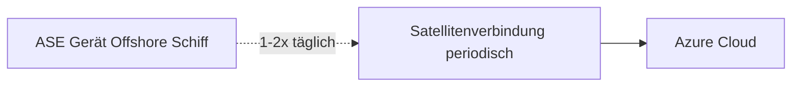

### Szenario 3: Vollständig getrennt (Disconnected)

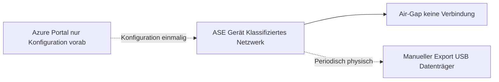

---

## Machine Learning am Edge

Azure Stack Edge mit NVIDIA GPU ist optimiert für **KI-Inferenz am Edge**:

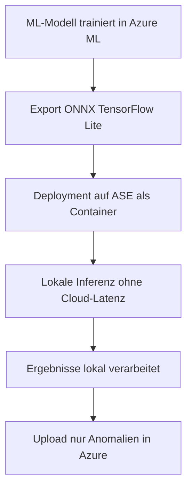

**Unterstützte ML-Frameworks auf ASE:**
- **TensorFlow / TensorFlow Serving**
- **PyTorch** (über ONNX Runtime)
- **ONNX Runtime** (CPU und GPU)
- **NVIDIA Triton Inference Server** (für Pro 2 mit A2-GPU)
- **Azure Machine Learning Inferencing** (als Container)

---

## Verwaltung via Azure Portal und lokal

| Aufgabe | Azure Portal | Lokales Web-Interface | PowerShell |
|---|---|---|---|
| Geräte-Onboarding | ✅ | ❌ | ✅ |
| Netzwerk-Konfiguration | Eingeschränkt | ✅ | ✅ |
| Share-Verwaltung | ✅ | ✅ | ✅ |
| VM-Deployment | ✅ (lokal ARM) | ✅ | ✅ |
| Kubernetes | ✅ (via Arc) | ❌ | ✅ |
| Logs und Diagnose | ✅ (Azure Monitor) | ✅ | ✅ |
| Updates | ✅ (Update Manager) | ✅ | ✅ |
| Offline-Verwaltung | ❌ | ✅ | ✅ |

---

## Verwandte Notizen
- [[Azure Arc Grundlagen]]
- [[Azure Stack HCI]]
- [[Azure IoT Edge]]
- [[Azure IoT Hub]]
